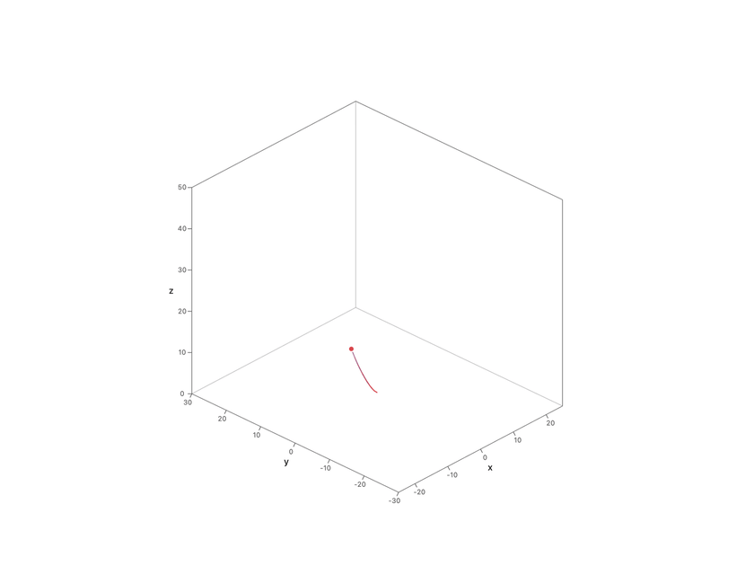
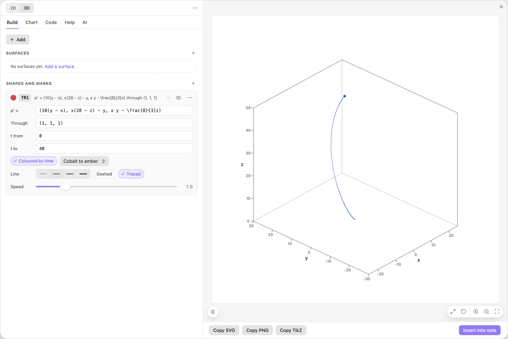
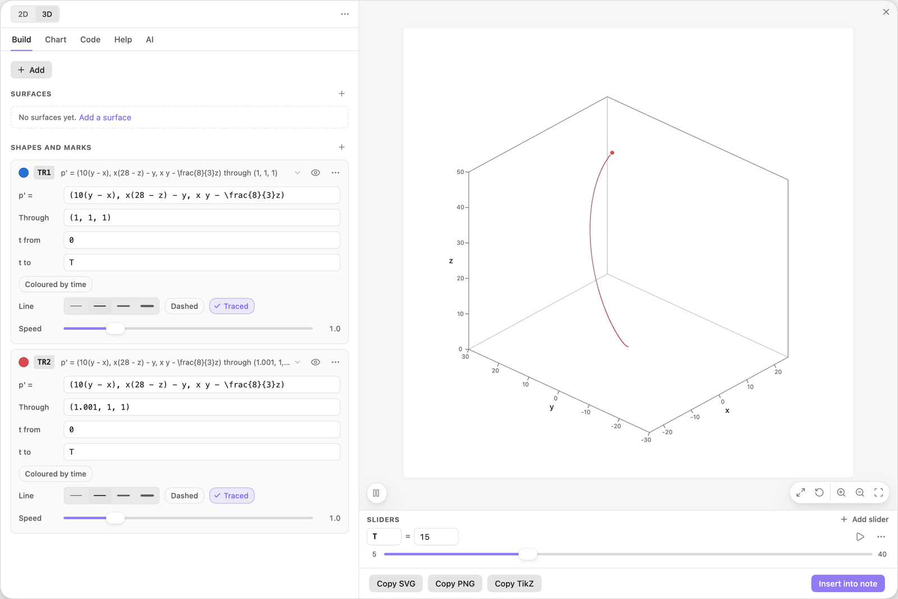
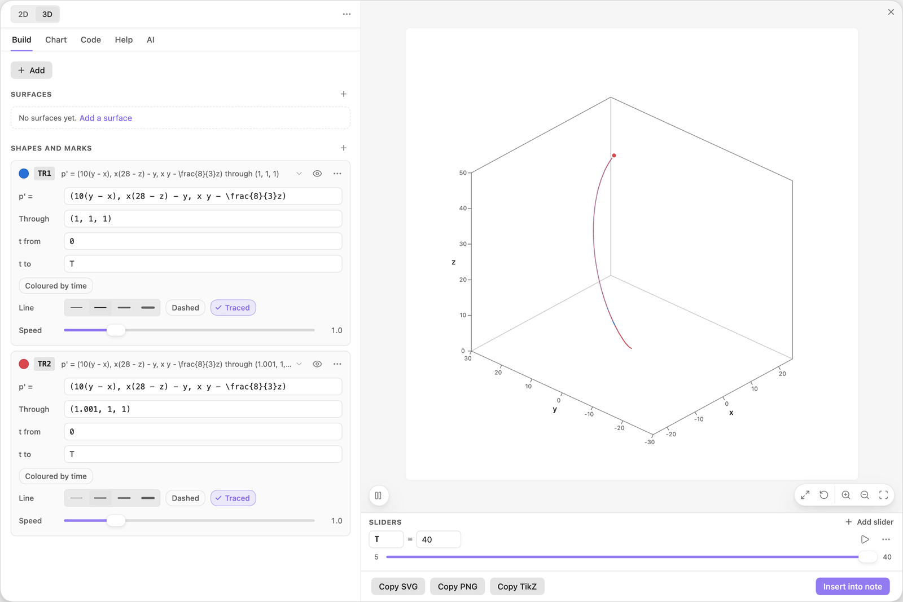

<!-- Generated by scripts/media/build-guides.mjs from src/guides. Do not edit. -->

# Two paths of the Lorenz system

[All guides](README.md) · Showcase · Advanced · about 2 minutes

Start the Lorenz system twice, a thousandth apart: the two paths draw themselves together for a while, then part for good.

<p align="center"></p>

**What you can do afterwards**

- Draw the solution of a system in 3D
- Let a path draw itself and the chart turn
- Start two solutions side by side

## 1. Draw one path

The Lorenz system from (1, 1, 1), coloured by time. `traced` lets it draw itself: it winds round two wings and never repeats. `turning` turns the chart slowly.

The chart in words:

```easy-tikz
3d
turning
show x from -25 to 25, y from -30 to 30 and z from 0 to 50
draw the solution of $\dot{p} = (10(y - x), x(28 - z) - y, x y - \frac{8}{3}z)$ through (1, 1, 1) for t from 0 to 40, coloured by time, traced
```



## 2. Start a second path close by

A red path starts at (1.001, 1, 1), and both end at the time `T`. Up to T = 15 the red path lies on the blue one.

The chart gets these lines:

```easy-tikz
slider T from 5 to 40, starting at 15
draw the solution of $\dot{p} = (10(y - x), x(28 - z) - y, x y - \frac{8}{3}z)$ through (1, 1, 1) for t from 0 to T in blue, traced
draw the solution of $\dot{p} = (10(y - x), x(28 - z) - y, x y - \frac{8}{3}z)$ through (1.001, 1, 1) for t from 0 to T, traced
```



## 3. Let time run on

Now `T` is 40. Watch them draw: past t = 18 the paths part and go round the wings each in its own way. A small change at the start grows until it is all that counts.

The chart gets these lines:

```easy-tikz
slider T from 5 to 40, starting at 40
```



## The finished chart

Paste this block into a note to get the finished chart of this guide. Click the chart in the note to open it in the editor.

<details>
<summary>The chart as an easy-tikz block</summary>

```easy-tikz
3d
turning
show x from -25 to 25, y from -30 to 30 and z from 0 to 50
slider T from 5 to 40, starting at 40
draw the solution of $\dot{p} = (10(y - x), x(28 - z) - y, x y - \frac{8}{3}z)$ through (1, 1, 1) for t from 0 to T in blue, traced
draw the solution of $\dot{p} = (10(y - x), x(28 - z) - y, x y - \frac{8}{3}z)$ through (1.001, 1, 1) for t from 0 to T, traced
```

</details>

## Next guides

- [Solutions of systems in 2D and 3D](systems.md): Draw the path a system of equations takes from a point: predators and prey in the plane, then the Lorenz system in space.

[All guides](README.md)
