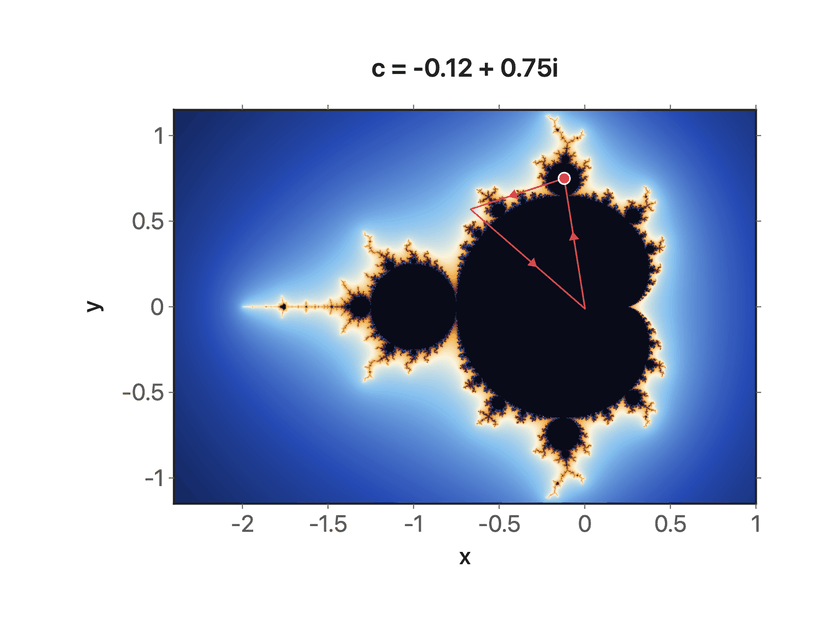
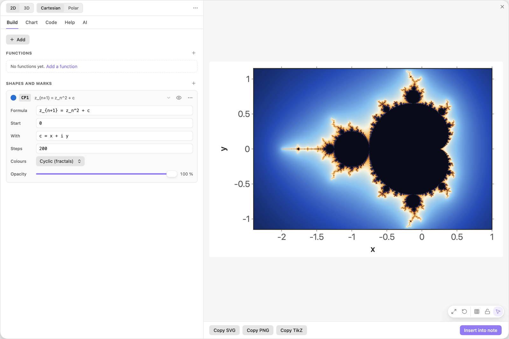
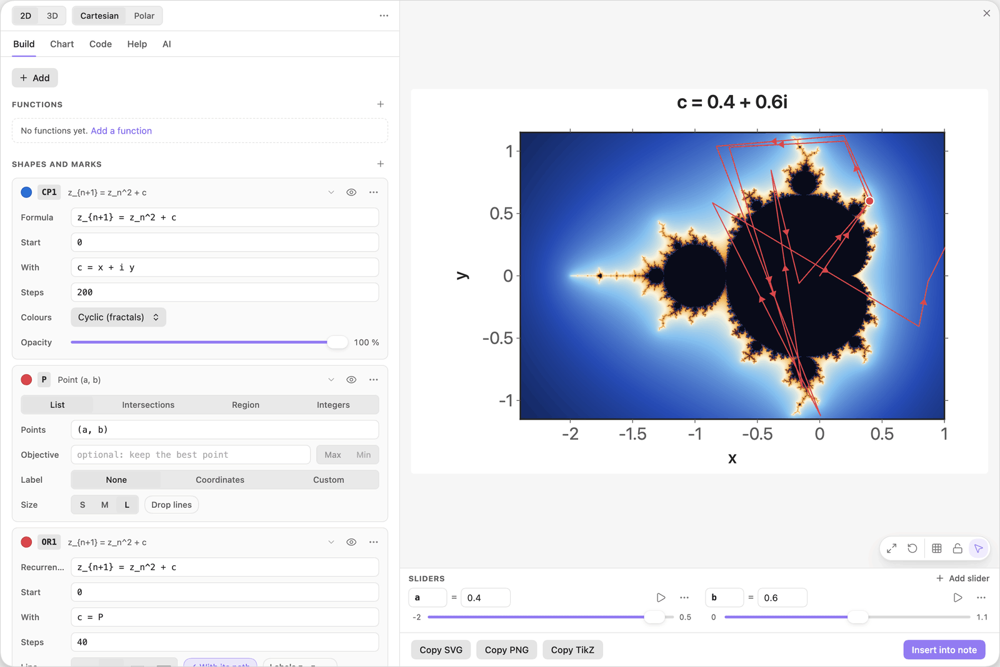

<!-- Generated by scripts/media/build-guides.mjs from src/guides. Do not edit. -->

# The orbit of a point in the Mandelbrot set

[All guides](README.md) · Showcase · Core · about 2 minutes

Move c with two sliders over the Mandelbrot set: its orbit goes round inside the set and flies off outside it.

<p align="center"></p>

**What you can do afterwards**

- Colour the plane by a recurrence
- Draw the orbit of a point on sliders
- See the inside and the outside of the set

## 1. Colour the plane by the recurrence

Every point c runs `z_{n+1} = z_n^2 + c` from 0. The dark points keep their orbit small: they are the Mandelbrot set.

The chart in words:

```easy-tikz
show x from -2.4 to 1 and y from -1.15 to 1.15
size 12 x 8
equal scale
colour the plane by $z_{n+1} = z_n^2 + c$, $z_0 = 0$, $c = x + i y$, 200 steps
```



## 2. Put c on two sliders

P sits at `(a, b)`, and the orbit of 0 for c = P is drawn as a path. Here it goes round three points for ever.

The chart gets these lines:

```easy-tikz
title c = {a} + {b}i
slider a from -2 to 0.5, starting at -0.12, in steps of 0.01
slider b from 0 to 1.1, starting at 0.75, in steps of 0.01
P: mark (a, b), large
draw the orbit of $z_{n+1} = z_n^2 + c$, $z_0 = 0$, $c = P$, 40 steps, as a path
```


## 3. Move c out of the set

Drag `a` and `b` to 0.4 and 0.6. Outside the set the orbit turns a few times and flies away.

The chart gets these lines:

```easy-tikz
slider a from -2 to 0.5, starting at 0.4, in steps of 0.01
slider b from 0 to 1.1, starting at 0.6, in steps of 0.01
```



## The finished chart

Paste this block into a note to get the finished chart of this guide. Click the chart in the note to open it in the editor.

<details>
<summary>The chart as an easy-tikz block</summary>

```easy-tikz
show x from -2.4 to 1 and y from -1.15 to 1.15
size 12 x 8
equal scale
title c = {a} + {b}i
slider a from -2 to 0.5, starting at -0.12, in steps of 0.01
slider b from 0 to 1.1, starting at 0.75, in steps of 0.01
colour the plane by $z_{n+1} = z_n^2 + c$, $z_0 = 0$, $c = x + i y$, 200 steps
P: mark (a, b), large
draw the orbit of $z_{n+1} = z_n^2 + c$, $z_0 = 0$, $c = P$, 40 steps, as a path
```

</details>

## Next guides

- [Fractals: Mandelbrot, Julia and Newton](fractals.md): Colour every point of the plane by its orbit: the Mandelbrot set, Julia sets on sliders and the basins of Newton's method.
- [Orbits, cobwebs and bifurcation](orbits-cobwebs.md): Follow x ↦ r x (1 - x) step by step on a cobweb, over time, and for every r at once in the bifurcation diagram.

[All guides](README.md)
