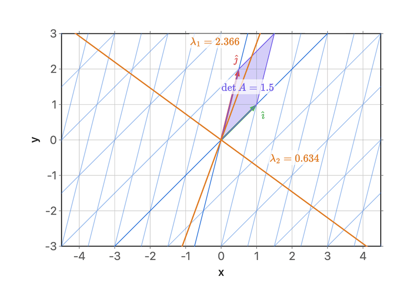
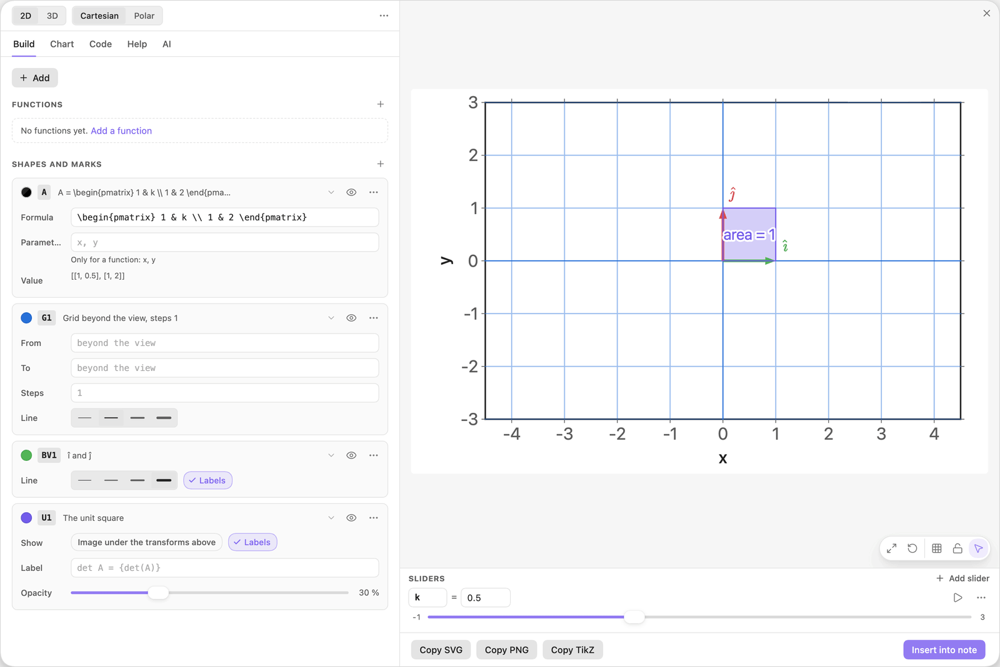
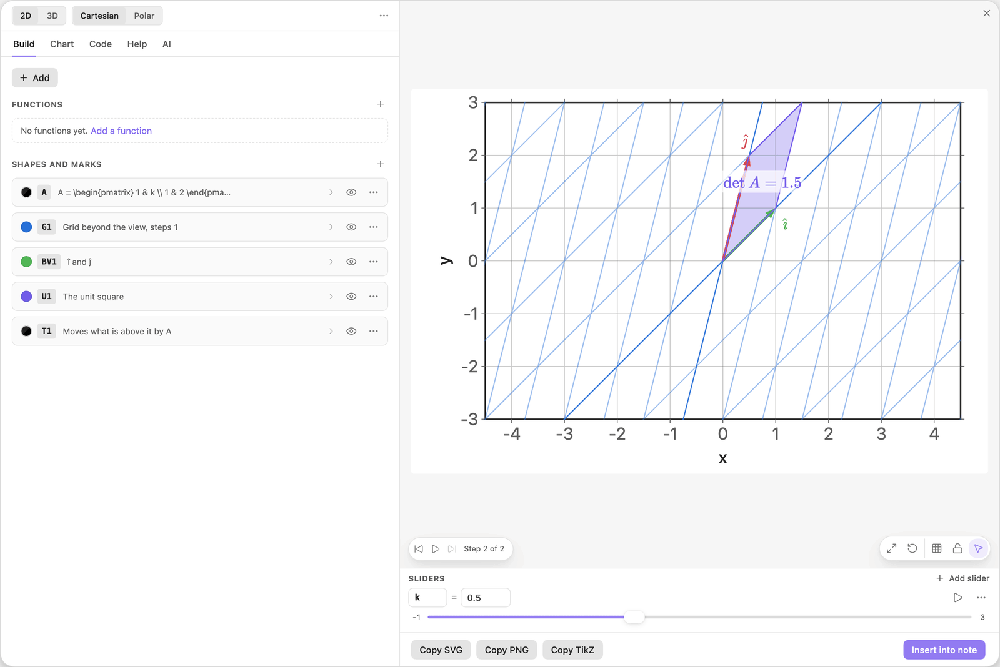
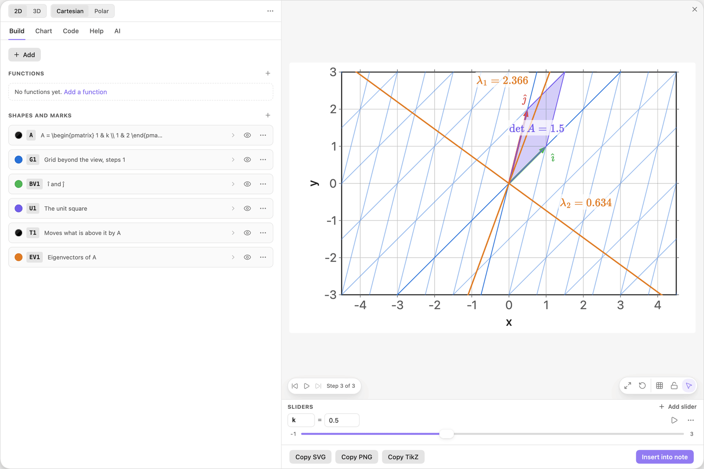
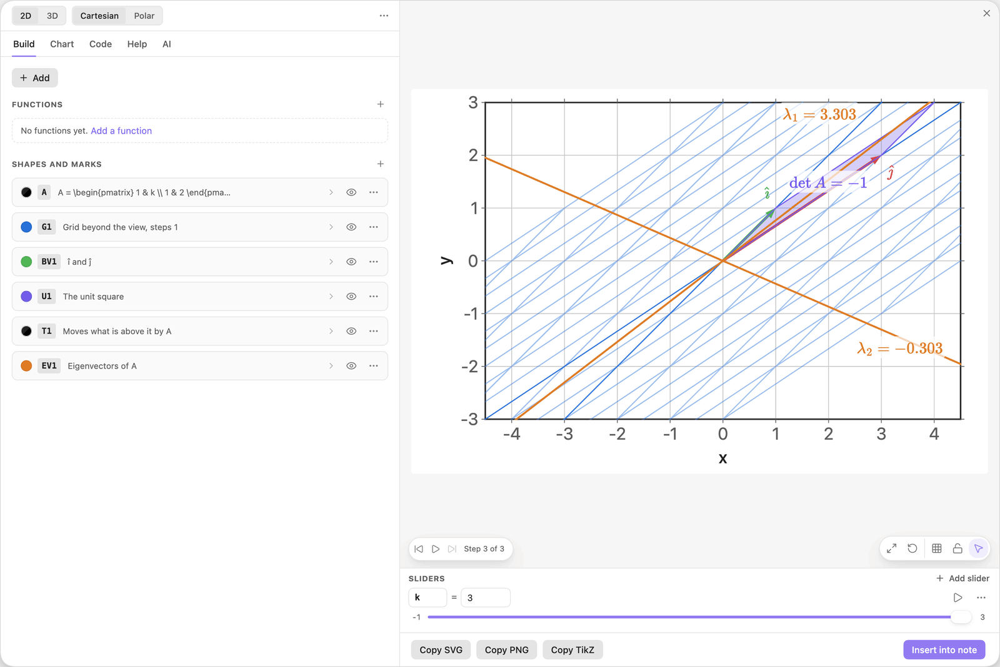

<!-- Generated by scripts/media/build-guides.mjs from src/guides. Do not edit. -->

# A matrix with a slider moves the grid

[All guides](README.md) · Showcase · Core · about 2 minutes

A slider changes one number of a matrix: the moved grid, the eigenvectors and the determinant follow it.

<p align="center"></p>

**What you can do afterwards**

- Put a slider inside a matrix
- Play the move of the plane
- Watch the determinant pass through 0

## 1. Draw the plane before the move

The grid, î, ĵ and the unit square. The matrix A has the slider `k` in its top right corner.

The chart in words:

```easy-tikz
show x from -4.5 to 4.5 and y from -3 to 3
size 12 x 8
equal scale
slider k from -1 to 3, starting at 0.5
let $A = \begin{pmatrix} 1 & k \\ 1 & 2 \end{pmatrix}$
draw the grid
draw the basis vectors
shade the unit square, labelled
```



## 2. Move it by A

`then transform the plane by A` moves it in step 2. Press Play, then drag `k`: the grid follows at once.

The chart gets these lines:

```easy-tikz
then transform the plane by A
```



## 3. Add the eigenvectors

Step 3 adds the eigenvectors of A. Drag `k` and they turn; below -0.25 they are gone, as A then turns every line.

The chart gets these lines:

```easy-tikz
then draw the eigenvectors of A, labelled
```



## 4. Flatten the plane

At k = 2 the determinant is 0 and the plane falls onto a line. Past 2 it is below 0: the square turns over.

The chart gets these lines:

```easy-tikz
slider k from -1 to 3, starting at 3
```



## The finished chart

Paste this block into a note to get the finished chart of this guide. Click the chart in the note to open it in the editor.

<details>
<summary>The chart as an easy-tikz block</summary>

```easy-tikz
show x from -4.5 to 4.5 and y from -3 to 3
size 12 x 8
equal scale
slider k from -1 to 3, starting at 0.5
let $A = \begin{pmatrix} 1 & k \\ 1 & 2 \end{pmatrix}$
draw the grid
draw the basis vectors
shade the unit square, labelled
then transform the plane by A
then draw the eigenvectors of A, labelled
```

</details>

## Next guides

- [A matrix moves the plane](matrix-plane.md): Draw the grid and the basis vectors, then let a matrix move the whole plane in a step you can play.

[All guides](README.md)
