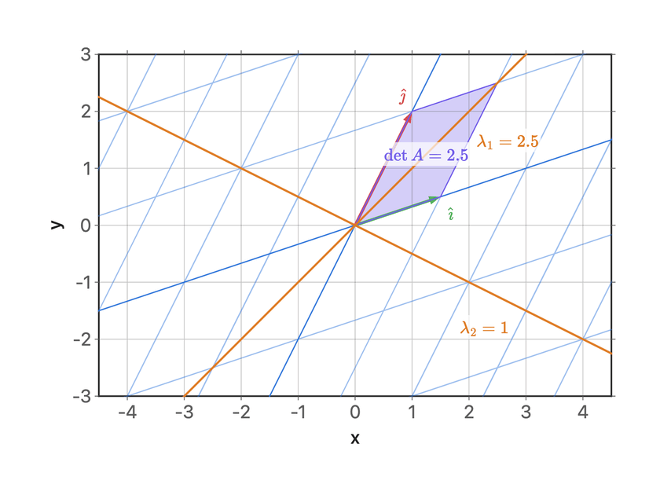
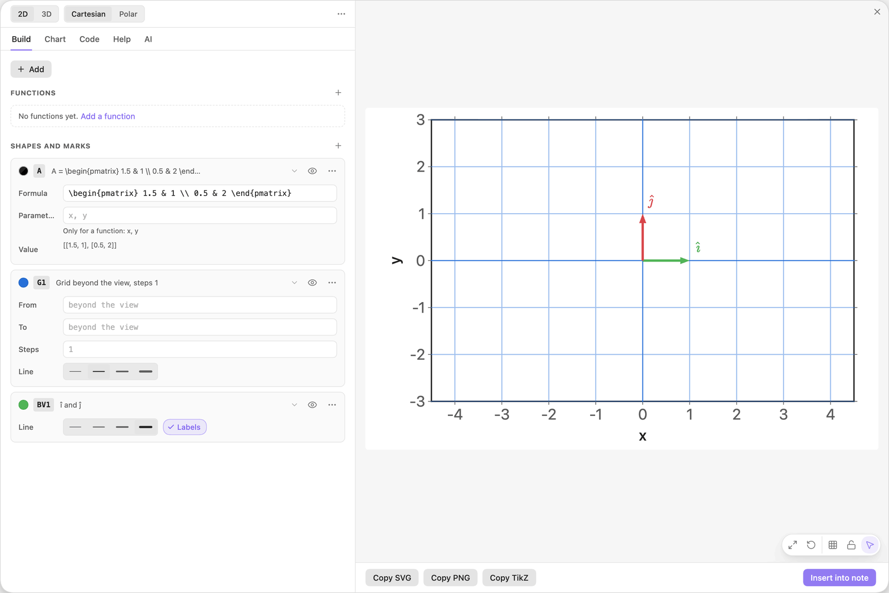
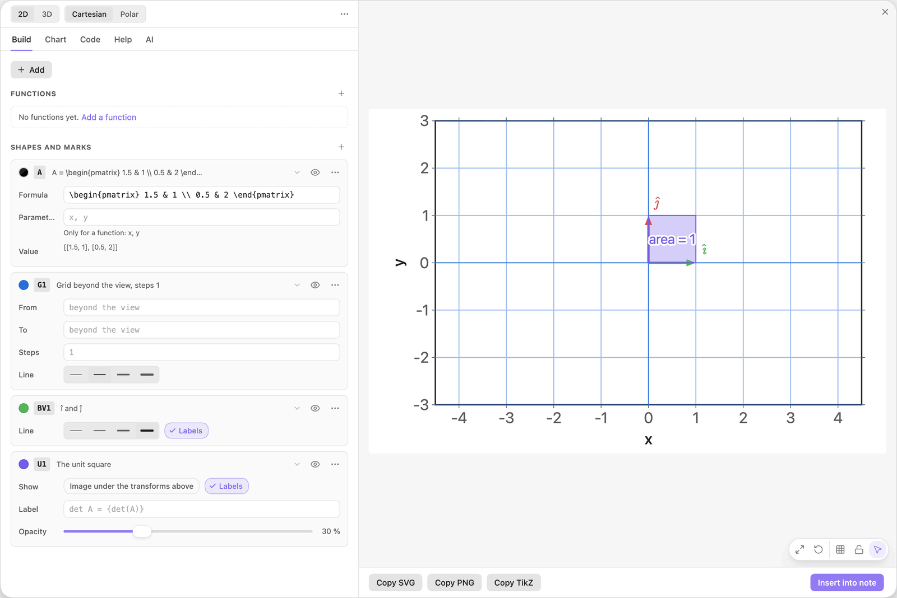
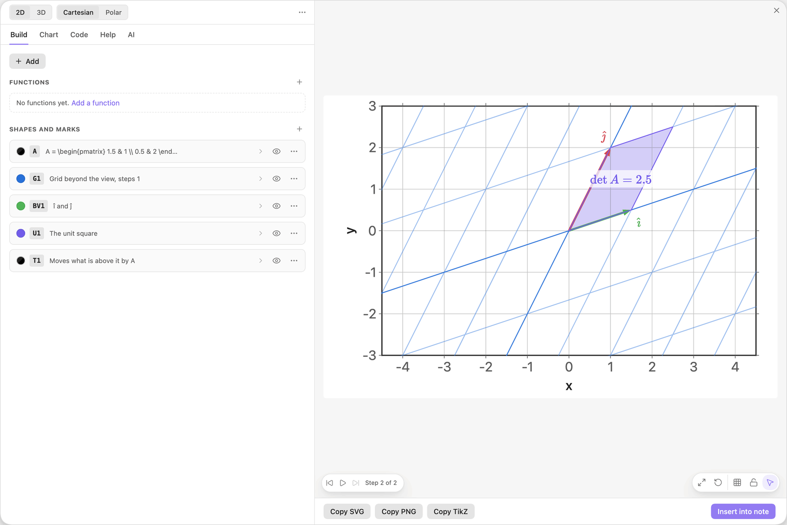
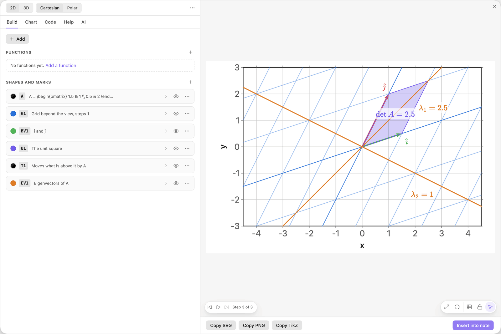

<!-- Generated by scripts/media/build-guides.mjs from src/guides. Do not edit. -->

# A matrix moves the plane

[All guides](README.md) · Linear algebra and complex numbers · Core · about 3 minutes

Draw the grid and the basis vectors, then let a matrix move the whole plane in a step you can play.

<p align="center"></p>

**What you can do afterwards**

- Draw the grid, the basis vectors and the unit square
- Move the plane by a matrix in a step
- Read the determinant and the eigenvectors

**Read first:** [Vectors and arrows](vectors-arrows.md)

## 1. Draw the grid and the basis vectors

Name the matrix with `let`. `draw the grid` draws lines that a transform can move, and `draw the basis vectors` draws î in green and ĵ in red.

The chart in words:

```easy-tikz
show x from -4.5 to 4.5 and y from -3 to 3
size 12 x 8
equal scale
let $A = \begin{pmatrix} 1.5 & 1 \\ 0.5 & 2 \end{pmatrix}$
draw the grid
draw the basis vectors
```



## 2. Shade the unit square

`shade the unit square, labelled` fills the square between î and ĵ and prints its area, 1.

The chart gets these lines:

```easy-tikz
shade the unit square, labelled
```



## 3. Move the plane in the next step

`then transform the plane by A` moves everything above it in step 2. Press Play: î lands on the first column of A, ĵ on the second. The square now reads det A = 2.5, its new area.

The chart gets these lines:

```easy-tikz
then transform the plane by A
```



> **Tip:** In the editor, drag the tip of ĵ: the second column of A follows.

## 4. Draw the eigenvectors

`then draw the eigenvectors of A` adds step 3: the lines that A only stretches, by λ₁ = 2.5 along one and by λ₂ = 1 along the other.

The chart gets these lines:

```easy-tikz
then draw the eigenvectors of A, labelled
```



## The finished chart

Paste this block into a note to get the finished chart of this guide. Click the chart in the note to open it in the editor.

<details>
<summary>The chart as an easy-tikz block</summary>

```easy-tikz
show x from -4.5 to 4.5 and y from -3 to 3
size 12 x 8
equal scale
let $A = \begin{pmatrix} 1.5 & 1 \\ 0.5 & 2 \end{pmatrix}$
draw the grid
draw the basis vectors
shade the unit square, labelled
then transform the plane by A
then draw the eigenvectors of A, labelled
```

</details>

## Next guides

- [A matrix with a slider moves the grid](matrix-grid.md): A slider changes one number of a matrix: the moved grid, the eigenvectors and the determinant follow it.
- [Complex numbers and maps](complex-maps.md): Mark complex numbers as points, bend a grid with z ↦ z² and colour the plane by a complex function.
- [Steps you can play](steps-frames.md): Start a step with then: the chart shows its lines a step at a time, plays in notes and exports every step as frames.

[All guides](README.md)
