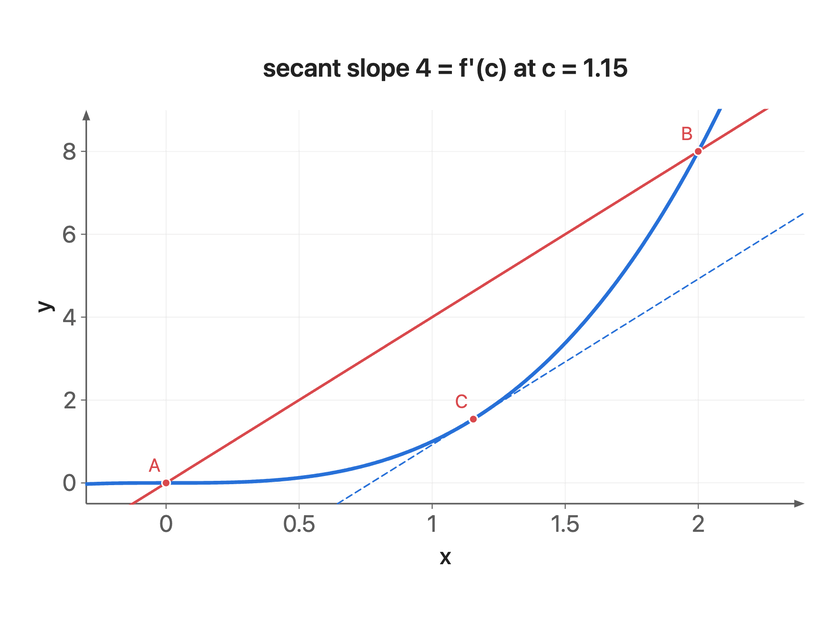
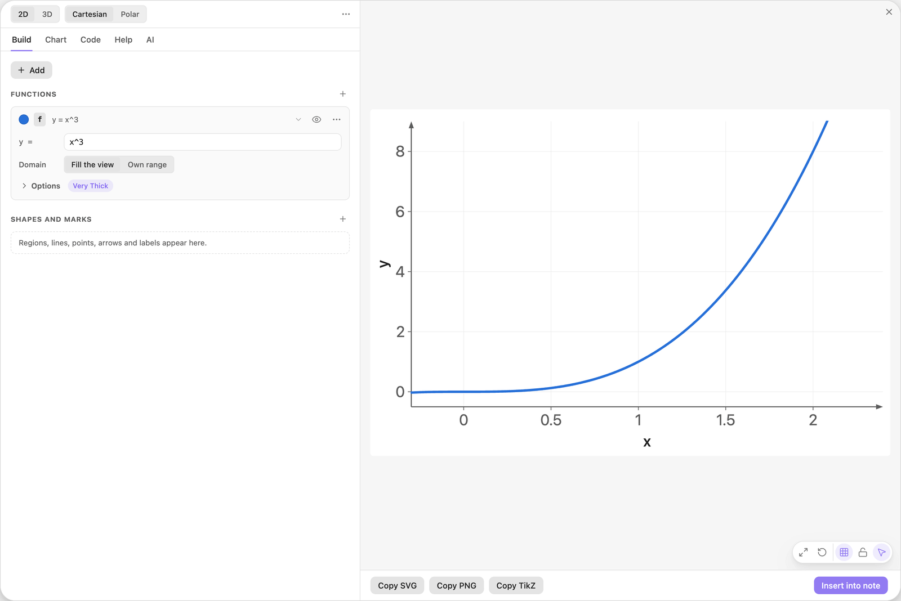
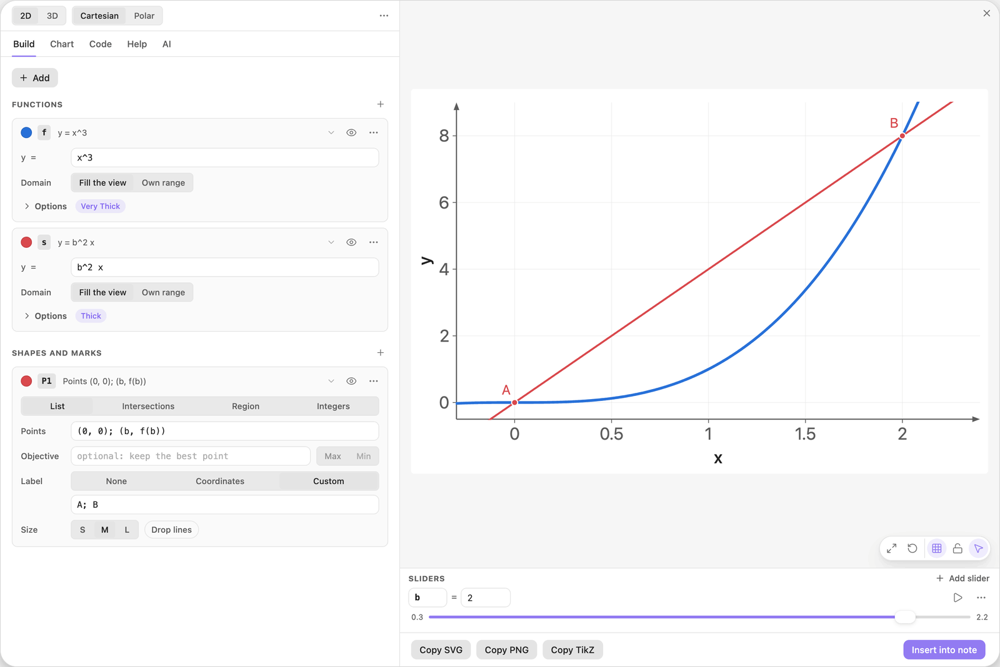
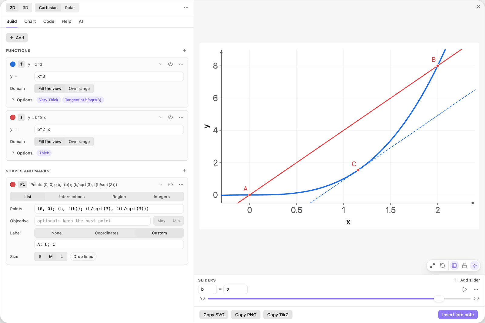
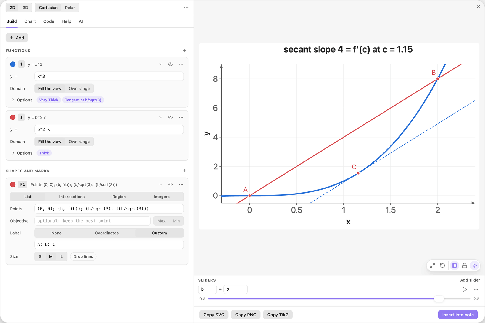

<!-- Generated by scripts/media/build-guides.mjs from src/guides. Do not edit. -->

# The mean value theorem

[All guides](README.md) · Showcase · Advanced · about 3 minutes

Between A and B a tangent runs parallel to the secant; drag B and the point C follows.

<p align="center"></p>

**What you can do afterwards**

- Draw a secant through two points of a curve
- Put a tangent at a point worked out from a slider
- Print slopes in the title

## 1. Plot the cubic

Start with `f(x) = x^3`.

The chart in words:

```easy-tikz
show x from -0.3 to 2.4 and y from -0.5 to 9
size 12 x 8
axes on the edges
with a grid
plot f(x) = x^3 in blue, very thick
```



## 2. Draw the secant from A to B

B sits on the curve over the slider `b`. The secant through A and B has the slope `b^2`.

The chart gets these lines:

```easy-tikz
slider b from 0.3 to 2.2, starting at 2, in steps of 0.01
plot s(x) = b^2 x in red, thick
mark (0, 0) and (b, f(b)), labelled "A; B"
```



## 3. Find the parallel tangent

At C, over `b/sqrt(3)`, the tangent has the same slope as the secant. The tangent point is a formula of `b`.

The chart gets these lines:

```easy-tikz
plot f(x) = x^3 in blue, very thick, with its tangent at b/sqrt(3)
mark (0, 0), (b, f(b)) and (b/sqrt(3), f(b/sqrt(3))), labelled "A; B; C"
```



## 4. Print both slopes

The title shows the slope and where C sits. Drag `b`: the tangent stays parallel to the secant.

The chart gets these lines:

```easy-tikz
title secant slope {b^2:2} = f'(c) at c = {b/sqrt(3):2}
```



## The finished chart

Paste this block into a note to get the finished chart of this guide. Click the chart in the note to open it in the editor.

<details>
<summary>The chart as an easy-tikz block</summary>

```easy-tikz
show x from -0.3 to 2.4 and y from -0.5 to 9
size 12 x 8
axes on the edges
with a grid
title secant slope {b^2:2} = f'(c) at c = {b/sqrt(3):2}
slider b from 0.3 to 2.2, starting at 2, in steps of 0.01
plot f(x) = x^3 in blue, very thick, with its tangent at b/sqrt(3)
plot s(x) = b^2 x in red, thick
mark (0, 0), (b, f(b)) and (b/sqrt(3), f(b/sqrt(3))), labelled "A; B; C"
```

</details>

## Next guides

- [From secant to tangent](secant-tangent.md): Shrink the gap h between two points of a curve and watch the secant through them turn into the tangent.

[All guides](README.md)
