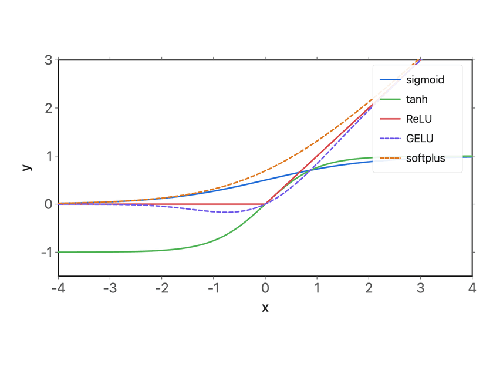
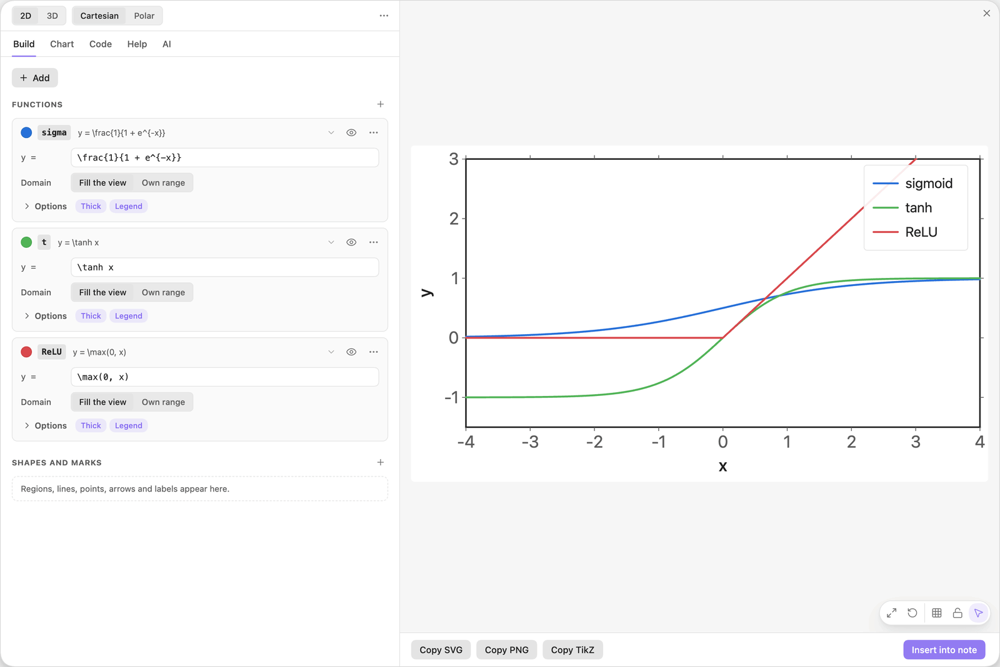
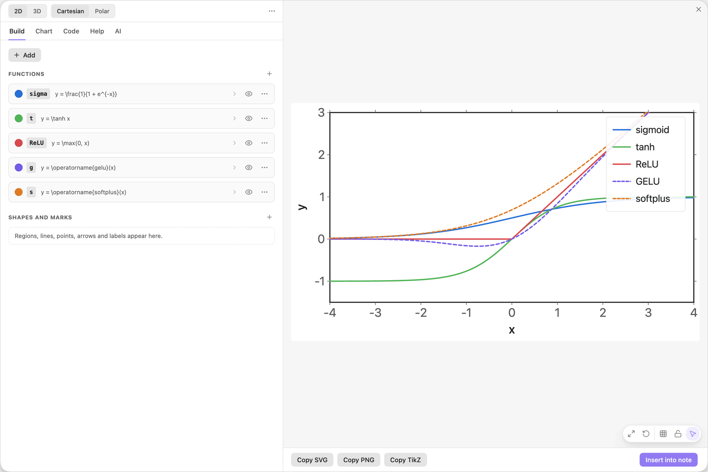
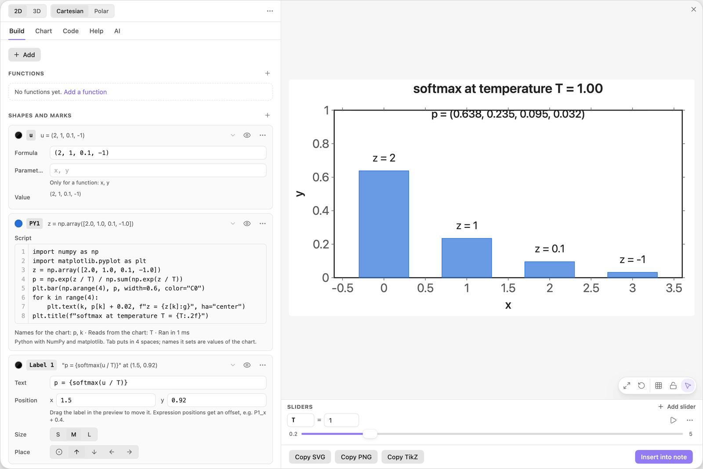
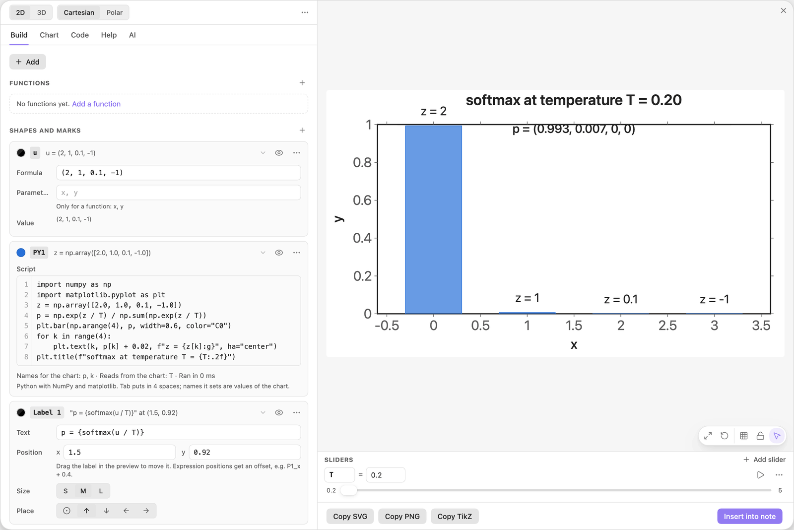

<!-- Generated by scripts/media/build-guides.mjs from src/guides. Do not edit. -->

# Activation functions and softmax

[All guides](README.md) · Data and probability · Start here · about 3 minutes

Write σ, tanh and ReLU as in your notes, use GELU and softplus by name, and turn the temperature of a softmax with a slider.

<p align="center"></p>

**What you can do afterwards**

- Name functions as ML notes do: σ, ReLU
- Use sigmoid, relu, softplus, gelu and softmax
- Change a softmax temperature on a slider

## 1. Plot σ, tanh and ReLU

Write the names as your notes do: `\sigma(x)`, `\mathrm{ReLU}(x)`, or `t(x)` for tanh. Each is a function of the chart, printed back as written; other lines call it, `\sigma(2x)`.

The chart in words:

```easy-tikz
show x from -4 to 4 and y from -1.5 to 3
size 12 x 7
plot $\sigma(x) = \frac{1}{1 + e^{-x}}$ in blue, thick, with the legend "sigmoid"
plot $t(x) = \tanh x$ in green, thick, with the legend "tanh"
plot $\mathrm{ReLU}(x) = \max(0, x)$ in red, thick, with the legend "ReLU"
```



## 2. Use the built-in names

`sigmoid`, `relu`, `softplus`, `gelu` and `silu` work in every formula, plain or as `\operatorname{gelu}(x)`. A function or slider of the same name wins.

The chart gets these lines:

```easy-tikz
plot $g(x) = \operatorname{gelu}(x)$ in purple, thick, dashed, with the legend "GELU"
plot $s(x) = \operatorname{softplus}(x)$ in orange, thick, dashed, with the legend "softplus"
```



## 3. Turn the softmax temperature

softmax(z / T) turns scores into probabilities. The script draws them as bars; the label prints the built-in `softmax(u / T)`. Drag `T` up: the bars even out.

The chart gets these lines:

```easy-tikz
show x from -0.6 to 3.6 and y from 0 to 1
slider T from 0.2 to 5, starting at 1, in steps of 0.02
let u = (2, 1, 0.1, -1)
python:
    import numpy as np
    import matplotlib.pyplot as plt
    z = np.array([2.0, 1.0, 0.1, -1.0])
    p = np.exp(z / T) / np.sum(np.exp(z / T))
    plt.bar(np.arange(4), p, width=0.6, color="C0")
    for k in range(4):
        plt.text(k, p[k] + 0.02, f"z = {z[k]:g}", ha="center")
    plt.title(f"softmax at temperature T = {T:.2f}")
write "p = {softmax(u / T)}" at (1.5, 0.92)
```



## 4. Cool it down

At T = 0.2 almost all the probability sits on the largest score: softmax becomes a choice of the maximum.

The chart gets these lines:

```easy-tikz
slider T from 0.2 to 5, in steps of 0.02
```



## The finished chart

Paste this block into a note to get the finished chart of this guide. Click the chart in the note to open it in the editor.

<details>
<summary>The chart as an easy-tikz block</summary>

```easy-tikz
show x from -4 to 4 and y from -1.5 to 3
size 12 x 7
plot $\sigma(x) = \frac{1}{1 + e^{-x}}$ in blue, thick, with the legend "sigmoid"
plot $t(x) = \tanh x$ in green, thick, with the legend "tanh"
plot $\mathrm{ReLU}(x) = \max(0, x)$ in red, thick, with the legend "ReLU"
plot $g(x) = \operatorname{gelu}(x)$ in purple, thick, dashed, with the legend "GELU"
plot $s(x) = \operatorname{softplus}(x)$ in orange, thick, dashed, with the legend "softplus"
```

</details>

## Next guides

- [A neural network that learns](ml-network.md): Points no straight line can split, a small network trained in NumPy, and frame(t) playing its training as a moving picture.
- [Logistic regression](ml-logistic.md): Train a classifier by gradient descent in a script: the probability as a picture, the line where it is one half, and a slider for the steps.

[All guides](README.md)
