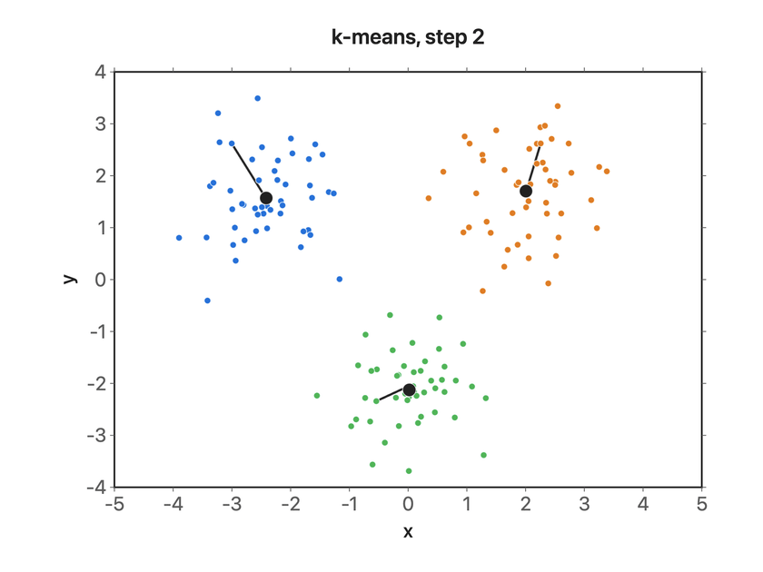
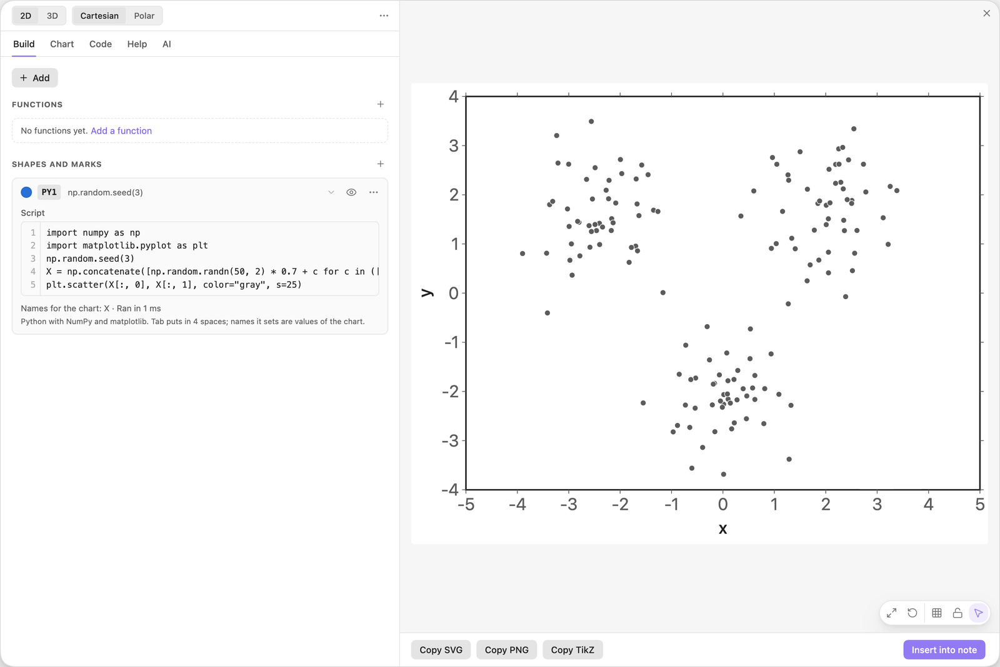
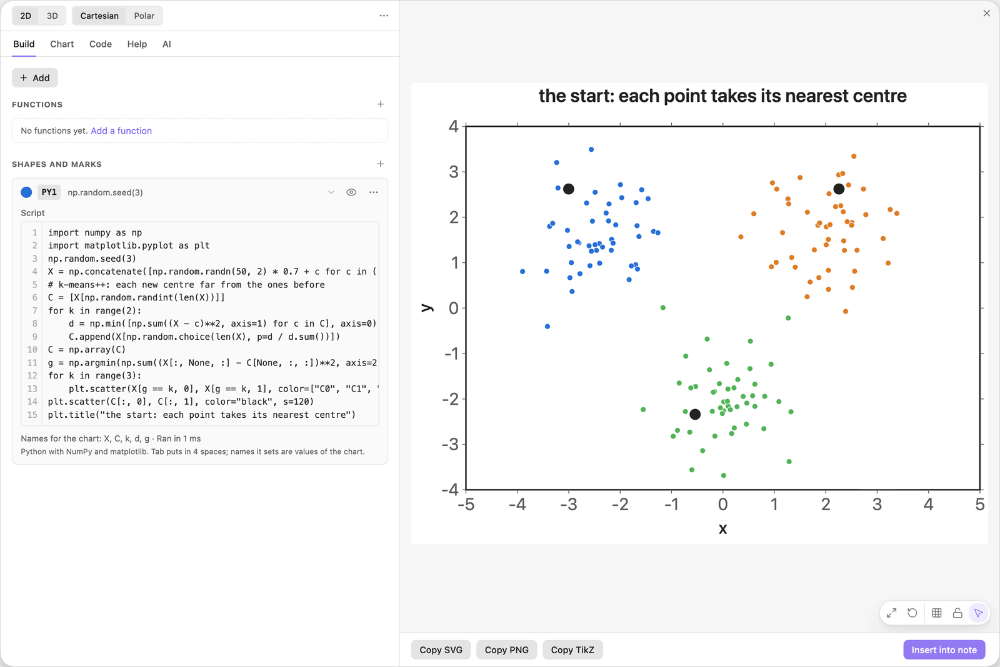
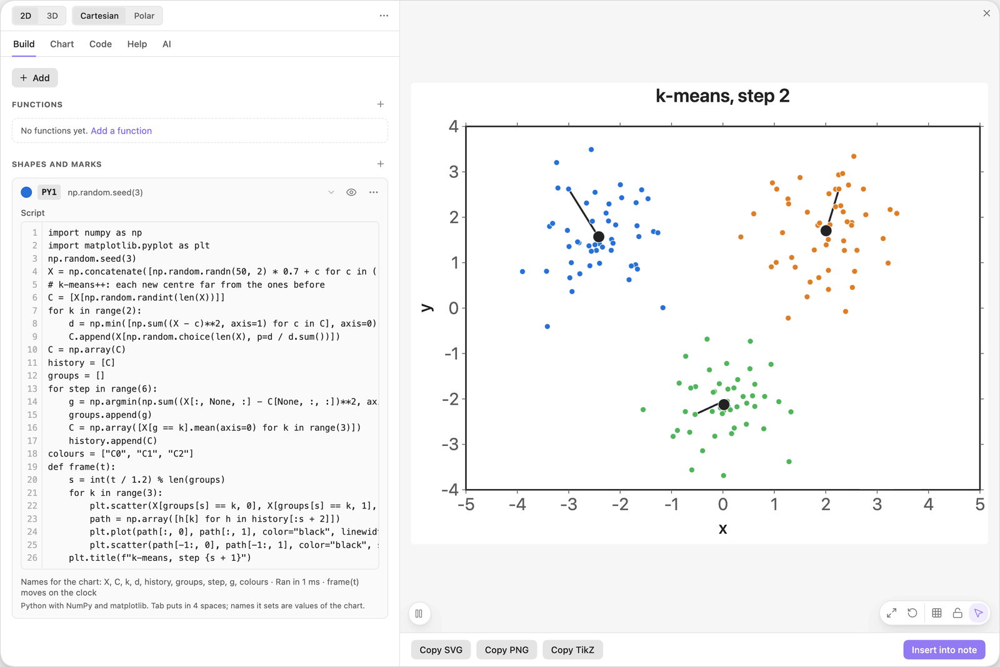
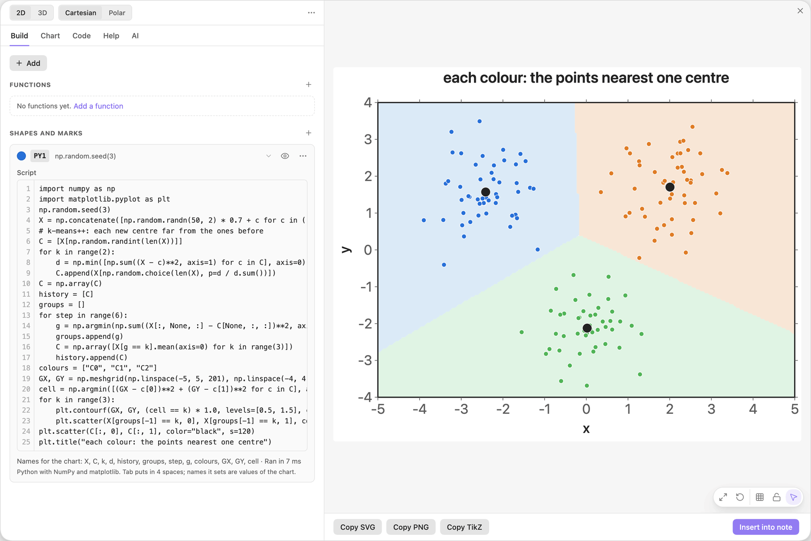

<!-- Generated by scripts/media/build-guides.mjs from src/guides. Do not edit. -->

# k-means step by step

[All guides](README.md) · Data and probability · Core · about 3 minutes

Three groups of points, three centres: each point joins its nearest centre, each centre moves to the middle of its points, again and again.

<p align="center"></p>

**What you can do afterwards**

- Start k-means with k-means++
- Play its steps with frame(t)
- Colour the plane by the nearest centre

## 1. Draw three groups of points

A seeded script makes three clouds of 50 points. k-means does not know which point came from which cloud; it has to find the groups.

The chart in words:

```easy-tikz
show x from -5 to 5 and y from -4 to 4
size 12 x 9.6
python:
    import numpy as np
    import matplotlib.pyplot as plt
    np.random.seed(3)
    X = np.concatenate([np.random.randn(50, 2) * 0.7 + c for c in ([-2.5, 1.5], [2.0, 2.0], [0.0, -2.0])])
    plt.scatter(X[:, 0], X[:, 1], color="gray", s=25)
```



## 2. Pick three centres far apart

k-means++ takes a random point as the first centre, then each next one with a chance growing with its squared distance to the centres so far. Every point then joins its nearest centre.

The chart gets these lines:

```easy-tikz
    # k-means++: each new centre far from the ones before
    C = [X[np.random.randint(len(X))]]
    for k in range(2):
        d = np.min([np.sum((X - c)**2, axis=1) for c in C], axis=0)
        C.append(X[np.random.choice(len(X), p=d / d.sum())])
    C = np.array(C)
    g = np.argmin(np.sum((X[:, None, :] - C[None, :, :])**2, axis=2), axis=1)
    for k in range(3):
        plt.scatter(X[g == k, 0], X[g == k, 1], color=["C0", "C1", "C2"][k], s=25)
    plt.scatter(C[:, 0], C[:, 1], color="black", s=120)
    plt.title("the start: each point takes its nearest centre")
```



## 3. Watch the centres move

Each step moves every centre to the mean of its points, then the points choose again. `frame(t)` shows one step every 1.2 s; the black lines trace the centres.

The chart gets these lines:

```easy-tikz
    history = [C]
    groups = []
    for step in range(6):
        g = np.argmin(np.sum((X[:, None, :] - C[None, :, :])**2, axis=2), axis=1)
        groups.append(g)
        C = np.array([X[g == k].mean(axis=0) for k in range(3)])
        history.append(C)
    colours = ["C0", "C1", "C2"]
    def frame(t):
        s = int(t / 1.2) % len(groups)
        for k in range(3):
            plt.scatter(X[groups[s] == k, 0], X[groups[s] == k, 1], color=colours[k], s=25)
            path = np.array([h[k] for h in history[:s + 2]])
            plt.plot(path[:, 0], path[:, 1], color="black", linewidth=1.5)
            plt.scatter(path[-1:, 0], path[-1:, 1], color="black", s=120)
        plt.title(f"k-means, step {s + 1}")
```



## 4. Colour the plane by the centres

After six steps nothing changes. `np.argmin` over a grid finds the nearest centre of each place, and `plt.contourf` fills each cell in its colour: three cells with straight borders.

The chart gets these lines:

```easy-tikz
    GX, GY = np.meshgrid(np.linspace(-5, 5, 201), np.linspace(-4, 4, 161))
    cell = np.argmin([(GX - c[0])**2 + (GY - c[1])**2 for c in C], axis=0)
    for k in range(3):
        plt.contourf(GX, GY, (cell == k) * 1.0, levels=[0.5, 1.5], colors=[colours[k]], alpha=0.2)
        plt.scatter(X[groups[-1] == k, 0], X[groups[-1] == k, 1], color=colours[k], s=25)
    plt.scatter(C[:, 0], C[:, 1], color="black", s=120)
    plt.title("each colour: the points nearest one centre")
```



## The finished chart

Paste this block into a note to get the finished chart of this guide. Click the chart in the note to open it in the editor.

<details>
<summary>The chart as an easy-tikz block</summary>

```easy-tikz
show x from -5 to 5 and y from -4 to 4
size 12 x 9.6
python:
    import numpy as np
    import matplotlib.pyplot as plt
    np.random.seed(3)
    X = np.concatenate([np.random.randn(50, 2) * 0.7 + c for c in ([-2.5, 1.5], [2.0, 2.0], [0.0, -2.0])])
    # k-means++: each new centre far from the ones before
    C = [X[np.random.randint(len(X))]]
    for k in range(2):
        d = np.min([np.sum((X - c)**2, axis=1) for c in C], axis=0)
        C.append(X[np.random.choice(len(X), p=d / d.sum())])
    C = np.array(C)
    history = [C]
    groups = []
    for step in range(6):
        g = np.argmin(np.sum((X[:, None, :] - C[None, :, :])**2, axis=2), axis=1)
        groups.append(g)
        C = np.array([X[g == k].mean(axis=0) for k in range(3)])
        history.append(C)
    colours = ["C0", "C1", "C2"]
    def frame(t):
        s = int(t / 1.2) % len(groups)
        for k in range(3):
            plt.scatter(X[groups[s] == k, 0], X[groups[s] == k, 1], color=colours[k], s=25)
            path = np.array([h[k] for h in history[:s + 2]])
            plt.plot(path[:, 0], path[:, 1], color="black", linewidth=1.5)
            plt.scatter(path[-1:, 0], path[-1:, 1], color="black", s=120)
        plt.title(f"k-means, step {s + 1}")
```

</details>

## Next guides

- [Principal components](ml-pca.md): The SVD of a cloud of points gives its principal directions; a slider turns a line and shows the variance along it peak at the first one.
- [Logistic regression](ml-logistic.md): Train a classifier by gradient descent in a script: the probability as a picture, the line where it is one half, and a slider for the steps.

[All guides](README.md)
