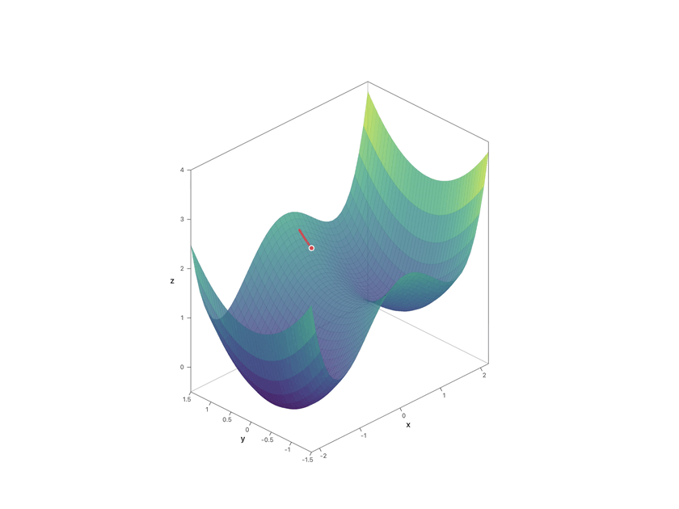
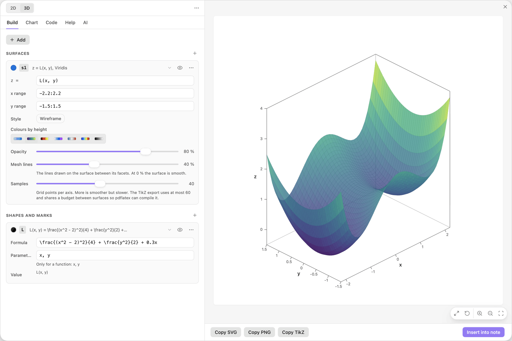
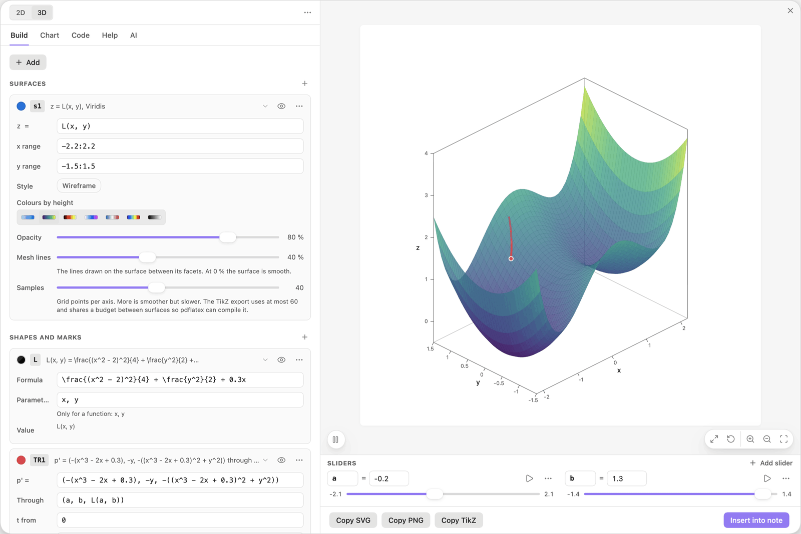

<!-- Generated by scripts/media/build-guides.mjs from src/guides. Do not edit. -->

# A loss landscape in 3D

[All guides](README.md) · Data and probability · Advanced · about 3 minutes

A loss with two valleys as a surface, and gradient descent as a ball that rolls down it, from a start on two sliders.

<p align="center"></p>

**What you can do afterwards**

- Draw a loss as a surface in 3D
- Draw the gradient flow on it as a traced path
- See the start pick the valley

**Read first:** [Optimizers on a loss surface](ml-optimizers.md)

## 1. Draw the loss surface

L(x, y) has two valleys: a deeper one on the left, a shallower one on the right, and a ridge between them near x = 0.15. Drag the chart to turn it.

The chart in words:

```easy-tikz
3d
show x from -2.2 to 2.2, y from -1.5 to 1.5 and z from -0.5 to 4
let $L(x, y) = \frac{(x^2 - 2)^2}{4} + \frac{y^2}{2} + 0.3x$
plot s1(x, y) = L(x, y) for x from -2.2 to 2.2 and y from -1.5 to 1.5 in viridis, opacity 0.8
```



## 2. Roll down from a start

Gradient descent with tiny steps is the system ẋ = -∂L/∂x, ẏ = -∂L/∂y; the third part, ż, keeps the path on the surface. `traced` lets it roll down from (a, b).

The chart gets these lines:

```easy-tikz
slider a from -2.1 to 2.1, starting at 0.3
slider b from -1.4 to 1.4, starting at 1.3
draw the solution of $\dot{p} = (-(x^3 - 2x + 0.3), -y, -((x^3 - 2x + 0.3)^2 + y^2))$ through (a, b, L(a, b)) for t from 0 to 8, very thick, traced
```


## 3. Start across the ridge

Drag `a` below 0.15: the path rolls into the deeper valley on the left instead. Where training starts decides which minimum it finds.

The chart gets these lines:

```easy-tikz
slider a from -2.1 to 2.1, starting at -0.2
```



## The finished chart

Paste this block into a note to get the finished chart of this guide. Click the chart in the note to open it in the editor.

<details>
<summary>The chart as an easy-tikz block</summary>

```easy-tikz
3d
show x from -2.2 to 2.2, y from -1.5 to 1.5 and z from -0.5 to 4
slider a from -2.1 to 2.1, starting at 0.3
slider b from -1.4 to 1.4, starting at 1.3
let $L(x, y) = \frac{(x^2 - 2)^2}{4} + \frac{y^2}{2} + 0.3x$
plot s1(x, y) = L(x, y) for x from -2.2 to 2.2 and y from -1.5 to 1.5 in viridis, opacity 0.8
draw the solution of $\dot{p} = (-(x^3 - 2x + 0.3), -y, -((x^3 - 2x + 0.3)^2 + y^2))$ through (a, b, L(a, b)) for t from 0 to 8, very thick, traced
```

</details>

## Next guides

- [The optimizer race](optimizer-race.md): Gradient descent, momentum, RMSprop and Adam start together on a curved valley and race to the minimum, 40 steps a second.
- [Solutions of systems in 2D and 3D](systems.md): Draw the path a system of equations takes from a point: predators and prey in the plane, then the Lorenz system in space.

[All guides](README.md)
