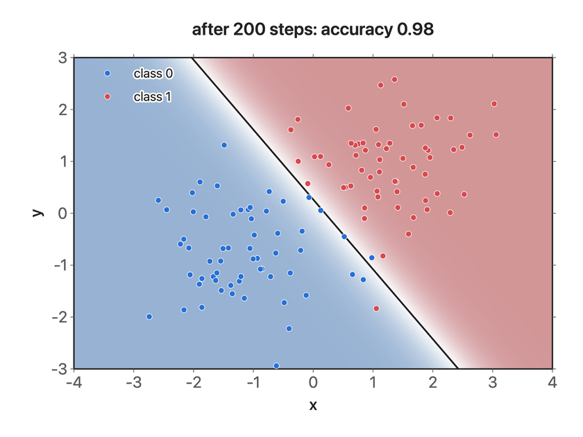
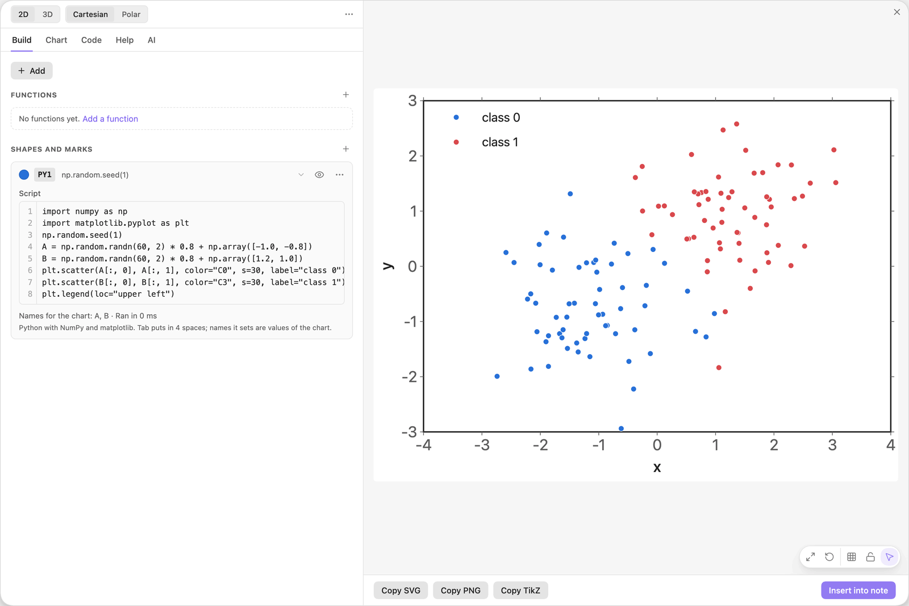
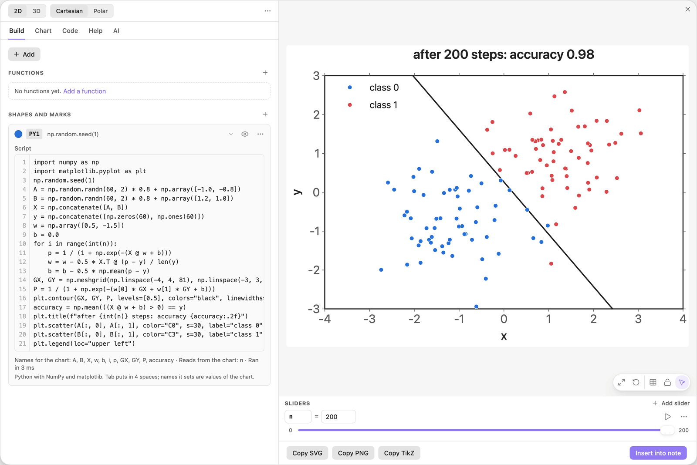
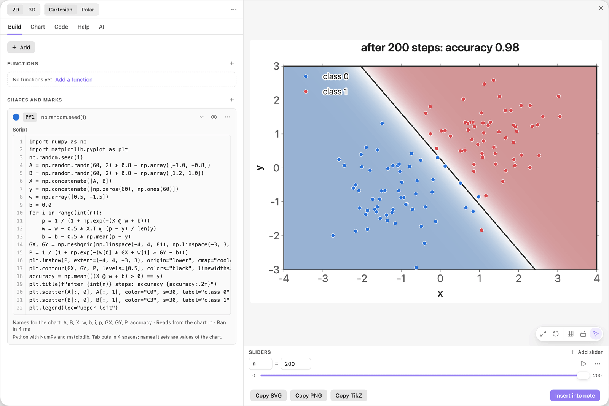
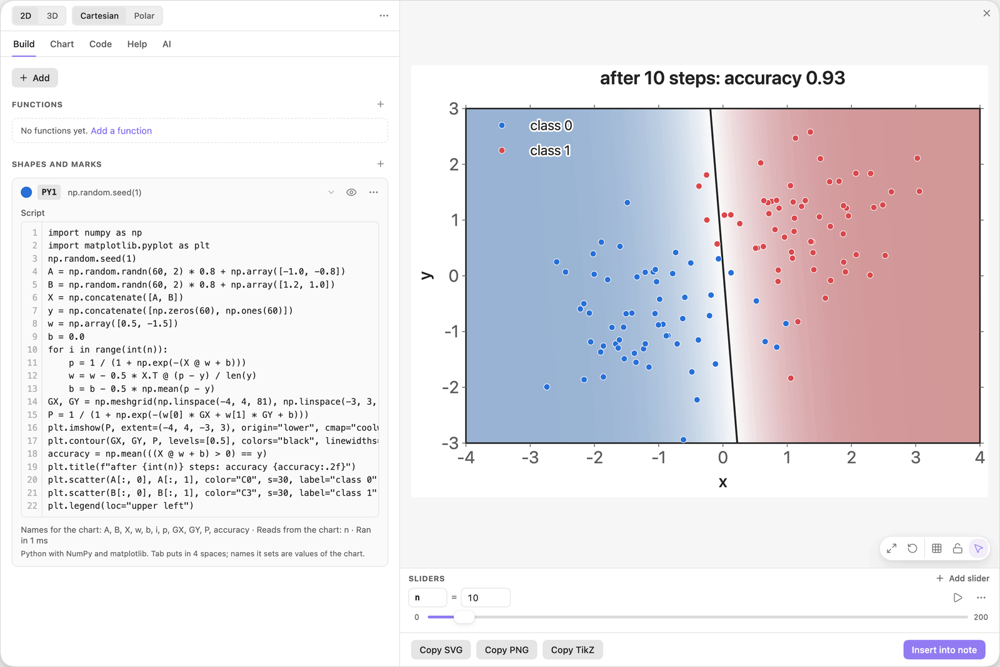

<!-- Generated by scripts/media/build-guides.mjs from src/guides. Do not edit. -->

# Logistic regression

[All guides](README.md) · Data and probability · Core · about 3 minutes

Train a classifier by gradient descent in a script: the probability as a picture, the line where it is one half, and a slider for the steps.

<p align="center"></p>

**What you can do afterwards**

- Draw two classes of points from a script
- Train logistic regression with NumPy
- Show the probability as a picture

## 1. Draw two classes

The python block makes two seeded clouds of 60 points. `plt.scatter` draws them, `s=30` is the dot's area in points squared as in matplotlib.

The chart in words:

```easy-tikz
show x from -4 to 4 and y from -3 to 3
size 12 x 9
python:
    import numpy as np
    import matplotlib.pyplot as plt
    np.random.seed(1)
    A = np.random.randn(60, 2) * 0.8 + np.array([-1.0, -0.8])
    B = np.random.randn(60, 2) * 0.8 + np.array([1.2, 1.0])
    plt.scatter(A[:, 0], A[:, 1], color="C0", s=30, label="class 0")
    plt.scatter(B[:, 0], B[:, 1], color="C3", s=30, label="class 1")
    plt.legend(loc="upper left")
```



## 2. Train by gradient descent

The model is p = σ(w · x + b). Each step moves `w` and `b` against the gradient of the log loss. The black line is where p = 0.5; the title prints the accuracy.

The chart gets these lines:

```easy-tikz
slider n from 0 to 200, starting at 200, in steps of 5
    X = np.concatenate([A, B])
    y = np.concatenate([np.zeros(60), np.ones(60)])
    w = np.array([0.5, -1.5])
    b = 0.0
    for i in range(int(n)):
        p = 1 / (1 + np.exp(-(X @ w + b)))
        w = w - 0.5 * X.T @ (p - y) / len(y)
        b = b - 0.5 * np.mean(p - y)
    GX, GY = np.meshgrid(np.linspace(-4, 4, 81), np.linspace(-3, 3, 61))
    P = 1 / (1 + np.exp(-(w[0] * GX + w[1] * GY + b)))
    plt.contour(GX, GY, P, levels=[0.5], colors="black", linewidths=2)
    accuracy = np.mean(((X @ w + b) > 0) == y)
    plt.title(f"after {int(n)} steps: accuracy {accuracy:.2f}")
```



## 3. Colour the plane by the probability

`plt.imshow` draws p over the plane, blue near 0 and red near 1. `interpolation="bilinear"` blends the cells, so the picture is smooth.

The chart gets these lines:

```easy-tikz
    plt.imshow(P, extent=(-4, 4, -3, 3), origin="lower", cmap="coolwarm", vmin=0, vmax=1, alpha=0.5, interpolation="bilinear")
```



## 4. Watch the line turn

`n` is the number of steps. Drag it from 0: the line starts across the clouds and turns into place. The script runs again for each `n`.

The chart gets these lines:

```easy-tikz
slider n from 0 to 200, starting at 10, in steps of 5
```



## The finished chart

Paste this block into a note to get the finished chart of this guide. Click the chart in the note to open it in the editor.

<details>
<summary>The chart as an easy-tikz block</summary>

```easy-tikz
show x from -4 to 4 and y from -3 to 3
size 12 x 9
slider n from 0 to 200, starting at 200, in steps of 5
python:
    import numpy as np
    import matplotlib.pyplot as plt
    np.random.seed(1)
    A = np.random.randn(60, 2) * 0.8 + np.array([-1.0, -0.8])
    B = np.random.randn(60, 2) * 0.8 + np.array([1.2, 1.0])
    X = np.concatenate([A, B])
    y = np.concatenate([np.zeros(60), np.ones(60)])
    w = np.array([0.5, -1.5])
    b = 0.0
    for i in range(int(n)):
        p = 1 / (1 + np.exp(-(X @ w + b)))
        w = w - 0.5 * X.T @ (p - y) / len(y)
        b = b - 0.5 * np.mean(p - y)
    GX, GY = np.meshgrid(np.linspace(-4, 4, 81), np.linspace(-3, 3, 61))
    P = 1 / (1 + np.exp(-(w[0] * GX + w[1] * GY + b)))
    plt.imshow(P, extent=(-4, 4, -3, 3), origin="lower", cmap="coolwarm", vmin=0, vmax=1, alpha=0.5, interpolation="bilinear")
    plt.contour(GX, GY, P, levels=[0.5], colors="black", linewidths=2)
    accuracy = np.mean(((X @ w + b) > 0) == y)
    plt.title(f"after {int(n)} steps: accuracy {accuracy:.2f}")
    plt.scatter(A[:, 0], A[:, 1], color="C0", s=30, label="class 0")
    plt.scatter(B[:, 0], B[:, 1], color="C3", s=30, label="class 1")
    plt.legend(loc="upper left")
```

</details>

## Next guides

- [A neural network that learns](ml-network.md): Points no straight line can split, a small network trained in NumPy, and frame(t) playing its training as a moving picture.
- [Overfitting and regularisation](ml-overfitting.md): A polynomial with the degree on a slider fits 14 noisy points better and better, and new points worse and worse, until ridge holds it back.

[All guides](README.md)
