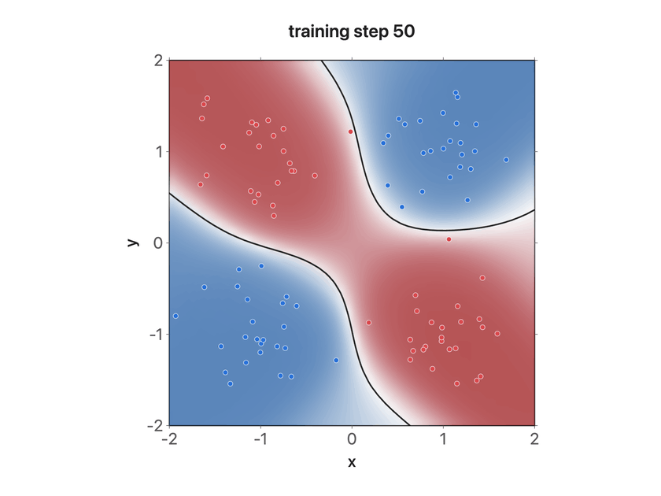
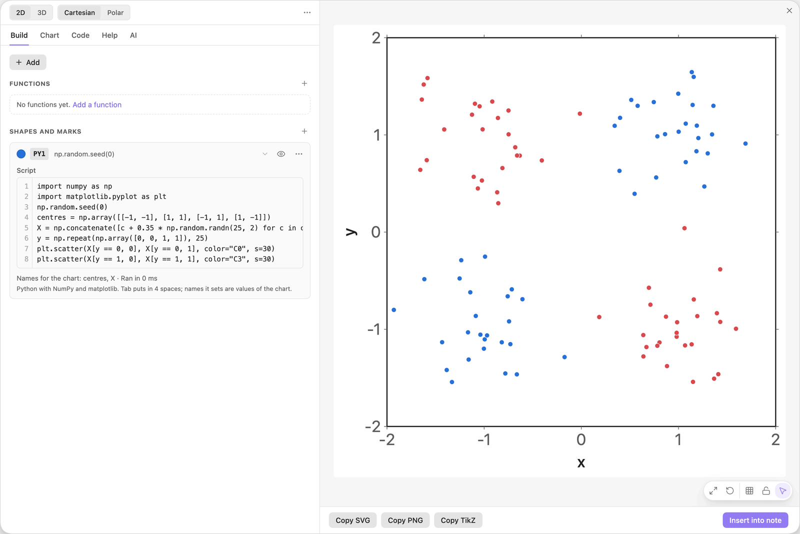
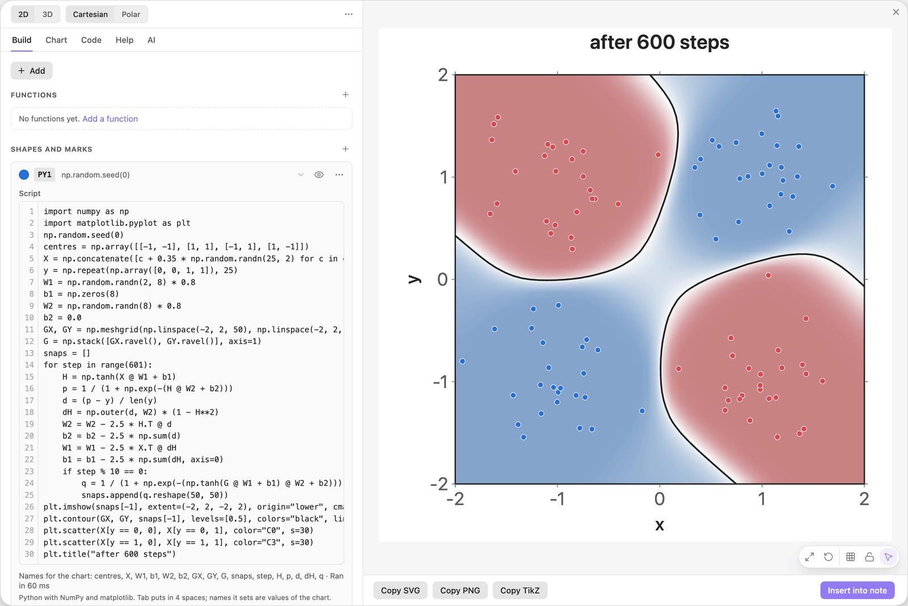
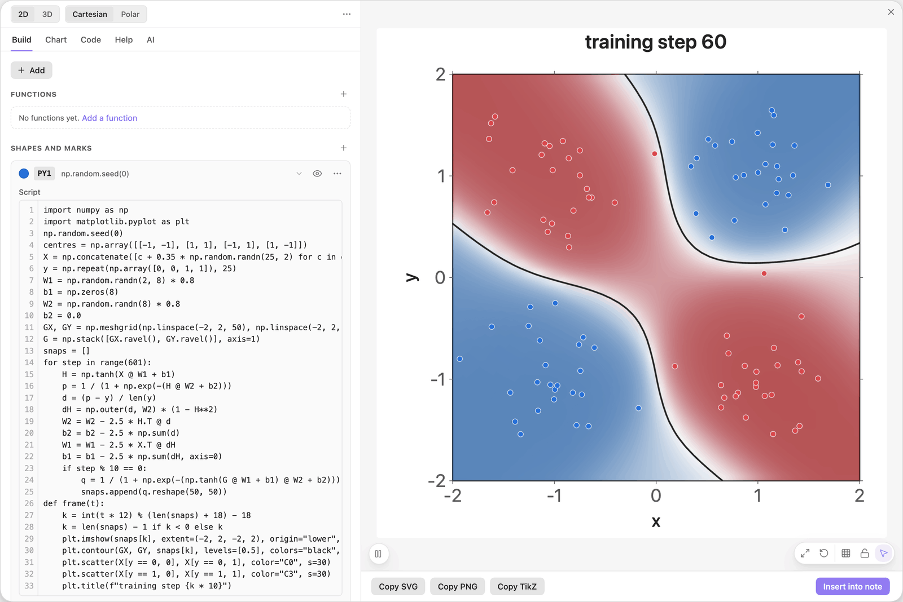

<!-- Generated by scripts/media/build-guides.mjs from src/guides. Do not edit. -->

# A neural network that learns

[All guides](README.md) · Data and probability · Advanced · about 3 minutes

Points no straight line can split, a small network trained in NumPy, and frame(t) playing its training as a moving picture.

<p align="center"></p>

**What you can do afterwards**

- Train a two-layer network in a script
- Draw its probability and its boundary
- Play the training with frame(t)

**Read first:** [Logistic regression](ml-logistic.md)

## 1. Draw points no line can split

Four clouds: blue at two opposite corners, red at the other two. No straight line puts the blues on one side, so logistic regression fails here.

The chart in words:

```easy-tikz
show x from -2 to 2 and y from -2 to 2
equal scale
python:
    import numpy as np
    import matplotlib.pyplot as plt
    np.random.seed(0)
    centres = np.array([[-1, -1], [1, 1], [-1, 1], [1, -1]])
    X = np.concatenate([c + 0.35 * np.random.randn(25, 2) for c in centres])
    y = np.repeat(np.array([0, 0, 1, 1]), 25)
    plt.scatter(X[y == 0, 0], X[y == 0, 1], color="C0", s=30)
    plt.scatter(X[y == 1, 0], X[y == 1, 1], color="C3", s=30)
```



## 2. Train a small network

Two inputs, 8 hidden units with tanh, one output through σ. The loop runs 600 steps of gradient descent by hand: the forward pass, the error, the backward pass. The bent boundary splits the four clouds.

The chart gets these lines:

```easy-tikz
    W1 = np.random.randn(2, 8) * 0.8
    b1 = np.zeros(8)
    W2 = np.random.randn(8) * 0.8
    b2 = 0.0
    GX, GY = np.meshgrid(np.linspace(-2, 2, 50), np.linspace(-2, 2, 50))
    G = np.stack([GX.ravel(), GY.ravel()], axis=1)
    snaps = []
    for step in range(601):
        H = np.tanh(X @ W1 + b1)
        p = 1 / (1 + np.exp(-(H @ W2 + b2)))
        d = (p - y) / len(y)
        dH = np.outer(d, W2) * (1 - H**2)
        W2 = W2 - 2.5 * H.T @ d
        b2 = b2 - 2.5 * np.sum(d)
        W1 = W1 - 2.5 * X.T @ dH
        b1 = b1 - 2.5 * np.sum(dH, axis=0)
        if step % 10 == 0:
            q = 1 / (1 + np.exp(-(np.tanh(G @ W1 + b1) @ W2 + b2)))
            snaps.append(q.reshape(50, 50))
    plt.imshow(snaps[-1], extent=(-2, 2, -2, 2), origin="lower", cmap="coolwarm", vmin=0, vmax=1, alpha=0.6, interpolation="bilinear")
    plt.contour(GX, GY, snaps[-1], levels=[0.5], colors="black", linewidths=2)
    plt.title("after 600 steps")
```



## 3. Watch it learn

Every 10 steps the loop keeps a picture in `snaps`. `def frame(t):` shows 12 of them a second, with the step in the title: the boundary bends into shape.

The chart gets these lines:

```easy-tikz
    def frame(t):
        k = int(t * 12) % (len(snaps) + 18) - 18
        k = len(snaps) - 1 if k < 0 else k
        plt.imshow(snaps[k], extent=(-2, 2, -2, 2), origin="lower", cmap="coolwarm", vmin=0, vmax=1, alpha=0.6, interpolation="bilinear")
        plt.contour(GX, GY, snaps[k], levels=[0.5], colors="black", linewidths=2)
        plt.scatter(X[y == 0, 0], X[y == 0, 1], color="C0", s=30)
        plt.scatter(X[y == 1, 0], X[y == 1, 1], color="C3", s=30)
        plt.title(f"training step {k * 10}")
```



> **Tip:** A picture that comes again is drawn from memory, so a frame costs about a millisecond.

## The finished chart

Paste this block into a note to get the finished chart of this guide. Click the chart in the note to open it in the editor.

<details>
<summary>The chart as an easy-tikz block</summary>

```easy-tikz
show x from -2 to 2 and y from -2 to 2
equal scale
python:
    import numpy as np
    import matplotlib.pyplot as plt
    np.random.seed(0)
    centres = np.array([[-1, -1], [1, 1], [-1, 1], [1, -1]])
    X = np.concatenate([c + 0.35 * np.random.randn(25, 2) for c in centres])
    y = np.repeat(np.array([0, 0, 1, 1]), 25)
    W1 = np.random.randn(2, 8) * 0.8
    b1 = np.zeros(8)
    W2 = np.random.randn(8) * 0.8
    b2 = 0.0
    GX, GY = np.meshgrid(np.linspace(-2, 2, 50), np.linspace(-2, 2, 50))
    G = np.stack([GX.ravel(), GY.ravel()], axis=1)
    snaps = []
    for step in range(601):
        H = np.tanh(X @ W1 + b1)
        p = 1 / (1 + np.exp(-(H @ W2 + b2)))
        d = (p - y) / len(y)
        dH = np.outer(d, W2) * (1 - H**2)
        W2 = W2 - 2.5 * H.T @ d
        b2 = b2 - 2.5 * np.sum(d)
        W1 = W1 - 2.5 * X.T @ dH
        b1 = b1 - 2.5 * np.sum(dH, axis=0)
        if step % 10 == 0:
            q = 1 / (1 + np.exp(-(np.tanh(G @ W1 + b1) @ W2 + b2)))
            snaps.append(q.reshape(50, 50))
    def frame(t):
        k = int(t * 12) % (len(snaps) + 18) - 18
        k = len(snaps) - 1 if k < 0 else k
        plt.imshow(snaps[k], extent=(-2, 2, -2, 2), origin="lower", cmap="coolwarm", vmin=0, vmax=1, alpha=0.6, interpolation="bilinear")
        plt.contour(GX, GY, snaps[k], levels=[0.5], colors="black", linewidths=2)
        plt.scatter(X[y == 0, 0], X[y == 0, 1], color="C0", s=30)
        plt.scatter(X[y == 1, 0], X[y == 1, 1], color="C3", s=30)
        plt.title(f"training step {k * 10}")
```

</details>

## Next guides

- [A network learns](network-learns.md): Watch a small neural network learn: its probability picture and boundary change step by step, first on four clouds, then on two rings.
- [Activation functions and softmax](ml-activations.md): Write σ, tanh and ReLU as in your notes, use GELU and softplus by name, and turn the temperature of a softmax with a slider.

[All guides](README.md)
