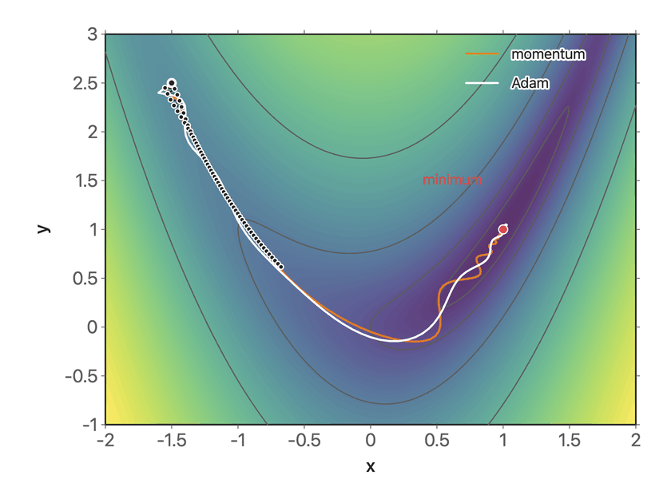
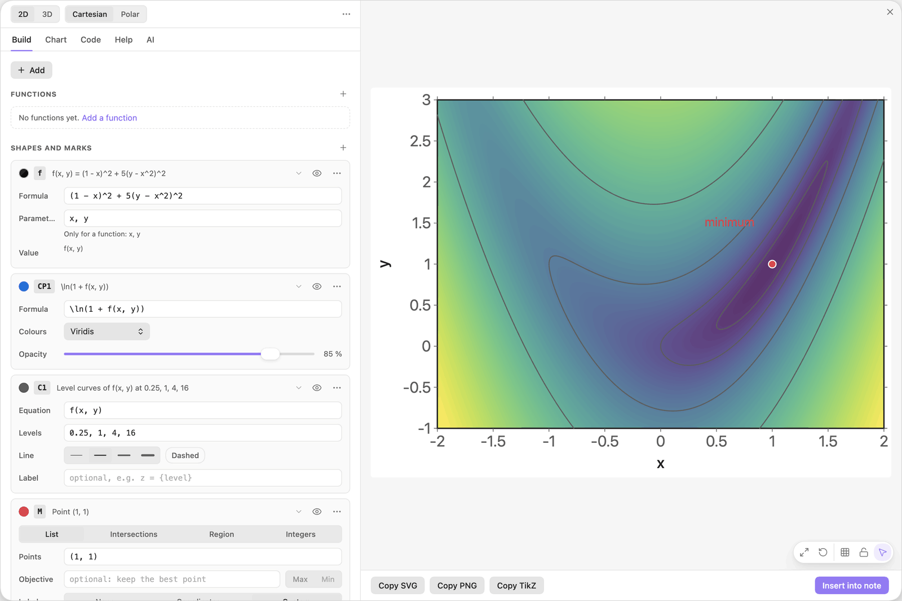
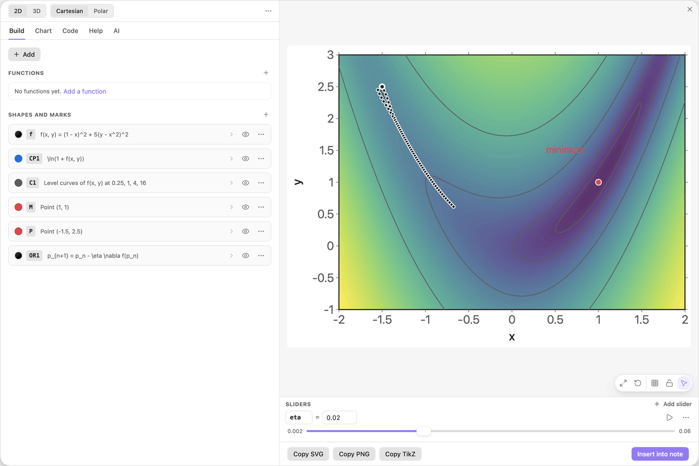
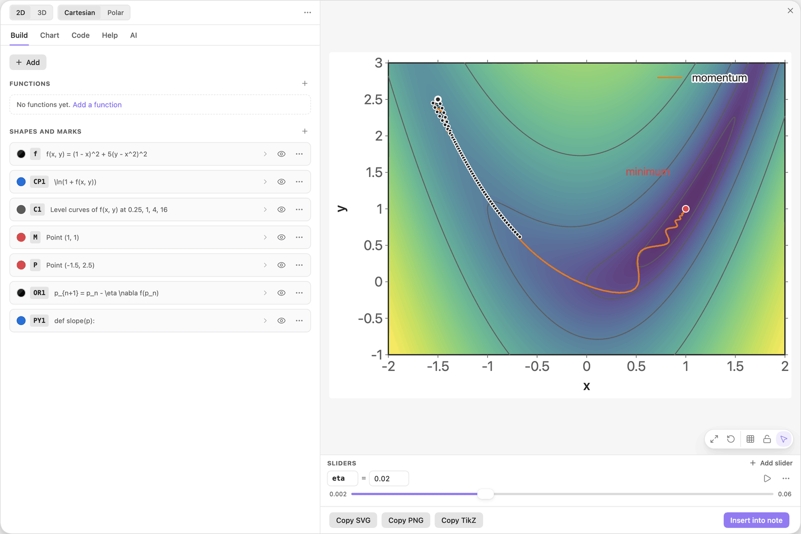
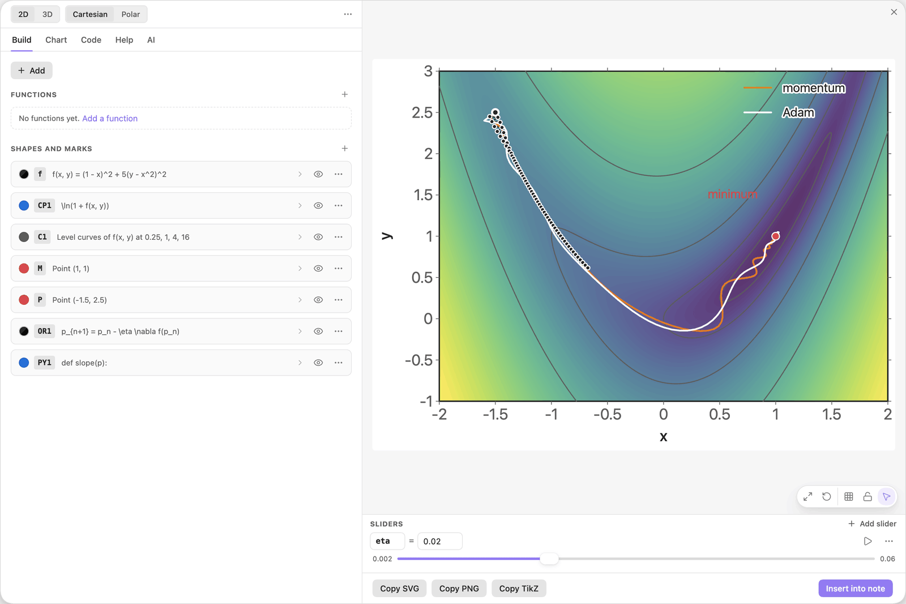

<!-- Generated by scripts/media/build-guides.mjs from src/guides. Do not edit. -->

# Optimizers on a loss surface

[All guides](README.md) · Data and probability · Advanced · about 4 minutes

Gradient descent, momentum and Adam walk down the same curved valley: one zigzags and crawls, the others glide to the minimum.

<p align="center"></p>

**What you can do afterwards**

- Draw a loss as a heat map with level curves
- Walk gradient descent with the step size on a slider
- Compare momentum and Adam in a script

## 1. Draw the loss surface

`let` names a loss f(x, y) with a long curved valley and its minimum at (1, 1). The heat map shows ln(1 + f), so the valley floor stands out; the level curves mark its walls.

The chart in words:

```easy-tikz
show x from -2 to 2 and y from -1 to 3
size 12 x 9
let f(x, y) = (1 - x)^2 + 5(y - x^2)^2
colour the plane by $\ln(1 + f(x, y))$ in viridis, opacity 0.85
draw the level curves of f(x, y) at 0.25, 1, 4 and 16 in gray
M: mark (1, 1), large, labelled "minimum"
```



## 2. Walk downhill with gradient descent

Each step goes against the gradient `\nabla f`, times the step size `eta`. With `eta` at 0.02 the path slides down the steep wall, then crawls along the flat floor: after 60 steps it is far from the minimum.

The chart gets these lines:

```easy-tikz
slider eta from 0.002 to 0.06, starting at 0.02
P: mark (-1.5, 2.5), large
draw the orbit of $p_{n+1} = p_n - \eta \nabla f(p_n)$, $p_0 = P$, 60 steps in black
```



> **Tip:** Drag `eta` to 0.04: it reaches the minimum in 60 steps. At 0.05 it jumps off the chart.

## 3. Add momentum

The python block runs momentum: each step keeps 0.9 of the last one. Across the valley the pushes cancel; along it they add up, so the path speeds along the floor.

The chart gets these lines:

```easy-tikz
C1: draw the level curves of f(x, y) at 0.25, 1, 4 and 16 in gray
python:
    import numpy as np
    import matplotlib.pyplot as plt
    def slope(p):
        x, y = p
        return np.array([-2 * (1 - x) - 20 * x * (y - x**2), 10 * (y - x**2)])
    def descend(kind, steps=150):
        p = np.array([-1.5, 2.5])
        m = np.zeros(2)
        s = np.zeros(2)
        path = [p]
        for k in range(1, steps + 1):
            g = slope(p)
            if kind == "momentum":
                m = 0.9 * m + g
                p = p - 0.005 * m
            else:
                m = 0.9 * m + 0.1 * g
                s = 0.999 * s + 0.001 * g**2
                p = p - 0.1 * (m / (1 - 0.9**k)) / (np.sqrt(s / (1 - 0.999**k)) + 1e-8)
            path.append(p)
        return np.array(path)
    for kind, colour in [("momentum", "C1")]:
        path = descend(kind)
        plt.plot(path[:, 0], path[:, 1], color=colour, linewidth=2.5, label=kind)
    plt.legend(loc="upper right")
```



## 4. Add Adam

Adam divides each coordinate of the step by its own recent size, so steps stay about as long on steep walls as on the flat floor. The white path reaches the minimum first.

The chart gets these lines:

```easy-tikz
    for kind, colour in (("momentum", "C1"), ("Adam", "#ffffff")):
```



## The finished chart

Paste this block into a note to get the finished chart of this guide. Click the chart in the note to open it in the editor.

<details>
<summary>The chart as an easy-tikz block</summary>

```easy-tikz
show x from -2 to 2 and y from -1 to 3
size 12 x 9
slider eta from 0.002 to 0.06, starting at 0.02
let f(x, y) = (1 - x)^2 + 5(y - x^2)^2
colour the plane by $\ln(1 + f(x, y))$ in viridis, opacity 0.85
C1: draw the level curves of f(x, y) at 0.25, 1, 4 and 16 in gray
M: mark (1, 1), large, labelled "minimum"
P: mark (-1.5, 2.5), large
draw the orbit of $p_{n+1} = p_n - \eta \nabla f(p_n)$, $p_0 = P$, 60 steps in black
python:
    import numpy as np
    import matplotlib.pyplot as plt
    def slope(p):
        x, y = p
        return np.array([-2 * (1 - x) - 20 * x * (y - x**2), 10 * (y - x**2)])
    def descend(kind, steps=150):
        p = np.array([-1.5, 2.5])
        m = np.zeros(2)
        s = np.zeros(2)
        path = [p]
        for k in range(1, steps + 1):
            g = slope(p)
            if kind == "momentum":
                m = 0.9 * m + g
                p = p - 0.005 * m
            else:
                m = 0.9 * m + 0.1 * g
                s = 0.999 * s + 0.001 * g**2
                p = p - 0.1 * (m / (1 - 0.9**k)) / (np.sqrt(s / (1 - 0.999**k)) + 1e-8)
            path.append(p)
        return np.array(path)
    for kind, colour in (("momentum", "C1"), ("Adam", "#ffffff")):
        path = descend(kind)
        plt.plot(path[:, 0], path[:, 1], color=colour, linewidth=2.5, label=kind)
    plt.legend(loc="upper right")
```

</details>

## Next guides

- [The optimizer race](optimizer-race.md): Gradient descent, momentum, RMSprop and Adam start together on a curved valley and race to the minimum, 40 steps a second.
- [A loss landscape in 3D](ml-landscape.md): A loss with two valleys as a surface, and gradient descent as a ball that rolls down it, from a start on two sliders.
- [Gradient descent in a bowl and two valleys](two-valleys.md): Walk downhill with the step size on a slider: a step too large zigzags away, and the start picks the valley you end in.

[All guides](README.md)
