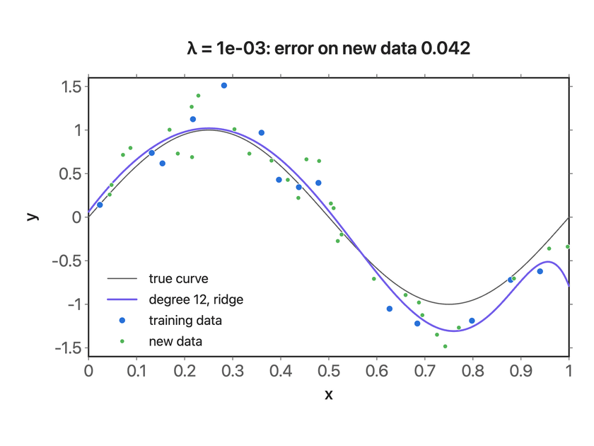
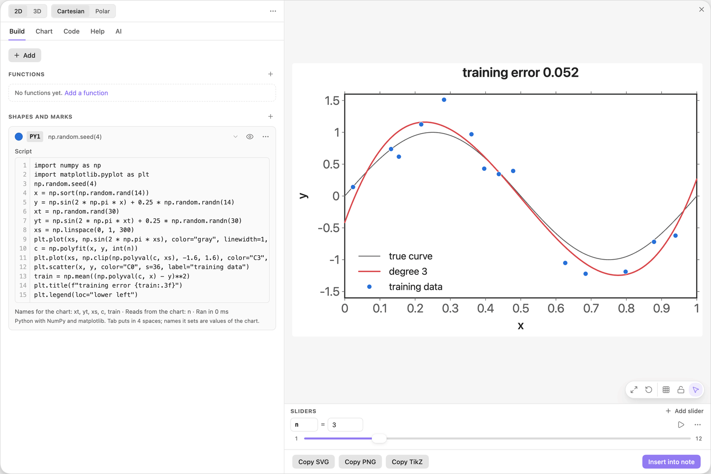
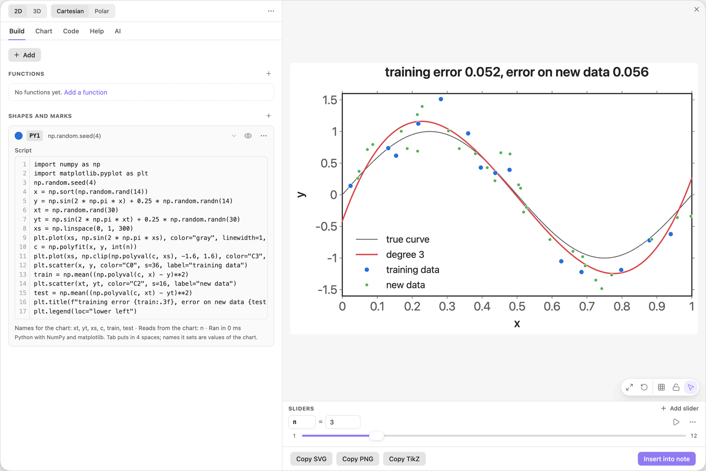
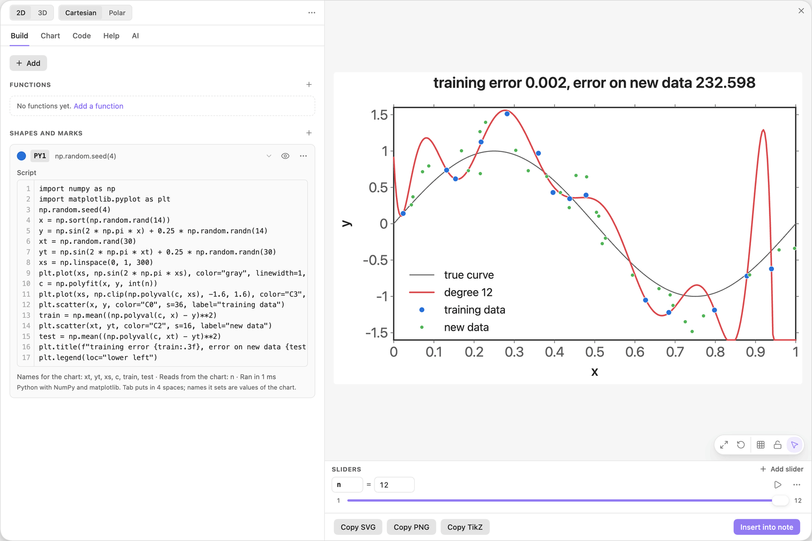
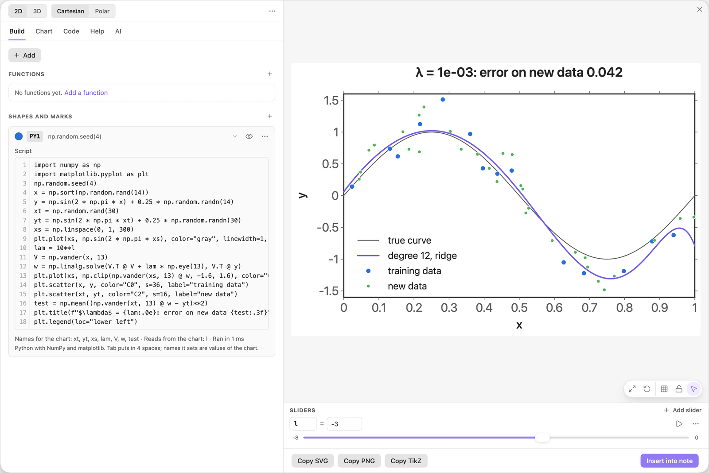

<!-- Generated by scripts/media/build-guides.mjs from src/guides. Do not edit. -->

# Overfitting and regularisation

[All guides](README.md) · Data and probability · Core · about 3 minutes

A polynomial with the degree on a slider fits 14 noisy points better and better, and new points worse and worse, until ridge holds it back.

<p align="center"></p>

**What you can do afterwards**

- Fit a polynomial of any degree with NumPy
- Compare the error on training and new data
- Hold a fit back with ridge and a λ slider

## 1. Fit a polynomial

14 noisy samples of a sine. `np.polyfit` fits a polynomial of degree `n`, the slider. Degree 3 follows the true curve well.

The chart in words:

```easy-tikz
show x from 0 to 1 and y from -1.6 to 1.6
size 12 x 8
slider n from 1 to 12, starting at 3, in steps of 1
python:
    import numpy as np
    import matplotlib.pyplot as plt
    np.random.seed(4)
    x = np.sort(np.random.rand(14))
    y = np.sin(2 * np.pi * x) + 0.25 * np.random.randn(14)
    xt = np.random.rand(30)
    yt = np.sin(2 * np.pi * xt) + 0.25 * np.random.randn(30)
    xs = np.linspace(0, 1, 300)
    plt.plot(xs, np.sin(2 * np.pi * xs), color="gray", linewidth=1, label="true curve")
    c = np.polyfit(x, y, int(n))
    plt.plot(xs, np.clip(np.polyval(c, xs), -1.6, 1.6), color="C3", linewidth=2.5, label=f"degree {int(n)}")
    plt.scatter(x, y, color="C0", s=36, label="training data")
    train = np.mean((np.polyval(c, x) - y)**2)
    plt.title(f"training error {train:.3f}")
    plt.legend(loc="lower left")
```



## 2. Check it on new data

The green points are 30 new samples the fit never saw. The title prints the mean squared error on both: at degree 3 they are close, 0.052 and 0.056.

The chart gets these lines:

```easy-tikz
    plt.scatter(xt, yt, color="C2", s=16, label="new data")
    test = np.mean((np.polyval(c, xt) - yt)**2)
    plt.title(f"training error {train:.3f}, error on new data {test:.3f}")
```



## 3. Raise the degree

At degree 12 the curve passes almost through every blue point, so the training error is near 0. Between them it swings wildly, and the error on new data grows thousands of times.

The chart gets these lines:

```easy-tikz
slider n from 1 to 12, starting at 12, in steps of 1
```



## 4. Hold it back with ridge

Ridge regression adds λ times the squared weights to the loss. `np.vander` makes the 13 powers of x and `np.linalg.solve` finds the weights. Drag `l`: λ = 10^l near 0.001 is best.

The chart gets these lines:

```easy-tikz
slider l from -8 to 0, starting at -3
    lam = 10**l
    V = np.vander(x, 13)
    w = np.linalg.solve(V.T @ V + lam * np.eye(13), V.T @ y)
    plt.plot(xs, np.clip(np.vander(xs, 13) @ w, -1.6, 1.6), color="C4", linewidth=2.5, label="degree 12, ridge")
    test = np.mean((np.vander(xt, 13) @ w - yt)**2)
    plt.title(f"$\lambda$ = {lam:.0e}: error on new data {test:.3f}")
```



> **Tip:** Too small a λ overfits again; too large a λ flattens the curve towards a line.

## The finished chart

Paste this block into a note to get the finished chart of this guide. Click the chart in the note to open it in the editor.

<details>
<summary>The chart as an easy-tikz block</summary>

```easy-tikz
show x from 0 to 1 and y from -1.6 to 1.6
size 12 x 8
slider l from -8 to 0, starting at -3
python:
    import numpy as np
    import matplotlib.pyplot as plt
    np.random.seed(4)
    x = np.sort(np.random.rand(14))
    y = np.sin(2 * np.pi * x) + 0.25 * np.random.randn(14)
    xt = np.random.rand(30)
    yt = np.sin(2 * np.pi * xt) + 0.25 * np.random.randn(30)
    xs = np.linspace(0, 1, 300)
    plt.plot(xs, np.sin(2 * np.pi * xs), color="gray", linewidth=1, label="true curve")
    lam = 10**l
    V = np.vander(x, 13)
    w = np.linalg.solve(V.T @ V + lam * np.eye(13), V.T @ y)
    plt.plot(xs, np.clip(np.vander(xs, 13) @ w, -1.6, 1.6), color="C4", linewidth=2.5, label="degree 12, ridge")
    plt.scatter(x, y, color="C0", s=36, label="training data")
    plt.scatter(xt, yt, color="C2", s=16, label="new data")
    test = np.mean((np.vander(xt, 13) @ w - yt)**2)
    plt.title(f"$\lambda$ = {lam:.0e}: error on new data {test:.3f}")
    plt.legend(loc="lower left")
```

</details>

## Next guides

- [Logistic regression](ml-logistic.md): Train a classifier by gradient descent in a script: the probability as a picture, the line where it is one half, and a slider for the steps.
- [Data and a regression line](data-regression.md): Plot data points, fit a regression line and print its equation and R² beside it.

[All guides](README.md)
