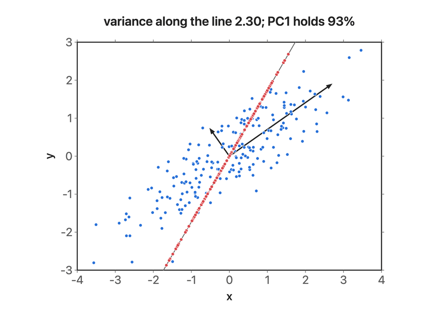
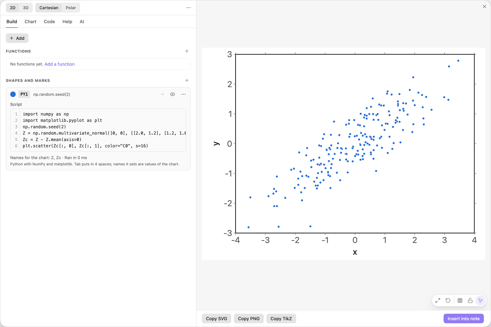
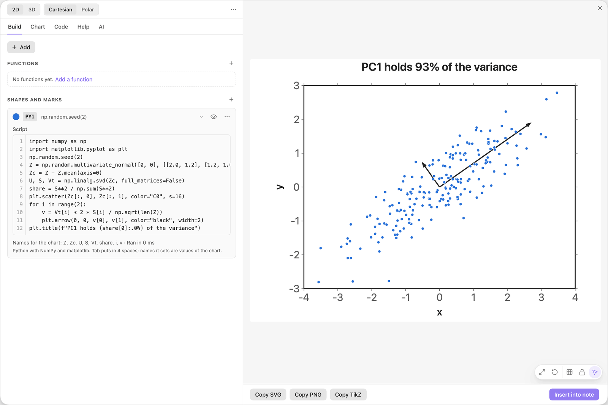
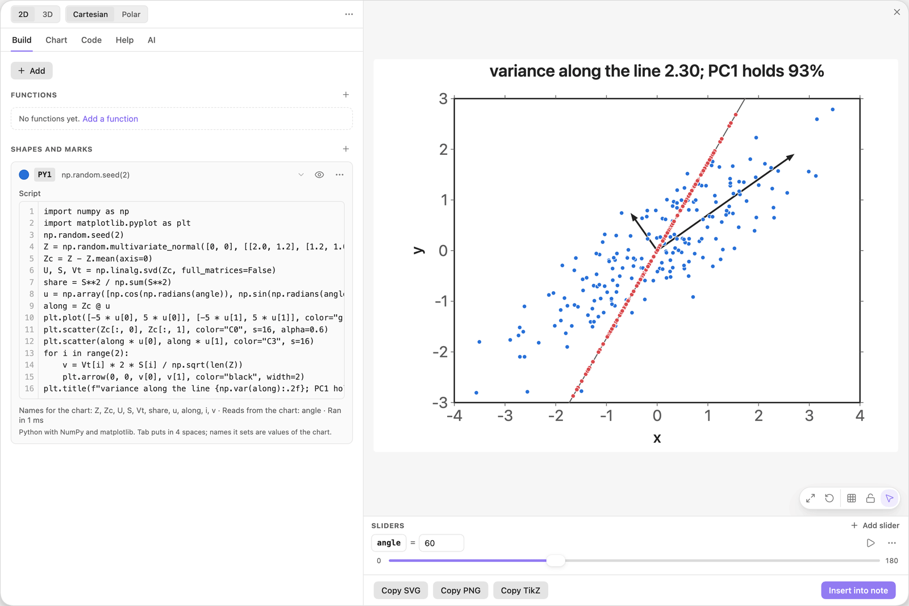

<!-- Generated by scripts/media/build-guides.mjs from src/guides. Do not edit. -->

# Principal components

[All guides](README.md) · Data and probability · Core · about 3 minutes

The SVD of a cloud of points gives its principal directions; a slider turns a line and shows the variance along it peak at the first one.

<p align="center"></p>

**What you can do afterwards**

- Sample correlated points
- Find the principal directions with the SVD
- Project onto a line on a slider

## 1. Draw a cloud of points

`np.random.multivariate_normal` draws 200 points with the covariance \[\[2, 1.2\], \[1.2, 1\]\]: a cloud tilted up to the right. The script moves its mean to the origin.

The chart in words:

```easy-tikz
show x from -4 to 4 and y from -3 to 3
size 12 x 9
equal scale
python:
    import numpy as np
    import matplotlib.pyplot as plt
    np.random.seed(2)
    Z = np.random.multivariate_normal([0, 0], [[2.0, 1.2], [1.2, 1.0]], 200)
    Zc = Z - Z.mean(axis=0)
    plt.scatter(Zc[:, 0], Zc[:, 1], color="C0", s=16)
```



## 2. Draw the principal directions

The rows of `Vt` from `np.linalg.svd` are the principal directions; each arrow is two standard deviations long. The first holds 93 % of the variance.

The chart gets these lines:

```easy-tikz
    U, S, Vt = np.linalg.svd(Zc, full_matrices=False)
    share = S**2 / np.sum(S**2)
    for i in range(2):
        v = Vt[i] * 2 * S[i] / np.sqrt(len(Z))
        plt.arrow(0, 0, v[0], v[1], color="black", width=2)
    plt.title(f"PC1 holds {share[0]:.0%} of the variance")
```



## 3. Project onto a line

The red dots are the points dropped onto a line at `angle` degrees. Drag it: the variance along the line peaks at 2.74 near 34°, along the first arrow, and drops to 0.21 across it.

The chart gets these lines:

```easy-tikz
slider angle from 0 to 180, starting at 60, in steps of 1
    u = np.array([np.cos(np.radians(angle)), np.sin(np.radians(angle))])
    along = Zc @ u
    plt.plot([-5 * u[0], 5 * u[0]], [-5 * u[1], 5 * u[1]], color="gray", linewidth=1)
    plt.scatter(Zc[:, 0], Zc[:, 1], color="C0", s=16, alpha=0.6)
    plt.scatter(along * u[0], along * u[1], color="C3", s=16)
    plt.title(f"variance along the line {np.var(along):.2f}; PC1 holds {share[0]:.0%}")
```



## The finished chart

Paste this block into a note to get the finished chart of this guide. Click the chart in the note to open it in the editor.

<details>
<summary>The chart as an easy-tikz block</summary>

```easy-tikz
show x from -4 to 4 and y from -3 to 3
size 12 x 9
equal scale
slider angle from 0 to 180, starting at 60, in steps of 1
python:
    import numpy as np
    import matplotlib.pyplot as plt
    np.random.seed(2)
    Z = np.random.multivariate_normal([0, 0], [[2.0, 1.2], [1.2, 1.0]], 200)
    Zc = Z - Z.mean(axis=0)
    U, S, Vt = np.linalg.svd(Zc, full_matrices=False)
    share = S**2 / np.sum(S**2)
    u = np.array([np.cos(np.radians(angle)), np.sin(np.radians(angle))])
    along = Zc @ u
    plt.plot([-5 * u[0], 5 * u[0]], [-5 * u[1], 5 * u[1]], color="gray", linewidth=1)
    plt.scatter(Zc[:, 0], Zc[:, 1], color="C0", s=16, alpha=0.6)
    plt.scatter(along * u[0], along * u[1], color="C3", s=16)
    for i in range(2):
        v = Vt[i] * 2 * S[i] / np.sqrt(len(Z))
        plt.arrow(0, 0, v[0], v[1], color="black", width=2)
    plt.title(f"variance along the line {np.var(along):.2f}; PC1 holds {share[0]:.0%}")
```

</details>

## Next guides

- [k-means step by step](ml-kmeans.md): Three groups of points, three centres: each point joins its nearest centre, each centre moves to the middle of its points, again and again.
- [Vectors and arrows](vectors-arrows.md): Name vectors with let, draw them as arrows, add them tip to tail and scale one with a slider.

[All guides](README.md)
