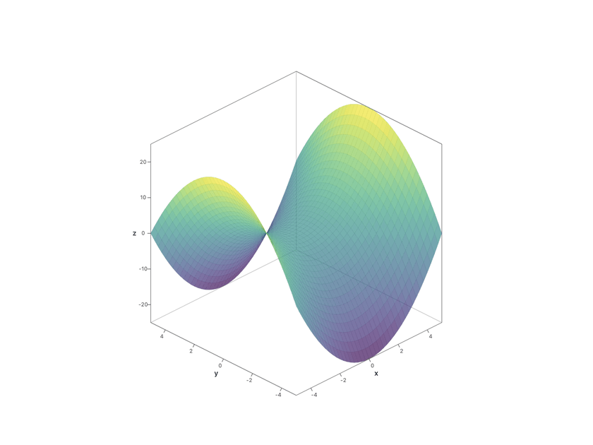
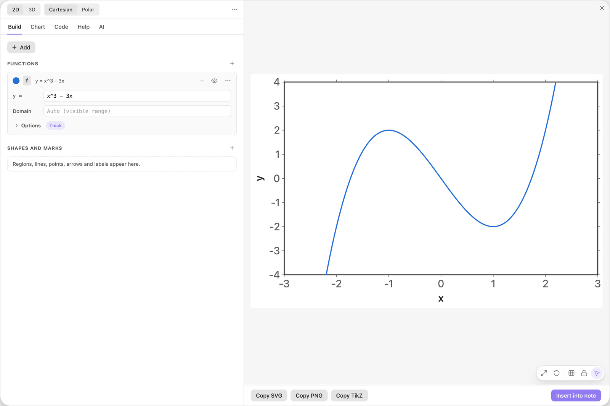
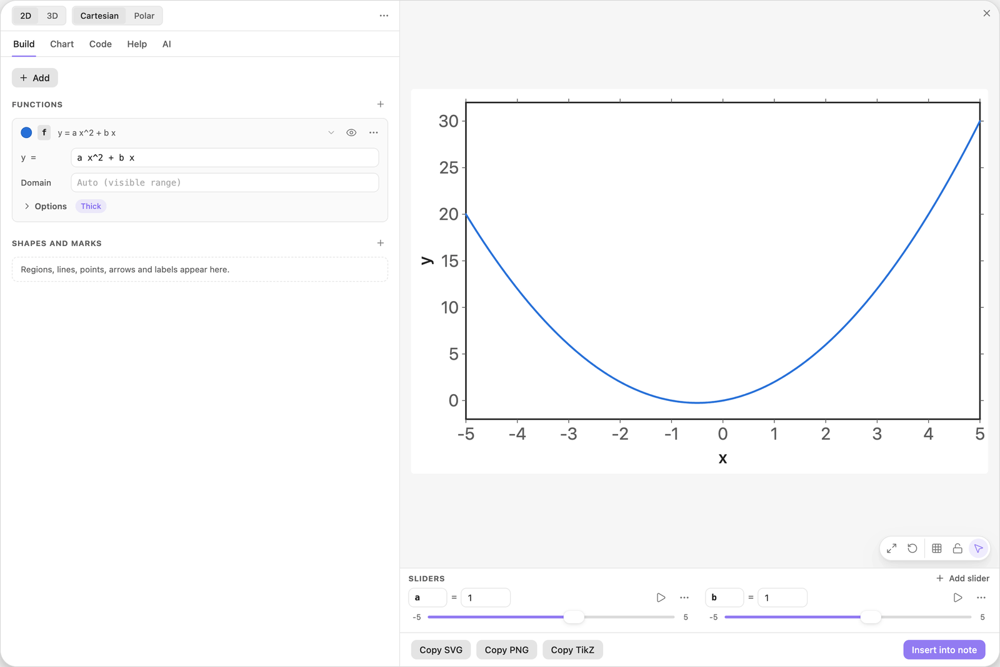
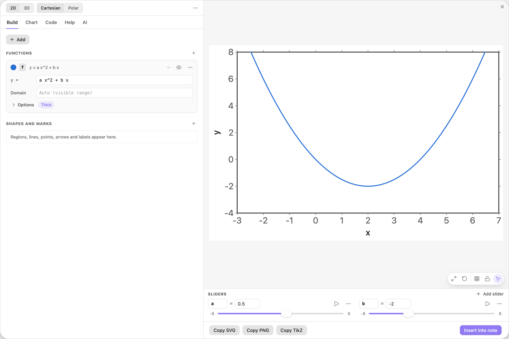
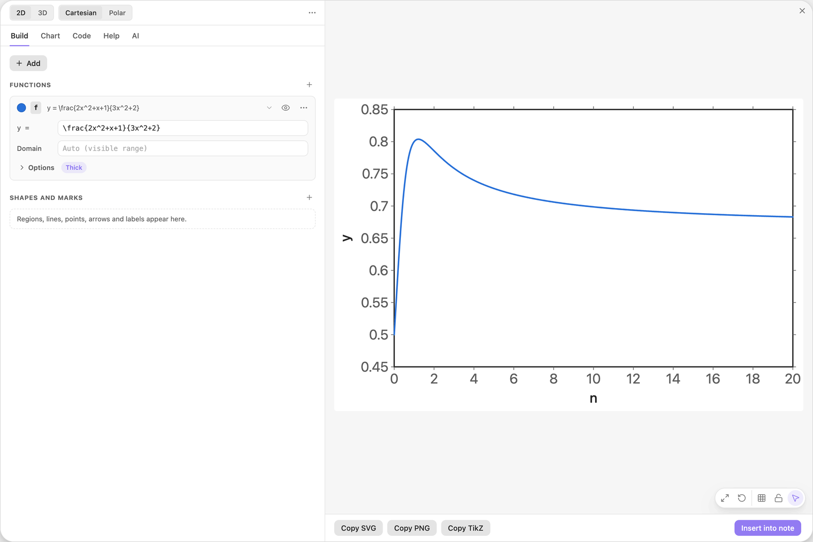
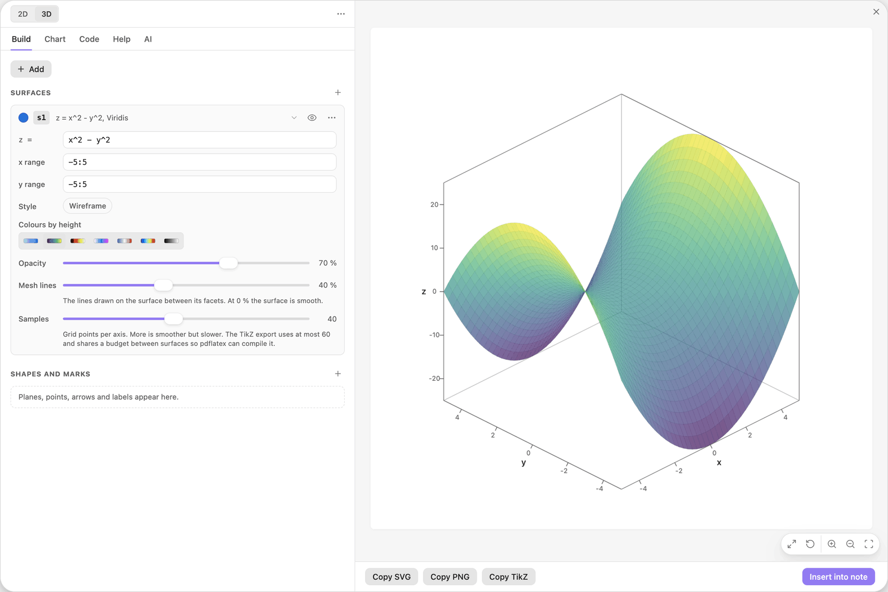

<!-- Generated by scripts/media/build-guides.mjs from src/guides. Do not edit. -->

# Every formula is a chart

[All guides](README.md) · Getting started · Start here · about 3 minutes

Rest the pointer on a formula in a note: its chart opens in a card, with sliders, ready to insert.

<p align="center"></p>

**What you can do afterwards**

- Open the chart of any formula in a note
- Move its sliders, zoom it and turn a surface
- Insert the chart under the paragraph

## 1. Rest the pointer on a formula

In Reading view or Live Preview, rest the pointer on a formula such as `$f(x) = x^3 - 3x$`: a card opens with its chart. A dotted line marks the formulas that have one.

The chart in words:

```easy-tikz
show x from -3 to 3 and y from -4 to 4
size 12 x 8
plot f(x) = x^3 - 3x in blue, thick
```



> **Tip:** The dotted line is the setting Highlight formulas in notes, and on a phone a tap opens the card.

## 2. Drag a slider for each letter

Each letter besides x becomes a slider: `$f(x) = ax^2 + bx$` gets `a` and `b`. Drag them and the chart follows.

The chart gets these lines:

```easy-tikz
show x from -5 to 5 and y from -2 to 32
slider a from -5 to 5, starting at 1
slider b from -5 to 5, starting at 1
plot f(x) = a x^2 + b x in blue, thick
```



## 3. Zoom in and insert the chart

In the card the wheel zooms, a drag pans and a double click goes back. Insert chart writes the chart under the paragraph, with the view and values you see.

The chart gets these lines:

```easy-tikz
show x from -3 to 7 and y from -4 to 8
slider a from -5 to 5, starting at 0.5
slider b from -5 to 5, starting at -2
```



> **Tip:** To change more first, click Open in the editor instead.

## 4. Chart a formula in n, t or k

A formula without x and y charts against its letter: `$\frac{2n^2+n+1}{3n^2+2}$` shows n from 0 to 20, as a sequence does. The chart writes it in x, on an axis named n.

The chart gets these lines:

```easy-tikz
show x from 0 to 20 and y from 0.45 to 0.85
xlabel n
plot $f(x) = \frac{2x^2+x+1}{3x^2+2}$ in blue, thick
```



> **Tip:** In a block of rows (`aligned`), the row under the pointer opens its chart.

## 5. Turn a surface with a drag

A formula in x and y is a surface: `$z = x^2 - y^2$` opens in 3D, coloured by height. Drag in the card to turn it.

The chart gets these lines:

```easy-tikz
3d
cube
show x from -5 to 5, y from -5 to 5 and z from -25 to 25
plot s1(x, y) = x^2 - y^2 in viridis
```



## The finished chart

Paste this block into a note to get the finished chart of this guide. Click the chart in the note to open it in the editor.

<details>
<summary>The chart as an easy-tikz block</summary>

```easy-tikz
3d
cube
show x from -5 to 5, y from -5 to 5 and z from -25 to 25
plot s1(x, y) = x^2 - y^2 in viridis
```

</details>

## Next guides

- [Write formulas as in your notes](formulas.md): Write LaTeX in dollars, where `ax` is a times x, or plain formulas, and limit a curve with a domain.
- [Sliders that move the picture](sliders.md): Turn letters into sliders, set their range and step, press play, and connect them across a note.
- [Surfaces, planes and points in 3D](surfaces-3d.md): Plot a surface coloured by height in a cube, turn it, and cut it with a plane on a slider.

[All guides](README.md)
