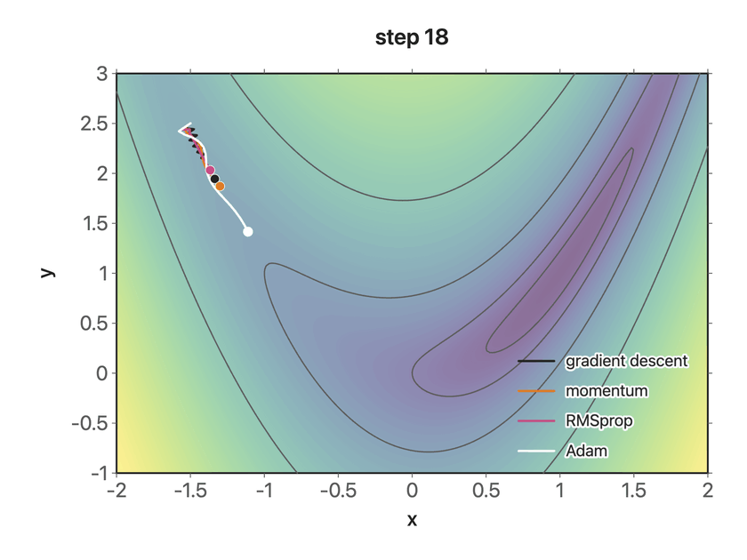
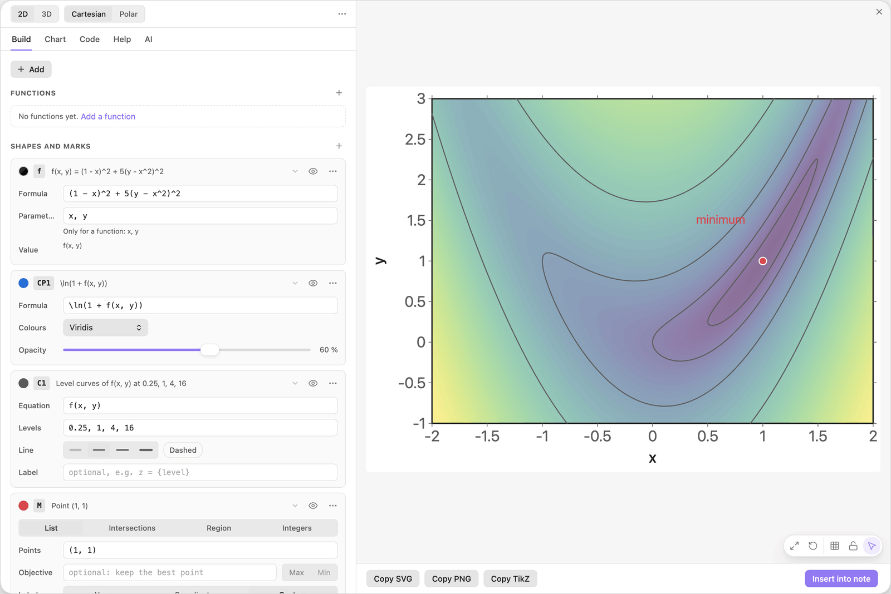
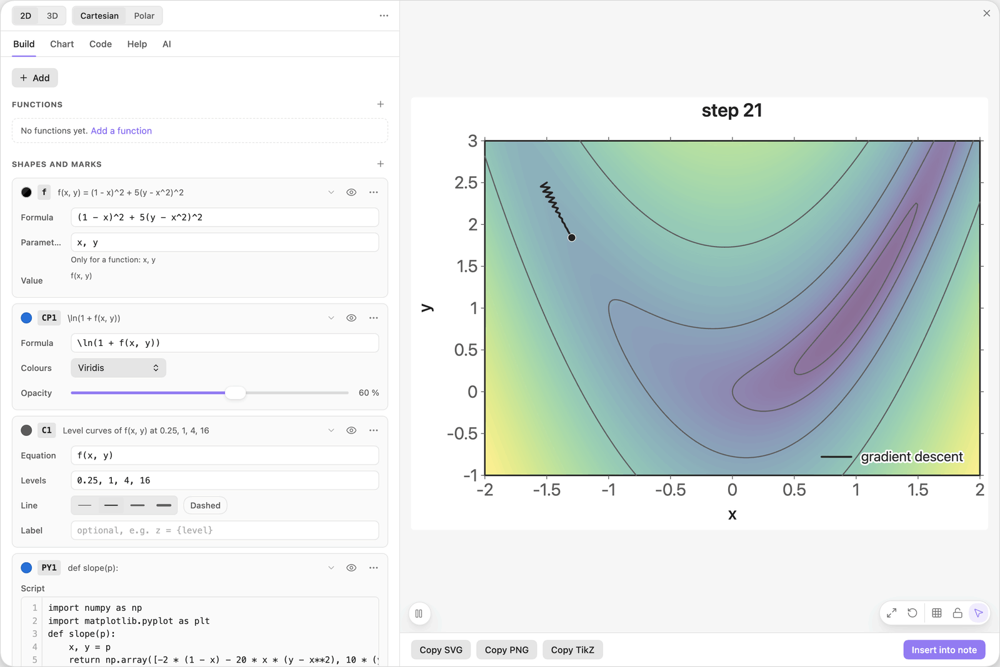
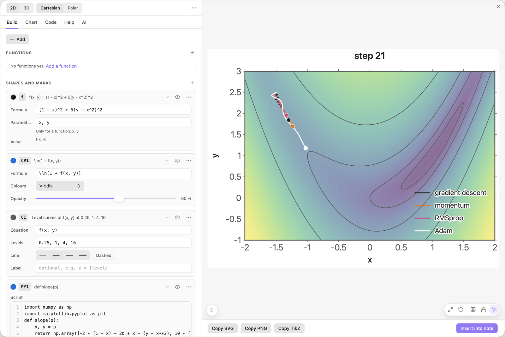

<!-- Generated by scripts/media/build-guides.mjs from src/guides. Do not edit. -->

# The optimizer race

[All guides](README.md) · Showcase · Advanced · about 2 minutes

Gradient descent, momentum, RMSprop and Adam start together on a curved valley and race to the minimum, 40 steps a second.

<p align="center"></p>

**What you can do afterwards**

- Run four optimizers in one script
- Let their paths draw themselves with frame(t)
- See which one reaches the minimum first

## 1. Draw the curved valley

The loss f(x, y) has a long curved valley with its minimum at (1, 1): steep walls, a nearly flat floor. A hard course for an optimizer.

The chart in words:

```easy-tikz
show x from -2 to 2 and y from -1 to 3
size 12 x 9
let f(x, y) = (1 - x)^2 + 5(y - x^2)^2
colour the plane by $\ln(1 + f(x, y))$ in viridis, opacity 0.6
draw the level curves of f(x, y) at 0.25, 1, 4 and 16 in gray
M: mark (1, 1), large, labelled "minimum"
```



## 2. Send gradient descent alone

The script runs 200 steps from (-1.5, 2.5); `frame(t)` draws 40 steps a second, the head gliding between them. Plain gradient descent reaches the floor fast, then crawls.

The chart gets these lines:

```easy-tikz
python:
    import numpy as np
    import matplotlib.pyplot as plt
    def slope(p):
        x, y = p
        return np.array([-2 * (1 - x) - 20 * x * (y - x**2), 10 * (y - x**2)])
    def race(kind, steps=200):
        p = np.array([-1.5, 2.5])
        m = np.zeros(2)
        s = np.zeros(2)
        path = [p]
        for k in range(1, steps + 1):
            g = slope(p)
            if kind == "gradient descent":
                p = p - 0.02 * g
            elif kind == "momentum":
                m = 0.9 * m + g
                p = p - 0.004 * m
            elif kind == "RMSprop":
                s = 0.9 * s + 0.1 * g**2
                p = p - 0.02 * g / (np.sqrt(s) + 1e-8)
            else:
                m = 0.9 * m + 0.1 * g
                s = 0.999 * s + 0.001 * g**2
                p = p - 0.08 * (m / (1 - 0.9**k)) / (np.sqrt(s / (1 - 0.999**k)) + 1e-8)
            path.append(p)
        return np.array(path)
    runners = [("gradient descent", "black")]
    paths = [race(kind) for kind, colour in runners]
    def frame(t):
        u = (t * 40 + 200) % 260
        k = min(int(u), 199)
        a = min(u - k, 1.0)
        for (kind, colour), path in zip(runners, paths):
            head = path[k] + a * (path[k + 1] - path[k])
            trail = np.vstack([path[:k + 1], head])
            plt.plot(trail[:, 0], trail[:, 1], color=colour, linewidth=2, label=kind)
            plt.scatter([head[0]], [head[1]], color=colour, s=50)
        plt.legend(loc="lower right")
        plt.title(f"step {min(int(u), 200)}")
```



## 3. Start the race

Momentum, RMSprop and Adam join from the same start. Adam reaches the minimum near step 90, momentum near step 175; RMSprop and gradient descent are still on the way at step 200.

The chart gets these lines:

```easy-tikz
C1: draw the level curves of f(x, y) at 0.25, 1, 4 and 16 in gray
    runners = [("gradient descent", "black"), ("momentum", "C1"), ("RMSprop", "C6"), ("Adam", "#ffffff")]
```



## The finished chart

Paste this block into a note to get the finished chart of this guide. Click the chart in the note to open it in the editor.

<details>
<summary>The chart as an easy-tikz block</summary>

```easy-tikz
show x from -2 to 2 and y from -1 to 3
size 12 x 9
let f(x, y) = (1 - x)^2 + 5(y - x^2)^2
colour the plane by $\ln(1 + f(x, y))$ in viridis, opacity 0.6
C1: draw the level curves of f(x, y) at 0.25, 1, 4 and 16 in gray
python:
    import numpy as np
    import matplotlib.pyplot as plt
    def slope(p):
        x, y = p
        return np.array([-2 * (1 - x) - 20 * x * (y - x**2), 10 * (y - x**2)])
    def race(kind, steps=200):
        p = np.array([-1.5, 2.5])
        m = np.zeros(2)
        s = np.zeros(2)
        path = [p]
        for k in range(1, steps + 1):
            g = slope(p)
            if kind == "gradient descent":
                p = p - 0.02 * g
            elif kind == "momentum":
                m = 0.9 * m + g
                p = p - 0.004 * m
            elif kind == "RMSprop":
                s = 0.9 * s + 0.1 * g**2
                p = p - 0.02 * g / (np.sqrt(s) + 1e-8)
            else:
                m = 0.9 * m + 0.1 * g
                s = 0.999 * s + 0.001 * g**2
                p = p - 0.08 * (m / (1 - 0.9**k)) / (np.sqrt(s / (1 - 0.999**k)) + 1e-8)
            path.append(p)
        return np.array(path)
    runners = [("gradient descent", "black"), ("momentum", "C1"), ("RMSprop", "C6"), ("Adam", "#ffffff")]
    paths = [race(kind) for kind, colour in runners]
    def frame(t):
        u = (t * 40 + 200) % 260
        k = min(int(u), 199)
        a = min(u - k, 1.0)
        for (kind, colour), path in zip(runners, paths):
            head = path[k] + a * (path[k + 1] - path[k])
            trail = np.vstack([path[:k + 1], head])
            plt.plot(trail[:, 0], trail[:, 1], color=colour, linewidth=2, label=kind)
            plt.scatter([head[0]], [head[1]], color=colour, s=50)
        plt.legend(loc="lower right")
        plt.title(f"step {min(int(u), 200)}")
```

</details>

## Next guides

- [Optimizers on a loss surface](ml-optimizers.md): Gradient descent, momentum and Adam walk down the same curved valley: one zigzags and crawls, the others glide to the minimum.
- [A loss landscape in 3D](ml-landscape.md): A loss with two valleys as a surface, and gradient descent as a ball that rolls down it, from a start on two sliders.

[All guides](README.md)
