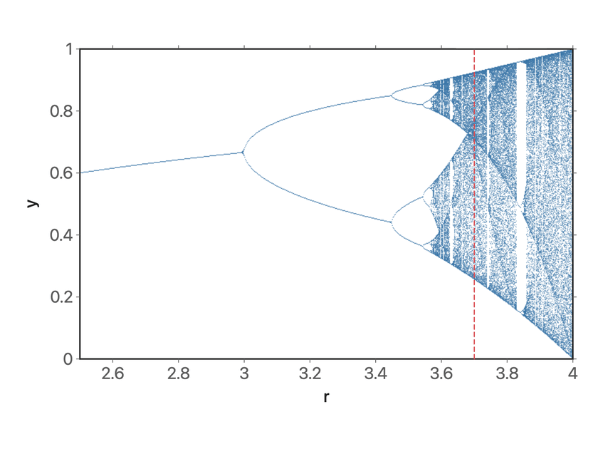
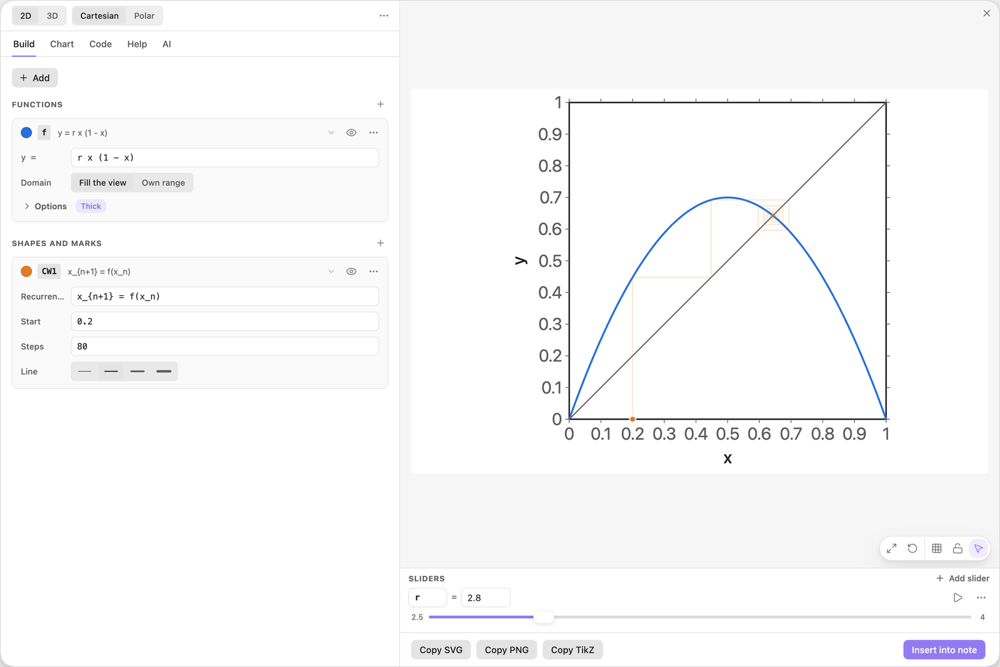
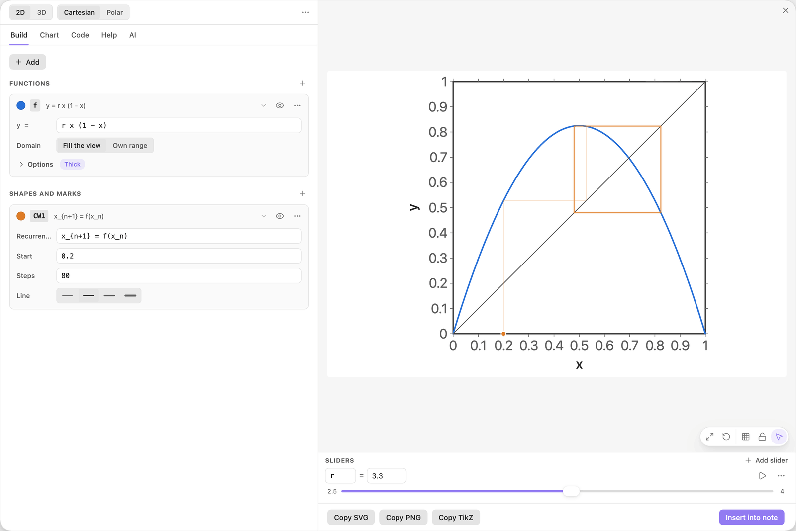
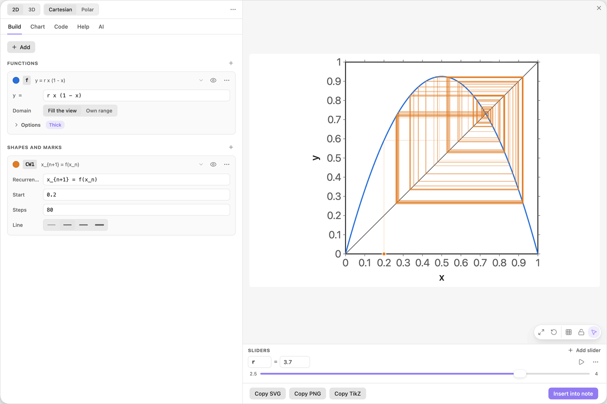
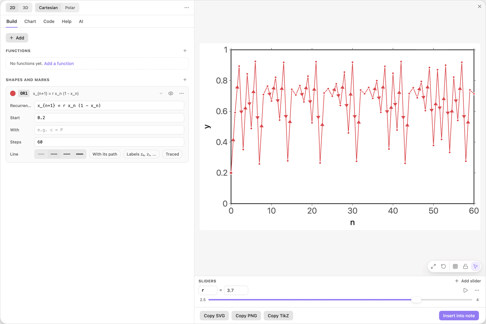
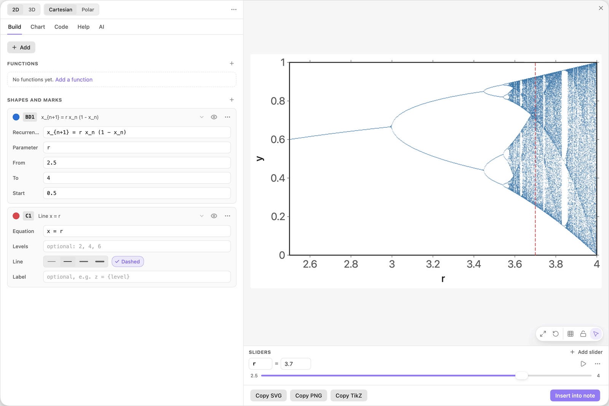

<!-- Generated by scripts/media/build-guides.mjs from src/guides. Do not edit. -->

# Orbits, cobwebs and bifurcation

[All guides](README.md) · Dynamics and fractals · Advanced · about 4 minutes

Follow x ↦ r x (1 - x) step by step on a cobweb, over time, and for every r at once in the bifurcation diagram.

<p align="center"></p>

**What you can do afterwards**

- Draw the cobweb of a map
- Draw an orbit of numbers over n
- Draw a bifurcation diagram

## 1. Draw the cobweb of a map

Plot the map f, then `draw the cobweb`: from 0.2 up to the graph, across to the line y = x, up again. At r = 2.8 the path settles where f meets y = x.

The chart in words:

```easy-tikz
show x from 0 to 1 and y from 0 to 1
size 12 x 8
equal scale
slider r from 2.5 to 4, starting at 2.8
plot f(x) = r x (1 - x) in blue, thick
draw the cobweb of $x_{n+1} = f(x_n)$ from 0.2, 80 steps
```



## 2. Raise r past 3

At r = 3.3 the cobweb closes into a square: the orbit swaps between two values for ever.

The chart gets these lines:

```easy-tikz
slider r from 2.5 to 4, starting at 3.3
```



## 3. Find chaos at r = 3.7

At r = 3.7 the path never settles: it fills a whole band. Drag `r` slowly up from 3 to see the square split into more and more corners first.

The chart gets these lines:

```easy-tikz
slider r from 2.5 to 4, starting at 3.7
```



## 4. Draw the orbit over time

`draw the orbit` of a recurrence of numbers draws each value over n: the same chaos at r = 3.7, as a jagged line.

The chart gets these lines:

```easy-tikz
show x from 0 to 60 and y from 0 to 1
xlabel n
draw the orbit of $x_{n+1} = r x_n (1 - x_n)$, $x_0 = 0.2$, 60 steps
```



## 5. Draw the bifurcation diagram

For each r on the x-axis the diagram marks where the orbit settles: one value, then 2, 4, 8, then chaos. The dashed line is the r of the slider.

The chart gets these lines:

```easy-tikz
show x from 2.5 to 4 and y from 0 to 1
xlabel r
draw the bifurcation diagram of $x_{n+1} = r x_n (1 - x_n)$ for r from 2.5 to 4
draw x = r in red, dashed
```



## The finished chart

Paste this block into a note to get the finished chart of this guide. Click the chart in the note to open it in the editor.

<details>
<summary>The chart as an easy-tikz block</summary>

```easy-tikz
show x from 2.5 to 4 and y from 0 to 1
size 12 x 8
xlabel r
slider r from 2.5 to 4, starting at 3.7
draw the bifurcation diagram of $x_{n+1} = r x_n (1 - x_n)$ for r from 2.5 to 4
draw x = r in red, dashed
```

</details>

## Next guides

- [Fractals: Mandelbrot, Julia and Newton](fractals.md): Colour every point of the plane by its orbit: the Mandelbrot set, Julia sets on sliders and the basins of Newton's method.
- [Gradient descent and Newton's method](descent-newton.md): Walk downhill on level curves with gradient descent, take steps that are too long, and find a root with Newton's method.

[All guides](README.md)
