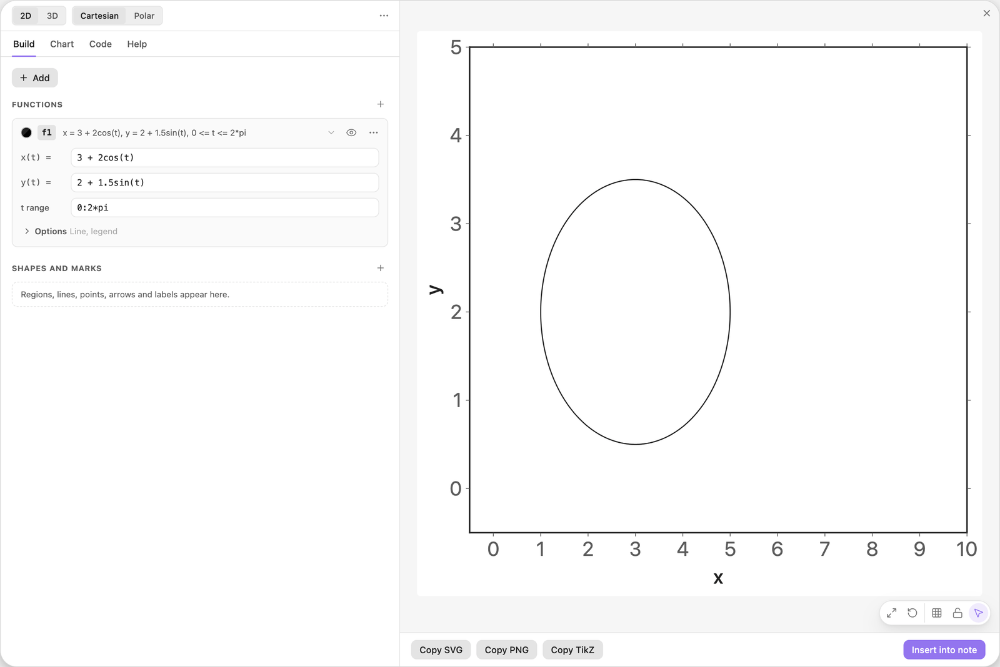
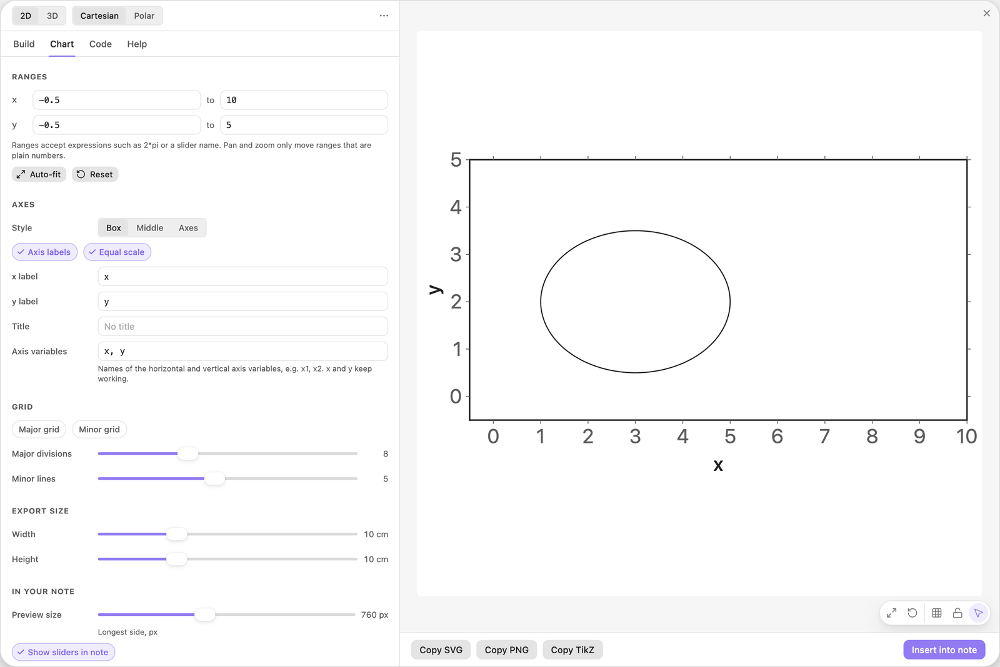
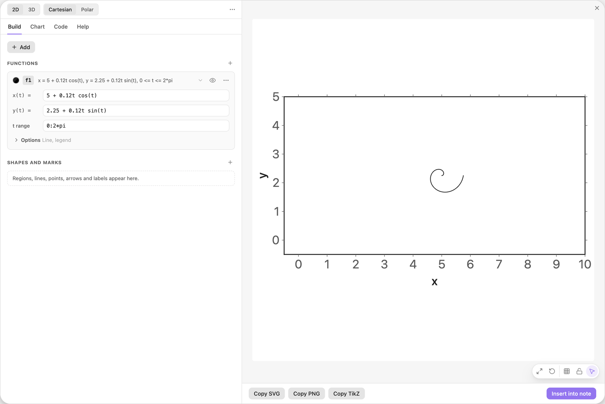
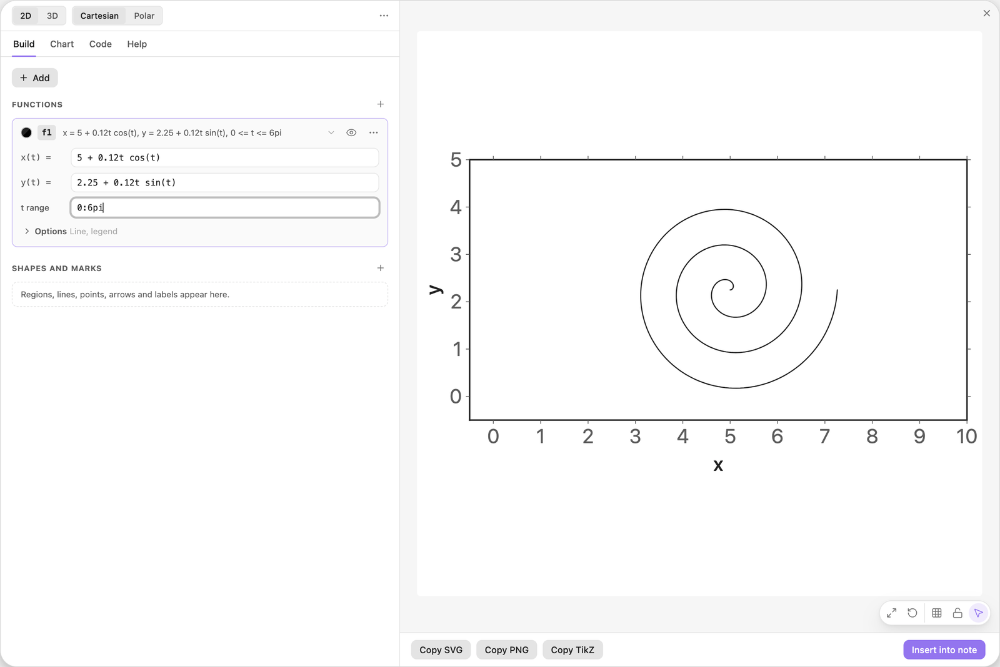
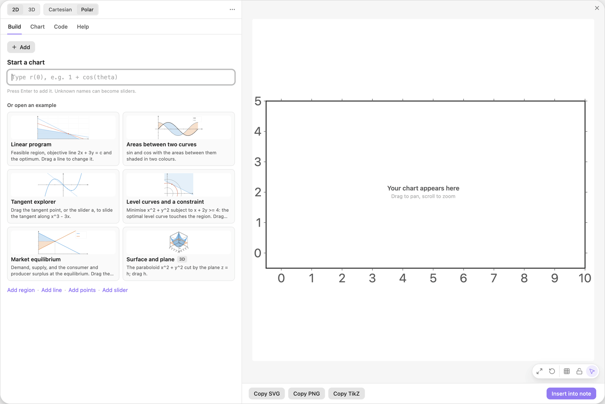
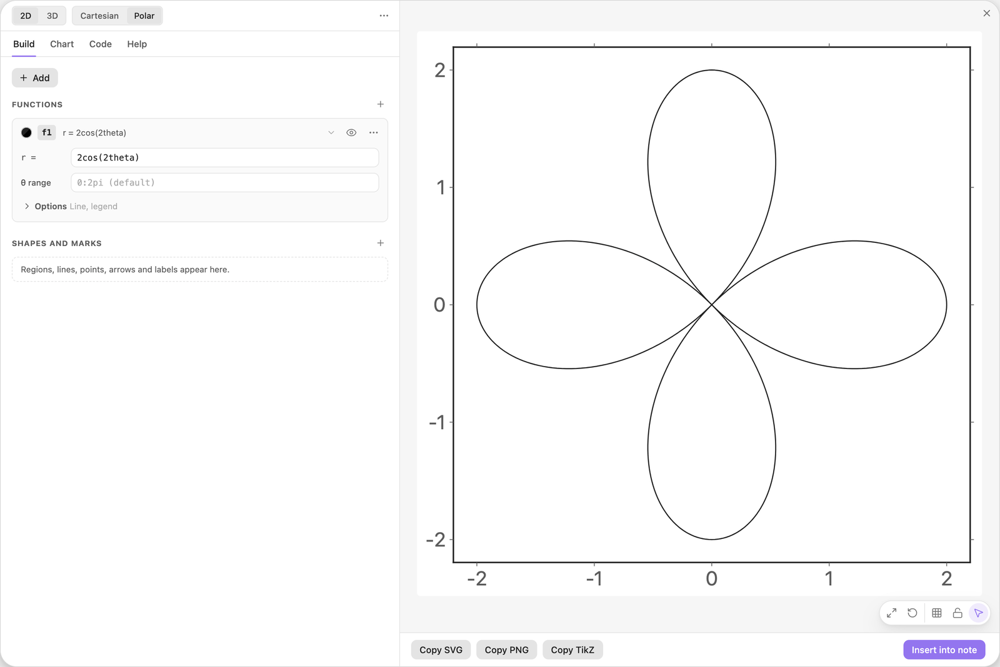
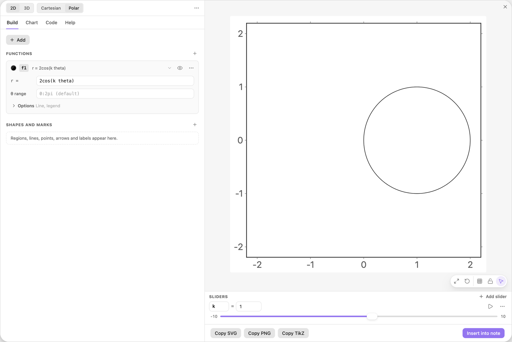
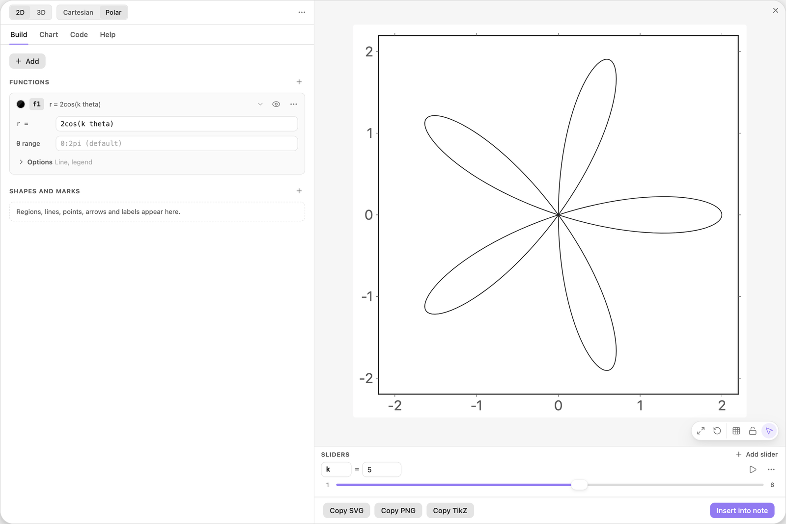

<!-- Generated by scripts/media/build-guides.mjs from src/guides. Do not edit. -->

# Parametric and polar curves

[All guides](README.md) · Functions and sliders · Core · about 7 minutes

Draw a curve from x(t) and y(t), then switch a chart to polar and grow a rose from r(θ).

<p align="center"></p>

**What you can do afterwards**

- Add a parametric curve and set its t range
- Keep shapes true with Equal scale
- Switch a chart to polar and type r(θ)
- Count petals with a whole-number slider

**Read first:** [Your first chart](first-chart.md), [Sliders that move the picture](sliders.md)

## 1. Add a parametric curve

In a new chart, click + Add and choose Parametric curve x(t), y(t). The card has two formula rows, `x(t) =` and `y(t) =`, and a t range. It arrives filled in with an ellipse around (3, 2).



*The parametric recipe: an ellipse given by x(t) and y(t).*

> **Tip:** An existing function becomes parametric in its Options: switch from y = f(x) to x(t), y(t) at the top.

## 2. Give both axes the same scale

The ellipse is 4 wide and 3 high, yet it looks taller than wide, because the two axes use different units. Open the Chart tab and click Equal scale under Axes.

Both axes now share one unit, so the ellipse has its true shape and circles are round. The exported picture keeps that.



*Equal scale on: the ellipse is wider than high, as its formulas say.*

## 3. Type a spiral

Back in the Build tab, replace the two formulas. The radius `0.12t` grows with t while `cos(t)` and `sin(t)` go around, so the curve spirals away from (5, 2.25).

With the range the recipe came with, `0:2*pi`, it makes one turn.

| Where | Type |
| --- | --- |
| f1, x(t) = | `5 + 0.12t cos(t)` |
| f1, y(t) = | `2.25 + 0.12t sin(t)` |



*One turn of the spiral.*

> **Tip:** Keep the space in `0.12t cos(t)`. Without it, `tcos` is read as one unknown name, and the field offers `Use t*cos`.

## 4. Extend the t range

Type `0:6pi` into the t range field. The spiral now makes three turns.

The t range is written like a domain, `min:max`, and accepts formulas. Left empty it runs from 0 to 2π.

| Where | Type |
| --- | --- |
| f1, t range | `0:6pi` |



*t from 0 to 6π: three turns.*

## 5. Switch a new chart to Polar

Polar curves get a chart of their own. Insert the spiral into your note (or close the editor), open the editor again and click Polar in the header. If the editor offers to restore the unsaved spiral, click Discard.

The Start a chart field now asks for r(θ): in a polar chart every function gives the radius for an angle.



*A new chart switched to Polar. The field asks for r(θ).*

> **Tip:** In a polar chart Equal scale is always on.

## 6. Type r as a formula in theta

Type the formula and press Enter. Write the angle as `theta` (or `θ`).

The curve is a rose with four petals, and the ranges are fitted around it. The θ range is empty, which means 0 to 2π.

| Where | Type |
| --- | --- |
| Start a chart | `2cos(2theta)` |



*r = 2cos(2theta): a rose with four petals.*

## 7. Put the petal count on a slider

In the formula, replace the `2` inside the cosine with `k` and click Add slider k. `k` starts at 1, and `2cos(theta)` is a plain circle.

Keep the space in `k theta`: `ktheta` would be one name.

| Where | Type |
| --- | --- |
| f1, r = | `2cos(k theta)` |



*With k = 1 the rose is a single circle.*

## 8. Step through whole numbers

Open the menu behind the three dots on the slider row and set Min to 1, Max to 8 and Step to 1. Then drag `k` to 5: five petals.

An odd `k` gives k petals, an even `k` twice as many. With a step of 0.1 the slider would also stop between whole numbers, where the rose does not close.

| Where | Type |
| --- | --- |
| Sliders, k: Min | `1` |
| Sliders, k: Max | `8` |
| Sliders, k: Step | `1` |



*k = 5 in whole steps: five petals.*

> **Tip:** Parametric and polar curves cannot be dragged in the preview yet. Change their formulas or their sliders.

## The finished chart

Paste this block into a note to get the finished chart of this guide. Click the chart in the note to open it in the editor.

<details>
<summary>The chart as an easy-tikz block</summary>

```easy-tikz
polar
show x from -2.2 to 2.2 and y from -2.195 to 2.195
slider k from 1 to 8, starting at 5, in steps of 1
plot f1(theta) = 2cos(k theta)
```

</details>

## Next guides

- [Tangents and extrema](tangents-extrema.md): Mark the turning points of a function, add a tangent, slide it along the curve and label its slope.
- [Shade the areas between two curves](areas-between.md): Two curves, the areas between them in two colours, and their crossing points as the limits of the shading.
- [Export to LaTeX](export-latex.md): Get pgfplots code that compiles with pdflatex: as a standalone document or as a snippet, at the size you need, in the colours of the preview.

[All guides](README.md)
