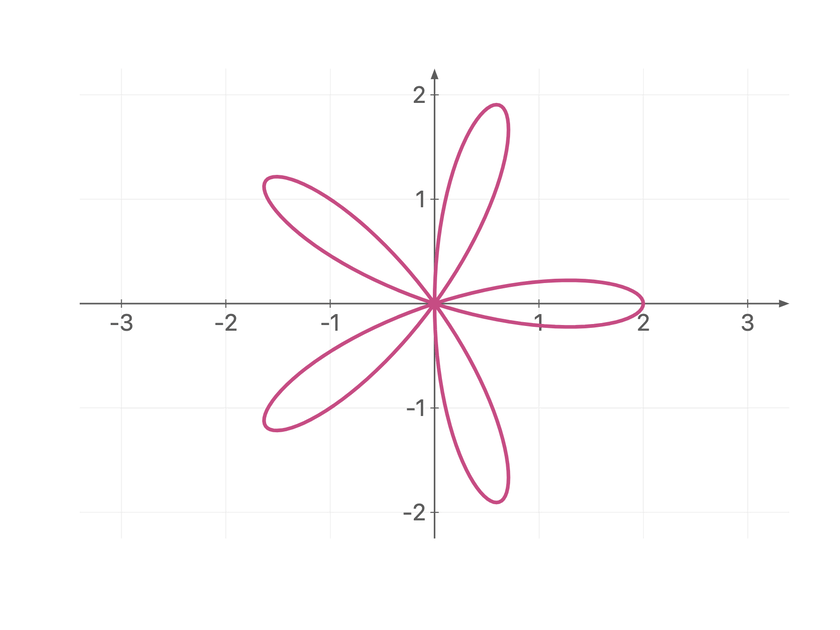
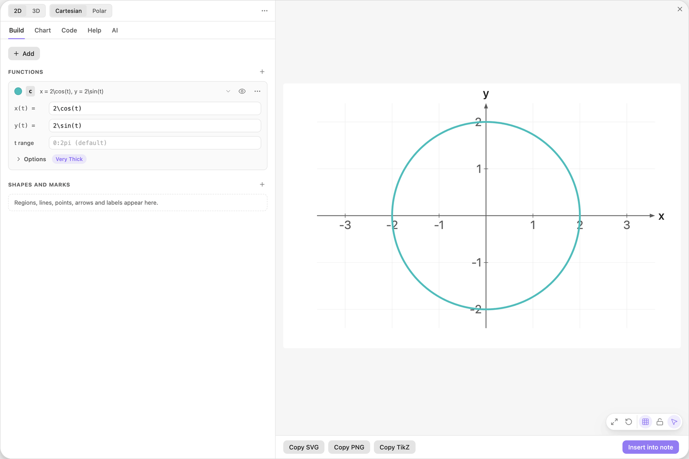
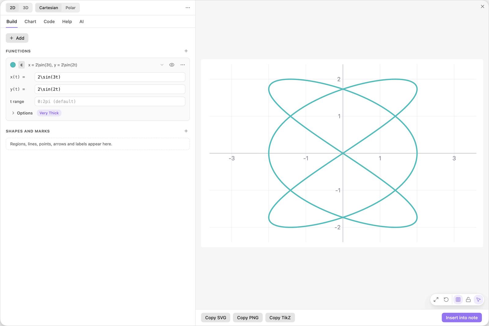
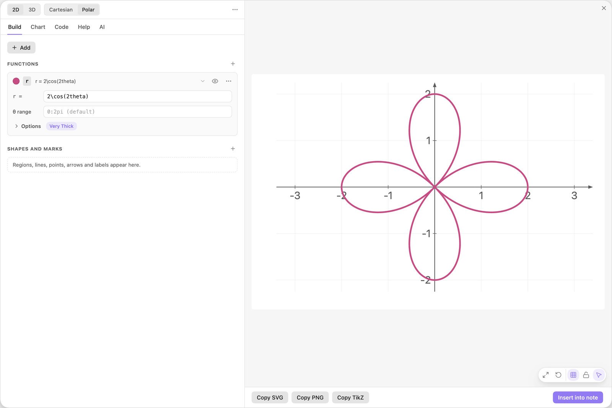
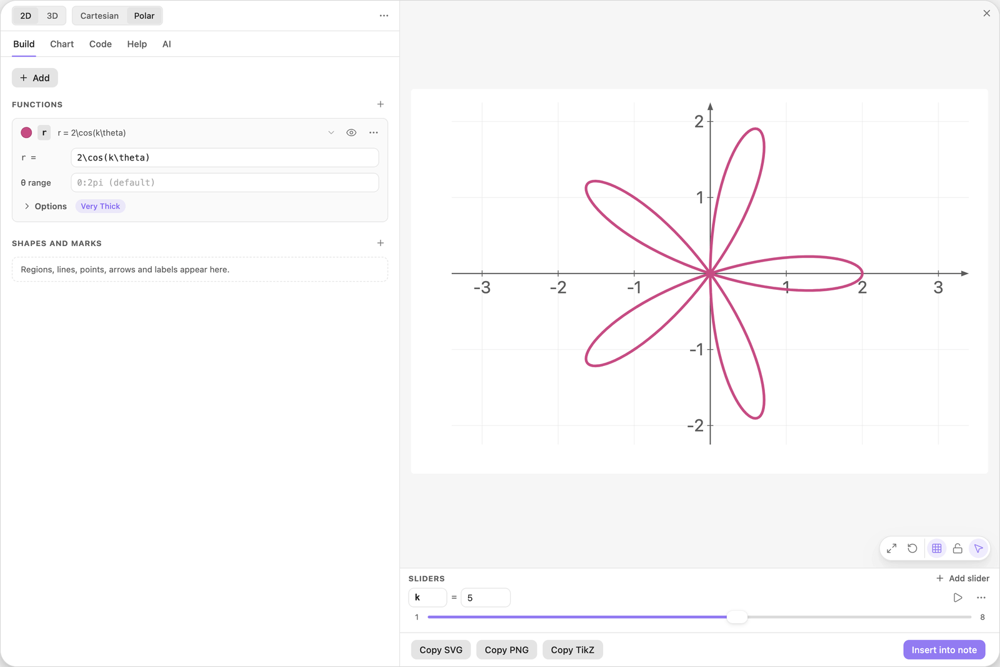

<!-- Generated by scripts/media/build-guides.mjs from src/guides. Do not edit. -->

# Parametric and polar curves

[All guides](README.md) · Functions and sliders · Core · about 3 minutes

Trace a curve from x(t) and y(t), then switch to polar and grow a rose whose petals a slider counts.

<p align="center"></p>

**What you can do afterwards**

- Draw a parametric curve and keep its shape with equal scale
- Plot r(θ) in a polar chart
- Count petals with a whole-number slider

**Read first:** [Sliders that move the picture](sliders.md)

## 1. Trace a curve with t

A parametric curve gives x and y as formulas in t. `(2\cos(t), 2\sin(t))` runs once around a circle as t goes from 0 to 2π, and `equal scale` keeps it round.

The chart in words:

```easy-tikz
show x from -3.6 to 3.6 and y from -2.4 to 2.4
size 12 x 8
equal scale
axes in the middle
with a grid
plot $c(t) = (2\cos(t), 2\sin(t))$ in teal, very thick
```



> **Tip:** In the editor, choose + Add, then Parametric curve x(t), y(t).

## 2. Change the speeds of x and y

Give x and y different speeds: `(2\sin(3t), 2\sin(2t))` is a Lissajous figure. It closes because 3 and 2 are whole numbers.

The chart gets these lines:

```easy-tikz
plot $c(t) = (2\sin(3t), 2\sin(2t))$ in teal, very thick
```



## 3. Switch to a polar chart

In a chart with the line `polar`, a formula gives the radius r for each angle θ. `2\cos(2\theta)` is a rose with four petals.

The chart gets these lines:

```easy-tikz
polar
show x from -3.4 to 3.4 and y from -2.25 to 2.25
plot $r(theta) = 2\cos(2theta)$ in magenta, very thick
```



> **Tip:** In the editor, Polar in the header switches a new chart.

## 4. Count the petals with a slider

Write `k` for the 2, give `k` whole steps from 1 to 8 and press play. An odd `k` draws k petals, an even one 2k.

The chart gets these lines:

```easy-tikz
slider k from 1 to 8, starting at 5, in steps of 1
plot $r(theta) = 2\cos(k\theta)$ in magenta, very thick
```



> **Tip:** A whole-number step stays whole while it plays, so the rose always closes.

## The finished chart

Paste this block into a note to get the finished chart of this guide. Click the chart in the note to open it in the editor.

<details>
<summary>The chart as an easy-tikz block</summary>

```easy-tikz
polar
show x from -3.4 to 3.4 and y from -2.25 to 2.25
size 12 x 8
axes in the middle
with a grid
slider k from 1 to 8, starting at 5, in steps of 1
plot $r(theta) = 2\cos(k\theta)$ in magenta, very thick
```

</details>

## Next guides

- [Animate a chart with play](animate-play.md): A point runs around the unit circle while the circle unrolls into the sine curve, all on one slider.
- [Tangents and extrema](tangents-extrema.md): Mark the turning points of a curve, roll a tangent along it with a slider and print its slope.
- [Export to LaTeX](export-latex.md): Copy a chart as pgfplots code, compile it with pdflatex, or take only the picture for your document.

[All guides](README.md)
