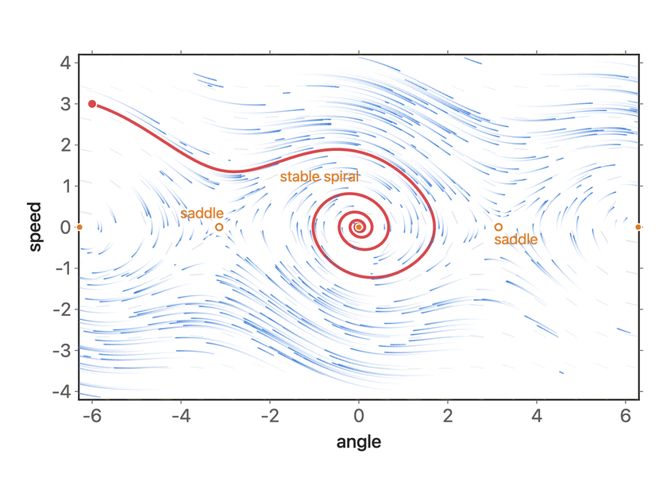
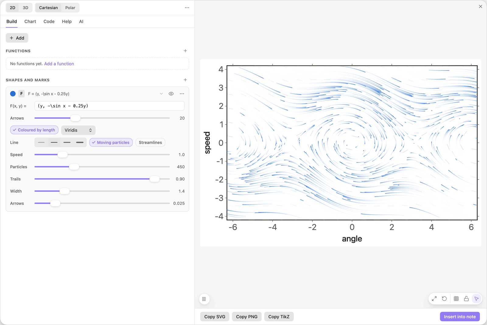
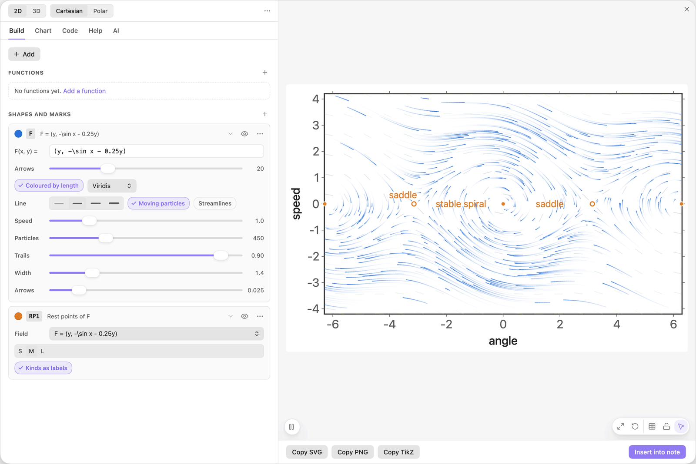
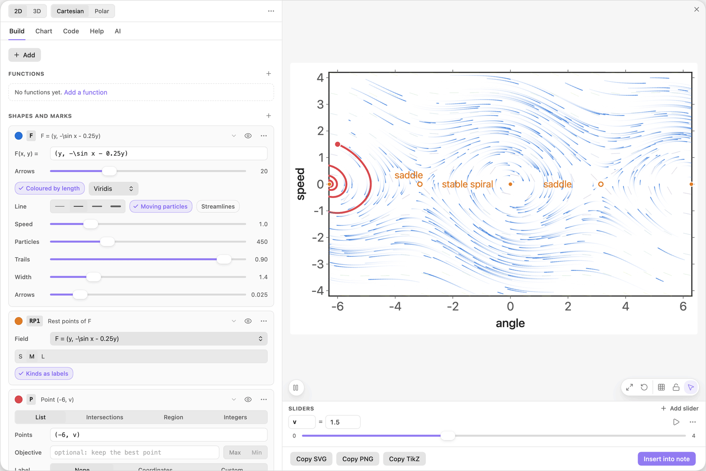
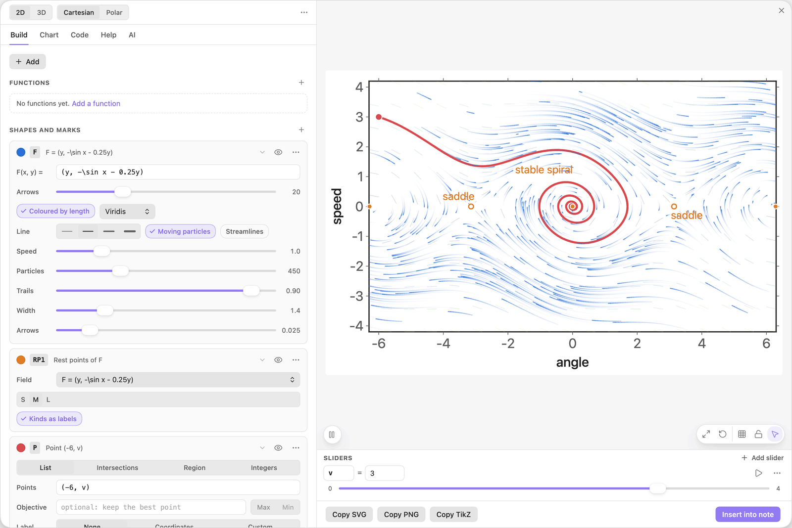

<!-- Generated by scripts/media/build-guides.mjs from src/guides. Do not edit. -->

# A pendulum as a vector field

[All guides](README.md) · Showcase · Core · about 2 minutes

The angle and the speed of a pendulum as a field with flowing particles: push it with a slider until it swings over the top.

<p align="center"></p>

**What you can do afterwards**

- Draw a field with moving particles
- Mark and name its rest points
- Draw the solution from a point on a slider

## 1. Draw the field of the pendulum

x is the angle and y the speed. `$F(x, y) = (y, -\sin x - 0.25y)$` has a little friction; the particles flow the way the pendulum moves.

The chart in words:

```easy-tikz
show x from -6.3 to 6.3 and y from -4.2 to 4.2
size 12 x 8
xlabel angle
ylabel speed
draw the vector field $F(x, y) = (y, -\sin x - 0.25y)$, coloured by length, with moving particles
```



## 2. Mark the rest points

Hanging down is stable: spirals at 0 and ±2π. Standing upright, at ±π, is a saddle.

The chart gets these lines:

```easy-tikz
mark the rest points of F, labelled
```



## 3. Push the pendulum

P starts near the left rest point with the speed `v`. The red path is its swing: a small push dies down in the same well.

The chart gets these lines:

```easy-tikz
slider v from 0 to 4, starting at 1.5
P: mark (-6, v), large
draw the solution of $\dot{p} = (y, -\sin x - 0.25y)$ through P for t from 0 to 40, very thick
```



## 4. Push it over the top

Drag `v` past 2.5: the pendulum swings over the top once and comes to rest in the next well. At 4 it goes over twice.

The chart gets these lines:

```easy-tikz
slider v from 0 to 4, starting at 3
```



## The finished chart

Paste this block into a note to get the finished chart of this guide. Click the chart in the note to open it in the editor.

<details>
<summary>The chart as an easy-tikz block</summary>

```easy-tikz
show x from -6.3 to 6.3 and y from -4.2 to 4.2
size 12 x 8
xlabel angle
ylabel speed
slider v from 0 to 4, starting at 3
draw the vector field $F(x, y) = (y, -\sin x - 0.25y)$, coloured by length, with moving particles
mark the rest points of F, labelled
P: mark (-6, v), large
draw the solution of $\dot{p} = (y, -\sin x - 0.25y)$ through P for t from 0 to 40, very thick
```

</details>

## Next guides

- [Vector fields and rest points](vector-fields.md): Draw a vector field, colour it by length, mark its rest points and set particles flowing along it.
- [Solutions of systems in 2D and 3D](systems.md): Draw the path a system of equations takes from a point: predators and prey in the plane, then the Lorenz system in space.

[All guides](README.md)
