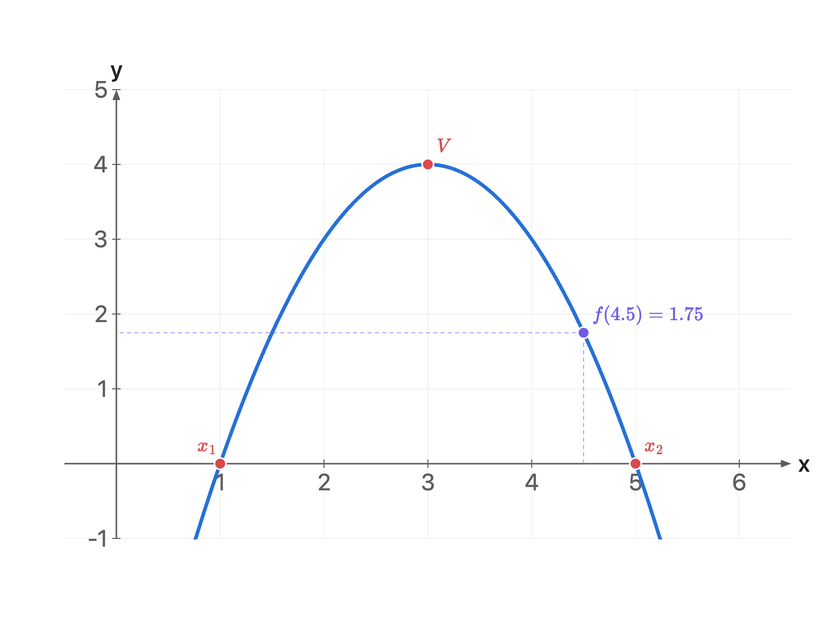
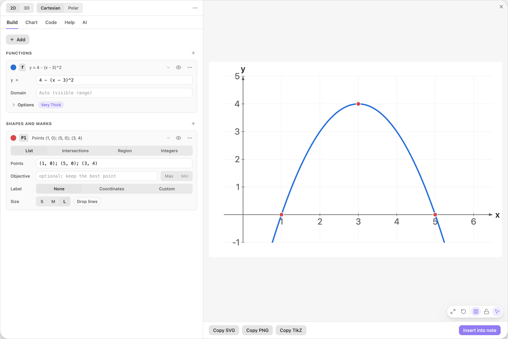
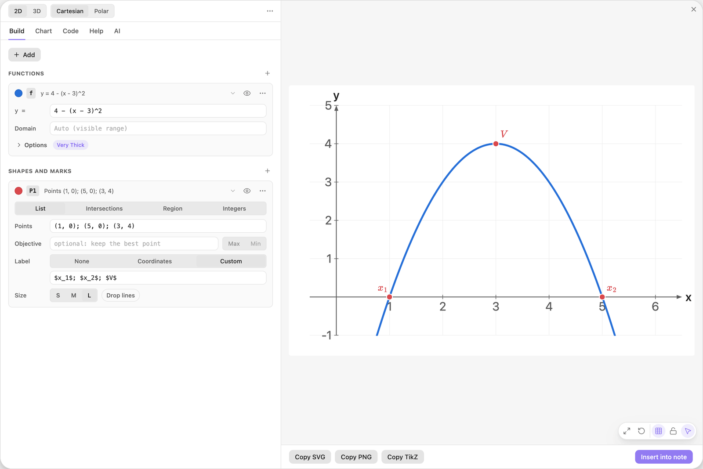
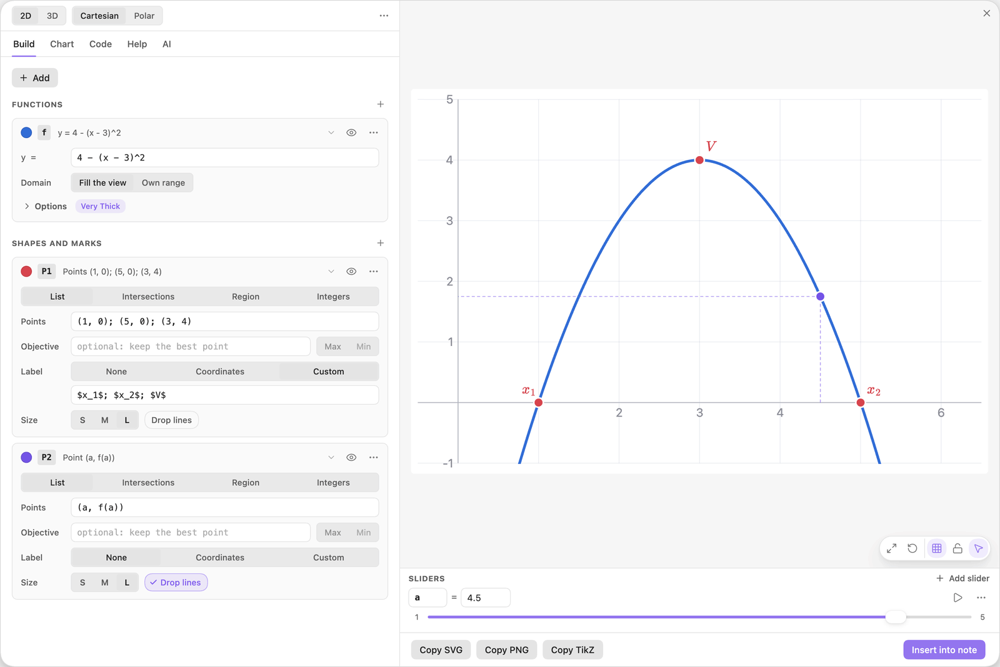
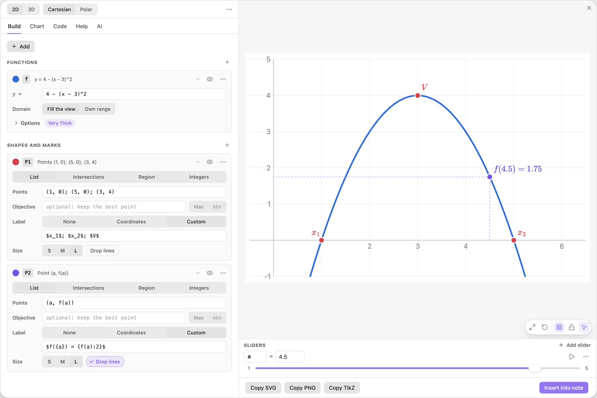

<!-- Generated by scripts/media/build-guides.mjs from src/guides. Do not edit. -->

# Points and live labels

[All guides](README.md) · Points, lines and labels · Core · about 3 minutes

Mark points from a list or from a formula, name them in LaTeX and print their values in labels.

<p align="center"></p>

**What you can do afterwards**

- Mark points from a list and name them
- Put a point on a curve with a slider
- Print values in labels, as text or as math

**Read first:** [Write a chart in words](chart-language.md)

## 1. Mark points from a list

Write each point as `(x, y)` and join them with commas and `and`. These three are where the parabola meets the x-axis, and its top.

The chart in words:

```easy-tikz
show x from -0.5 to 6.5 and y from -1 to 5
size 12 x 8
axes in the middle
with a grid
plot f(x) = 4 - (x - 3)^2 in blue, very thick
mark (1, 0), (5, 0) and (3, 4), large
```



## 2. Name the points in math

`labelled` gives one name per point, in order, split by `;`. Between dollars a name is LaTeX math, as in your notes.

The chart gets these lines:

```easy-tikz
mark (1, 0), (5, 0) and (3, 4), large, labelled "$x_1$; $x_2$; $V$"
```



## 3. Put a point on the curve

A coordinate may be a formula: `(a, f(a))` sits on the curve above `x = a`. Drag the slider `a` and the point follows.

The chart gets these lines:

```easy-tikz
slider a from 1 to 5, starting at 4.5
mark (a, f(a)) in purple, large, with lines to the axes
```



## 4. Print its values in the label

Curly brackets in a label print a value: `{a}` is the slider, `{f(a):2}` the height with up to 2 decimals. The label changes as `a` moves.

The chart gets these lines:

```easy-tikz
mark (a, f(a)) in purple, large, with lines to the axes, labelled "$f({a}) = {f(a):2}$"
```



> **Tip:** In the label of a point, `{x}` and `{y}` are its own coordinates.

## The finished chart

Paste this block into a note to get the finished chart of this guide. Click the chart in the note to open it in the editor.

<details>
<summary>The chart as an easy-tikz block</summary>

```easy-tikz
show x from -0.5 to 6.5 and y from -1 to 5
size 12 x 8
axes in the middle
with a grid
slider a from 1 to 5, starting at 4.5
plot f(x) = 4 - (x - 3)^2 in blue, very thick
mark (1, 0), (5, 0) and (3, 4), large, labelled "$x_1$; $x_2$; $V$"
mark (a, f(a)) in purple, large, with lines to the axes, labelled "$f({a}) = {f(a):2}$"
```

</details>

## Next guides

- [Segments, arrows and braces](arrows-braces.md): Draw a slope triangle: a path for the run and the rise, braces with live labels and an arrow.
- [Calculate with computed points](computed-values.md): Use what crossing points publish, their count and coordinates, in a title, a new point and an area.

[All guides](README.md)
