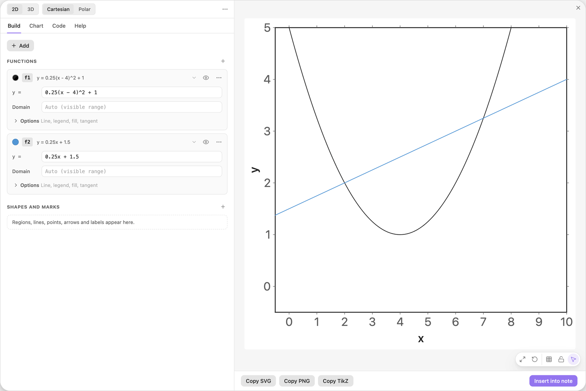
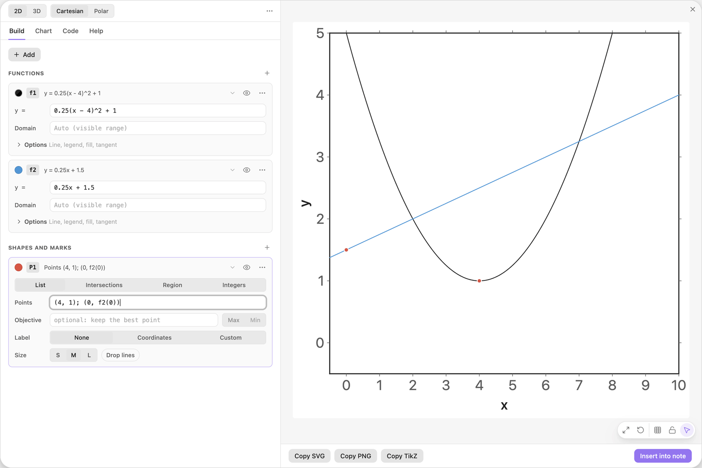
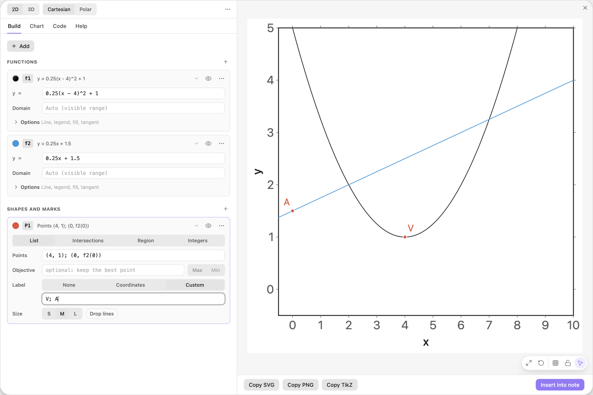
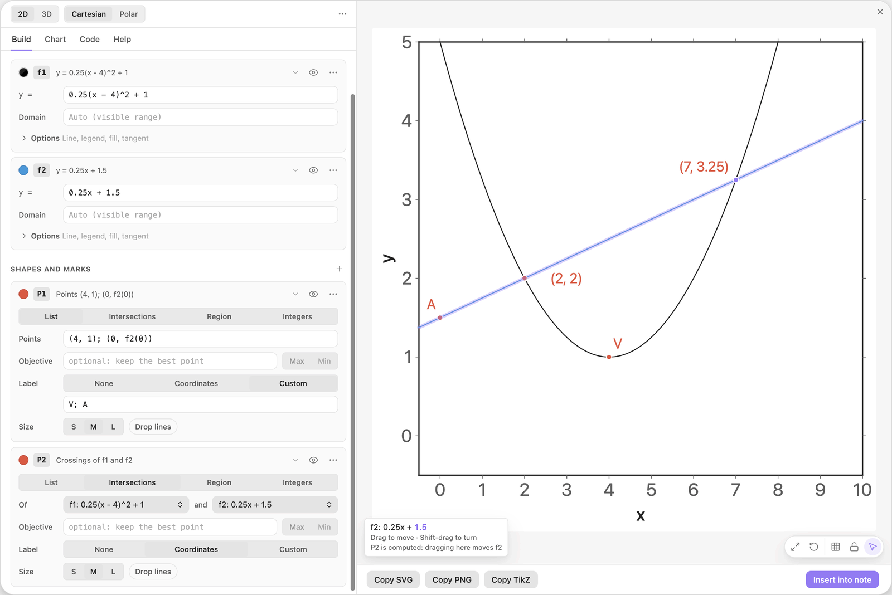
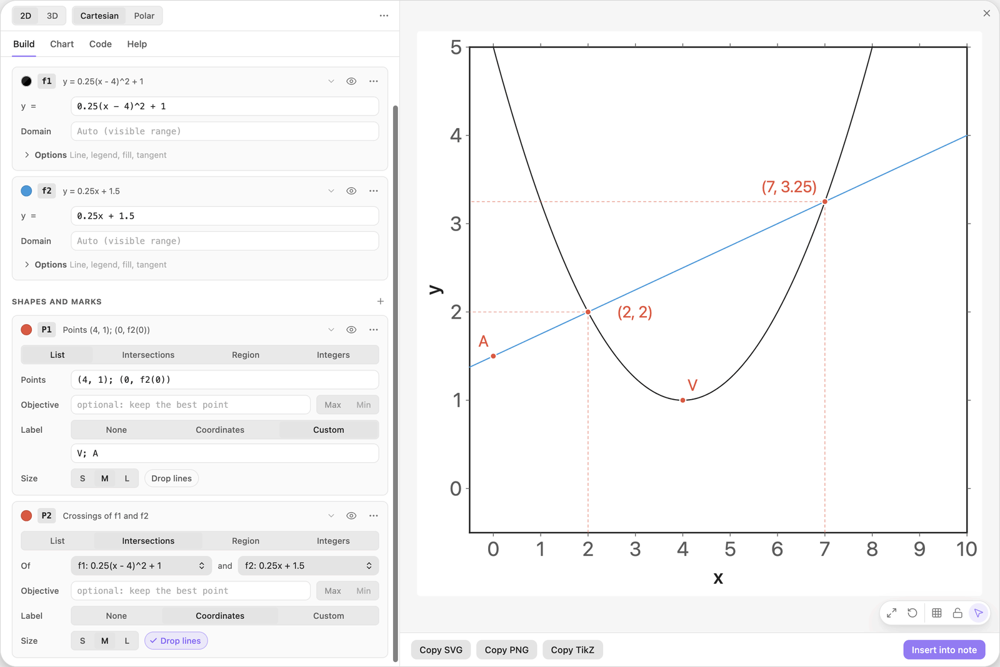
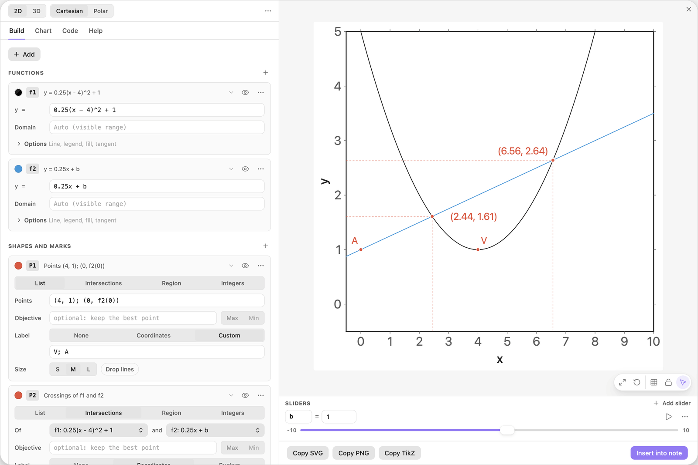
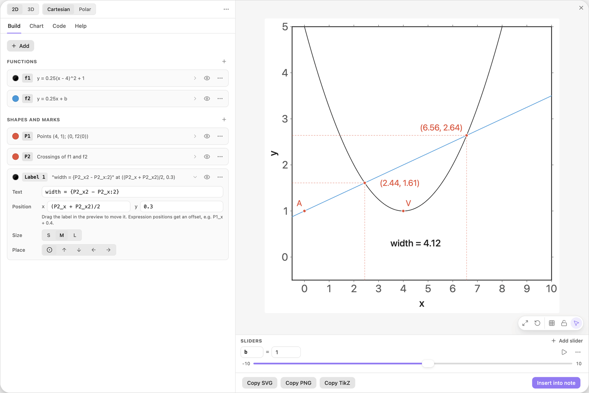

<!-- Generated by scripts/media/build-guides.mjs from src/guides. Do not edit. -->

# Points, intersections and live labels

[All guides](README.md) · Points, lines and labels · Core · about 10 minutes

Mark points from a list, find where two curves cross, and print values that update when a slider moves.

<p align="center"></p>

**What you can do afterwards**

- Mark and name points from a list
- Find the crossings of two functions and show their coordinates
- Use computed values such as P2\_x in positions and labels

**Read first:** [Your first chart](first-chart.md)

## 1. Start with two curves

Open the editor from the ribbon icon or with the command `Easy TikZ: Open editor`. Click + Add and choose Function y = f(x). A card f1 appears. Type the parabola into its `y =` field.

Add a second function the same way and type the line. The preview shows a parabola and a line that cross twice.

| Where | Type |
| --- | --- |
| f1, y = | `0.25(x - 4)^2 + 1` |
| f2, y = | `0.25x + 1.5` |



*Two function cards and their curves: a parabola and a line.*

> **Tip:** If you type the first formula into Start a chart instead, the view is fitted to that curve. Reset ranges (the round arrow in the action pill of the preview) brings back the default view this guide uses.

## 2. Mark points from a list

Click + Add and choose Points from a list. The card P1 starts with three sample points. Replace them with your own: a point is written `(x, y)`, and points are separated by `;`.

The first point is the vertex of the parabola. The second uses a formula: `f2(0)` is the value of the line at x = 0, so this point stays on the line when the line changes. Two red markers appear.

| Where | Type |
| --- | --- |
| P1, Points | `(4, 1); (0, f2(0))` |



*P1 marks the vertex and the point where the line meets the y-axis.*

> **Tip:** A comma between two points is the usual slip. The message under the field then asks you to separate points with `;`.

## 3. Name each point

In the Label row of P1, click Custom and type one label per point, separated by `;`. The names appear next to the markers: V at the vertex, A on the y-axis.

| Where | Type |
| --- | --- |
| P1, Label text | `V; A` |



*Label set to Custom, with one name per point.*

> **Tip:** A label without `;` is used for every point. `{i}` is the number of the point, so `Q{i}` gives Q1, Q2 and so on.

## 4. Mark where the curves cross

Click + Add and choose Intersections of two functions. In the new card P2, Intersections is selected in the row at the top (List, Intersections, Region, Integers), and the card has picked the first two functions: Of f1 and f2. A marker sits on each crossing, labelled with its coordinates: (2, 2) and (7, 3.25).

These points are computed. Change either formula and they move on their own.



*P2 marks both crossings. Resting the pointer on one shows that it is computed.*

> **Tip:** A computed point is not moved by itself. Rest the pointer on a crossing and the tip in the corner of the preview names the curve under it and adds "P2 is computed: dragging here moves f2". Drag f1 or f2 and the crossing follows.

## 5. Add drop lines to the axes

On the P2 card, switch on Drop lines in the Size row. Dashed guides run from each crossing down to the x-axis and across to the y-axis, so the coordinates can be read off the axes.



*Drop lines from both crossings to the axes.*

> **Tip:** Drop lines belong to the whole card. To get them for one point only, give that point a card of its own.

## 6. Move the line with a slider

In the f2 card, replace `1.5` with the name `b`. The chart does not know `b` yet, so a button Add slider b appears under the field. Click it. The slider b = 1 appears in the Sliders dock under the preview.

Drag b. The line moves up and down, the crossings and their drop lines follow, and point A stays on the line because its position is `f2(0)`.

| Where | Type |
| --- | --- |
| f2, y = | `0.25x + b` |



*The line now uses the slider b. The crossings follow when b moves.*

> **Tip:** At b = -0.1 and below, the line no longer meets the parabola. The markers disappear, and the status chip on the preview says that f1 and f2 do not cross in the view.

## 7. Show a live value in a label

Click + Add and choose Text label. In the new card Label 1, type the text and the two position formulas below.

`P2_x` and `P2_x2` are the x-coordinates of the first and the second crossing, published by the card P2. `{...}` prints the value of a formula, and `:2` limits it to two decimals. The label sits halfway between the drop lines and reads width = 4.12. Drag b: the number and the position both update.

| Where | Type |
| --- | --- |
| Label 1, Text | `width = {P2_x2 - P2_x:2}` |
| Label 1, Position x | `(P2_x + P2_x2)/2` |
| Label 1, Position y | `0.3` |



*A text label between the drop lines shows the distance between the crossings.*

> **Tip:** Every points card publishes its results: `P2_x`, `P2_y` for the first point, `P2_x2`, `P2_y2` for the second, and `P2_n` for the number of points. Any field can use them.

## The finished chart

Paste this block into a note to get the finished chart of this guide. Click the chart in the note to open it in the editor.

<details>
<summary>The chart as an easy-tikz block</summary>

```easy-tikz
slider b from -10 to 10, starting at 1, in steps of 0.1
plot f1(x) = 0.25(x - 4)^2 + 1
plot f2(x) = 0.25x + b in blue
mark (4, 1) and (0, f2(0)), labelled "V; A"
P2: mark where f1 and f2 cross, with lines to the axes and coordinates
write "width = {P2_x2 - P2_x:2}" at ((P2_x + P2_x2)/2, 0.3), center
```

</details>

## Next guides

- [Calculate with computed points](computed-values.md): Crossing points publish their coordinates and their count: use them in the title, in a new point and in an area formula, and see what they do while a slider plays.
- [Segments, arrows and braces](arrows-braces.md): Draw a slope triangle on a line: a polyline for run and rise, two braces with labels and an arrow that points at the line.
- [Shade the areas between two curves](areas-between.md): Two curves, the areas between them in two colours, and their crossing points as the limits of the shading.
- [Draw a market with surplus areas](supply-demand.md): Demand and supply, their equilibrium with guide lines, and consumer and producer surplus that follow a slider.

[All guides](README.md)
