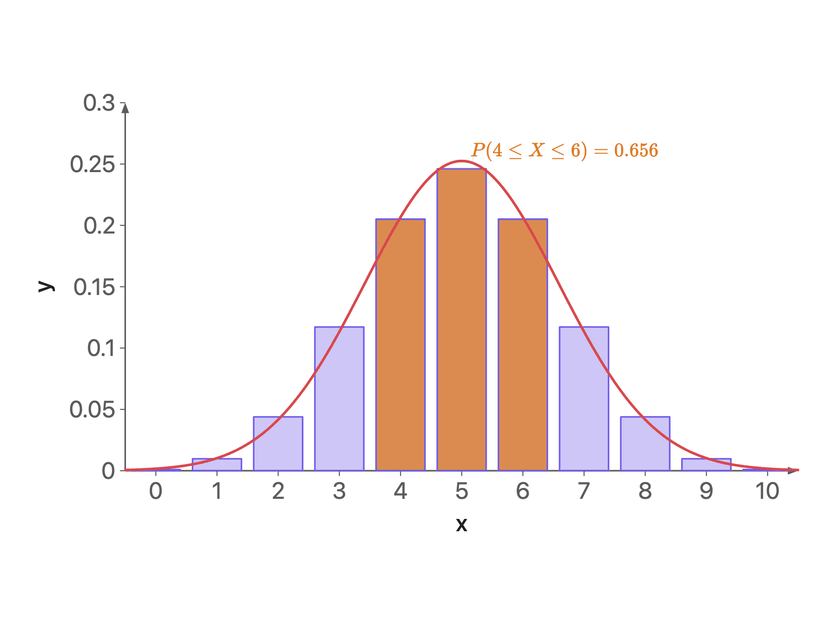
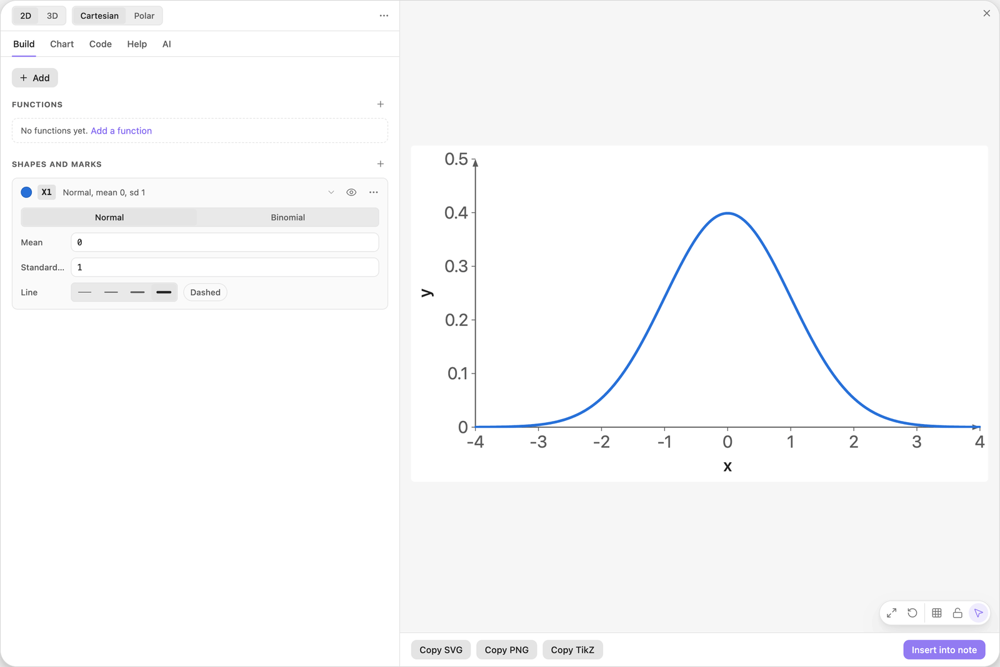
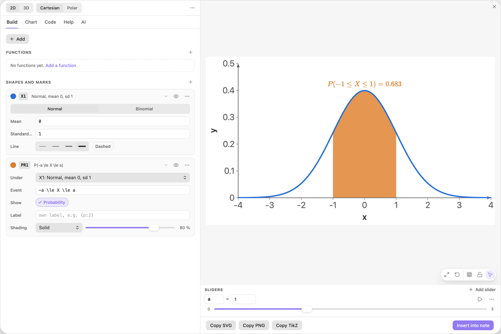
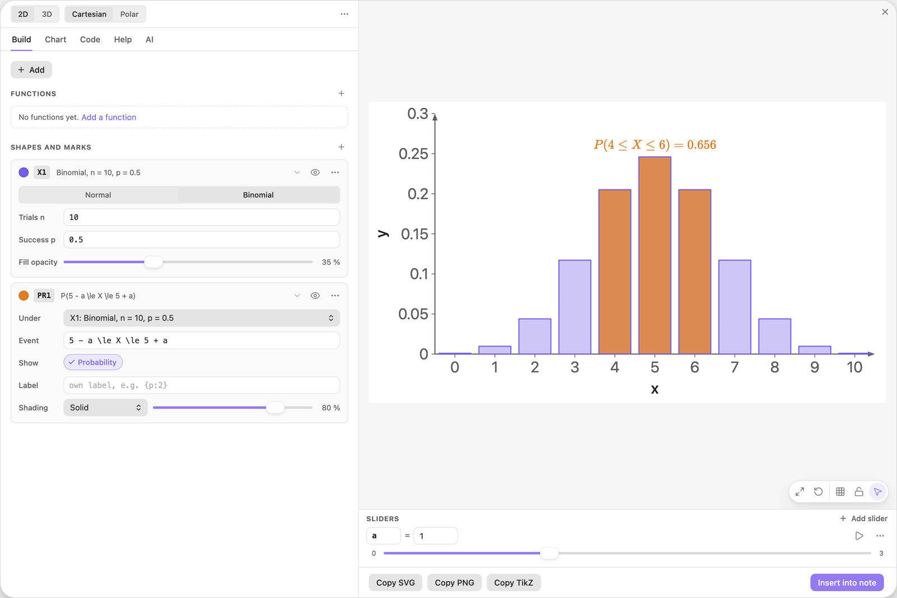
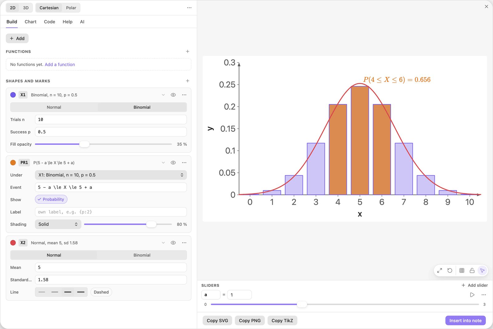

<!-- Generated by scripts/media/build-guides.mjs from src/guides. Do not edit. -->

# Normal and binomial probabilities

[All guides](README.md) · Data and probability · Core · about 3 minutes

Shade a probability under the normal curve with a slider, then compare binomial bars with a normal curve.

<p align="center"></p>

**What you can do afterwards**

- Plot normal and binomial distributions
- Shade a probability with a slider
- Print the probability in a label

**Read first:** [Write a chart in words](chart-language.md)

## 1. Plot the normal distribution

Give the mean and the standard deviation after `with`. This bell is the standard normal distribution of X.

The chart in words:

```easy-tikz
show x from -4 to 4 and y from 0 to 0.5
size 12 x 7
axes on the edges
plot the normal distribution with mean 0 and sd 1, very thick
```



## 2. Shade a probability

`shade` with an event in `P(...)` fills its area, and `labelled` prints the probability. Step `a` through 1, 2 and 3: 0.683, 0.954 and 0.997.

The chart gets these lines:

```easy-tikz
slider a from 0 to 3, starting at 1, in steps of 1
shade $P(-a \le X \le a)$, opacity 0.8, labelled
```



## 3. Switch to a binomial distribution

With `n = 10` and `p = 0.5`, each bar is the chance of k successes in 10 tries. The event now runs from `5 - a` to `5 + a`.

The chart gets these lines:

```easy-tikz
show x from -0.5 to 10.5 and y from 0 to 0.3
plot the binomial distribution with n = 10 and p = 0.5 in purple
shade $P(5 - a \le X \le 5 + a)$, opacity 0.8, labelled
```



## 4. Lay a normal curve over the bars

A normal curve with the same mean and spread, 5 and 1.58, runs almost through the tops of the bars.

The chart gets these lines:

```easy-tikz
plot the normal distribution with mean 5 and sd 1.58 in red, thick
```



> **Tip:** With two distributions, `shade` uses the nearest one above its line.

## The finished chart

Paste this block into a note to get the finished chart of this guide. Click the chart in the note to open it in the editor.

<details>
<summary>The chart as an easy-tikz block</summary>

```easy-tikz
show x from -0.5 to 10.5 and y from 0 to 0.3
size 12 x 7
axes on the edges
slider a from 0 to 3, starting at 1, in steps of 1
plot the binomial distribution with n = 10 and p = 0.5 in purple
shade $P(5 - a \le X \le 5 + a)$, opacity 0.8, labelled
plot the normal distribution with mean 5 and sd 1.58 in red, thick
```

</details>

## Next guides

- [Data and a regression line](data-regression.md): Plot data points, fit a regression line and print its equation and R² beside it.
- [Estimate an area with Riemann sums](riemann-sums.md): Fill an area with rectangles, watch their sum approach the integral, then try trapezoids and middle sums.

[All guides](README.md)
