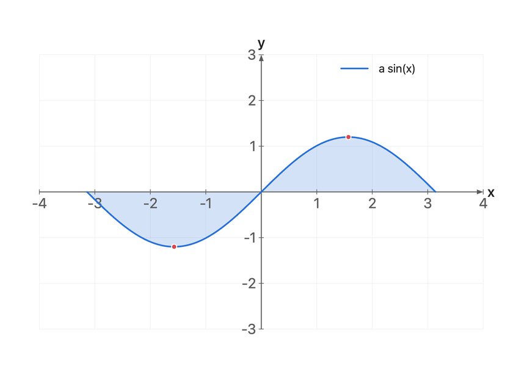
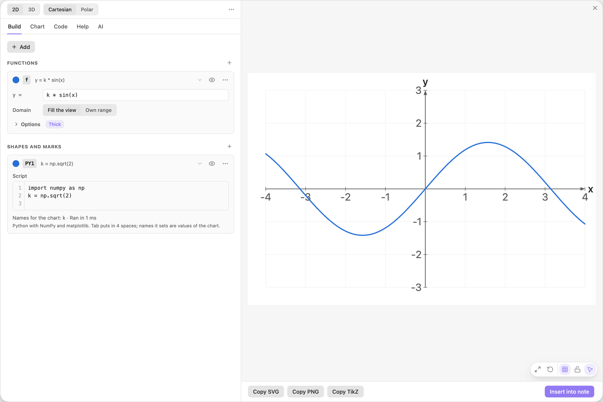
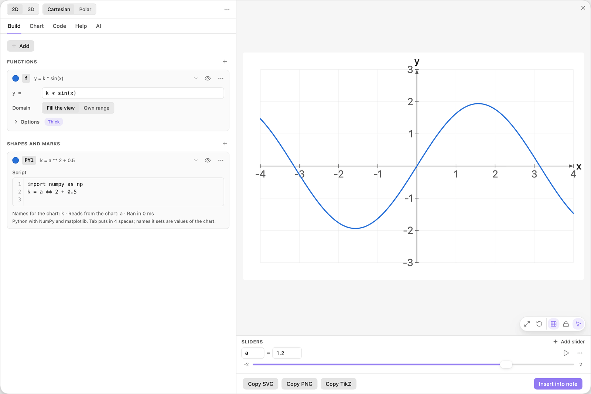
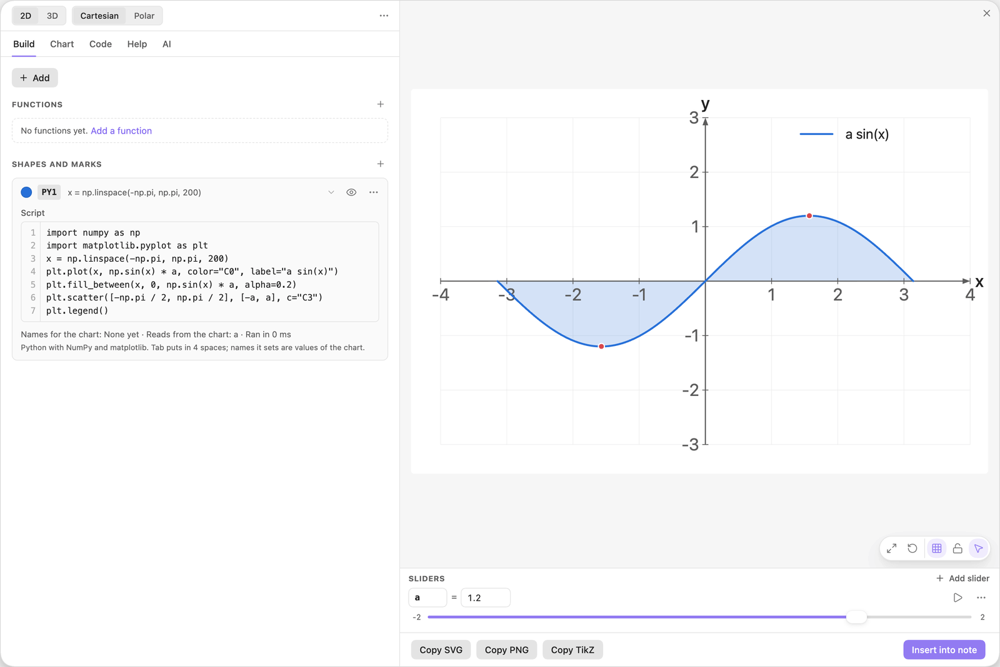
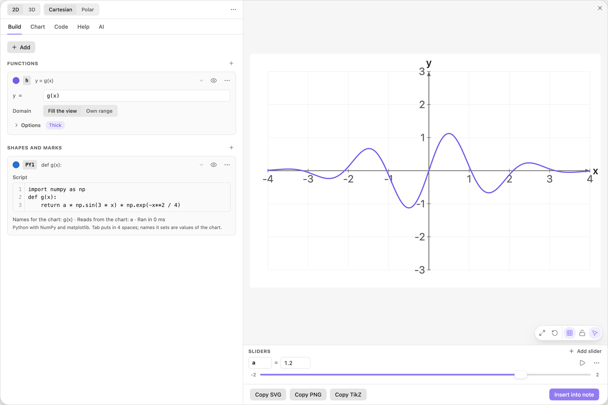
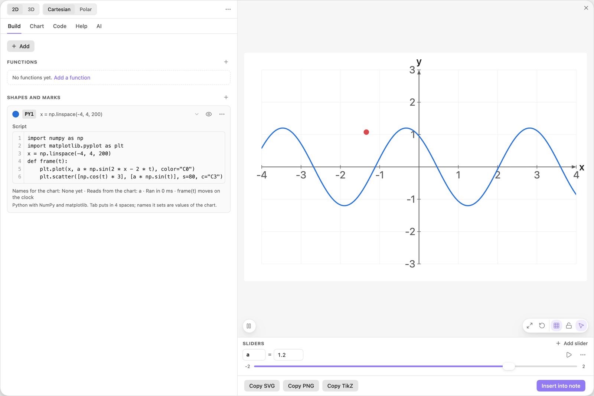

<!-- Generated by scripts/media/build-guides.mjs from src/guides. Do not edit. -->

# Python in a chart

[All guides](README.md) · Chart language · Core · about 5 minutes

Write NumPy and matplotlib in a python block: its names are values of the chart, sliders are its variables, frame(t) moves.

<p align="center"></p>

**What you can do afterwards**

- Use a name a script sets
- Read a slider in a script
- Draw with matplotlib calls
- Make a script move with frame(t)

**Read first:** [Write formulas as in your notes](formulas.md)

## 1. Write a python block

`python:` starts a script, and its lines are indented below it. A name it sets is a value of the chart: `plot f(x) = k * sin(x)` uses the script's `k`.

The chart in words:

```easy-tikz
show x from -4 to 4 and y from -3 to 3
size 12 x 8
axes in the middle
with a grid
plot f(x) = k * sin(x) in blue, thick
python:
    import numpy as np
    k = np.sqrt(2)
```



## 2. Read a slider in the script

A slider of the chart is a variable of the script. Drag `a`: the script runs again with the new `a`, and the curve follows.

The chart gets these lines:

```easy-tikz
slider a from -2 to 2, starting at 1.2
    k = a ** 2 + 0.5
```



## 3. Draw with matplotlib

`plt.plot`, `plt.scatter`, `plt.fill_between` and `plt.legend` draw in the chart, in its theme colours. `C0` to `C9` and names such as `red` are colours of the plugin.

The chart gets these lines:

```easy-tikz
    import matplotlib.pyplot as plt
    x = np.linspace(-np.pi, np.pi, 200)
    plt.plot(x, np.sin(x) * a, color="C0", label="a sin(x)")
    plt.fill_between(x, 0, np.sin(x) * a, alpha=0.2)
    plt.scatter([-np.pi / 2, np.pi / 2], [-a, a], c="C3")
    plt.legend()
```



## 4. Give the chart a function

A function of numbers the script defines is a function of the chart: `plot h(x) = g(x)` draws the script's `g`.

The chart gets these lines:

```easy-tikz
plot h(x) = g(x) in purple, thick
    def g(x):
        return a * np.sin(3 * x) * np.exp(-x**2 / 4)
```



## 5. Make it move with frame(t)

A script with `def frame(t):` moves: the chart calls it on its clock, with `t` in seconds. Print and the export draw `frame(0)`.

The chart gets these lines:

```easy-tikz
    import matplotlib.pyplot as plt
    x = np.linspace(-4, 4, 200)
    def frame(t):
        plt.plot(x, a * np.sin(2 * x - 2 * t), color="C0")
        plt.scatter([np.cos(t) * 3], [a * np.sin(t)], s=80, c="C3")
```



> **Tip:** Scripts run inside the plugin, on phones too: numpy, math, cmath, random and matplotlib.pyplot. They read no files and reach no network.

## The finished chart

Paste this block into a note to get the finished chart of this guide. Click the chart in the note to open it in the editor.

<details>
<summary>The chart as an easy-tikz block</summary>

```easy-tikz
show x from -4 to 4 and y from -3 to 3
size 12 x 8
axes in the middle
with a grid
slider a from -2 to 2, starting at 1.2
python:
    import numpy as np
    import matplotlib.pyplot as plt
    x = np.linspace(-np.pi, np.pi, 200)
    plt.plot(x, np.sin(x) * a, color="C0", label="a sin(x)")
    plt.fill_between(x, 0, np.sin(x) * a, alpha=0.2)
    plt.scatter([-np.pi / 2, np.pi / 2], [-a, a], c="C3")
    plt.legend()
```

</details>

## Next guides

- [A heart drawn by turning circles](python-heart.md): A Python script takes the FFT of a heart; each coefficient is a circle turning on the one before, and their tip draws the heart.
- [A matplotlib plot with a slider](python-plot.md): Lines, a legend and a fill written as in matplotlib, drawn in the chart; the phase a is a slider the script reads.
- [Two waves that move in Python](python-wave.md): A script with frame(t) draws on the chart's clock: two waves run against each other, and their sum beats.

[All guides](README.md)
