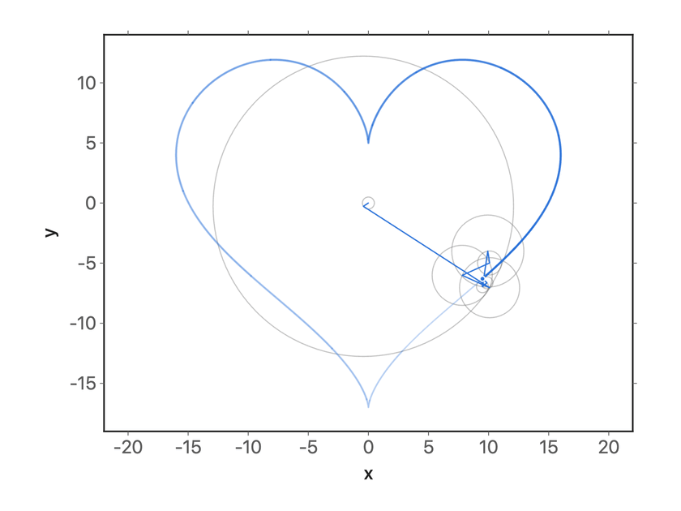
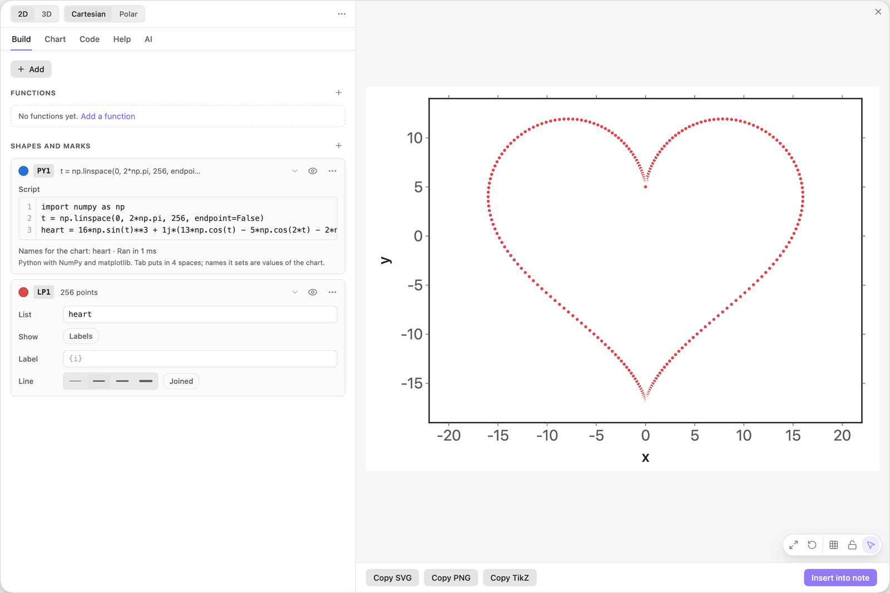
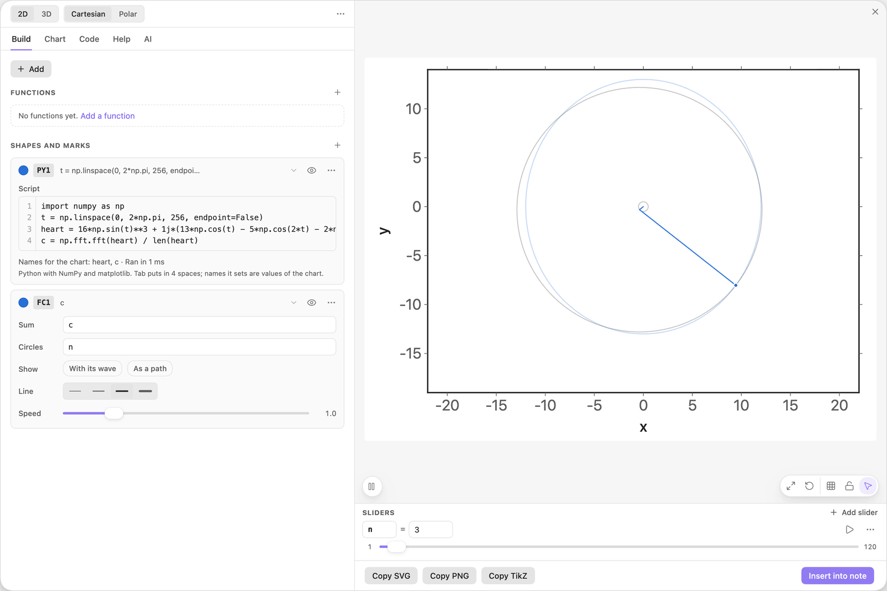
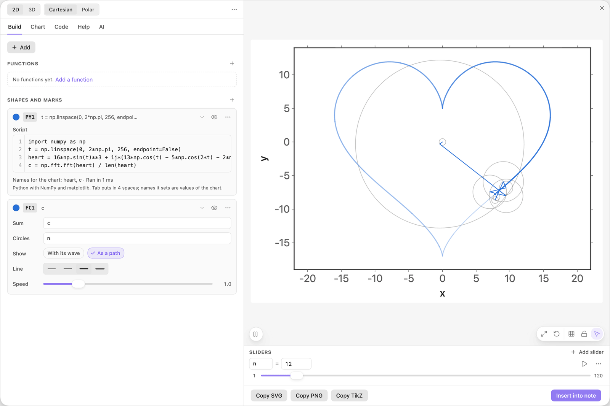
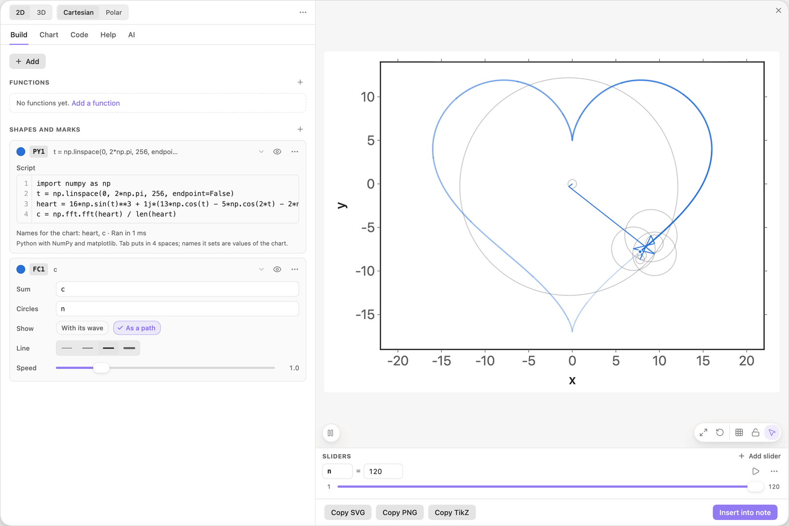

<!-- Generated by scripts/media/build-guides.mjs from src/guides. Do not edit. -->

# A heart drawn by turning circles

[All guides](README.md) · Showcase · Core · about 3 minutes

A Python script takes the FFT of a heart; each coefficient is a circle turning on the one before, and their tip draws the heart.

<p align="center"></p>

**What you can do afterwards**

- Sample a curve in Python
- Draw the circles of a list of coefficients
- Add circles with a slider

**Read first:** [Python in a chart](python-chart.md)

## 1. Sample the heart in Python

The script samples the heart at 256 points as complex numbers, x + iy. `mark the points of heart` draws them: a name the script sets is a value of the chart.

The chart in words:

```easy-tikz
show x from -22 to 22 and y from -19 to 14
size 12 x 9
equal scale
python:
    import numpy as np
    t = np.linspace(0, 2*np.pi, 256, endpoint=False)
    heart = 16*np.sin(t)**3 + 1j*(13*np.cos(t) - 5*np.cos(2*t) - 2*np.cos(3*t) - np.cos(4*t))
mark the points of heart, small
```



## 2. Take its Fourier transform

`np.fft.fft(heart) / len(heart)` gives 256 coefficients. `draw the circles of c` turns each one as a circle, with the frequencies 0, 1, -1, 2, -2 and on, in that order.

The chart gets these lines:

```easy-tikz
slider n from 1 to 120, starting at 3, in steps of 1
    c = np.fft.fft(heart) / len(heart)
draw the circles of c, using n circles
```



## 3. Draw the path of the tip

`with its path` draws where the tip goes. With 12 circles it is a rounded heart already.

The chart gets these lines:

```easy-tikz
slider n from 1 to 120, starting at 12, in steps of 1
draw the circles of c, using n circles, with its path
```



## 4. Use 120 circles

Drag `n` up: every circle adds a finer turn, and the path takes the sharp point at the bottom of the heart.

The chart gets these lines:

```easy-tikz
slider n from 1 to 120, starting at 120, in steps of 1
```



> **Tip:** Any closed drawing works the same way: put its points into `heart` as complex numbers.

## The finished chart

Paste this block into a note to get the finished chart of this guide. Click the chart in the note to open it in the editor.

<details>
<summary>The chart as an easy-tikz block</summary>

```easy-tikz
show x from -22 to 22 and y from -19 to 14
size 12 x 9
equal scale
slider n from 1 to 120, starting at 40, in steps of 1
python:
    import numpy as np
    t = np.linspace(0, 2*np.pi, 256, endpoint=False)
    heart = 16*np.sin(t)**3 + 1j*(13*np.cos(t) - 5*np.cos(2*t) - 2*np.cos(3*t) - np.cos(4*t))
    c = np.fft.fft(heart) / len(heart)
draw the circles of c, using n circles, with its path
```

</details>

## Next guides

- [Circles that draw square and sawtooth waves](fourier-circles.md): Circles turn on each other: the tip of the last draws a wave. More circles make it more square, other circles draw a sawtooth.

[All guides](README.md)
