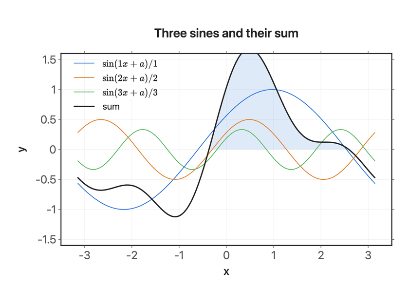
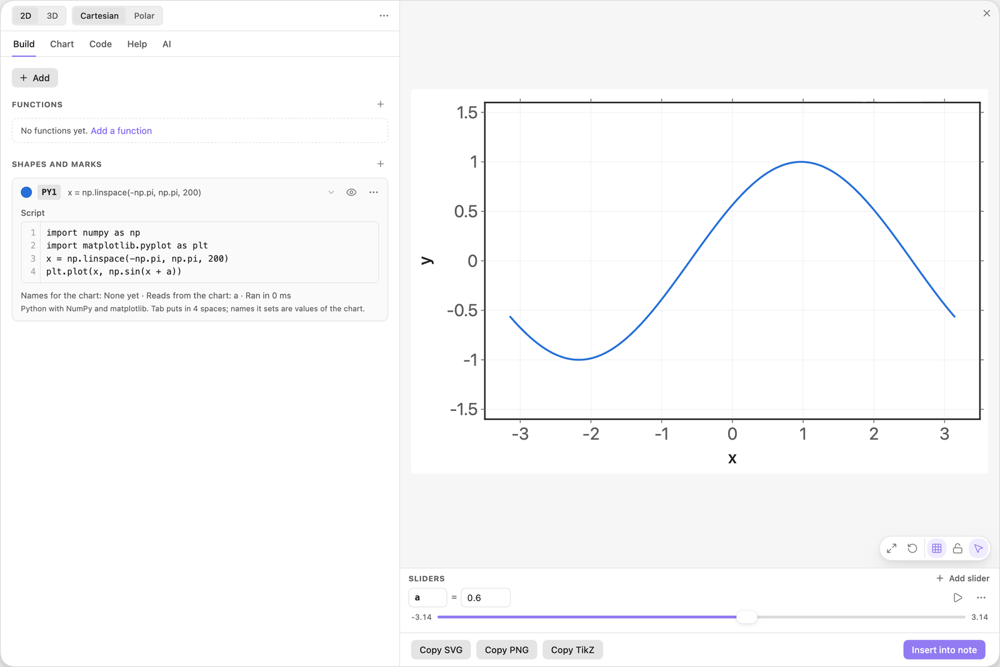
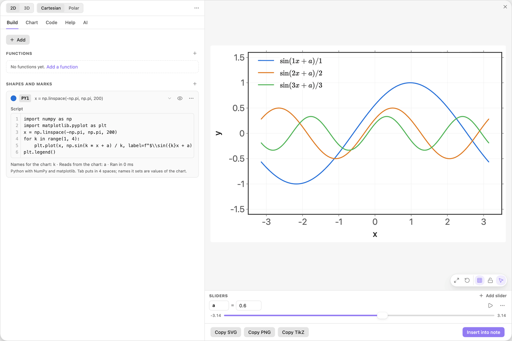
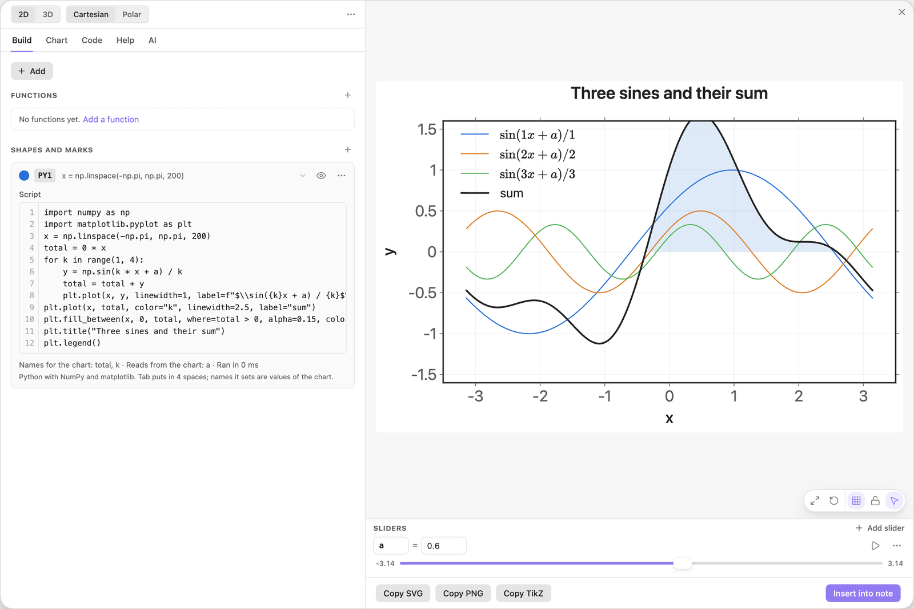

<!-- Generated by scripts/media/build-guides.mjs from src/guides. Do not edit. -->

# A matplotlib plot with a slider

[All guides](README.md) · Showcase · Core · about 3 minutes

Lines, a legend and a fill written as in matplotlib, drawn in the chart; the phase a is a slider the script reads.

<p align="center"></p>

**What you can do afterwards**

- Plot a NumPy array
- Draw curves in a loop with a legend
- Fill where a condition holds

**Read first:** [Python in a chart](python-chart.md)

## 1. Plot one curve

`plt.plot(x, np.sin(x + a))` draws the array as a line in the first colour of the cycle, `C0`. Drag `a` to move it.

The chart in words:

```easy-tikz
show x from -3.5 to 3.5 and y from -1.6 to 1.6
size 12 x 8
with a grid
slider a from -3.14 to 3.14, starting at 0.6
python:
    import numpy as np
    import matplotlib.pyplot as plt
    x = np.linspace(-np.pi, np.pi, 200)
    plt.plot(x, np.sin(x + a))
```



## 2. Plot in a loop

Each `plt.plot` takes the next colour. The labels are LaTeX in `$...$`, and `plt.legend()` lists them.

The chart gets these lines:

```easy-tikz
    for k in range(1, 4):
        plt.plot(x, np.sin(k * x + a) / k, label=f"$\\sin({k}x + a) / {k}$")
    plt.legend()
```



## 3. Add the sum and a fill

The script adds the curves up; `fill_between` with `where=total > 0` fills only where the sum is above 0. `plt.title` writes the title.

The chart gets these lines:

```easy-tikz
    total = 0 * x
        y = np.sin(k * x + a) / k
        total = total + y
        plt.plot(x, y, linewidth=1, label=f"$\\sin({k}x + a) / {k}$")
    plt.plot(x, total, color="k", linewidth=2.5, label="sum")
    plt.fill_between(x, 0, total, where=total > 0, alpha=0.15, color="C0")
    plt.title("Three sines and their sum")
```



## The finished chart

Paste this block into a note to get the finished chart of this guide. Click the chart in the note to open it in the editor.

<details>
<summary>The chart as an easy-tikz block</summary>

```easy-tikz
show x from -3.5 to 3.5 and y from -1.6 to 1.6
size 12 x 8
with a grid
slider a from -3.14 to 3.14, starting at 0.6
python:
    import numpy as np
    import matplotlib.pyplot as plt
    x = np.linspace(-np.pi, np.pi, 200)
    total = 0 * x
    for k in range(1, 4):
        y = np.sin(k * x + a) / k
        total = total + y
        plt.plot(x, y, linewidth=1, label=f"$\\sin({k}x + a) / {k}$")
    plt.plot(x, total, color="k", linewidth=2.5, label="sum")
    plt.fill_between(x, 0, total, where=total > 0, alpha=0.15, color="C0")
    plt.title("Three sines and their sum")
    plt.legend()
```

</details>

## Next guides

- [Two waves that move in Python](python-wave.md): A script with frame(t) draws on the chart's clock: two waves run against each other, and their sum beats.

[All guides](README.md)
