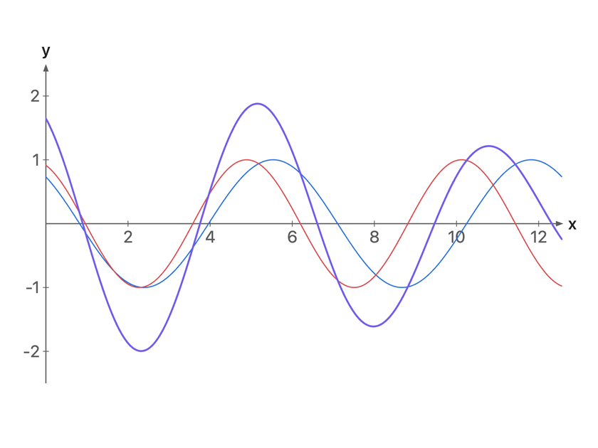
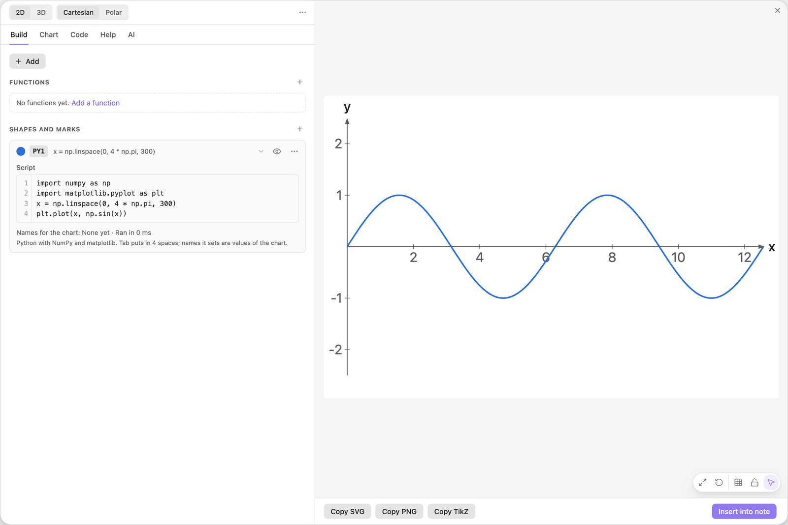
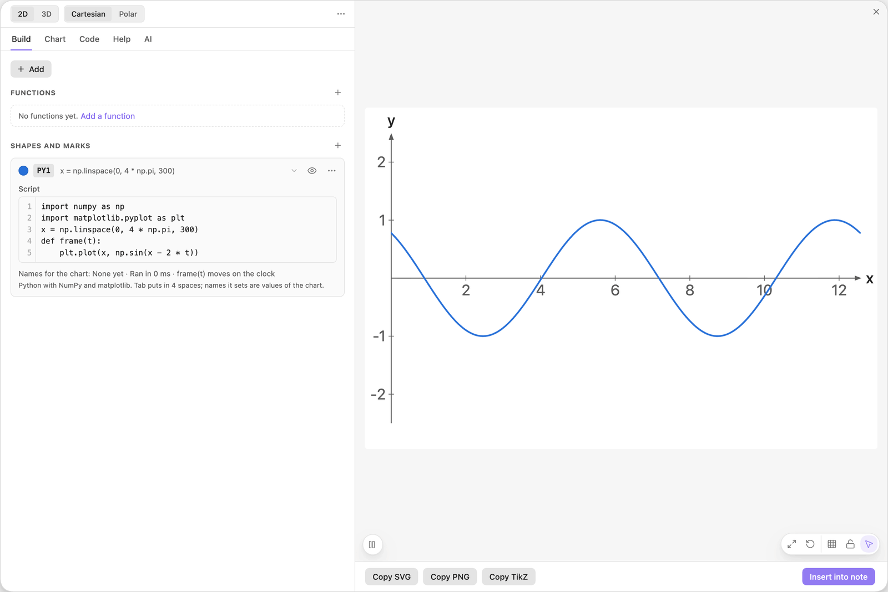
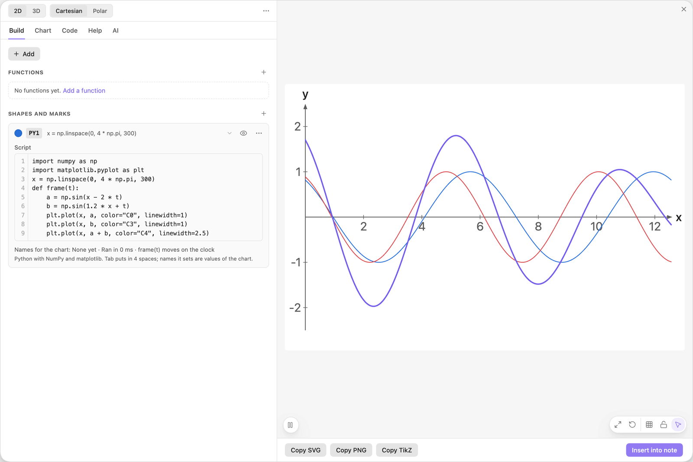

<!-- Generated by scripts/media/build-guides.mjs from src/guides. Do not edit. -->

# Two waves that move in Python

[All guides](README.md) · Showcase · Core · about 2 minutes

A script with frame(t) draws on the chart's clock: two waves run against each other, and their sum beats.

<p align="center"></p>

**What you can do afterwards**

- Draw a still picture with plt.plot
- Make it move with frame(t)
- Add waves into a beat

**Read first:** [Python in a chart](python-chart.md)

## 1. Draw a still wave

At the top of the script, `plt.plot` draws once: a still sine.

The chart in words:

```easy-tikz
show x from 0 to 12.6 and y from -2.5 to 2.5
size 12 x 8
axes in the middle
python:
    import numpy as np
    import matplotlib.pyplot as plt
    x = np.linspace(0, 4 * np.pi, 300)
    plt.plot(x, np.sin(x))
```



## 2. Make it move

Inside `def frame(t):` the calls run on the clock, `t` in seconds. `np.sin(x - 2 * t)` moves to the right; the pause button in the strip stops it.

The chart gets these lines:

```easy-tikz
    def frame(t):
        plt.plot(x, np.sin(x - 2 * t))
```



## 3. Add a second wave

A wave running the other way, a little shorter, and their sum in purple: where they meet in step the sum is twice as high, where they meet out of step it is flat.

The chart gets these lines:

```easy-tikz
        a = np.sin(x - 2 * t)
        b = np.sin(1.2 * x + t)
        plt.plot(x, a, color="C0", linewidth=1)
        plt.plot(x, b, color="C3", linewidth=1)
        plt.plot(x, a + b, color="C4", linewidth=2.5)
```



## The finished chart

Paste this block into a note to get the finished chart of this guide. Click the chart in the note to open it in the editor.

<details>
<summary>The chart as an easy-tikz block</summary>

```easy-tikz
show x from 0 to 12.6 and y from -2.5 to 2.5
size 12 x 8
axes in the middle
python:
    import numpy as np
    import matplotlib.pyplot as plt
    x = np.linspace(0, 4 * np.pi, 300)
    def frame(t):
        a = np.sin(x - 2 * t)
        b = np.sin(1.2 * x + t)
        plt.plot(x, a, color="C0", linewidth=1)
        plt.plot(x, b, color="C3", linewidth=1)
        plt.plot(x, a + b, color="C4", linewidth=2.5)
```

</details>

## Next guides

- [A heart drawn by turning circles](python-heart.md): A Python script takes the FFT of a heart; each coefficient is a circle turning on the one before, and their tip draws the heart.

[All guides](README.md)
