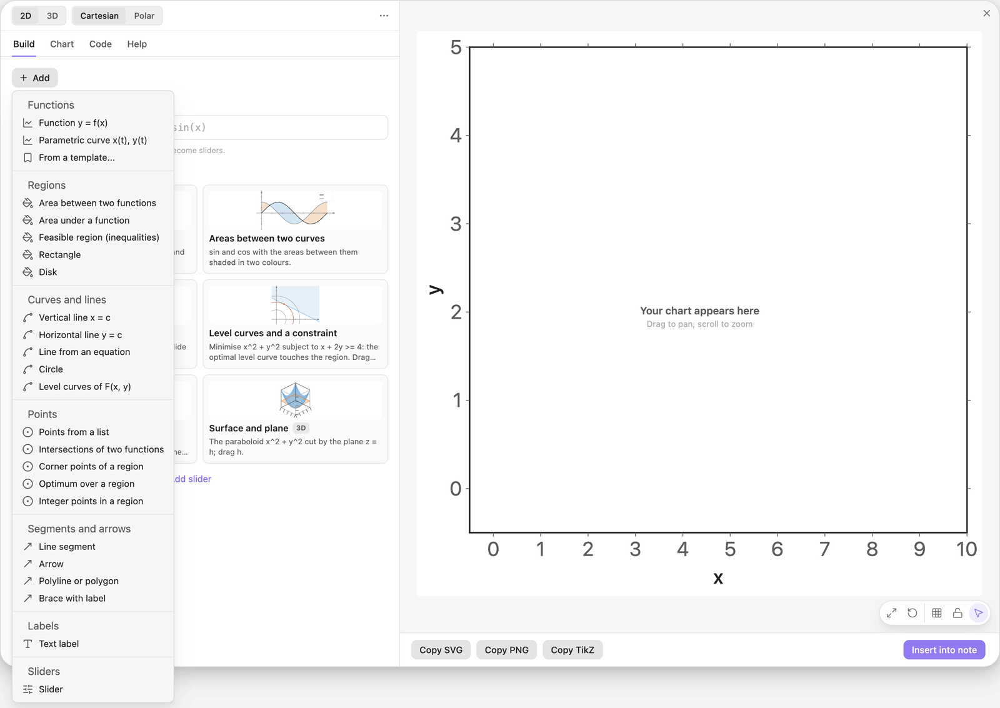
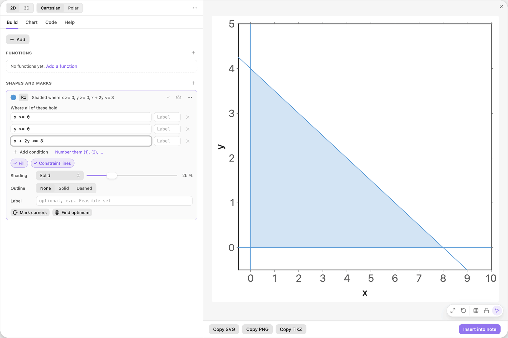
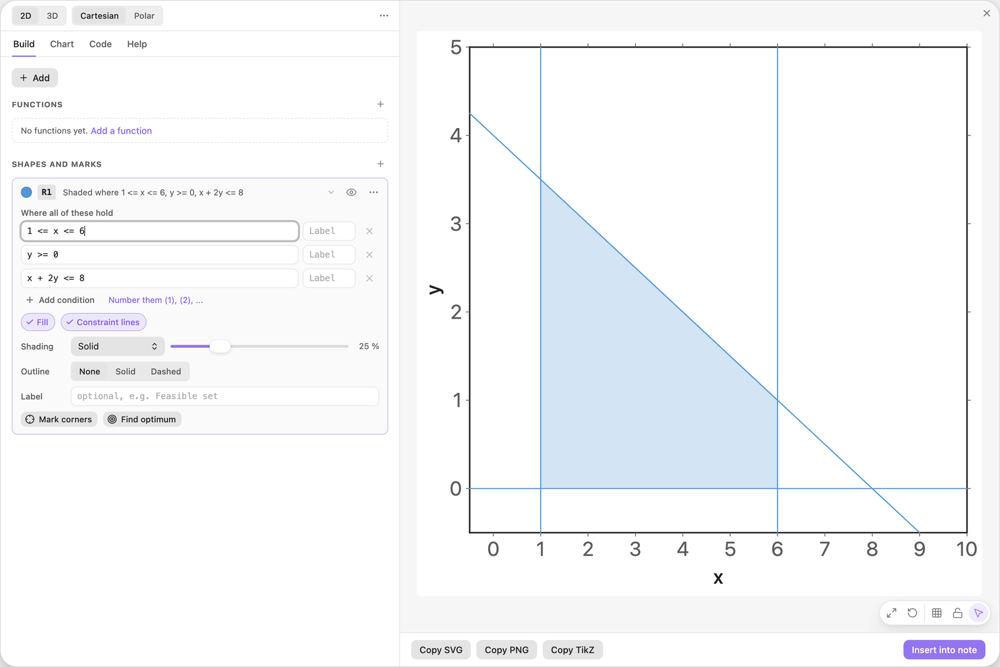
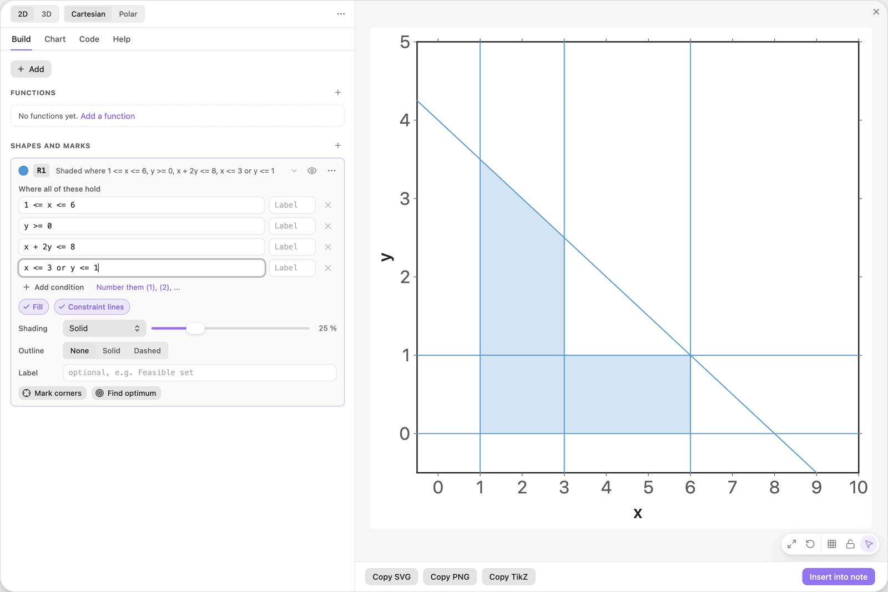
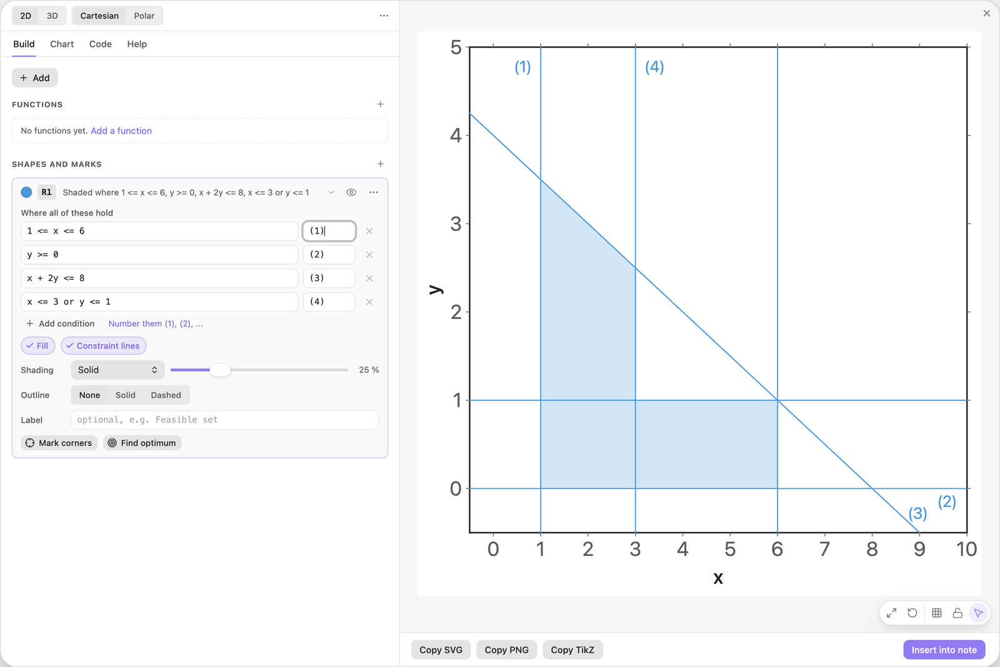
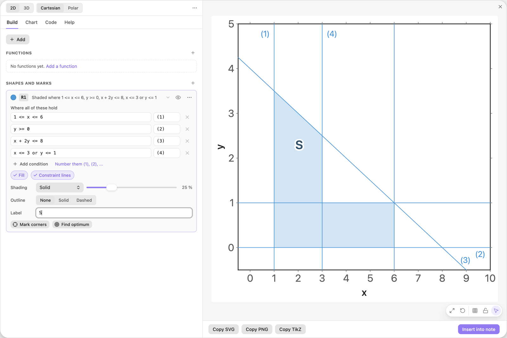
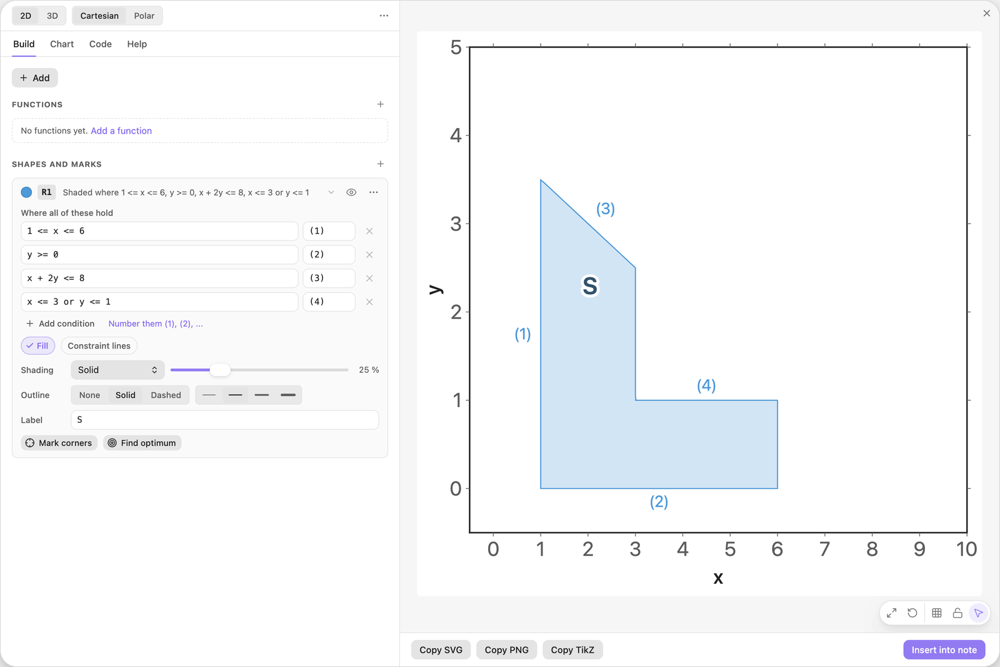

<!-- Generated by scripts/media/build-guides.mjs from src/guides. Do not edit. -->

# Shade a region with inequalities

[All guides](README.md) · Regions and optimisation · Core · about 6 minutes

Shade the set where inequalities hold: one condition per row, chains, alternatives with or, and labels for the rows and the region.

<p align="center"></p>

**What you can do afterwards**

- Shade the set of points where several inequalities hold at once
- Write a range as a chain and join alternatives with or
- Label the conditions and the region, and choose between constraint lines and an outline

**Read first:** [Your first chart](first-chart.md)

## 1. Add a feasible region

Start with a new chart. Click + Add and choose Feasible region (inequalities) in the group Regions.

A card named R1 appears under Shapes and marks. It has two rows, `x >= 0` and `y >= 0`, and an empty third row. The preview shades every point where both rows hold: everything to the right of the line x = 0 and above the line y = 0.

A region is one card. Each row is one condition, and a point is shaded only when every row holds.



*The + Add menu of a new chart lists the recipes by group. Feasible region (inequalities) starts a region with two rows filled in.*

> **Tip:** A region is computed inside the visible ranges only. If nothing is shaded, check Chart \> Ranges first.

## 2. Type a third inequality

Click the empty third row and type the condition below.

The shaded set shrinks to the triangle under the line x + 2y = 8. The line itself runs across the whole view, because the chip Constraint lines is on.

You write a condition the way you would on paper: `2y` means 2 times y, and less than or equal is typed as `<=`.

| Where | Type |
| --- | --- |
| R1, condition 3 | `x + 2y <= 8` |



*Three rows, one triangle. Every row cuts a piece off the plane.*

> **Tip:** Use `<=` and `>=` in a region. A single `=` is not a condition: to draw the line itself, use + Add \> Line from an equation.

## 3. Write a range as a chain

Replace the first row, `x >= 0`, with the chain below.

A chain means that both comparisons hold, so the region is now limited on the left and on the right: it lies between x = 1 and x = 6. The preview draws two vertical constraint lines for this one row.

| Where | Type |
| --- | --- |
| R1, condition 1 | `1 <= x <= 6` |



*One row, two bounds: the chain 1 &lt;= x &lt;= 6 replaces two separate rows.*

> **Tip:** Both ends of a chain can be formulas, for example `0 <= y <= 4 - x/2`.

## 4. Join two alternatives with or

Press Enter in the last row (or click Add condition) and type the condition below into the new row.

A row with `or` holds when at least one side holds. The region keeps its tall part to the left of x = 3 and the low strip under y = 1, and loses the corner above and to the right of both. The result is an L shape: a dent that straight-line conditions joined with and can never make.

| Where | Type |
| --- | --- |
| R1, condition 4 | `x <= 3 or y <= 1` |



*The fourth row allows either side: left of x = 3 or below y = 1.*

> **Tip:** Rows are always joined with and. Write `or` inside one row: two separate rows can never mean or.

## 5. Number the conditions

Click Number them (1), (2), ... under the rows.

Each row gets its number in the small Label box next to it, and the preview prints the number at the end of the row's constraint line. Now a text can refer to condition (3) and the reader finds it in the picture.

Instead of a number you can type any text into a Label box, for example `budget`.



*Every row has a Label box. Its text is printed on the constraint line of that row.*

> **Tip:** The link appears as soon as two rows are filled in. It overwrites the Label boxes, so number first and rename afterwards.

## 6. Name the region

Type a name into the field Label of the card, below Outline.

The name is printed in bold at the visual centre of the shaded area. It moves with the region whenever a condition changes, so you never have to place it by hand.

| Where | Type |
| --- | --- |
| R1, Label | `S` |



*The region label sits inside the shape and follows it.*

> **Tip:** Text between dollar signs is typeset as math: `$S_1$` prints S with a subscript 1.

## 7. Swap constraint lines for an outline

Click the chip Constraint lines to switch it off, then set Outline to Solid.

The full-length lines disappear and only the region's own boundary is drawn. The numbers move to the edges they belong to.

Use constraint lines when the picture is about the inequalities, as in a linear program. Use an outline when it is about the shape.



*The same region with an outline instead of constraint lines.*

> **Tip:** To show the boundary without shading, switch the chip Fill off and keep the outline.

## The finished chart

Paste this block into a note to get the finished chart of this guide. Click the chart in the note to open it in the editor.

<details>
<summary>The chart as an easy-tikz block</summary>

```easy-tikz
{
  "v": 4,
  "dimension": false,
  "documentSetup": true,
  "title": "",
  "size_x_cm": 10,
  "size_y_cm": 10,
  "show_axis_label": true,
  "axis_label_x": "x",
  "axis_label_y": "y",
  "showAxis": true,
  "showLargeGrid": false,
  "showSmallGrid": false,
  "gridSize": 5,
  "majorTickNum": 8,
  "xmin": "-0.5",
  "xmax": "10",
  "ymin": "-0.5",
  "ymax": "5",
  "zmin": "-5",
  "zmax": "5",
  "axis_style": "box",
  "coordinateSystem": "cartesian",
  "axis_label_x_polar": "",
  "axis_label_y_polar": "",
  "axis_label_z": "z",
  "rotationX": 30,
  "rotationZ": 45,
  "zoom3D": 1,
  "boxAspect": "true",
  "previewSize": 760,
  "functions": [],
  "functions3D": [],
  "tools": [
    {
      "type": "region",
      "color": "blue",
      "conditions": [
        "1 <= x <= 6",
        "y >= 0",
        "x + 2y <= 8",
        "x <= 3 or y <= 1"
      ],
      "conditionLabels": [
        "(1)",
        "(2)",
        "(3)",
        "(4)"
      ],
      "fill": true,
      "fillOpacity": 0.25,
      "fillPattern": "solid",
      "outline": "solid",
      "thickness": "thin",
      "constraintLines": false,
      "label": "S",
      "id": "t0",
      "name": "R1"
    }
  ],
  "annotations": [],
  "parameters": [],
  "variables": "x, y",
  "equalScale": false,
  "showSlidersInNote": true
}
```

</details>

## Next guides

- [Shade the areas between two curves](areas-between.md): Two curves, the areas between them in two colours, and their crossing points as the limits of the shading.
- [Solve a linear program in a picture](linear-program.md): Feasible region, labelled constraint lines, an objective line on a slider, the optimum, the corners, and a sensitivity test by dragging.
- [Points, intersections and live labels](points-labels.md): Mark points from a list, find where two curves cross, and print values that update when a slider moves.

[All guides](README.md)
