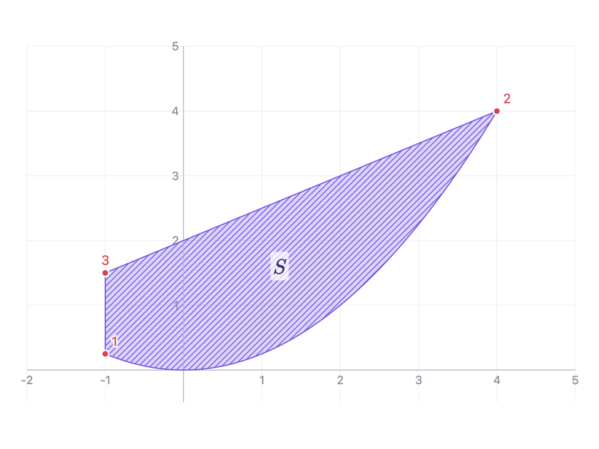
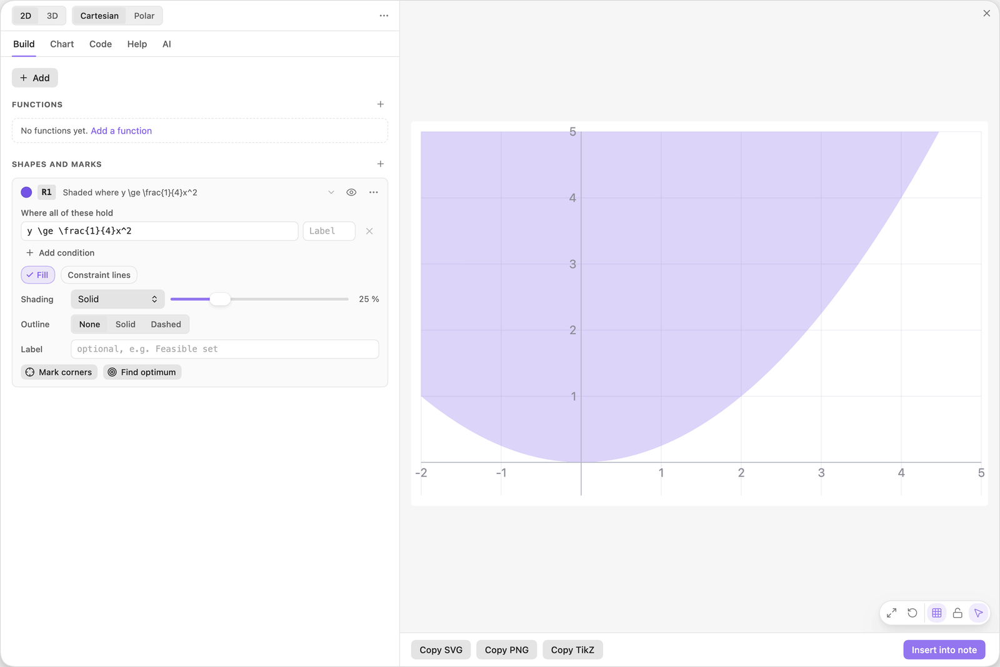
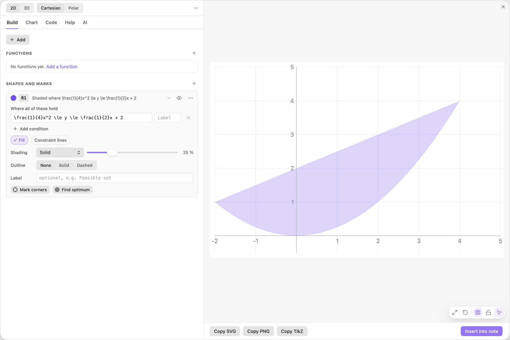
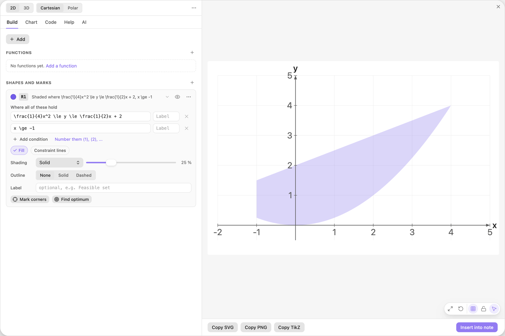
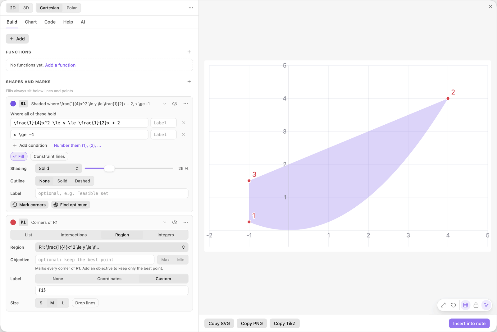
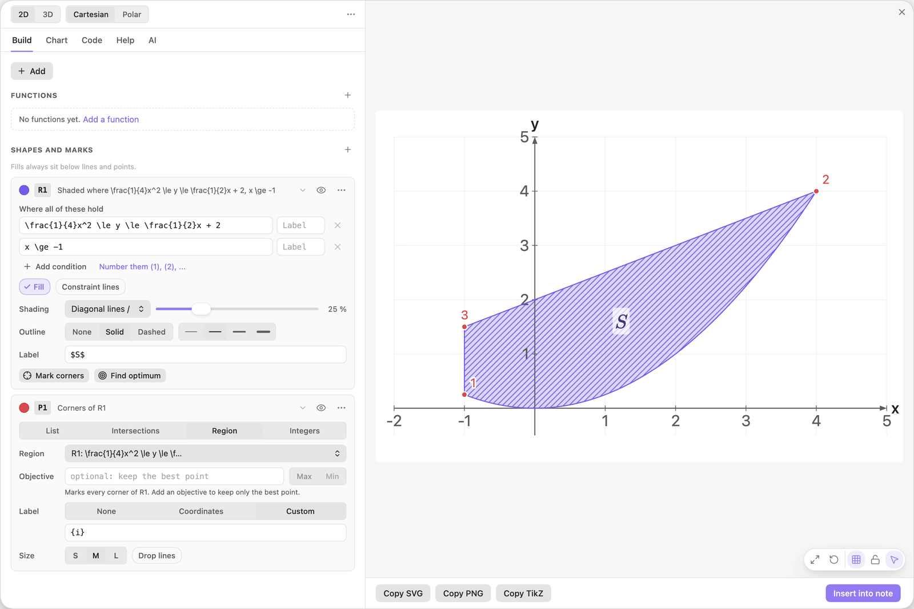

<!-- Generated by scripts/media/build-guides.mjs from src/guides. Do not edit. -->

# Shade a region with inequalities

[All guides](README.md) · Regions and optimisation · Core · about 3 minutes

Shade where conditions hold, between two curves and cut by a third, then number its corners and hatch it.

<p align="center"></p>

**What you can do afterwards**

- Shade a region with conditions in LaTeX
- Put y between two curves with a chain
- Mark and number the corners of a region

**Read first:** [Write a chart in words](chart-language.md)

## 1. Shade where a condition holds

A `shade where` line colours every point where its condition holds. Write the condition in LaTeX between dollars, as in your notes: here, every point above a parabola.

The chart in words:

```easy-tikz
show x from -2 to 5 and y from -0.5 to 5
size 12 x 8
axes in the middle
with a grid
shade where $y \ge \frac{1}{4}x^2$ in purple
```



> **Tip:** A region is shaded inside the window only, so the `show` line decides where it ends.

## 2. Shade between two curves

A chain puts y between two curves: above the parabola and below the line. The region ends where the two curves cross.

The chart gets these lines:

```easy-tikz
shade where $\frac{1}{4}x^2 \le y \le \frac{1}{2}x + 2$ in purple
```



## 3. Add a condition with and

Join conditions with `and`: a point is shaded only where all of them hold. Here `$x \ge -1$` cuts off the left tip.

The chart gets these lines:

```easy-tikz
shade where $\frac{1}{4}x^2 \le y \le \frac{1}{2}x + 2$ and $x \ge -1$ in purple
```



## 4. Number the corners

`mark the corners of the region` puts a point where two edges meet. In the label, `{i}` counts them: 1, 2, 3.

The chart gets these lines:

```easy-tikz
mark the corners of the region, labelled "{i}"
```



> **Tip:** Write `with coordinates` instead of the label to see where each corner lies.

## 5. Hatch the region and name it

Options after a comma change the look: `pattern north-east` hatches the region, `outlined` draws its edge, and `labelled` writes a name in the middle.

The chart gets these lines:

```easy-tikz
shade where $\frac{1}{4}x^2 \le y \le \frac{1}{2}x + 2$ and $x \ge -1$ in purple, pattern north-east, outlined, labelled "$S$"
```



> **Tip:** Other patterns: `horizontal`, `vertical`, `crosshatch`, `dots` and `north-west`.

## The finished chart

Paste this block into a note to get the finished chart of this guide. Click the chart in the note to open it in the editor.

<details>
<summary>The chart as an easy-tikz block</summary>

```easy-tikz
show x from -2 to 5 and y from -0.5 to 5
size 12 x 8
axes in the middle
with a grid
shade where $\frac{1}{4}x^2 \le y \le \frac{1}{2}x + 2$ and $x \ge -1$ in purple, pattern north-east, outlined, labelled "$S$"
mark the corners of the region, labelled "{i}"
```

</details>

## Next guides

- [Shade the areas between two curves](areas-between.md): Two waves, the areas between them split where they cross, each in its own colour and labelled.
- [Solve a linear program in a picture](linear-program.md): Constraint lines, the feasible region and its corners, an objective line on a slider, the maximum and the minimum.

[All guides](README.md)
