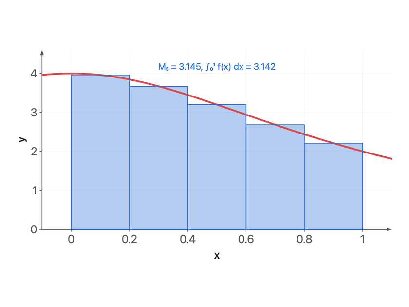
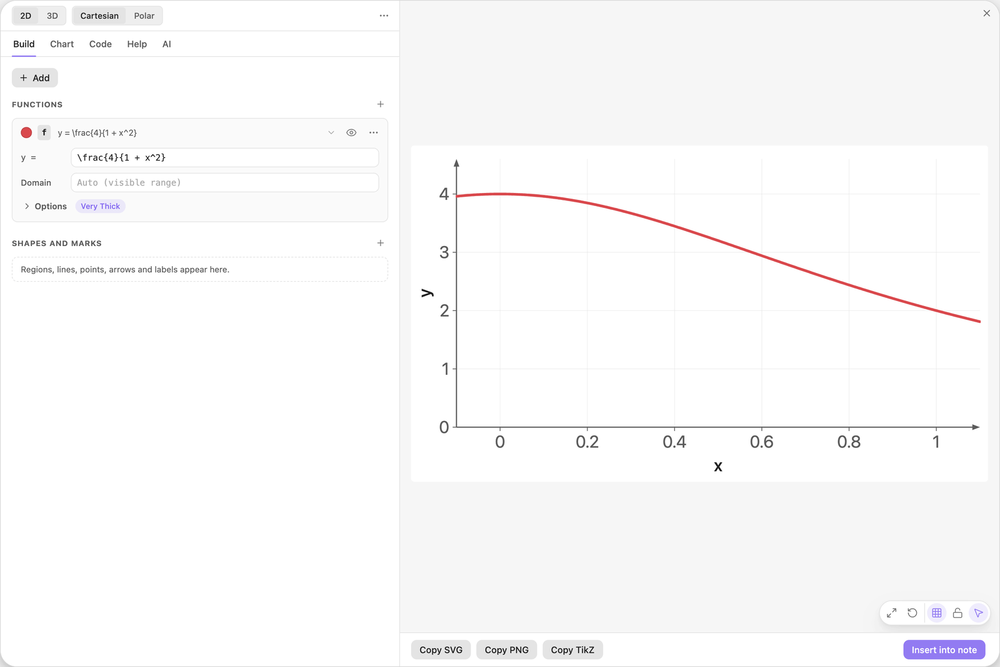
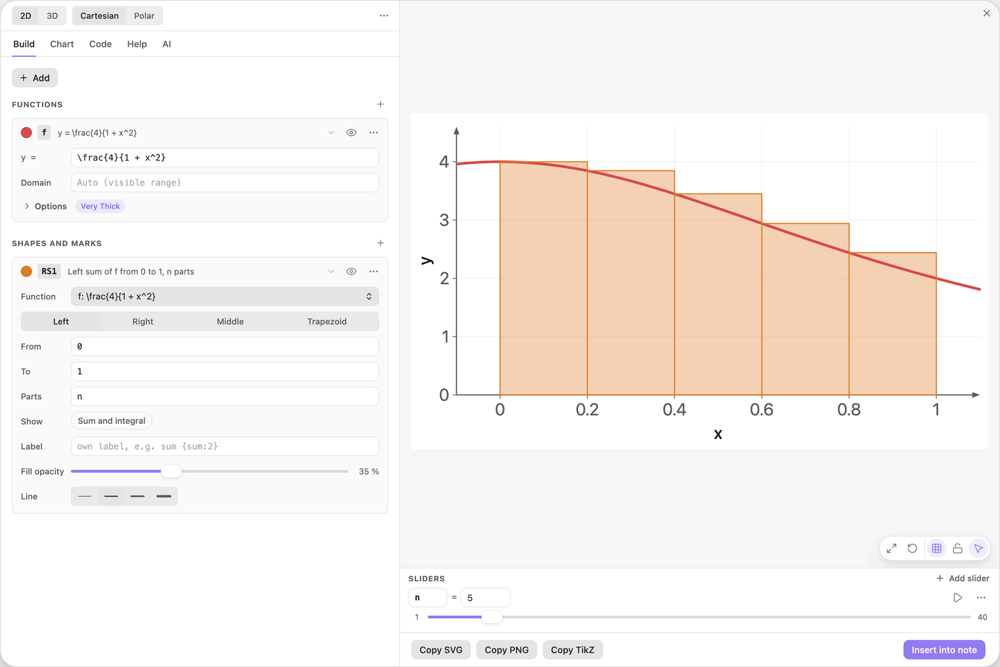
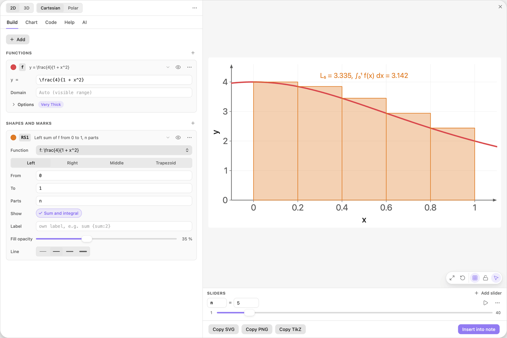
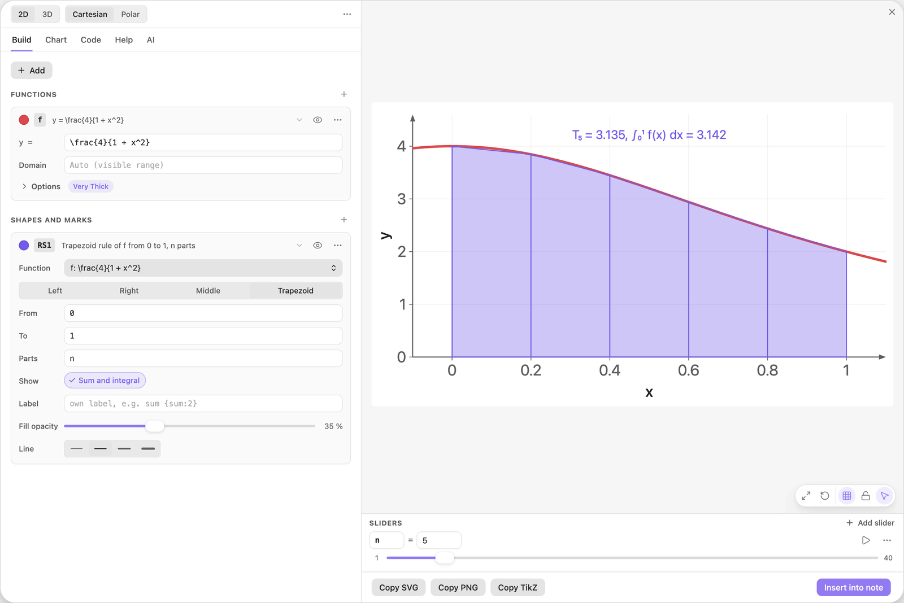
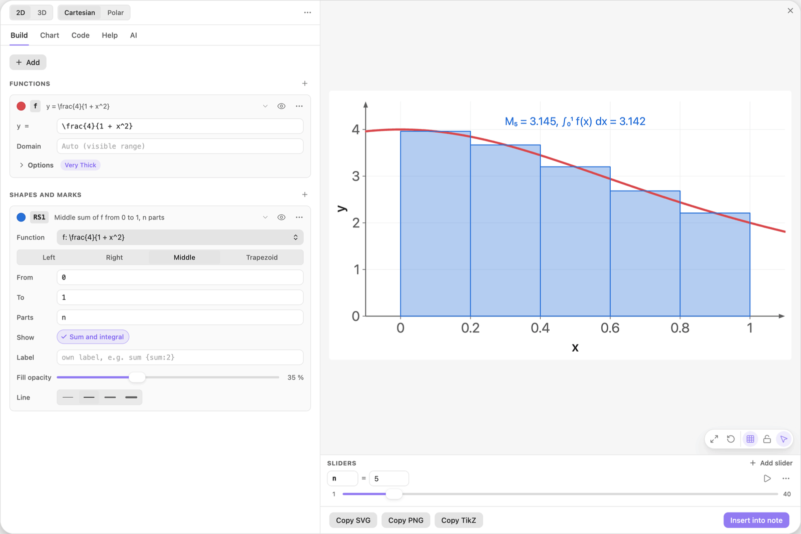

<!-- Generated by scripts/media/build-guides.mjs from src/guides. Do not edit. -->

# Estimate an area with Riemann sums

[All guides](README.md) · Calculus · Core · about 3 minutes

Fill an area with rectangles, watch their sum approach the integral, then try trapezoids and middle sums.

<p align="center"></p>

**What you can do afterwards**

- Draw a Riemann sum with a slider for the parts
- Print the sum next to the integral
- Compare left, trapezoid and middle sums

**Read first:** [An area that grows with a slider](area-accumulation.md)

## 1. Plot the function

The area under this curve from 0 to 1 is exactly π. The next steps estimate it with rectangles.

The chart in words:

```easy-tikz
show x from -0.1 to 1.1 and y from 0 to 4.6
size 12 x 7
axes on the edges
with a grid
plot $f(x) = \frac{4}{1 + x^2}$ in red, very thick
```



## 2. Draw the left Riemann sum

`with n parts` takes the number of rectangles from the slider `n`. Each rectangle is as high as f at its left end.

The chart gets these lines:

```easy-tikz
slider n from 1 to 40, starting at 5, in steps of 1
draw the left Riemann sum of f from 0 to 1 with n parts
```



## 3. Print the sum and the integral

`labelled` prints the sum and the exact integral. Press play on `n`: the thinner the parts, the closer the sum comes to 3.142.

The chart gets these lines:

```easy-tikz
draw the left Riemann sum of f from 0 to 1 with n parts, labelled
```



## 4. Use the trapezoid rule

Write `the trapezoid rule of f` instead. Each part gets a slanted top that joins the curve at both ends.

The chart gets these lines:

```easy-tikz
draw the trapezoid rule of f from 0 to 1 with n parts in purple, labelled
```



## 5. Try the middle sum

In a Riemann sum, write `right` or `middle` instead of `left`. The middle sum takes f at the centre of each part: with 5 parts it misses π by only 0.003.

The chart gets these lines:

```easy-tikz
draw the middle Riemann sum of f from 0 to 1 with n parts in blue, labelled
```



> **Tip:** `midpoint` is another word for `middle`.

## The finished chart

Paste this block into a note to get the finished chart of this guide. Click the chart in the note to open it in the editor.

<details>
<summary>The chart as an easy-tikz block</summary>

```easy-tikz
show x from -0.1 to 1.1 and y from 0 to 4.6
size 12 x 7
axes on the edges
with a grid
slider n from 1 to 40, starting at 5, in steps of 1
plot $f(x) = \frac{4}{1 + x^2}$ in red, very thick
draw the middle Riemann sum of f from 0 to 1 with n parts in blue, labelled
```

</details>

## Next guides

- [Slope fields and solutions](slope-fields.md): Draw the slope field of a differential equation and the solution through a point you move.
- [Normal and binomial probabilities](probability.md): Shade a probability under the normal curve with a slider, then compare binomial bars with a normal curve.

[All guides](README.md)
