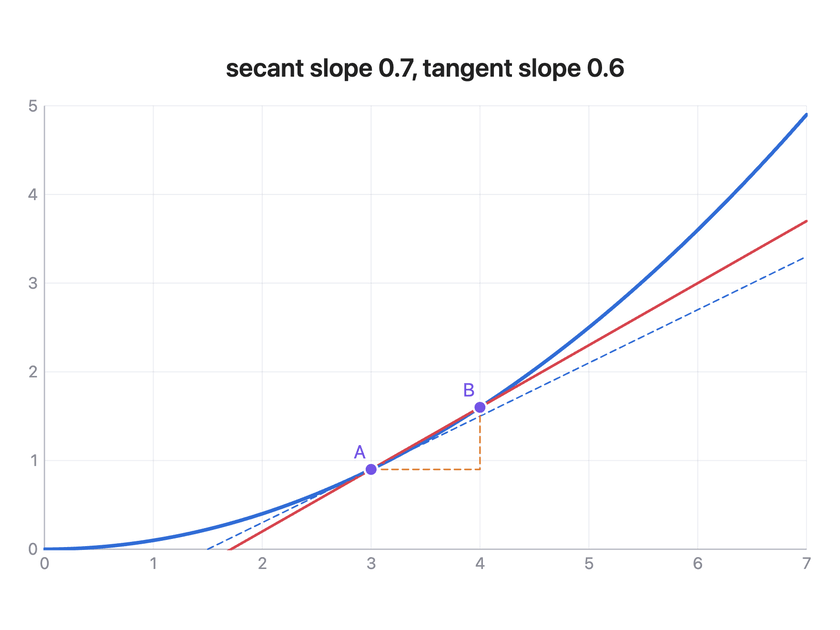
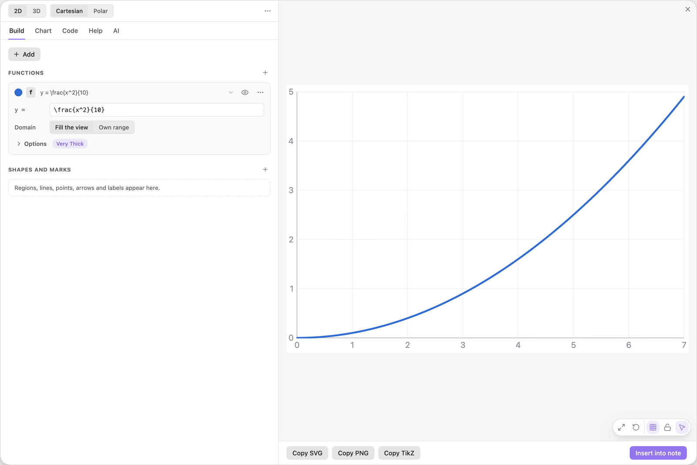
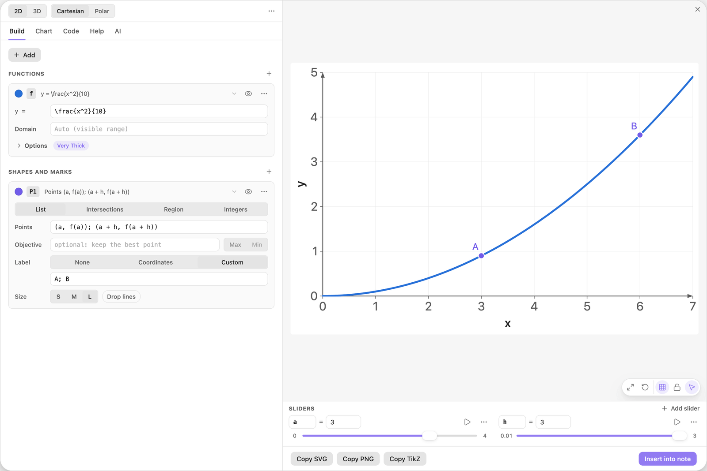
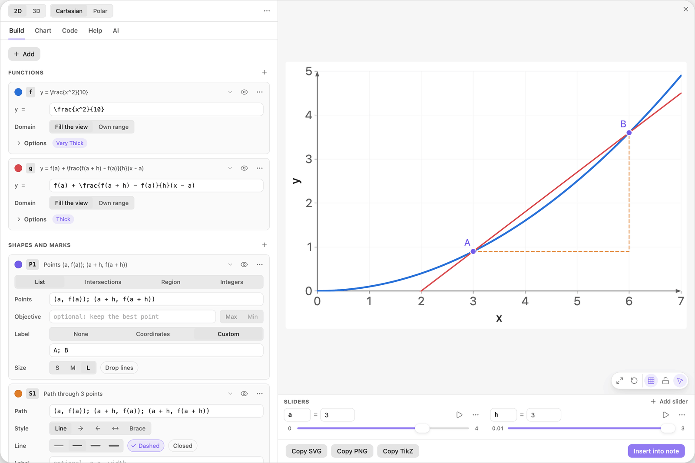
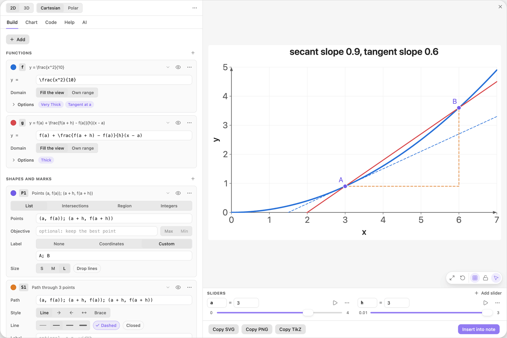
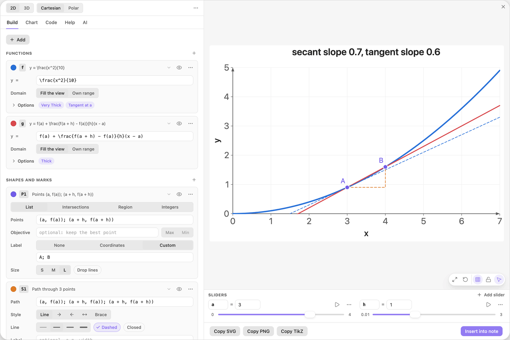

<!-- Generated by scripts/media/build-guides.mjs from src/guides. Do not edit. -->

# From secant to tangent

[All guides](README.md) · Calculus · Core · about 3 minutes

Shrink the gap h between two points of a curve and watch the secant through them turn into the tangent.

<p align="center"></p>

**What you can do afterwards**

- Write a secant with two sliders
- Print both slopes live in the title
- See the derivative as a limit

**Read first:** [Tangents and extrema](tangents-extrema.md)

## 1. Plot the curve

Plot the parabola. Its tangent at any x has the slope x/5: keep that number in mind.

The chart in words:

```easy-tikz
show x from 0 to 7 and y from 0 to 5
size 12 x 8
axes on the edges
with a grid
plot $f(x) = \frac{x^2}{10}$ in blue, very thick
```



## 2. Mark two points on sliders

A sits on the curve at x = `a`, and B is `h` further right. `labelled "A; B"` names the two points.

The chart gets these lines:

```easy-tikz
slider a from 0 to 4, starting at 3
slider h from 0.01 to 3, starting at 3, in steps of 0.01
mark (a, f(a)) and (a + h, f(a + h)) in purple, large, labelled "A; B"
```



## 3. Draw the secant through A and B

The orange legs show the run `h` and the rise. The secant starts at A and climbs with rise over run, so it passes through B too.

The chart gets these lines:

```easy-tikz
plot $g(x) = f(a) + \frac{f(a + h) - f(a)}{h}(x - a)$ in red, thick
draw a line from (a, f(a)) to (a + h, f(a)) to (a + h, f(a + h)) in orange, dashed
```



## 4. Add the tangent and both slopes

`with its tangent at a` draws the tangent at A. The title prints both slopes: 0.9 for the secant, 0.6 for the tangent.

The chart gets these lines:

```easy-tikz
title secant slope {(f(a + h) - f(a))/h:3}, tangent slope {a/5:3}
plot $f(x) = \frac{x^2}{10}$ in blue, very thick, with its tangent at a
```



## 5. Shrink h towards zero

Drag `h` down or press play. B slides into A, the secant turns into the tangent, and its slope tends to 0.6: that limit is the derivative.

The chart gets these lines:

```easy-tikz
slider h from 0.01 to 3, starting at 1, in steps of 0.01
```



> **Tip:** At `h = 0` the quotient is 0/0, so `h` stops at 0.01.

## The finished chart

Paste this block into a note to get the finished chart of this guide. Click the chart in the note to open it in the editor.

<details>
<summary>The chart as an easy-tikz block</summary>

```easy-tikz
show x from 0 to 7 and y from 0 to 5
size 12 x 8
axes on the edges
with a grid
title secant slope {(f(a + h) - f(a))/h:3}, tangent slope {a/5:3}
slider a from 0 to 4, starting at 3
slider h from 0.01 to 3, starting at 1, in steps of 0.01
plot $f(x) = \frac{x^2}{10}$ in blue, very thick, with its tangent at a
plot $g(x) = f(a) + \frac{f(a + h) - f(a)}{h}(x - a)$ in red, thick
mark (a, f(a)) and (a + h, f(a + h)) in purple, large, labelled "A; B"
draw a line from (a, f(a)) to (a + h, f(a)) to (a + h, f(a + h)) in orange, dashed
```

</details>

## Next guides

- [An area that grows with a slider](area-accumulation.md): Shade the area under a curve up to a slider and draw the function that adds it up.
- [Estimate an area with Riemann sums](riemann-sums.md): Fill an area with rectangles, watch their sum approach the integral, then try trapezoids and middle sums.

[All guides](README.md)
