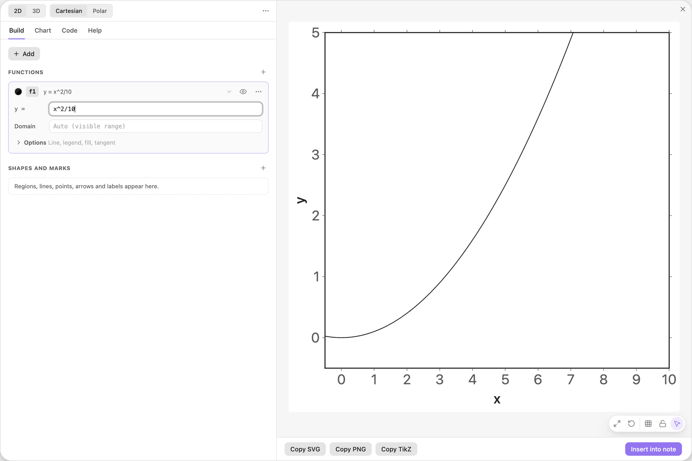
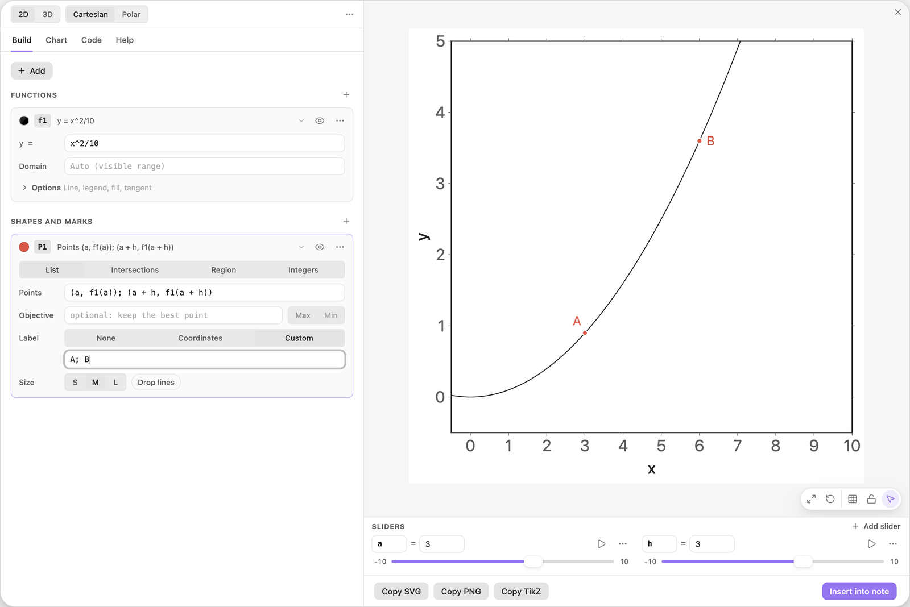
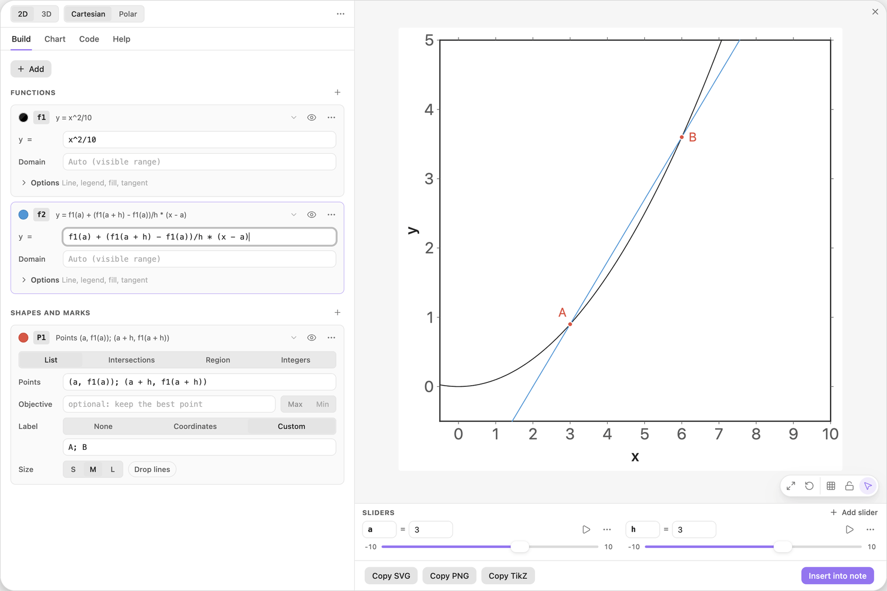
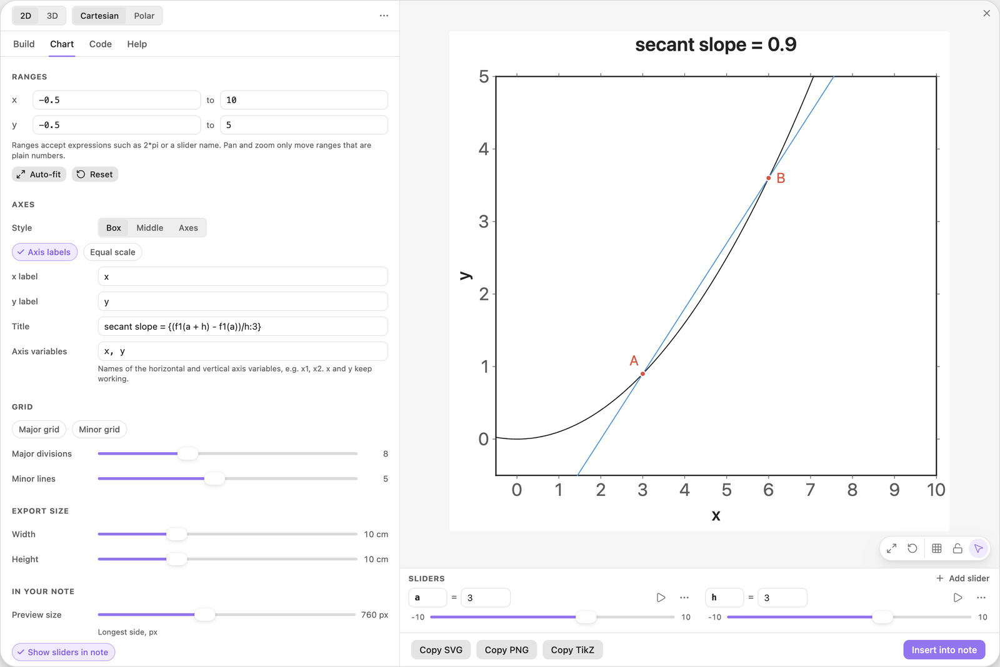
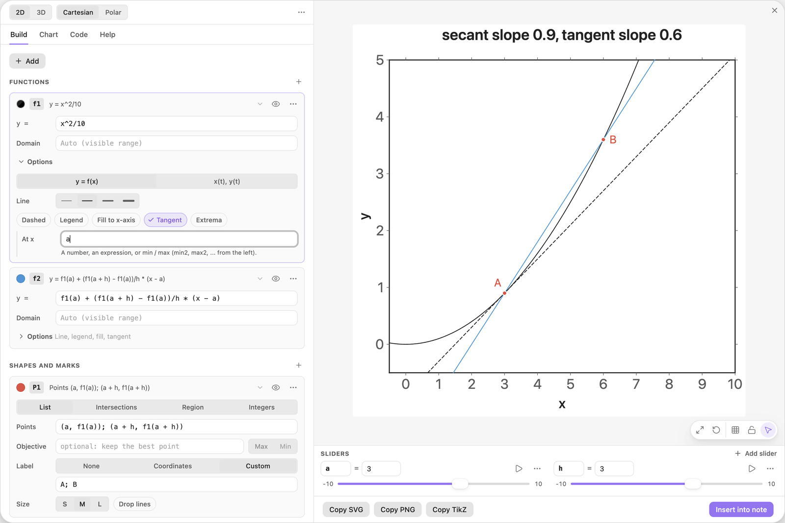
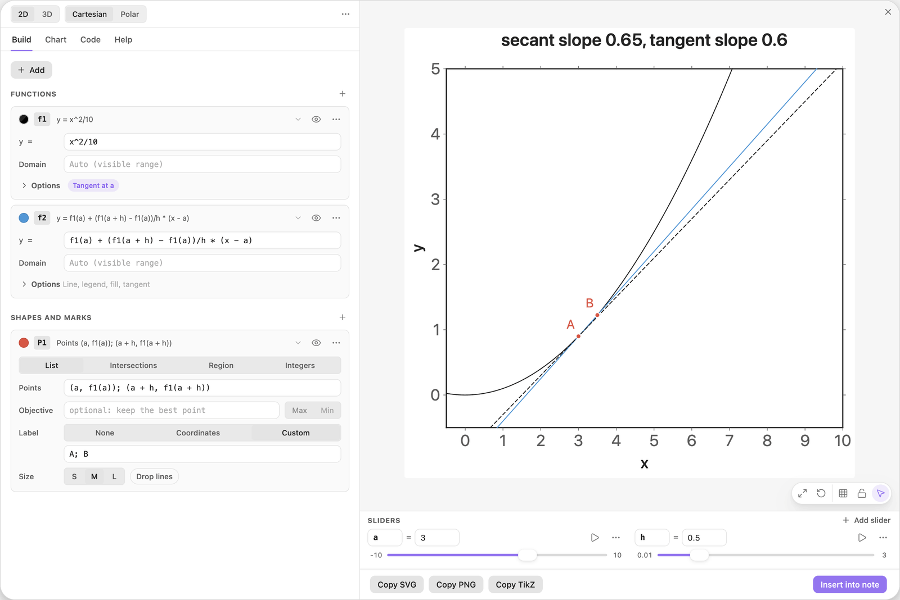
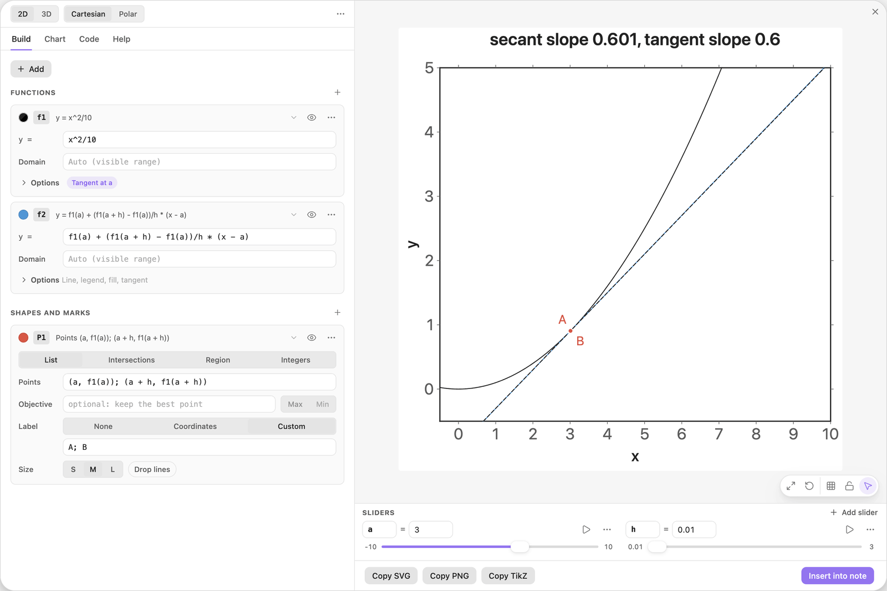
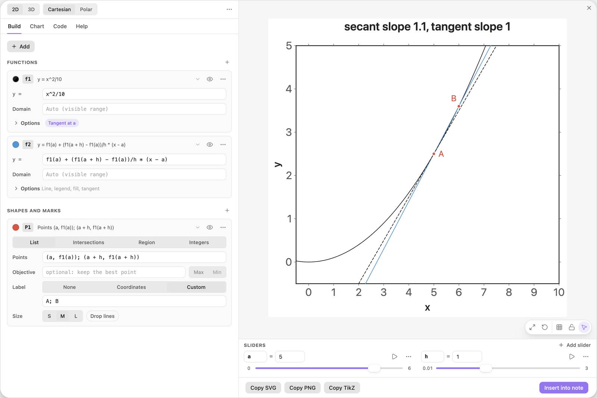

<!-- Generated by scripts/media/build-guides.mjs from src/guides. Do not edit. -->

# From secant to tangent

[All guides](README.md) · Functions and sliders · Core · about 9 minutes

Draw the secant through two points of a curve, shrink their distance h with a slider and watch its slope approach the slope of the tangent.

<p align="center"></p>

**What you can do afterwards**

- Write a secant as a function of two sliders
- Print a difference quotient live in the title
- Play a slider towards a limit and compare with the tangent
- Play two sliders at once

**Read first:** [Sliders that move the picture](sliders.md), [Tangents and extrema](tangents-extrema.md)

## 1. Draw the curve

Start with a new chart. Click + Add, choose Function y = f(x) and type the formula below into the card f1.

It is a parabola through the origin, gentle enough to stay in the default view up to x = 7. Its slope at any x is x/5. You will compare the secant with that number later.

| Where | Type |
| --- | --- |
| f1, y = | `x^2/10` |



*The curve f1 in the default view.*

> **Tip:** Use + Add here rather than Start a chart: + Add keeps the default view, while Start a chart fits the ranges to the curve.

## 2. Mark two points on two sliders

Click + Add and choose Points from a list. Replace the sample points with the text below. Click Add slider a under the field, then Add slider h. Both sliders start at 1.

Type 3 into the value of a and 3 into the value of h. The first point sits on the curve at x = a, the second one h further right: `f1(a)` is the height of the curve at a. Then set Label to Custom and type `A; B` to name the two points.

| Where | Type |
| --- | --- |
| P1, Points | `(a, f1(a)); (a + h, f1(a + h))` |
| Sliders, a: value | `3` |
| Sliders, h: value | `3` |
| P1, Label text | `A; B` |



*A at x = 3 and B at x = 6, both computed from the sliders a and h.*

## 3. Draw the secant through A and B

Click + Add, choose Function y = f(x) and type the formula below into the card f2. It is blue, the next free colour.

Read it as a line in point-slope form. It starts at the height of A, `f1(a)`, and climbs with the slope of the secant, rise over run, `(f1(a + h) - f1(a))/h`, for every unit it moves away from a. So it passes through both points.

| Where | Type |
| --- | --- |
| f2, y = | `f1(a) + (f1(a + h) - f1(a))/h * (x - a)` |



*The secant f2 through A and B.*

> **Tip:** Keep the brackets around the numerator: `f1(a + h) - f1(a)/h` would divide only f1(a) by h.

## 4. Print the slope in the title

Open the Chart tab and type the title below. Everything inside the curly brackets is computed, and `:3` keeps up to three decimals.

The title reads secant slope = 0.9: from A = (3, 0.9) to B = (6, 3.6) the curve rises 2.7 over a run of 3.

| Where | Type |
| --- | --- |
| Chart \> Axes, Title | `secant slope = {(f1(a + h) - f1(a))/h:3}` |



*The title computes the difference quotient for the current a and h.*

## 5. Add the tangent at A

Back in the Build tab, open Options on the card f1, click Tangent and type `a` into the field At x. A dashed tangent touches the curve at A.

The slope of the tangent of `x^2/10` is x/5, so put it into the title next to the secant slope, as below. At a = 3 the title reads secant slope 0.9, tangent slope 0.6.

| Where | Type |
| --- | --- |
| f1, At x | `a` |
| Chart \> Axes, Title | `secant slope {(f1(a + h) - f1(a))/h:3}, tangent slope {a/5:3}` |



*The tangent at A, and both slopes in the title.*

> **Tip:** The slope x/5 is typed by hand: Easy TikZ draws the tangent, but it does not publish its slope as a value.

## 6. Shrink h towards zero

Open the menu behind the three dots on the row of h and set Min to 0.01, Max to 3 and Step to 0.01. Then drag h down to 0.5.

B slides along the curve towards A, and the secant turns towards the tangent. The title reads 0.65 against 0.6. For this curve the secant slope is exactly (2a + h)/10, so the gap to the tangent is h/10 and shrinks with h.

| Where | Type |
| --- | --- |
| Sliders, h: Min | `0.01` |
| Sliders, h: Max | `3` |
| Sliders, h: Step | `0.01` |



*At h = 0.5 the secant is close to the tangent: slopes 0.65 and 0.6.*

## 7. Play h and watch the limit

Click the play button on the row of h. h sweeps between 0.01 and 3, about four seconds each way. Near the bottom of the sweep the secant lies on the tangent, and the title reads 0.601 against 0.6.

That is the derivative as a limit: the slope of the secant tends to the slope of the tangent as h goes to 0. Click the button again to stop.



*At h = 0.01 the secant and the tangent can no longer be told apart.*

> **Tip:** h stops at 0.01 on purpose. At h = 0 the quotient is 0/0: the secant disappears and the title prints a question mark.

## 8. Play a and h together

Click the small numbers at the two ends of the slider a and type 0 and 6, so that A stays in view. Then press play on h again, and on a as well.

Each slider sweeps its own range in about four seconds, so A travels along the curve while B closes in on it and moves away again. The tangent, the secant and both numbers in the title follow on every frame.

| Where | Type |
| --- | --- |
| Sliders, a: minimum | `0` |
| Sliders, a: maximum | `6` |



*One moment of the two sweeps: a = 5 and h = 1, secant slope 1.1, tangent slope 1.*

> **Tip:** Click a play button again to stop that slider alone. The other one keeps playing.

## The finished chart

Paste this block into a note to get the finished chart of this guide. Click the chart in the note to open it in the editor.

<details>
<summary>The chart as an easy-tikz block</summary>

```easy-tikz
title secant slope {(f1(a + h) - f1(a))/h:3}, tangent slope {a/5:3}
slider a from 0 to 6, starting at 5
slider h from 0.01 to 3, starting at 1, in steps of 0.01
plot f1(x) = x^2/10, with its tangent at a
plot f2(x) = f1(a) + (f1(a + h) - f1(a))/h * (x - a) in blue
mark (a, f1(a)) and (a + h, f1(a + h)), labelled "A; B"
```

</details>

## Next guides

- [Shade between a curve and its tangent](tangent-area.md): Write the tangent at a slider point as a function, shade the area it encloses with the curve, and make it work for any curve.
- [An area that grows with a slider](area-accumulation.md): Shade the area under a curve from 0 to a slider b, print its size, and draw the function that adds it up, so the height of one curve shows the area under the other.
- [Calculate with computed points](computed-values.md): Crossing points publish their coordinates and their count: use them in the title, in a new point and in an area formula, and see what they do while a slider plays.

[All guides](README.md)
