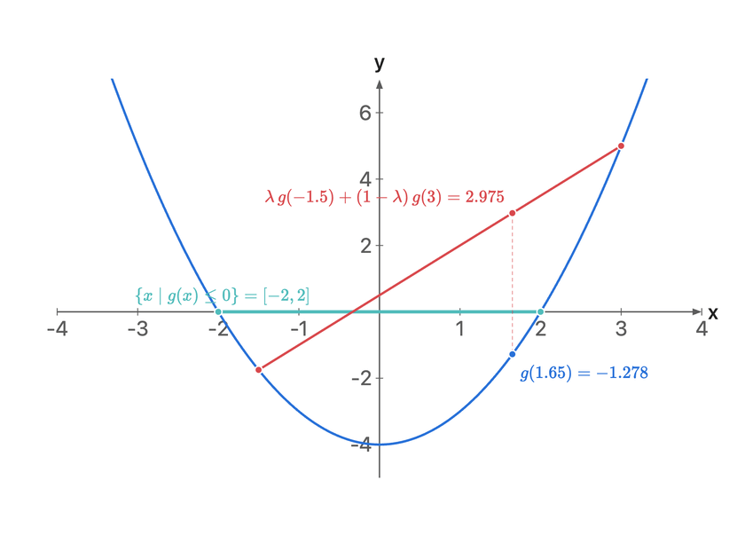
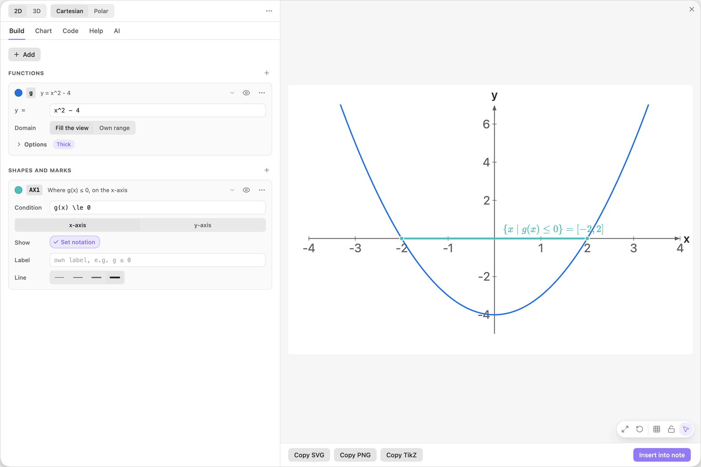
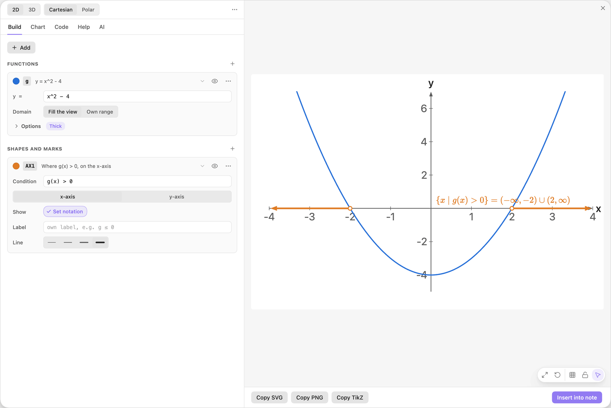
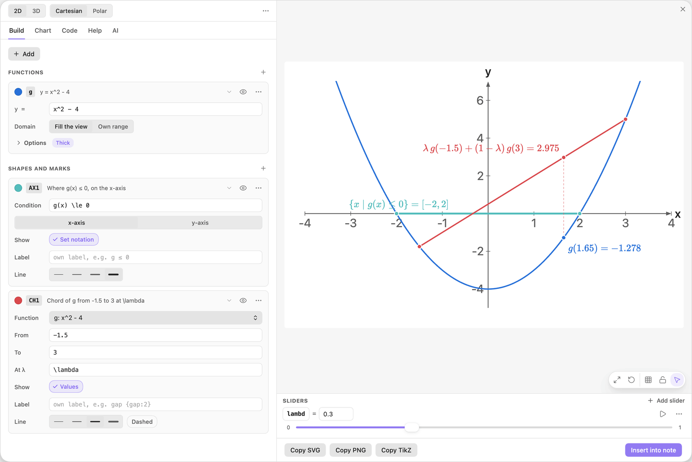
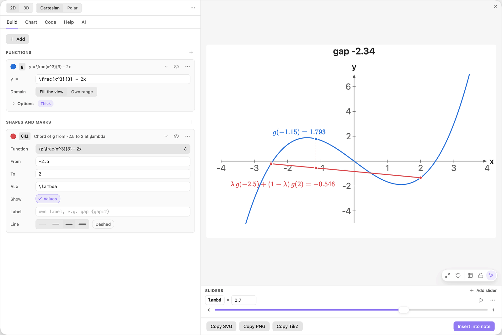

<!-- Generated by scripts/media/build-guides.mjs from src/guides. Do not edit. -->

# Sets and convex functions

[All guides](README.md) · Regions and optimisation · Core · about 3 minutes

Mark where g(x) ≤ 0 on the x-axis, read the set as intervals and test convexity with a chord.

<p align="center"></p>

**What you can do afterwards**

- Mark where a condition holds on an axis
- Read open and closed ends
- See Jensen's inequality on a chord

## 1. Mark a set on the x-axis

`mark where $g(x) \le 0$ on the x-axis, labelled` draws a bar where g is at most 0 and writes the set as an interval: \[-2, 2\]. Filled dots: both ends belong to it.

The chart in words:

```easy-tikz
show x from -4 to 4 and y from -5 to 7
size 12 x 8
axes in the middle
plot g(x) = x^2 - 4 in blue, thick
mark where $g(x) \le 0$ on the x-axis, labelled
```



## 2. Use a strict sign

With `>` the ends do not belong, so the dots are open. The set runs off both sides: the bar ends in arrows and the label is a union.

The chart gets these lines:

```easy-tikz
mark where g(x) > 0 on the x-axis in orange, labelled
```



> **Tip:** Conditions take `and`, `or` and bars: `$|x - 1| < 2$`.

## 3. Draw a chord with a slider

`draw the chord of g from -1.5 to 3 at $\lambda$` joins two points of the graph. For every λ the point on the chord lies above the graph: g is convex.

The chart gets these lines:

```easy-tikz
slider lambda from 0 to 1, starting at 0.3
mark where $g(x) \le 0$ on the x-axis, labelled
draw the chord of g from -1.5 to 3 at $\lambda$, labelled
```



## 4. Test a curve that is not convex

For this cubic the chord runs below the graph at λ = 0.7. The title prints the gap, `CH1_val`, and it is below 0: the cubic is not convex.

The chart gets these lines:

```easy-tikz
title gap {CH1_val:2}
slider lambda from 0 to 1, starting at 0.7
plot $g(x) = \frac{x^3}{3} - 2x$ in blue, thick
CH1: draw the chord of g from -2.5 to 2 at $\lambda$, labelled
```



## The finished chart

Paste this block into a note to get the finished chart of this guide. Click the chart in the note to open it in the editor.

<details>
<summary>The chart as an easy-tikz block</summary>

```easy-tikz
show x from -4 to 4 and y from -5 to 7
size 12 x 8
axes in the middle
slider lambda from 0 to 1, starting at 0.3
plot g(x) = x^2 - 4 in blue, thick
mark where $g(x) \le 0$ on the x-axis, labelled
draw the chord of g from -1.5 to 3 at $\lambda$, labelled
```

</details>

## Next guides

- [Cards of sets, matrices and sums](formula-cards.md): Rest the pointer on a set, a matrix, a recurrence or a sum in a note: its card draws it, with the names of the note.
- [Shade a region with inequalities](regions.md): Shade where conditions hold, between two curves and cut by a third, then number its corners and hatch it.

[All guides](README.md)
