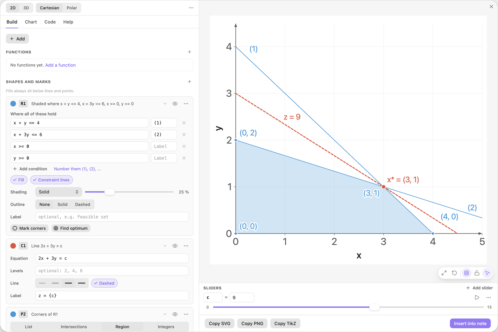
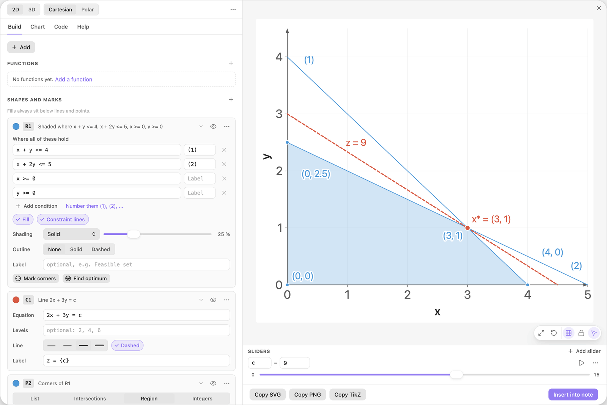
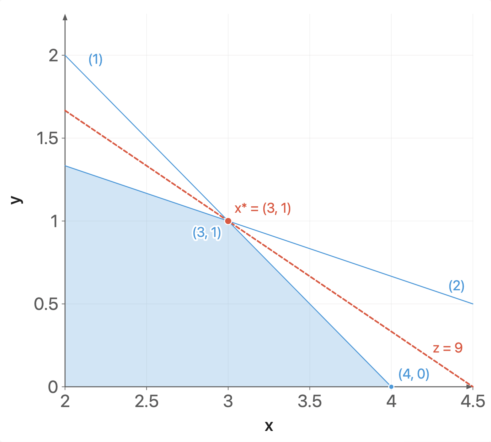
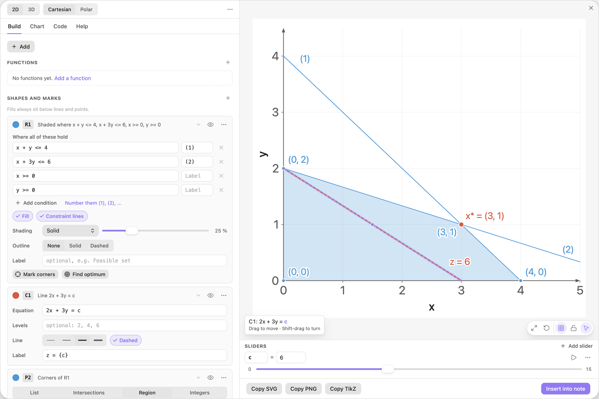
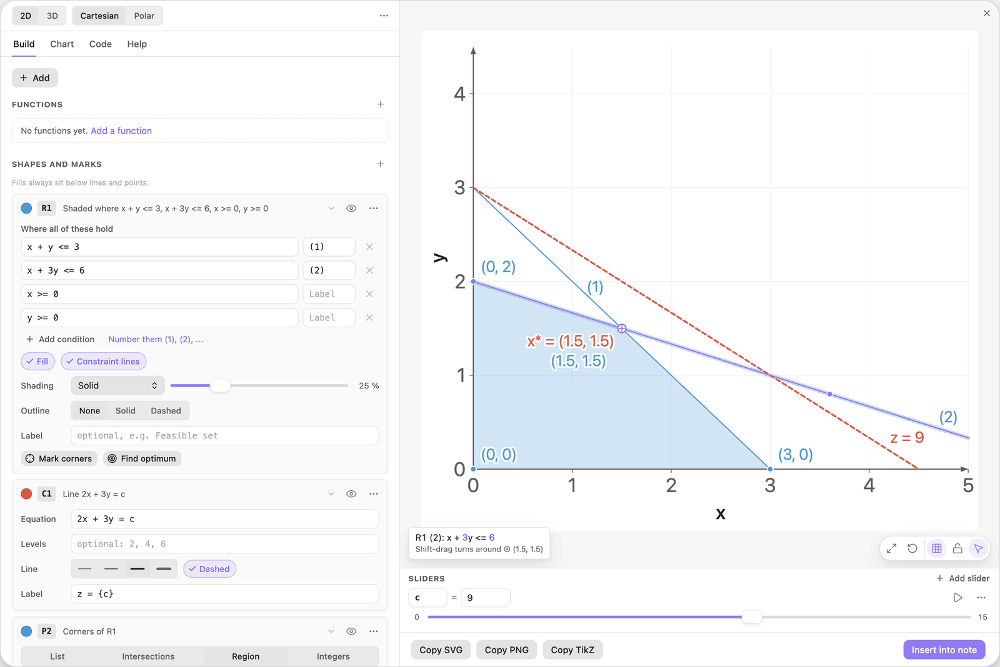
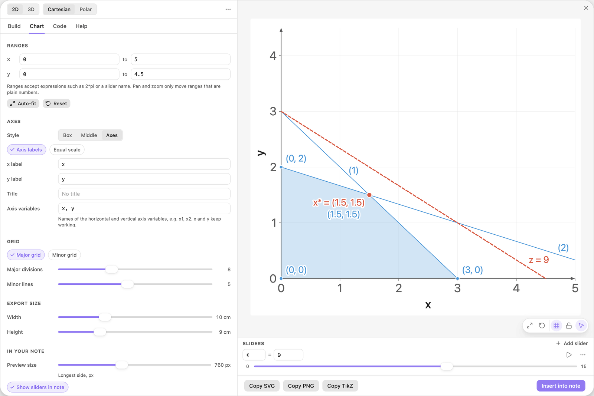

<!-- Generated by scripts/media/build-guides.mjs from src/guides. Do not edit. -->

# Keyboard, mouse and troubleshooting

[All guides](README.md) · Reference · Start here · about 7 minutes

Every shortcut of the editor, what the mouse does in the preview, and fixes for the usual problems.

<p align="center"></p>

**What you can do afterwards**

- Insert, undo and move around without the mouse
- Pan, zoom and edit shapes in the preview on purpose
- Recognise and fix the most common problems

## 1. Insert, save and close

These work anywhere in the editor. The pictures of this guide use the example Linear program.

- Cmd+Enter (Ctrl+Enter on Windows and Linux): Insert into note, or Save changes for a chart you opened from a note.
- Escape: cancel a drag in the preview or clear the selection, close an open menu or popover, otherwise close the editor.
- A chart you close without inserting is kept as a draft. The next time the editor opens, it offers Unsaved chart with Restore and Discard. Drafts older than 7 days are ignored.



*The editor with the Linear program example: cards on the left, preview and Sliders dock on the right.*

> **Tip:** The button at the bottom right shows which of the two the shortcut does: Insert into note for a new chart, Save changes for a chart opened from a note.

## 2. Undo and redo

- Cmd+Z (Ctrl+Z) undoes the last drag, arrow-key move, slider change or deleted card. Cmd+Shift+Z (Ctrl+Shift+Z) redoes a drag, a move or a slider change. The editor remembers up to 50 steps while the chart stays open.
- Inside a text field the same keys undo your typing.
- After a drag or a delete, a bar at the bottom of the editor names the step and offers Undo for 6 seconds.

Example: hold Shift and drag constraint line (2) upwards at the y-axis, from (0, 2) to (0, 2.5). It turns around the corner (3, 1), its condition becomes `x + 2y <= 5`, and the bar reads Turned R1 (2). Cmd or Ctrl+Z puts `x + 3y <= 6` back.



*Constraint (2) after the Shift-drag: its condition now reads x + 2y &lt;= 5.*

> **Tip:** An undo never overwrites a later edit. It restores what still holds the dragged value and says what it left alone.

## 3. Pan and zoom the preview

- Drag empty space to pan. Scroll, or pinch on a trackpad, to zoom around the pointer.
- With the preview focused and nothing selected, the arrow keys pan by a twentieth of the view.
- The action pill at the bottom of the preview has Fit ranges to the functions, Reset ranges, Major grid and Lock pan and zoom.
- A range written as a formula, such as `2a`, is left alone by pan and zoom. Change it in the Chart tab under Ranges.



*Zoomed in on the optimum of the linear program.*

> **Tip:** Lost the picture? Reset ranges goes back to the default view, x from -0.5 to 10 and y from -0.5 to 5.

## 4. Move a shape with the arrow keys

- Click a shape in the preview to select it. Its card flashes in the Build tab.
- The arrow keys move it by about a tenth of a grid step. Hold Shift for ten times as far, Alt (Option on macOS) for a tenth.
- Enter, or a double-click on the shape, opens its field with the first number a move would change selected.
- Escape clears the selection.

Example: click the red objective line, hold Shift and press the Down arrow twice. The line slides towards the origin, and because its equation is `2x + 3y = c`, it is the slider c that changes: from 9 down to 6. Without Shift a press moves c by about 0.15.



*The objective line moved down with the arrow keys. The slider c reads 6.*

> **Tip:** Presses within one second count as one undo step.

## 5. Drag with Shift, Alt and Space

- Drag a line, curve, point or label: it moves, and its numbers follow.
- Shift-drag: a line turns, a curve stretches and a circle resizes around the mark ⊕. Points and labels move straight.
- Alt (Option on macOS): fine control, without snapping and without rounding to round numbers.
- Space held, or the middle mouse button: pan, even when the pointer is on a shape.
- Escape during a drag cancels it and puts every number back.

Example: drag constraint line (1) towards the origin until its condition reads `x + y <= 3`. The region, its corners and the optimum follow.



*Shift held over constraint (2): the tip shows which numbers would change, and ⊕ marks the point the line would turn around.*

> **Tip:** The pointer button Edit shapes by dragging in the action pill switches all of this off. The preview then pans wherever you drag, and only text labels still move.

## 6. Move through tabs, cards and fields

- Tab bar focused: Left and Right switch tabs, Home and End jump to the first and last tab.
- Alt+Up and Alt+Down move the card that has the focus up or down in its list (with the focus outside a text field).
- Number field: Up and Down change the value by one step, with Shift by ten steps, with Alt by a tenth.
- Focused slider: the arrow keys move it by one step, Home and End jump to its ends.
- Enter applies a name or a number you typed. In the last condition of a region, Enter starts the next row.
- 3D preview focused: the arrow keys rotate the view by 5 degrees.



*The Chart tab. Left and Right on the tab bar switch between Build, Chart, Code and Help.*

> **Tip:** Tab and Shift+Tab reach every control. Enter or Space on the summary line of a card folds or unfolds it.

## 7. Fix the usual problems

- Unknown name ax: `ax` is one name. Click the fix under the field (Use a\*x), or type `a x`.
- A dot on a tab, or a chip at the top left of the preview: something is wrong. Click the chip to jump to the field. The rest of the chart still draws.
- The picture is empty or cut off: click Reset ranges or Fit ranges to the functions in the action pill, and check the Domain of the function.
- A drag pans when it should move a shape: switch on Edit shapes by dragging in the action pill. A drag moves a shape when it should pan: hold Space.
- A point will not move: it is computed (an optimum, a corner, an intersection). Drag the lines that define it.
- A chart in a note does not keep its width: it sits in a callout or a `~~~` fence, where the block cannot be found.

> **Tip:** A problem appears under its field after a short pause, often with a button that fixes it in one click: Add slider k, Use a\*x, Use sin.

## The finished chart

Paste this block into a note to get the finished chart of this guide. Click the chart in the note to open it in the editor.

<details>
<summary>The chart as an easy-tikz block</summary>

```easy-tikz
show x from 0 to 5 and y from 0 to 4.5
size 10 x 9
axes on the edges
with a grid
slider c from 0 to 15, starting at 9, in steps of 0.1
shade where x + y <= 4 and x + 3y <= 6 and x >= 0 and y >= 0, numbered, with constraint lines
draw 2x + 3y = c in red, thick, dashed, labelled "z = {c}"
P2: mark the corners of the region in blue, labelled "({x}, {y})"
mark the maximum of 2x + 3y in the region, large, labelled "x* = ({x:2}, {y:2})"
```

</details>

## Next guides

- [Drag shapes to edit them](drag-to-edit.md): Grab a line or a curve in the preview and its numbers follow: move, turn, stretch, undo.
- [Write formulas that work](formulas.md): Leave out the multiplication sign safely, avoid the traps ax and 1/2x, call functions by name and limit them with a domain.
- [Coming from 3.x](from-3x.md): What happens to your old charts, where the eight tabs went, and which new tool replaces each old one.

[All guides](README.md)
