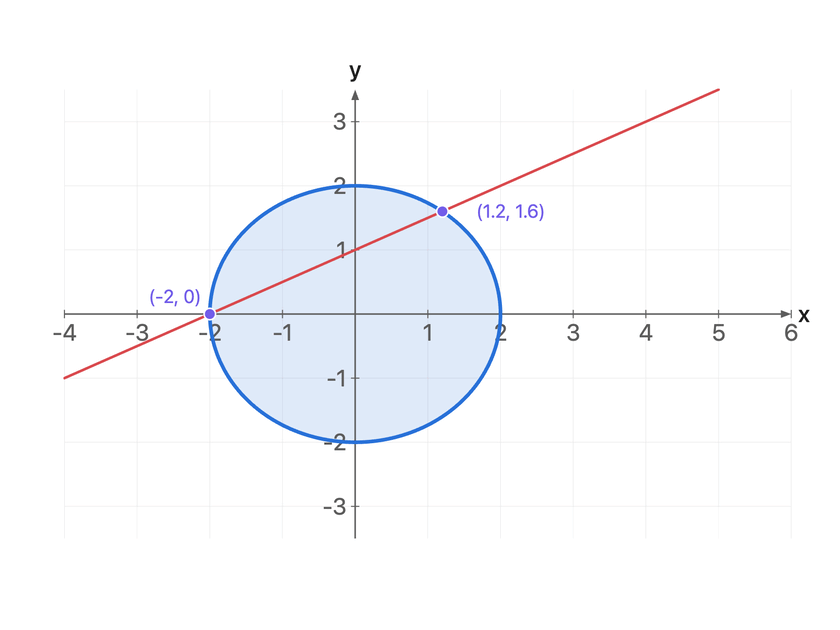
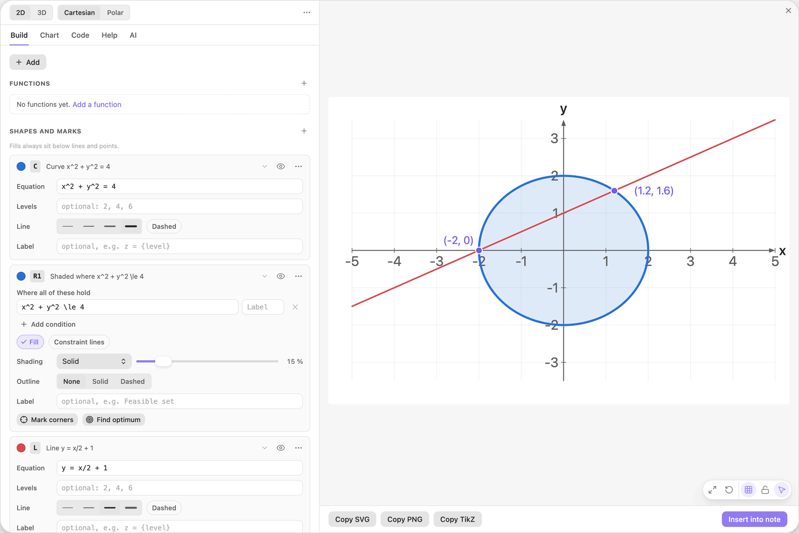
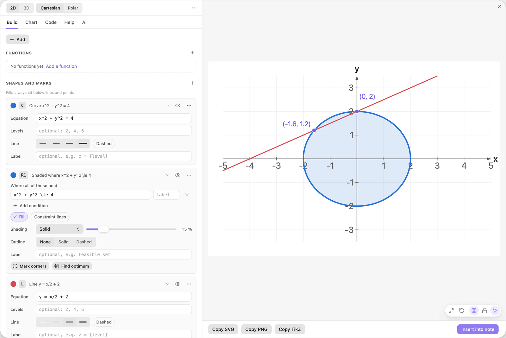
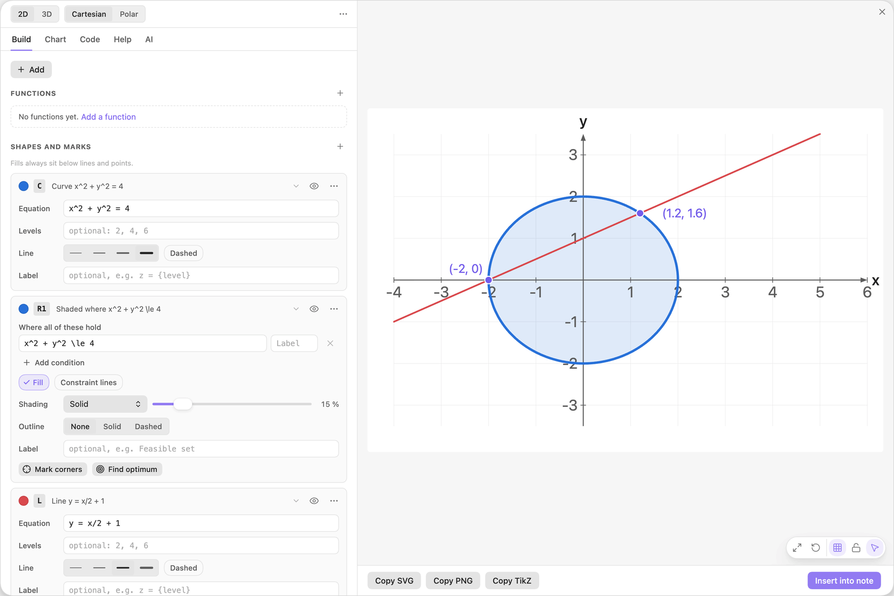
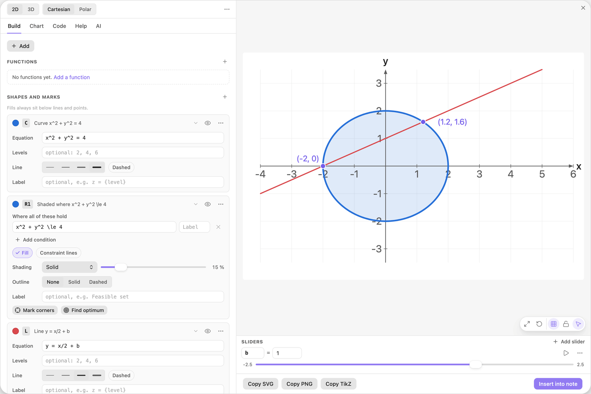

<!-- Generated by scripts/media/build-guides.mjs from src/guides. Do not edit. -->

# Keyboard shortcuts

[All guides](README.md) · Reference · Start here · about 3 minutes

The keys of the editor: insert, undo, move shapes and the view, and move between tabs.

<p align="center"></p>

**What you can do afterwards**

- Insert, save and undo from the keyboard
- Move shapes and the view with the arrow keys
- Move between tabs, cards and guide steps

## 1. Insert or save with Cmd+Enter

Cmd+Enter (Ctrl+Enter on Windows and Linux) inserts the chart into the note, or saves a chart you opened from one.

The chart in words:

```easy-tikz
show x from -5 to 5 and y from -3.5 to 3.5
size 12 x 8
axes in the middle
with a grid
C: draw x^2 + y^2 = 4 in blue, very thick
shade where $x^2 + y^2 \le 4$, opacity 0.15
L: draw y = x/2 + 1 in red, thick
mark where C and L cross in purple, large, with coordinates
```



> **Tip:** Escape cancels a drag or a selection; otherwise it closes the editor and keeps the chart as a draft.

## 2. Move a shape with the arrow keys

Click a shape in the preview and press an arrow key: it moves a tenth of a grid step, with Shift ten times as far. Here Shift+Up lifted the line.

The chart gets these lines:

```easy-tikz
L: draw y = x/2 + 2 in red, thick
```



> **Tip:** Alt (Option on macOS) moves a tenth as far, and Enter opens the field the move changes.

## 3. Undo and redo

Cmd+Z (Ctrl+Z) undoes the last move, drag, slider change or deleted card, as here; Cmd+Shift+Z redoes it. In a text field they undo typing.

The chart gets these lines:

```easy-tikz
L: draw y = x/2 + 1 in red, thick
```


## 4. Pan the view, or turn it in 3D

With the preview focused and nothing selected, the arrow keys pan the view, here twice to the right. In 3D they turn the chart by 5 degrees.

The chart gets these lines:

```easy-tikz
show x from -4 to 6 and y from -3.5 to 3.5
```



> **Tip:** Hold Space and drag to pan, even over lines and points.

## 5. Move through tabs, cards and steps

On the tab bar, Left and Right switch tabs, and in the Help they move between steps. Alt+Up and Alt+Down move the focused card.

The chart gets these lines:

```easy-tikz
slider b from -2.5 to 2.5, starting at 1
L: draw y = x/2 + b in red, thick
```



> **Tip:** In a number field, such as the value of `b`, Up and Down change it by one step.

## The finished chart

Paste this block into a note to get the finished chart of this guide. Click the chart in the note to open it in the editor.

<details>
<summary>The chart as an easy-tikz block</summary>

```easy-tikz
show x from -4 to 6 and y from -3.5 to 3.5
size 12 x 8
axes in the middle
with a grid
slider b from -2.5 to 2.5, starting at 1
C: draw x^2 + y^2 = 4 in blue, very thick
shade where $x^2 + y^2 \le 4$, opacity 0.15
L: draw y = x/2 + b in red, thick
mark where C and L cross in purple, large, with coordinates
```

</details>

## Next guides

- [Drag shapes to edit them](drag-to-edit.md): Grab a line or a curve in the preview and its numbers follow: move, turn, stretch, undo.
- [Write a chart in words](chart-language.md): Build a linear program line by line: the window, a region, a slider, a moving line and the best point.

[All guides](README.md)
