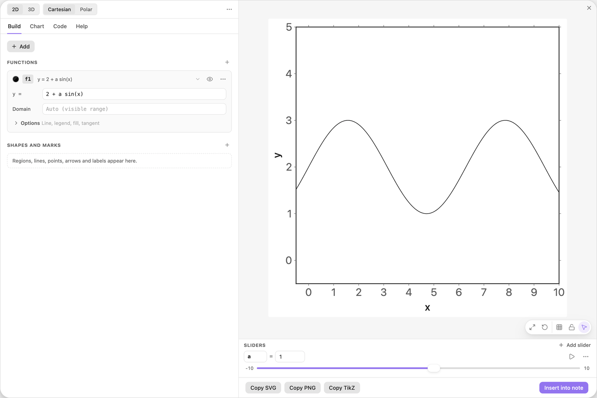
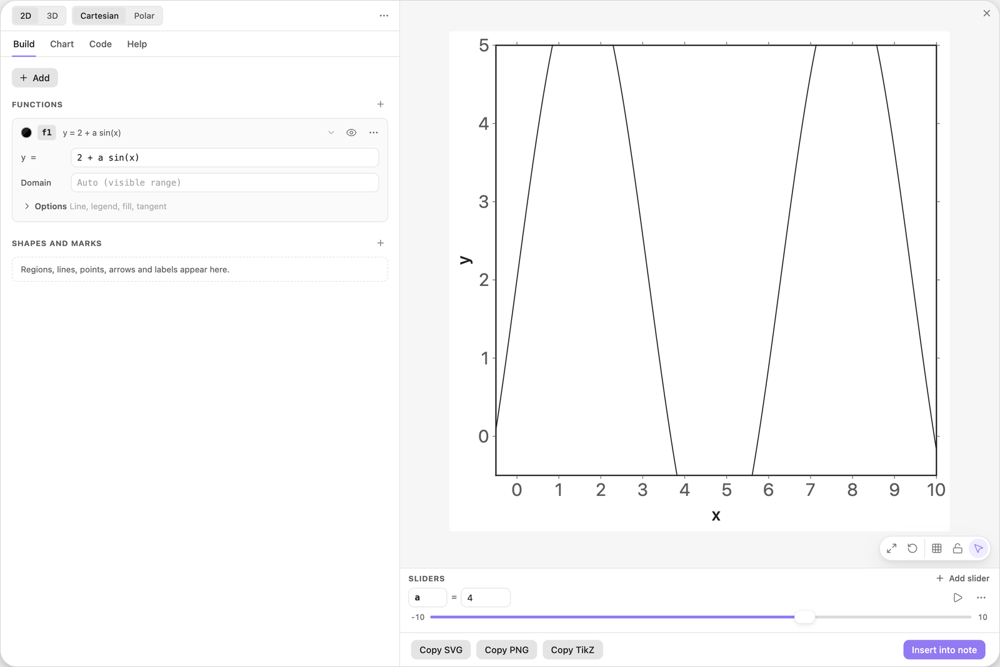
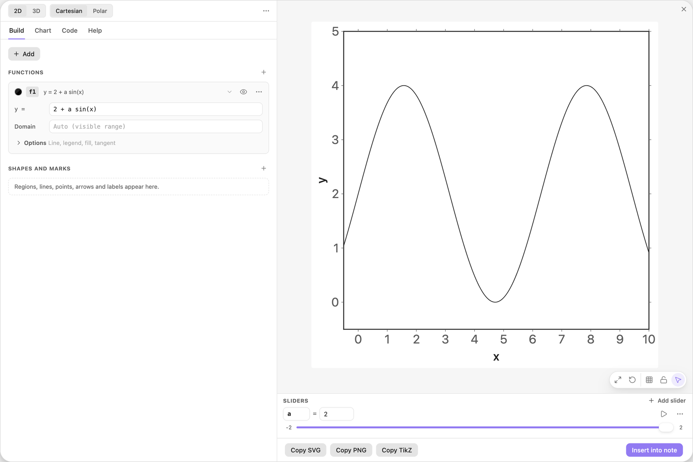
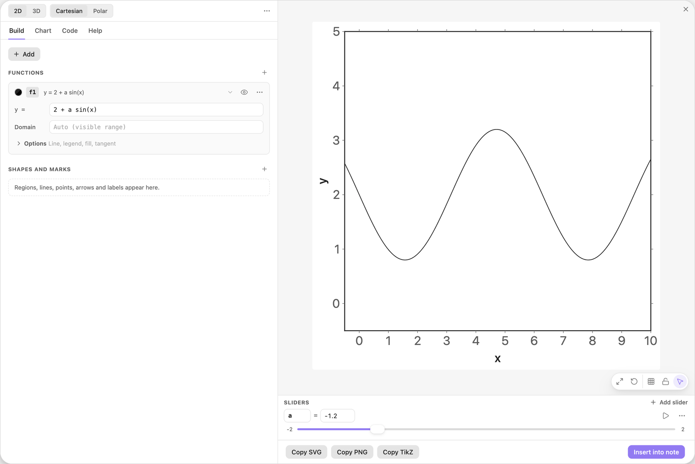
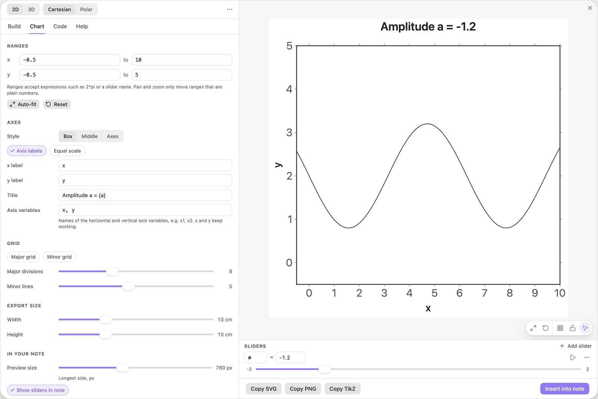
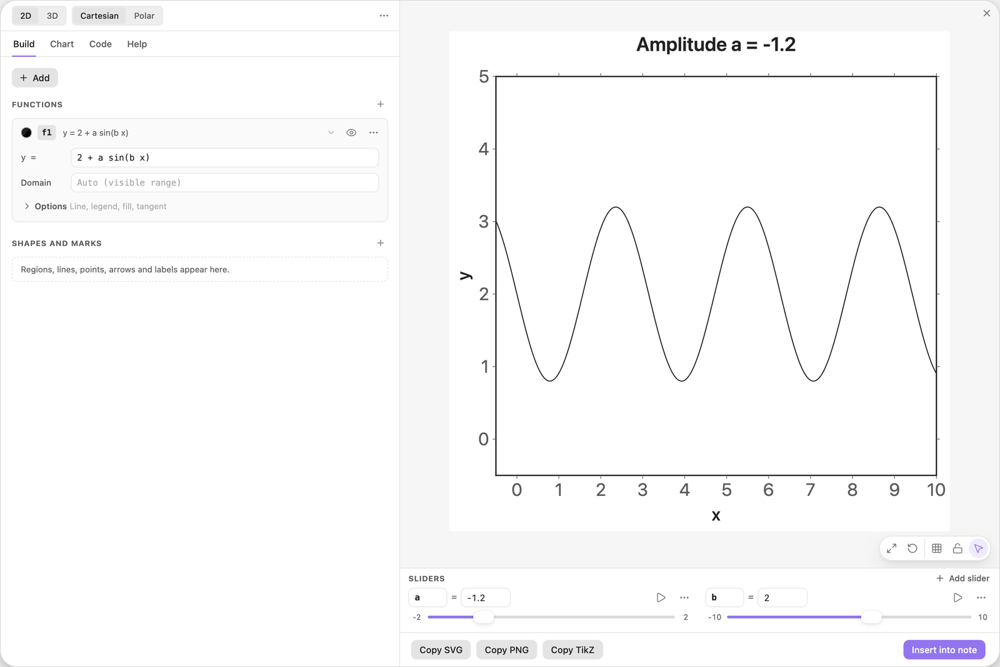
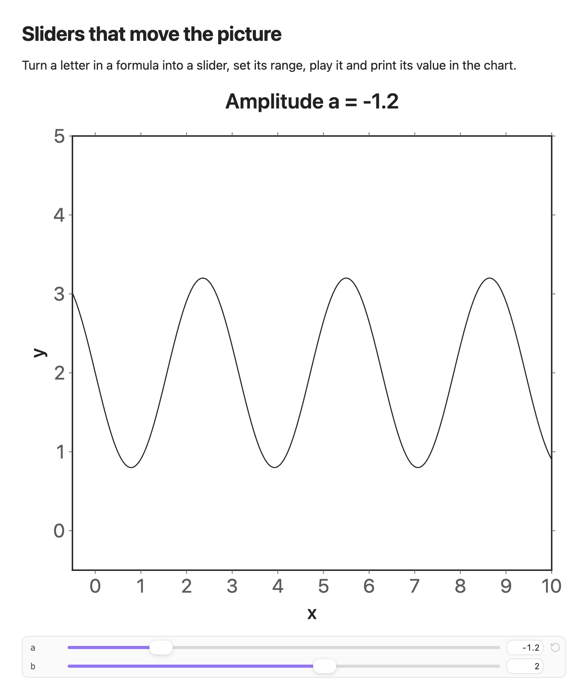

<!-- Generated by scripts/media/build-guides.mjs from src/guides. Do not edit. -->

# Sliders that move the picture

[All guides](README.md) · Functions and sliders · Core · about 6 minutes

Turn a letter in a formula into a slider, set its range, play it and print its value in the chart.

<p align="center"></p>

**What you can do afterwards**

- Create a slider from a letter in a formula
- Set the range of a slider and play it
- Print a live value in the title
- Use the sliders under the chart in your note

**Read first:** [Your first chart](first-chart.md)

## 1. Type a formula with a new letter

In a new chart, click + Add, choose Function y = f(x) and type the formula.

The chart does not know `a` yet. After a short pause the field reports `Unknown name 'a'` and offers a button. Click Add slider a. The Sliders dock appears under the preview with `a = 1`, and the wave is drawn.

| Where | Type |
| --- | --- |
| f1, y = | `2 + a sin(x)` |



*The letter a became a slider in the dock under the preview.*

> **Tip:** Keep a space or a `*` after the letter. `asin(x)` is the arcsine, and `ax` is one name.

## 2. Drag the slider

Drag the slider `a` to the right, up to 4. The wave grows while you drag: the preview redraws on every frame, not only when you let go. At 4 it no longer fits, and the crests leave the view.

You can also click the value and type a number, or press the arrow keys while the slider has the focus.



*a = 4: the wave has outgrown the view.*

## 3. Set the range of the slider

The small numbers at the two ends of the slider are its minimum and maximum. Click the right one, type `2` and press Enter. The value is pulled back to 2 and the wave fits the view again. Then click the left one and type `-2`.

Now the whole travel of the slider is useful. The step size sits in the menu behind the three dots on the row, next to Delete slider.

| Where | Type |
| --- | --- |
| Sliders, a: maximum | `2` |
| Sliders, a: minimum | `-2` |



*The slider now runs from -2 to 2, and the wave stays inside the view.*

> **Tip:** A number typed into the value field may lie outside the range. The range then widens to include it.

## 4. Press play

Click the play button on the slider row. The value sweeps back and forth between the minimum and the maximum, about four seconds each way, and the wave flips over as `a` passes zero.

Click the button again to stop, for example near -1.2. While it plays you can still drag the slider; it carries on from where you let go.



*Stopped at a = -1.2: a negative amplitude turns the wave upside down.*

## 5. Show the value in the title

Open the Chart tab and type a title under Axes. Curly brackets print the value of a formula, so the title always says where the slider stands.

`{a}` prints up to three decimals, `{a:1}` rounds to one. The same placeholders work in every label of the chart.

| Where | Type |
| --- | --- |
| Chart \> Axes, Title | `Amplitude a = {a}` |



*The title prints the live value of a.*

> **Tip:** A placeholder that cannot be computed prints a question mark, so a typo is easy to spot.

## 6. Add a second slider

Back in the Build tab, change the formula to `2 + a sin(b x)` and click Add slider b. `b` starts at 1, so nothing moves yet.

Drag `b` to 2: the wave now has twice as many crests. Each slider has its own row. From five sliders on, the dock shows compact pills instead and opens one row at a time.

| Where | Type |
| --- | --- |
| f1, y = | `2 + a sin(b x)` |



*Two sliders: a sets the height of the wave, b its frequency.*

> **Tip:** To rename a slider, type a new name into its name field. Every formula and label that uses it follows.

## 7. Take the sliders into your note

Click Insert into note. In the note, a strip with the same sliders sits under the chart.

Moving them there redraws the chart for the current session only. The note itself is never changed. To hide the strip, switch off Show sliders in note in the Chart tab, under In your note.



*The chart in a note with its slider strip.*

## The finished chart

Paste this block into a note to get the finished chart of this guide. Click the chart in the note to open it in the editor.

<details>
<summary>The chart as an easy-tikz block</summary>

```easy-tikz
{
  "v": 4,
  "dimension": false,
  "documentSetup": true,
  "title": "Amplitude a = {a}",
  "size_x_cm": 10,
  "size_y_cm": 10,
  "show_axis_label": true,
  "axis_label_x": "x",
  "axis_label_y": "y",
  "showAxis": true,
  "showLargeGrid": false,
  "showSmallGrid": false,
  "gridSize": 5,
  "majorTickNum": 8,
  "xmin": "-0.5",
  "xmax": "10",
  "ymin": "-0.5",
  "ymax": "5",
  "zmin": "-5",
  "zmax": "5",
  "axis_style": "box",
  "coordinateSystem": "cartesian",
  "axis_label_x_polar": "",
  "axis_label_y_polar": "",
  "axis_label_z": "z",
  "rotationX": 30,
  "rotationZ": 45,
  "zoom3D": 1,
  "boxAspect": "true",
  "previewSize": 760,
  "functions": [
    {
      "expression": "2 + a sin(b x)",
      "domain": "",
      "showLegend": false,
      "fill": false,
      "fillOpacity": 0.2,
      "fillPattern": "solid",
      "tangent": false,
      "color": "black",
      "dashed": false,
      "tangentPoint": "",
      "extrema": false,
      "thickness": "thin",
      "parametric": false,
      "expressionY": "",
      "name": "f1"
    }
  ],
  "functions3D": [],
  "tools": [],
  "annotations": [],
  "parameters": [
    {
      "name": "a",
      "value": -1.2,
      "min": -2,
      "max": 2,
      "step": 0.1
    },
    {
      "name": "b",
      "value": 2,
      "min": -10,
      "max": 10,
      "step": 0.1
    }
  ],
  "variables": "x, y",
  "equalScale": false,
  "showSlidersInNote": true
}
```

</details>

## Next guides

- [Animate a chart with play](animate-play.md): A point runs around the unit circle while the sine curve draws itself behind it: one slider in points, a domain, a path and the title, then press play.
- [Tangents and extrema](tangents-extrema.md): Mark the turning points of a function, add a tangent, slide it along the curve and label its slope.
- [Drag shapes to edit them](drag-to-edit.md): Grab a line or a curve in the preview and its numbers follow: move, turn, stretch, undo.
- [Charts in your notes](charts-in-notes.md): Insert a chart into a note, play with its sliders there, set its width and alignment, and open it again to change it.

[All guides](README.md)
