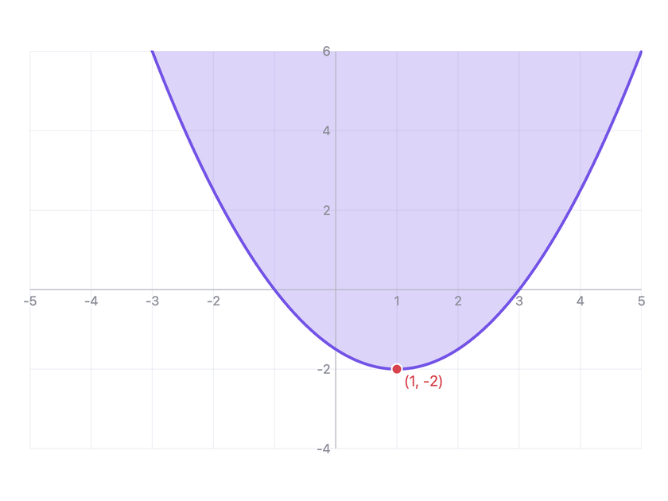
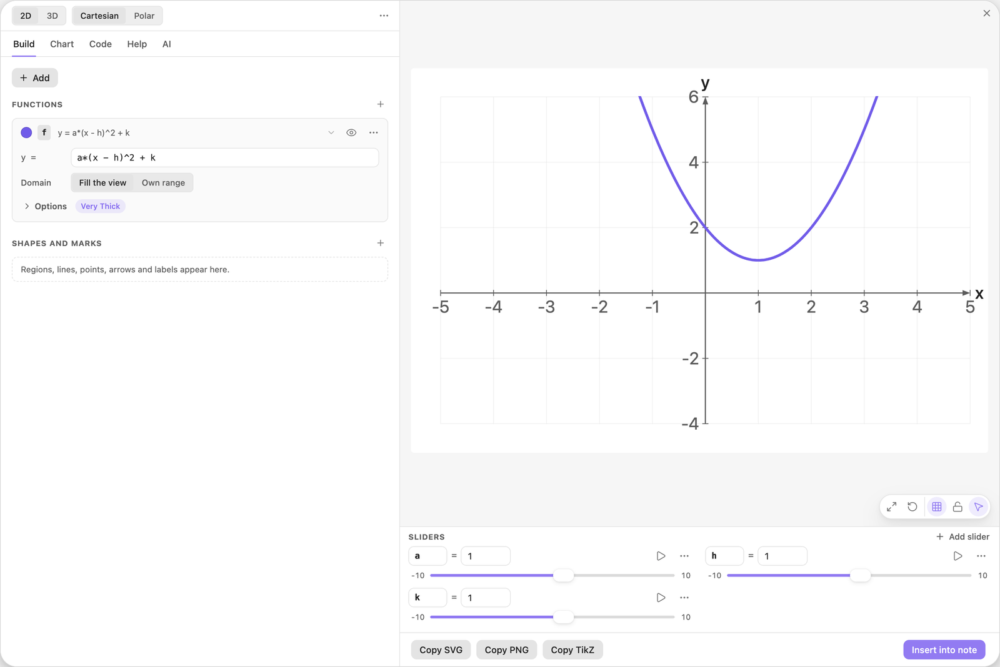
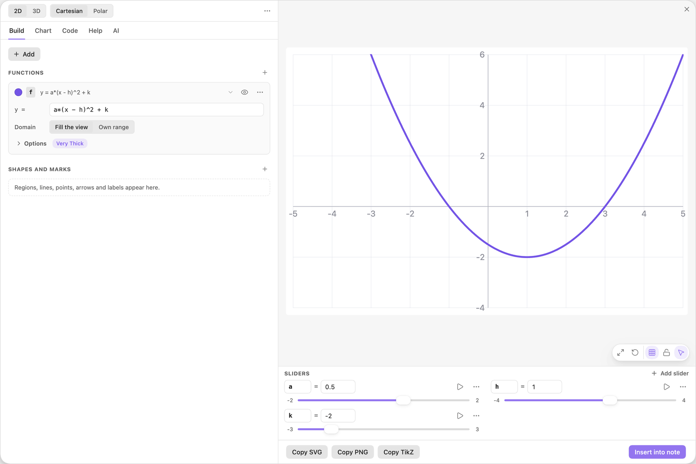
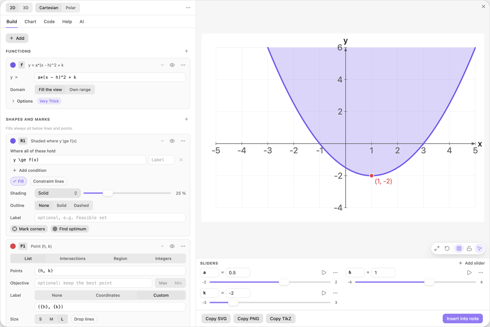

<!-- Generated by scripts/media/build-guides.mjs from src/guides. Do not edit. -->

# Sliders that move the picture

[All guides](README.md) · Functions and sliders · Core · about 3 minutes

Turn letters into sliders, set their range and step, press play, and connect them across a note.

<p align="center"></p>

**What you can do afterwards**

- Make sliders from the letters of a formula
- Set the range and the step of a slider, and play it
- Connect sliders across the charts of a note

**Read first:** [Your first chart](first-chart.md)

## 1. Turn letters into sliders

Type a formula with letters the chart does not know, such as `a*(x - h)^2 + k`. Click Add slider under the field for each one: each slider starts at 1.

The chart in words:

```easy-tikz
show x from -5 to 5 and y from -4 to 6
size 12 x 8
axes in the middle
with a grid
slider a from -10 to 10, starting at 1
slider h from -10 to 10, starting at 1
slider k from -10 to 10, starting at 1
plot f(x) = a*(x - h)^2 + k in purple, very thick
```



> **Tip:** Keep the star until `a` is a slider: before that, `a(x - h)` reads as a function named `a`.

## 2. Set the range and the step

Click the small numbers at the ends of a slider to type its minimum and maximum, then drag it. The step sits in the slider's options: `h` moves in steps of 0.5.

The chart gets these lines:

```easy-tikz
slider a from -2 to 2, starting at 0.5
slider h from -4 to 4, starting at 1, in steps of 0.5
slider k from -3 to 3, starting at -2
```



## 3. Press play

Click play on the row of `h`: it sweeps from minimum to maximum and back, about four seconds each way, and the shading and the vertex follow. `{h}` in a label prints its value.

The chart gets these lines:

```easy-tikz
shade where $y \ge f(x)$ in purple
mark (h, k), large, labelled "({h}, {k})"
```


> **Tip:** Drag a slider while it plays to take over, and it carries on from where you let go.

## 4. Connect sliders across a note

Add `connected` to a slider line. In a note, moving `a` then moves the slider `a` of every other chart whose `a` is connected too.

The chart gets these lines:

```easy-tikz
slider a from -2 to 2, starting at 0.5, connected
```



> **Tip:** The editor has it as Connect with others in the slider's options, and a note as the link button on the slider row.

## The finished chart

Paste this block into a note to get the finished chart of this guide. Click the chart in the note to open it in the editor.

<details>
<summary>The chart as an easy-tikz block</summary>

```easy-tikz
show x from -5 to 5 and y from -4 to 6
size 12 x 8
axes in the middle
with a grid
slider a from -2 to 2, starting at 0.5
slider h from -4 to 4, starting at 1, in steps of 0.5
slider k from -3 to 3, starting at -2
plot f(x) = a*(x - h)^2 + k in purple, very thick
shade where $y \ge f(x)$ in purple
mark (h, k), large, labelled "({h}, {k})"
```

</details>

## Next guides

- [Animate a chart with play](animate-play.md): A point runs around the unit circle while the circle unrolls into the sine curve, all on one slider.
- [Parametric and polar curves](parametric-polar.md): Trace a curve from x(t) and y(t), then switch to polar and grow a rose whose petals a slider counts.
- [Tangents and extrema](tangents-extrema.md): Mark the turning points of a curve, roll a tangent along it with a slider and print its slope.

[All guides](README.md)
