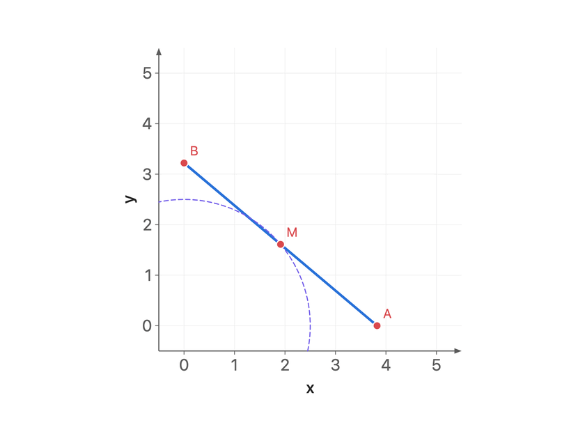
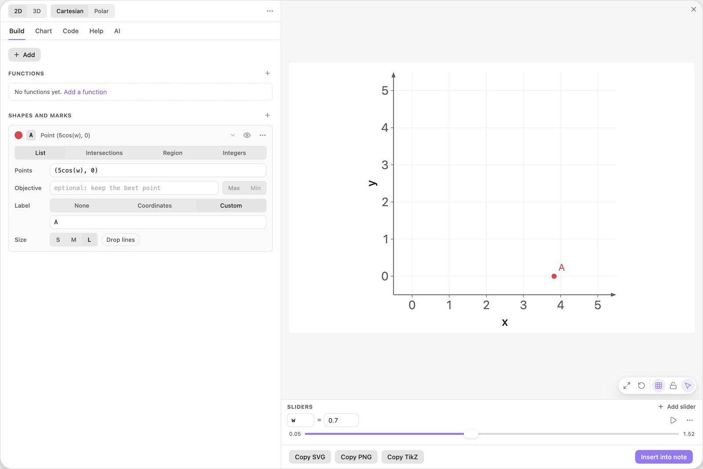
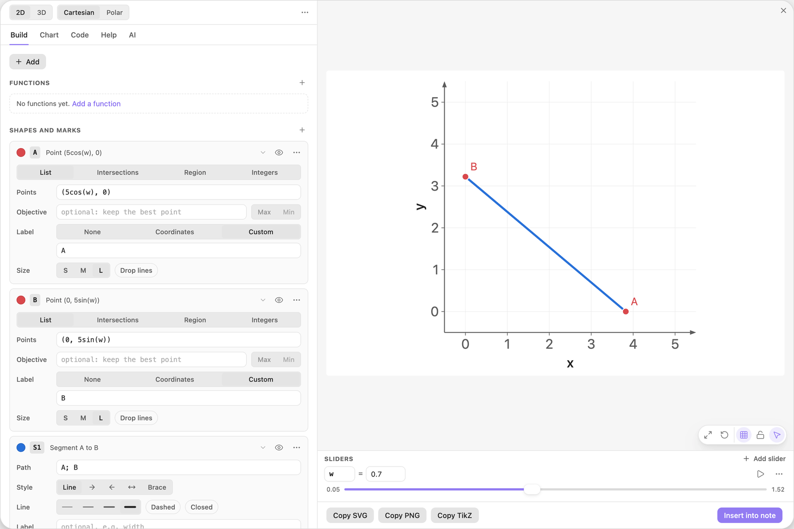
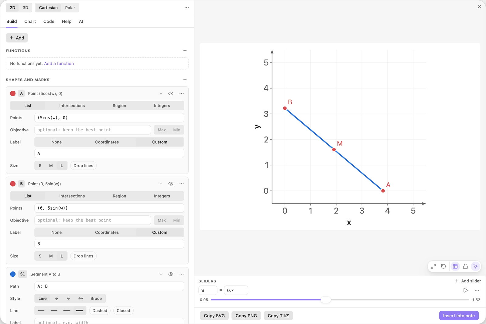
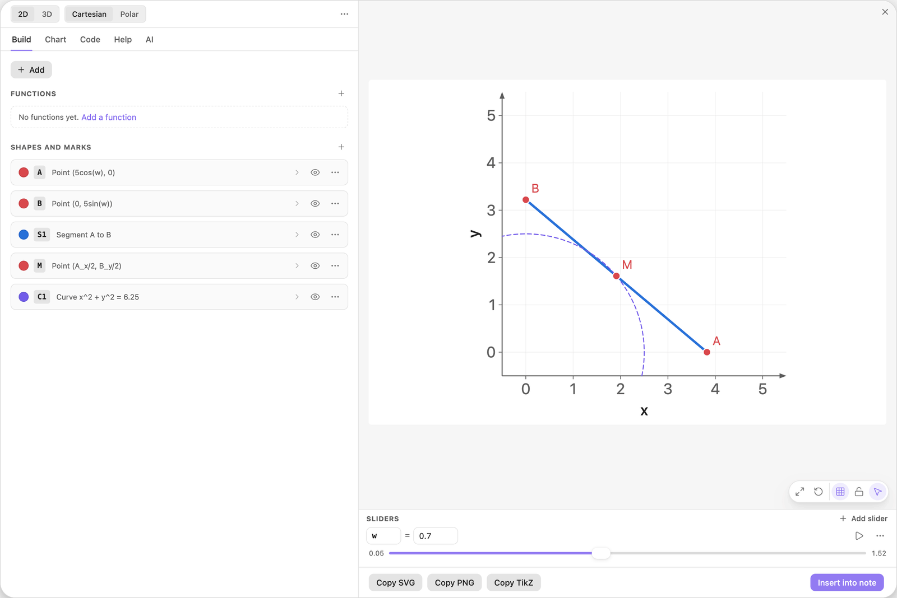

<!-- Generated by scripts/media/build-guides.mjs from src/guides. Do not edit. -->

# A ladder sliding down a wall

[All guides](README.md) · Showcase · Core · about 2 minutes

The foot of a ladder slides away from the wall; its middle point moves on a quarter circle.

<p align="center"></p>

**What you can do afterwards**

- Name points and use their coordinates
- Draw a line between named points
- Find the path a point follows

## 1. Put the foot on the floor

The ladder is 5 long. Its foot A sits at `5cos(w)` on the floor; the slider `w` is its angle.

The chart in words:

```easy-tikz
show x from -0.5 to 5.5 and y from -0.5 to 5.5
size 12 x 8
equal scale
axes on the edges
with a grid
slider w from 0.05 to 1.52, starting at 0.7, in steps of 0.01
A: mark (5cos(w), 0), large, labelled "A"
```



## 2. Lean the top on the wall

B sits at `5sin(w)` on the wall. `draw a line from A to B` joins the named points.

The chart gets these lines:

```easy-tikz
B: mark (0, 5sin(w)), large, labelled "B"
draw a line from A to B in blue, very thick
```



## 3. Mark the middle

M takes the coordinates of A and B: `A_x/2` and `B_y/2`.

The chart gets these lines:

```easy-tikz
M: mark (A_x/2, B_y/2), large, labelled "M"
```



## 4. Draw the path of the middle

Drag `w` or press play. M stays on the dashed circle of radius 2.5 round the corner.

The chart gets these lines:

```easy-tikz
draw x^2 + y^2 = 6.25 in purple, dashed
```



## The finished chart

Paste this block into a note to get the finished chart of this guide. Click the chart in the note to open it in the editor.

<details>
<summary>The chart as an easy-tikz block</summary>

```easy-tikz
show x from -0.5 to 5.5 and y from -0.5 to 5.5
size 12 x 8
equal scale
axes on the edges
with a grid
slider w from 0.05 to 1.52, starting at 0.7, in steps of 0.01
A: mark (5cos(w), 0), large, labelled "A"
B: mark (0, 5sin(w)), large, labelled "B"
draw a line from A to B in blue, very thick
M: mark (A_x/2, B_y/2), large, labelled "M"
draw x^2 + y^2 = 6.25 in purple, dashed
```

</details>

## Next guides

- [Points and live labels](points-labels.md): Mark points from a list or from a formula, name them in LaTeX and print their values in labels.

[All guides](README.md)
