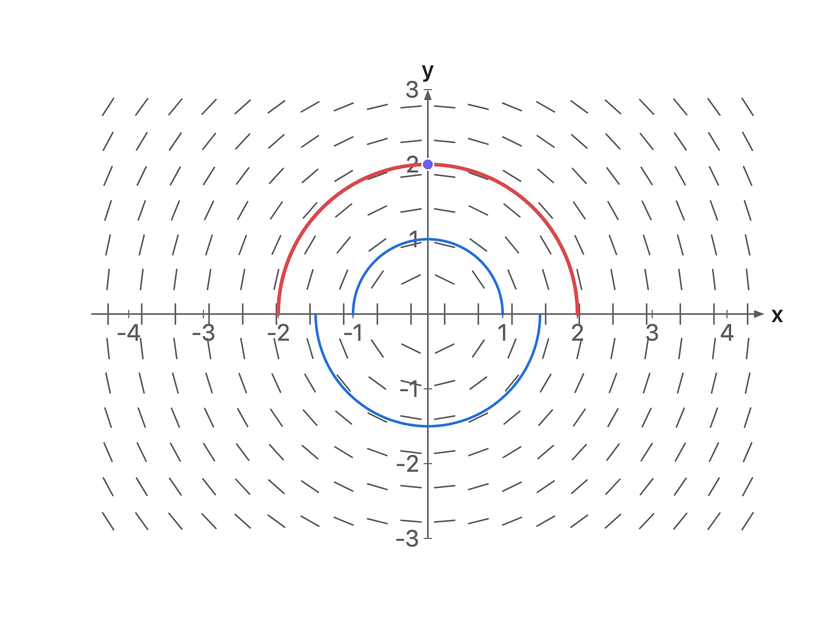
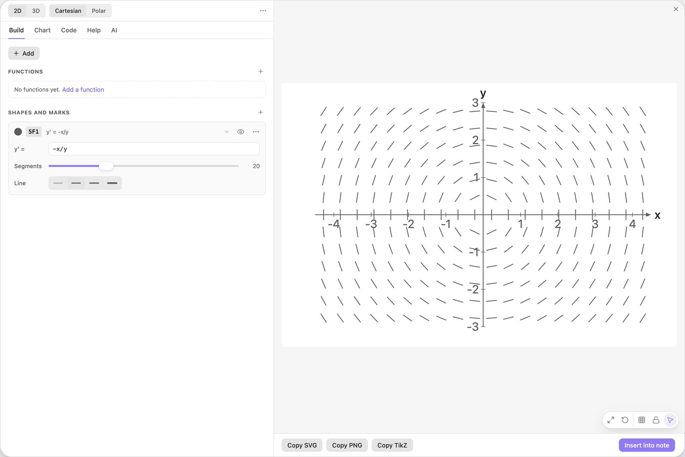
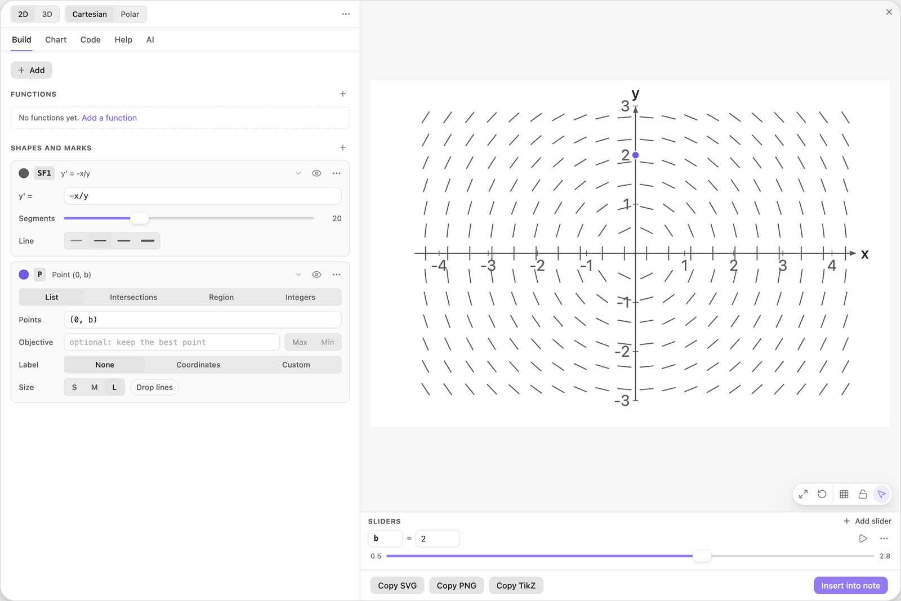
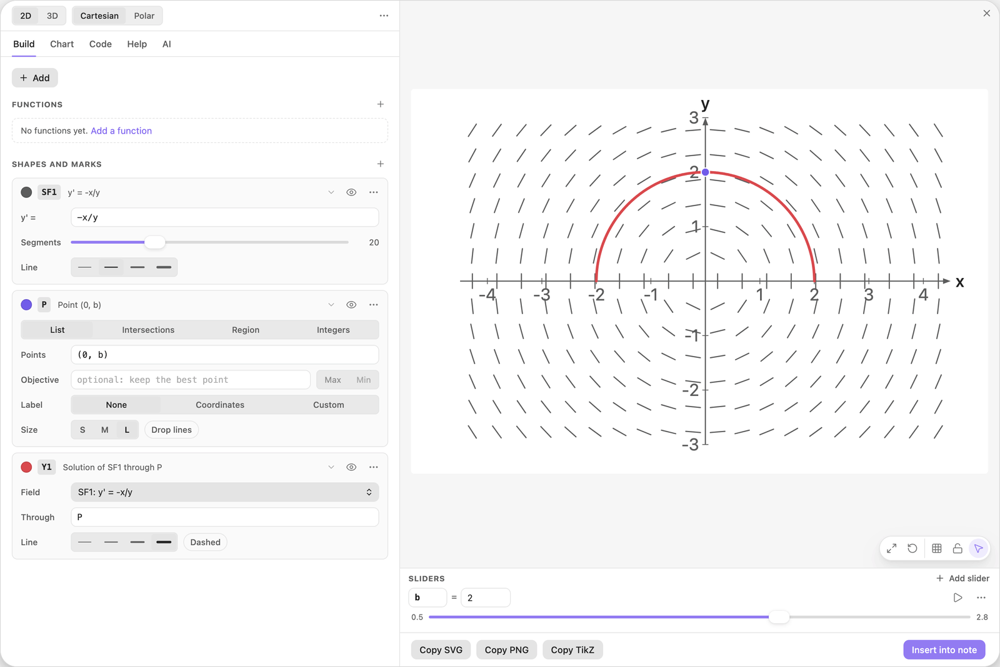
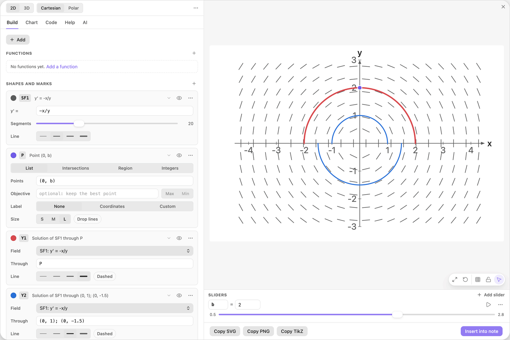

<!-- Generated by scripts/media/build-guides.mjs from src/guides. Do not edit. -->

# Slope fields and solutions

[All guides](README.md) · Calculus · Advanced · about 3 minutes

Draw the slope field of a differential equation and the solution through a point you move.

<p align="center"></p>

**What you can do afterwards**

- Draw the slope field of y' = f(x, y)
- Name a point and move it with a slider
- Draw the solutions through points

**Read first:** [Tangents and extrema](tangents-extrema.md)

## 1. Draw the slope field

Write the equation after `the slope field of`. Each short line has the slope y' at its point, so the lines show where solutions go.

The chart in words:

```easy-tikz
show x from -4.5 to 4.5 and y from -3 to 3
size 12 x 8
equal scale
axes in the middle
draw the slope field of y' = -x/y
```



## 2. Mark a point P on a slider

`P: mark (0, b)` marks a point and names it P. The slider `b` moves it up and down the y-axis.

The chart gets these lines:

```easy-tikz
slider b from 0.5 to 2.8, starting at 2
P: mark (0, b) in purple, large
```



## 3. Draw the solution through P

The chart follows the field from P to both sides until the curve turns vertical: here half a circle. Drag `b` or press play to resize it.

The chart gets these lines:

```easy-tikz
draw the solution through P, very thick
```



## 4. Add more solutions

List more points after `the solutions through`. Solutions never cross, so the half circles nest around the origin.

The chart gets these lines:

```easy-tikz
draw the solutions through (0, 1) and (0, -1.5) in blue
```



## The finished chart

Paste this block into a note to get the finished chart of this guide. Click the chart in the note to open it in the editor.

<details>
<summary>The chart as an easy-tikz block</summary>

```easy-tikz
show x from -4.5 to 4.5 and y from -3 to 3
size 12 x 8
equal scale
axes in the middle
slider b from 0.5 to 2.8, starting at 2
draw the slope field of y' = -x/y
P: mark (0, b) in purple, large
draw the solution through P, very thick
draw the solutions through (0, 1) and (0, -1.5) in blue
```

</details>

## Next guides

- [Estimate an area with Riemann sums](riemann-sums.md): Fill an area with rectangles, watch their sum approach the integral, then try trapezoids and middle sums.
- [Data and a regression line](data-regression.md): Plot data points, fit a regression line and print its equation and R² beside it.

[All guides](README.md)
