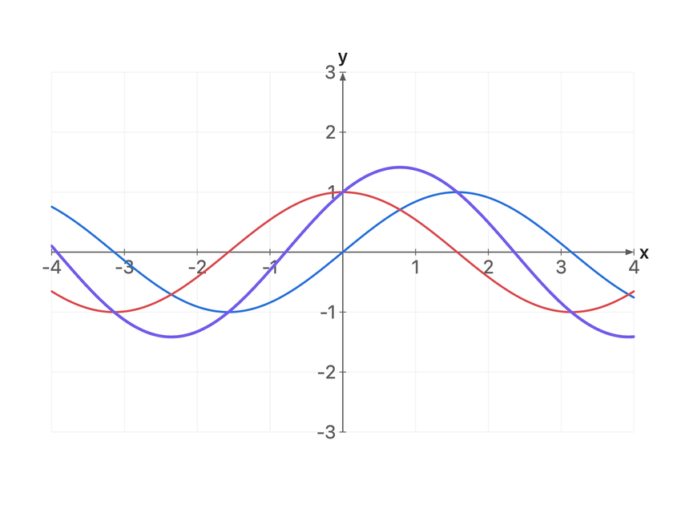
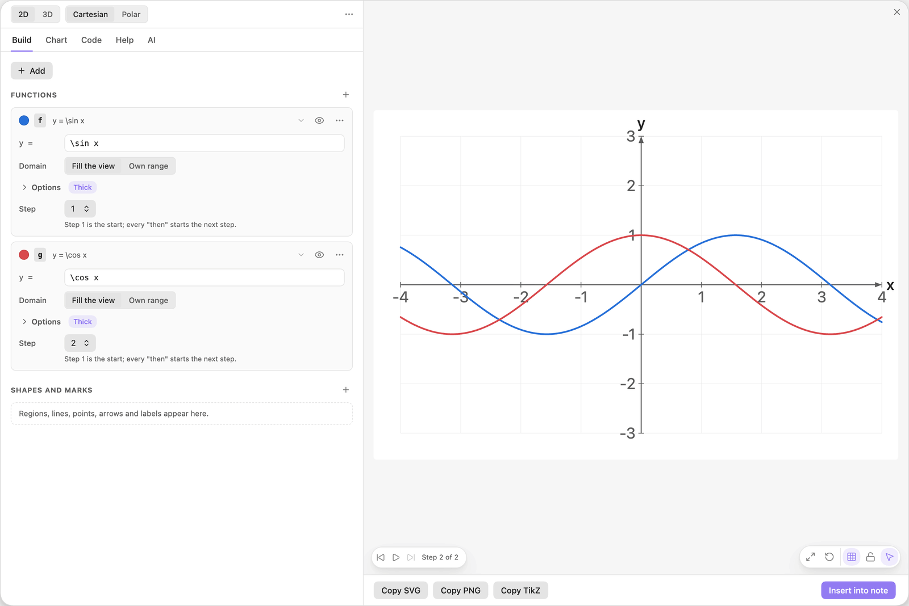
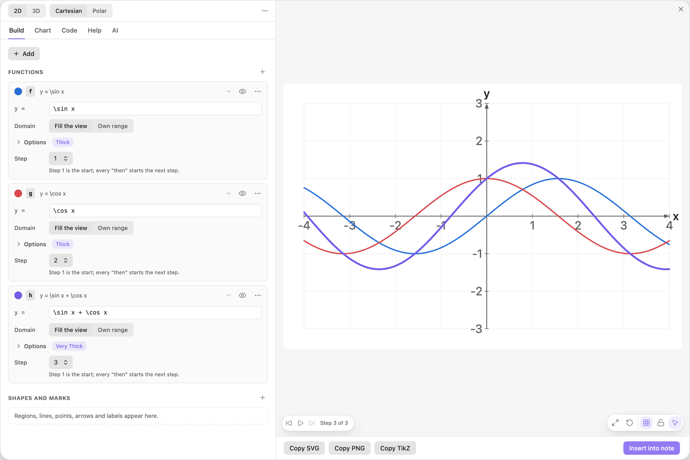
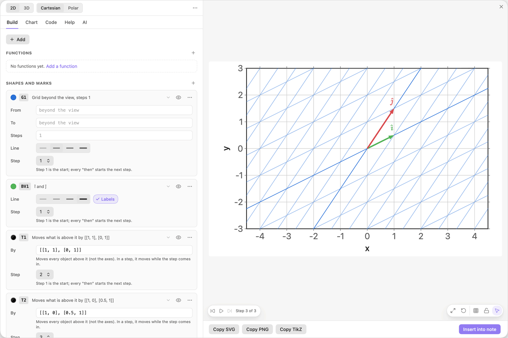

<!-- Generated by scripts/media/build-guides.mjs from src/guides. Do not edit. -->

# Steps you can play

[All guides](README.md) · Notes and export · Core · about 2 minutes

Start a step with then: the chart shows its lines a step at a time, plays in notes and exports every step as frames.

<p align="center"></p>

**What you can do afterwards**

- Split a chart into steps with then
- Play the steps in a note
- Export every step side by side

**Read first:** [Charts in your notes](charts-in-notes.md)

## 1. Start a step with then

The lines before the first `then` are step 1, and `then plot` starts step 2. Press Play: the sine comes first, then the cosine.

The chart in words:

```easy-tikz
show x from -4 to 4 and y from -3 to 3
size 12 x 8
axes in the middle
with a grid
plot $f(x) = \sin x$ in blue, thick
then plot $g(x) = \cos x$ in red, thick
```



## 2. Add a third step

Each `then` starts one more step. In a note the strip under the chart has Previous, Play, Next and the step number; the chart starts at its last step.

The chart gets these lines:

```easy-tikz
then plot $h(x) = \sin x + \cos x$ in purple, very thick
```


## 3. Export every step as frames

The PDF and Copy TikZ show the last step. With the line `frames` the export draws every step side by side instead.

The chart gets these lines:

```easy-tikz
frames
```



## 4. Let a step move

A transform moves while its step comes in: here a shear, then a second one. Use Next to go a step at a time.

The chart gets these lines:

```easy-tikz
show x from -4.5 to 4.5 and y from -3 to 3
equal scale
draw the grid
draw the basis vectors
then transform the plane by [[1, 1], [0, 1]]
then transform the plane by [[1, 0], [0.5, 1]]
```



## The finished chart

Paste this block into a note to get the finished chart of this guide. Click the chart in the note to open it in the editor.

<details>
<summary>The chart as an easy-tikz block</summary>

```easy-tikz
show x from -4 to 4 and y from -3 to 3
size 12 x 8
axes in the middle
with a grid
plot $f(x) = \sin x$ in blue, thick
then plot $g(x) = \cos x$ in red, thick
then plot $h(x) = \sin x + \cos x$ in purple, very thick
```

</details>

## Next guides

- [A matrix moves the plane](matrix-plane.md): Draw the grid and the basis vectors, then let a matrix move the whole plane in a step you can play.
- [Export to LaTeX](export-latex.md): Copy a chart as pgfplots code, compile it with pdflatex, or take only the picture for your document.

[All guides](README.md)
