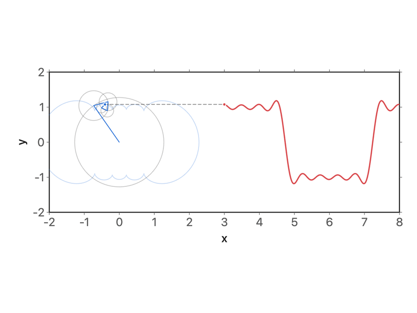
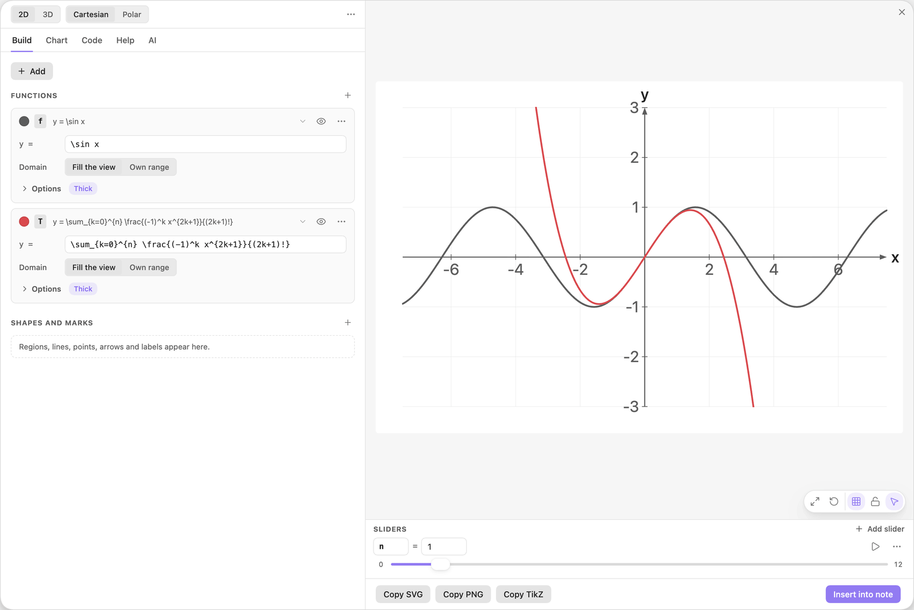
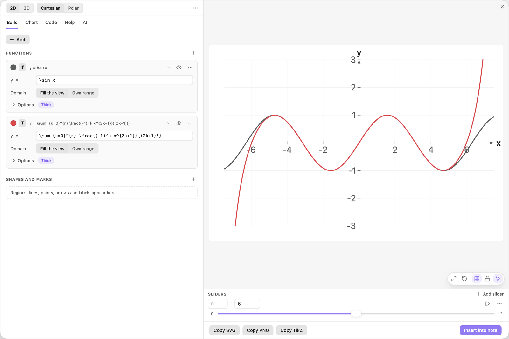
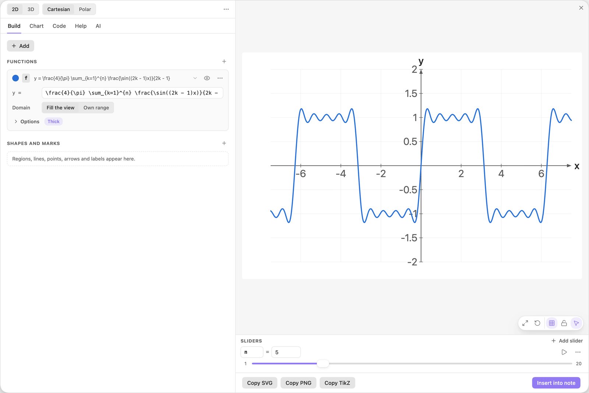
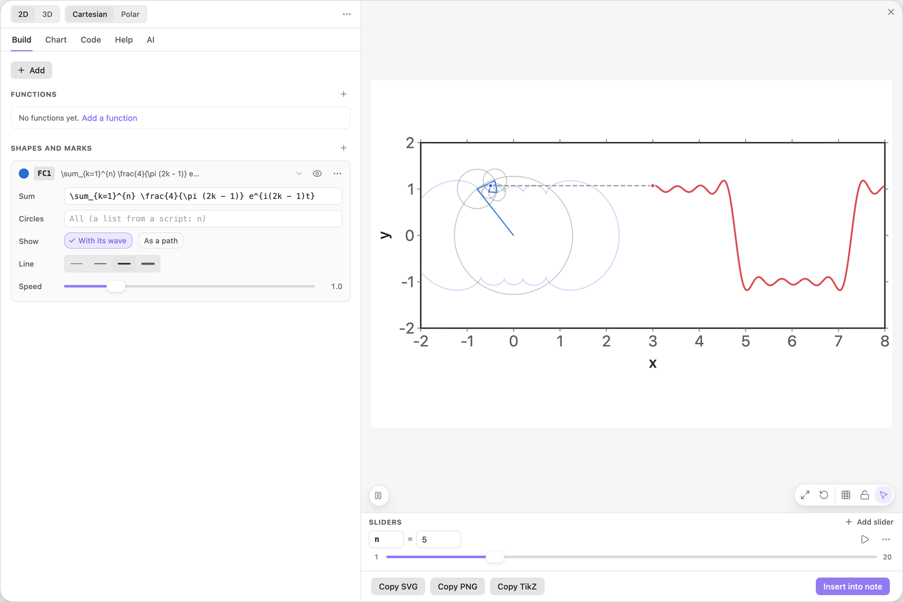

<!-- Generated by scripts/media/build-guides.mjs from src/guides. Do not edit. -->

# Sums: Taylor and Fourier series

[All guides](README.md) · Calculus · Core · about 3 minutes

Write a sum with a slider in its bound: a Taylor polynomial hugs the sine, and turning circles draw a square wave.

<p align="center"></p>

**What you can do afterwards**

- Write a sum with a slider as its bound
- Compare a Taylor polynomial with its function
- Draw a Fourier series as turning circles

**Read first:** [Sliders that move the picture](sliders.md)

## 1. Write a sum in a formula

`\sum_{k=0}^{n}` adds one term for each k from 0 to n, and the bound n is a slider. This sum is the Taylor polynomial of the sine.

The chart in words:

```easy-tikz
show x from -7.5 to 7.5 and y from -3 to 3
size 12 x 8
axes in the middle
with a grid
slider n from 0 to 12, starting at 1, in steps of 1
plot $f(x) = \sin x$ in gray, thick
plot $T(x) = \sum_{k=0}^{n} \frac{(-1)^k x^{2k+1}}{(2k+1)!}$ in red, thick
```



## 2. Raise n

Drag `n` up or press play. Each new term holds the red curve to the sine a little further out.

The chart gets these lines:

```easy-tikz
slider n from 0 to 12, starting at 6, in steps of 1
```



## 3. Write a Fourier series

Odd sines with falling weights add up to a square wave. With five terms the corners still ring; raise `n` and they get sharper.

The chart gets these lines:

```easy-tikz
show x from -7.5 to 7.5 and y from -2 to 2
slider n from 1 to 20, starting at 5, in steps of 1
plot $f(x) = \frac{4}{\pi} \sum_{k=1}^{n} \frac{\sin((2k - 1)x)}{2k - 1}$ in blue, thick
```



## 4. Turn the terms into circles

`draw the circles of` a sum in t puts each term on a circle that turns on the tip of the one before. `with its wave` draws the height of the tip: the same square wave.

The chart gets these lines:

```easy-tikz
show x from -2 to 8 and y from -2 to 2
equal scale
draw the circles of $\sum_{k=1}^{n} \frac{4}{\pi (2k - 1)} e^{i(2k - 1)t}$, with its wave
```



> **Tip:** The circles turn in notes and in the Help; the PDF draws them still.

## The finished chart

Paste this block into a note to get the finished chart of this guide. Click the chart in the note to open it in the editor.

<details>
<summary>The chart as an easy-tikz block</summary>

```easy-tikz
show x from -2 to 8 and y from -2 to 2
size 12 x 8
equal scale
slider n from 1 to 20, starting at 5, in steps of 1
draw the circles of $\sum_{k=1}^{n} \frac{4}{\pi (2k - 1)} e^{i(2k - 1)t}$, with its wave
```

</details>

## Next guides

- [Circles that draw square and sawtooth waves](fourier-circles.md): Circles turn on each other: the tip of the last draws a wave. More circles make it more square, other circles draw a sawtooth.
- [Taylor polynomials of sin(x)](taylor-sine.md): Raise the degree with a slider and watch the polynomial hug the sine over a wider and wider range.

[All guides](README.md)
