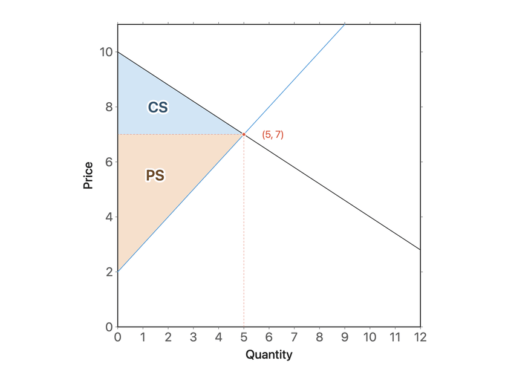
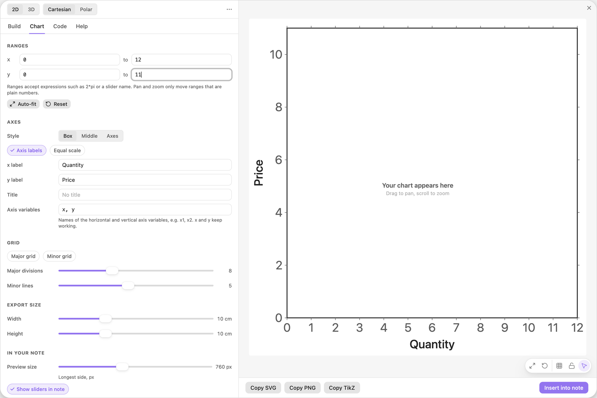
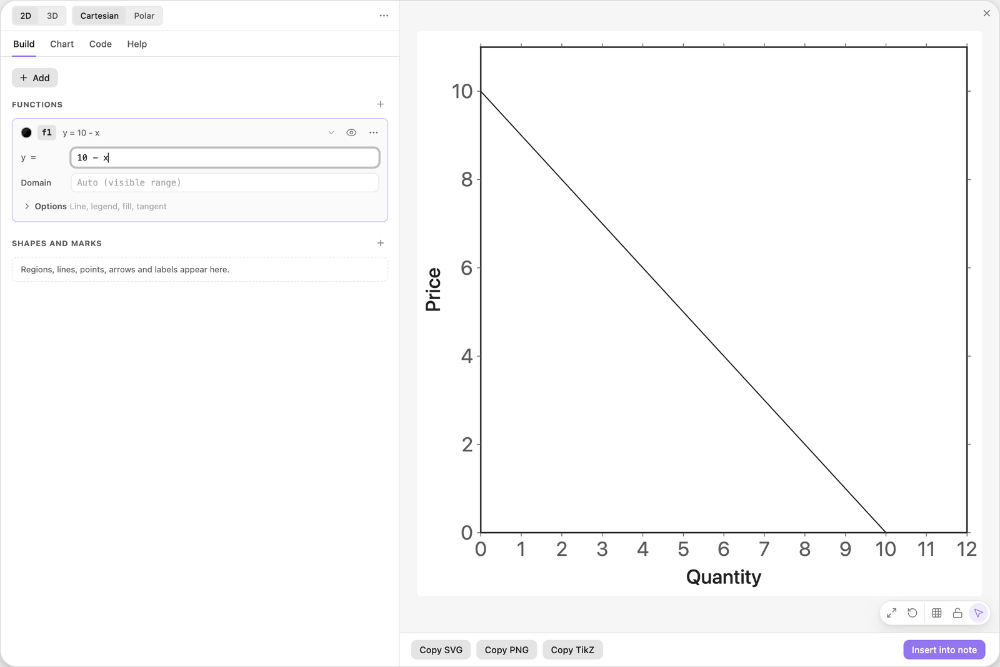
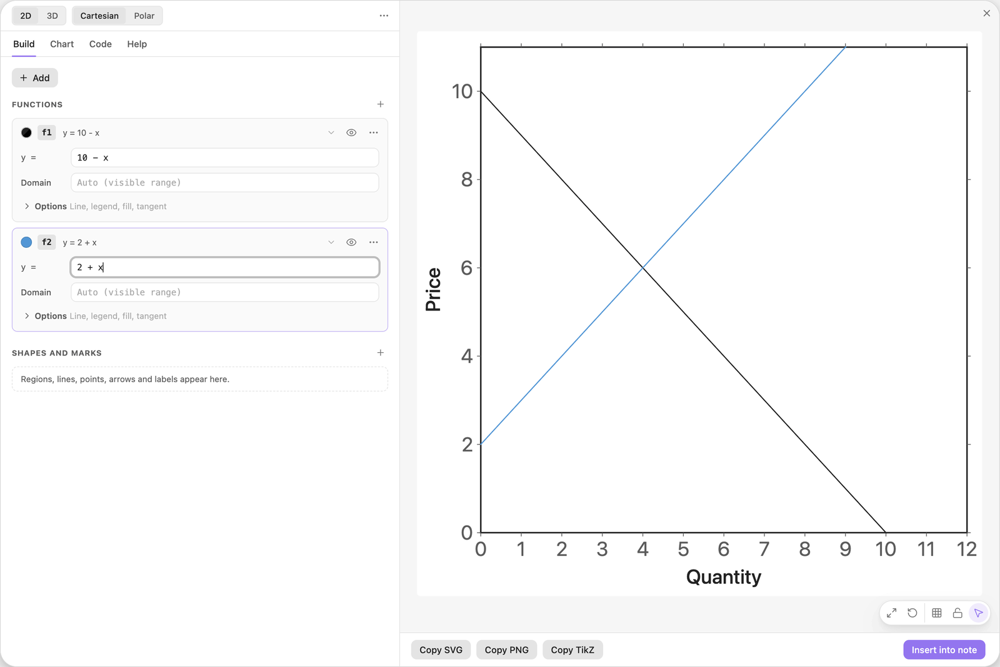
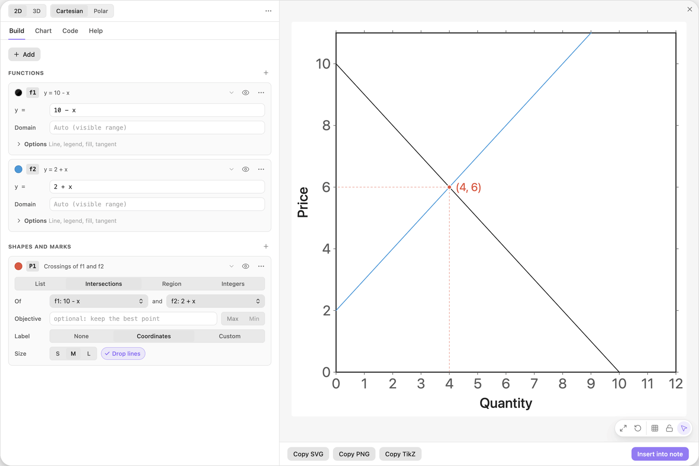
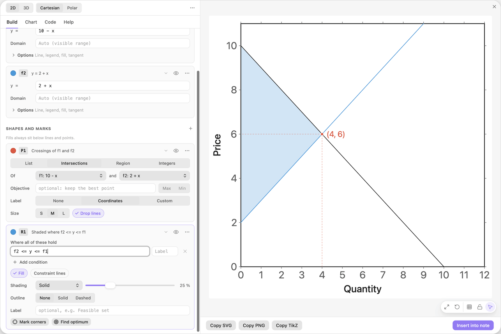
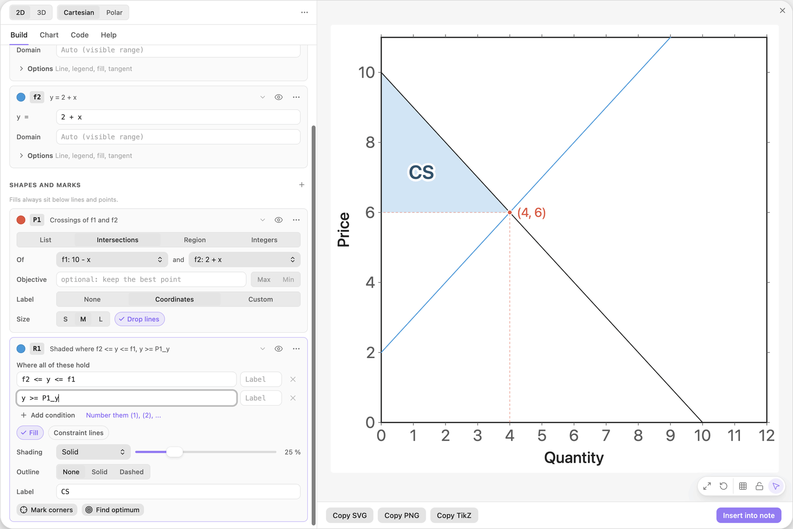
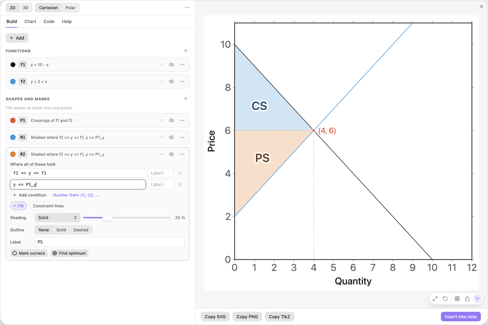
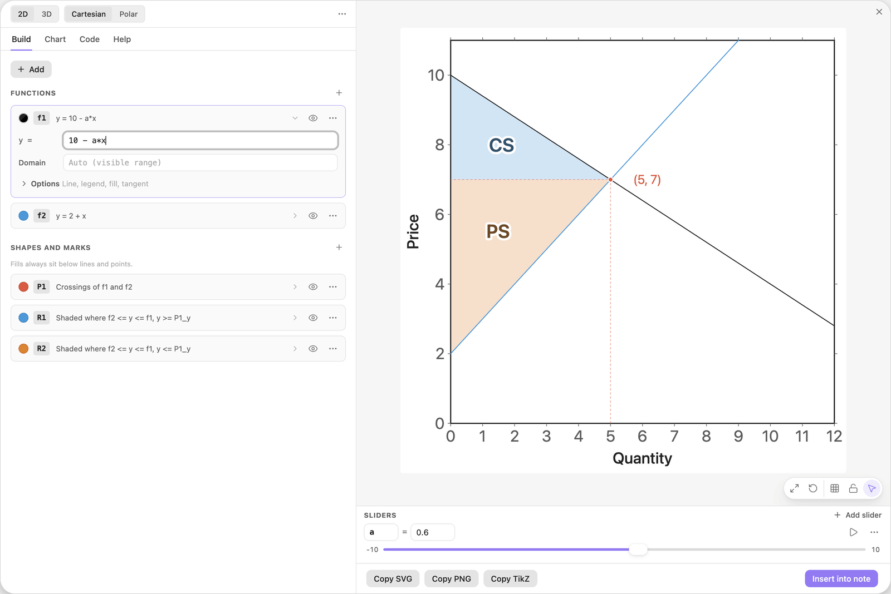

<!-- Generated by scripts/media/build-guides.mjs from src/guides. Do not edit. -->

# Draw a market with surplus areas

[All guides](README.md) · Regions and optimisation · Core · about 9 minutes

Demand and supply, their equilibrium with guide lines, and consumer and producer surplus that follow a slider.

<p align="center"></p>

**What you can do afterwards**

- Mark the equilibrium of two curves with dashed guides to the axes
- Shade consumer and producer surplus with limits taken from the equilibrium
- Change the slope of demand with a slider and watch everything follow

**Read first:** [Shade the areas between two curves](areas-between.md), [Sliders that move the picture](sliders.md)

## 1. Set up the axes

Start with a new chart and open the Chart tab. Under Ranges set x from 0 to 12 and y from 0 to 11. Under Axes type Quantity into x label and Price into y label.

Quantities and prices are not negative, so both axes start at 0. Setting the ranges first also keeps the editor from fitting the view to the first curve you type.



*Chart tab: the ranges on top, axis labels under Axes.*

> **Tip:** A range may start at exactly 0. Regions and lines are then cut off at the axis.

## 2. Type the demand curve

Go back to the Build tab, type the formula below into Start a chart and press Enter.

The card f1 is the demand curve: at a price of 10 nobody buys, and every drop of the price by 1 sells one more unit.

| Where | Type |
| --- | --- |
| Start a chart | `10 - x` |



*Demand as the function f1. The horizontal axis is the quantity x.*

> **Tip:** Economists put the price on the vertical axis, so write the price as a function of the quantity x.

## 3. Add the supply curve

Click + Add and choose Function y = f(x). Type the formula below into the new card f2.

Supply rises with the price. The two lines cross where the quantity supplied equals the quantity demanded.

| Where | Type |
| --- | --- |
| f2, y = | `2 + x` |



*Supply as the function f2, in the next free colour.*

> **Tip:** To name the curves in a legend, open Options on a function card, switch on Legend and type Demand or Supply.

## 4. Mark the equilibrium

Click + Add and choose Intersections of two functions. On the new card P1, switch on the chip Drop lines.

The marker sits at the equilibrium (4, 6), and dashed guides run from it to both axes: quantity 4 at price 6. P1 publishes these numbers as `P1_x` and `P1_y`.



*The equilibrium with drop lines to the quantity and the price axis.*

> **Tip:** The names follow the card: rename P1 to Eq by clicking its name badge and the values become `Eq_x` and `Eq_y`.

## 5. Shade the total surplus

Click + Add and choose Area between two functions. The card R1 holds the condition `f2 <= y <= f1`.

The preview shades the triangle between supply and demand, left of the equilibrium. It ends there by itself, because to the right of the crossing supply lies above demand and the condition cannot hold. This triangle is the total surplus of the market.



*Between supply and demand: the total surplus.*

> **Tip:** The left edge is the border of the view at x = 0. If your x axis starts below 0, add the row `x >= 0`.

## 6. Keep the consumer surplus

On the card R1 click Add condition and type the first row below. Then type CS into the field Label.

The new row cuts the triangle at the equilibrium price. What remains lies above the price and below demand: the consumer surplus, what buyers were willing to pay beyond the price.

| Where | Type |
| --- | --- |
| R1, condition 2 | `y >= P1_y` |
| R1, Label | `CS` |



*One more row: above the equilibrium price P1\_y.*

> **Tip:** A computed value in a condition needs no brackets or braces: write `P1_y` like any other name.

## 7. Add the producer surplus

Add a second Area between two functions. On the card R2, which is orange, click Add condition and type the first row below. Then type PS into its field Label.

R2 is the part of the triangle below the price and above supply: the producer surplus. Together the two regions fill the triangle from the step before.

| Where | Type |
| --- | --- |
| R2, condition 2 | `y <= P1_y` |
| R2, Label | `PS` |



*Consumer and producer surplus, split at the equilibrium price.*

> **Tip:** Both regions use the same first row. Only the second row decides which side of the price they keep.

## 8. Put demand on a slider

On the card f1 change the formula to the row below and click Add slider a under the field. Then drag the slider a down to 0.6.

Demand becomes flatter. The equilibrium moves to (5, 7), the guides follow, and both surplus areas are recomputed while you drag, because every limit in this chart is a computed value.

| Where | Type |
| --- | --- |
| f1, y = | `10 - a*x` |



*At a = 0.6 demand is flatter and the equilibrium has moved to quantity 5 and price 7.*

> **Tip:** Limit a to slopes that make sense: click the small numbers at the two ends of the slider and type 0.5 and 3. At 0 or below, demand no longer falls.

## The finished chart

Paste this block into a note to get the finished chart of this guide. Click the chart in the note to open it in the editor.

<details>
<summary>The chart as an easy-tikz block</summary>

```easy-tikz
show x from 0 to 12 and y from 0 to 11
xlabel Quantity
ylabel Price
slider a from -10 to 10, starting at 0.6, in steps of 0.1
plot f1(x) = 10 - a*x
plot f2(x) = 2 + x in blue
P1: mark where f1 and f2 cross, with lines to the axes and coordinates
shade where f2 <= y <= f1 and y >= P1_y, labelled "CS"
shade where f2 <= y <= f1 and y <= P1_y in orange, labelled "PS"
```

</details>

## Next guides

- [Charts in your notes](charts-in-notes.md): Insert a chart into a note, play with its sliders there, set its width and alignment, and open it again to change it.
- [Export to LaTeX](export-latex.md): Get pgfplots code that compiles with pdflatex: as a standalone document or as a snippet, at the size you need, in the colours of the preview.
- [Find a nonlinear optimum with level curves](level-curves.md): Level curves of an objective, a constraint region, the best point on its edge, and the level curve that touches it there.

[All guides](README.md)
