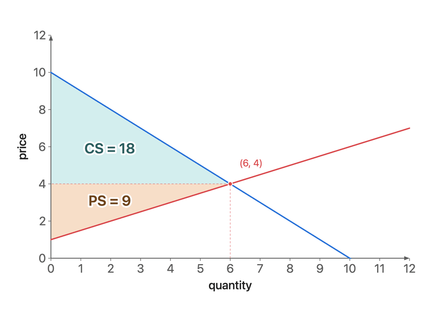
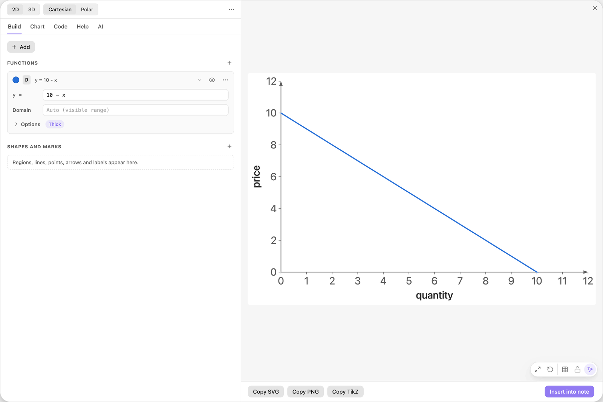
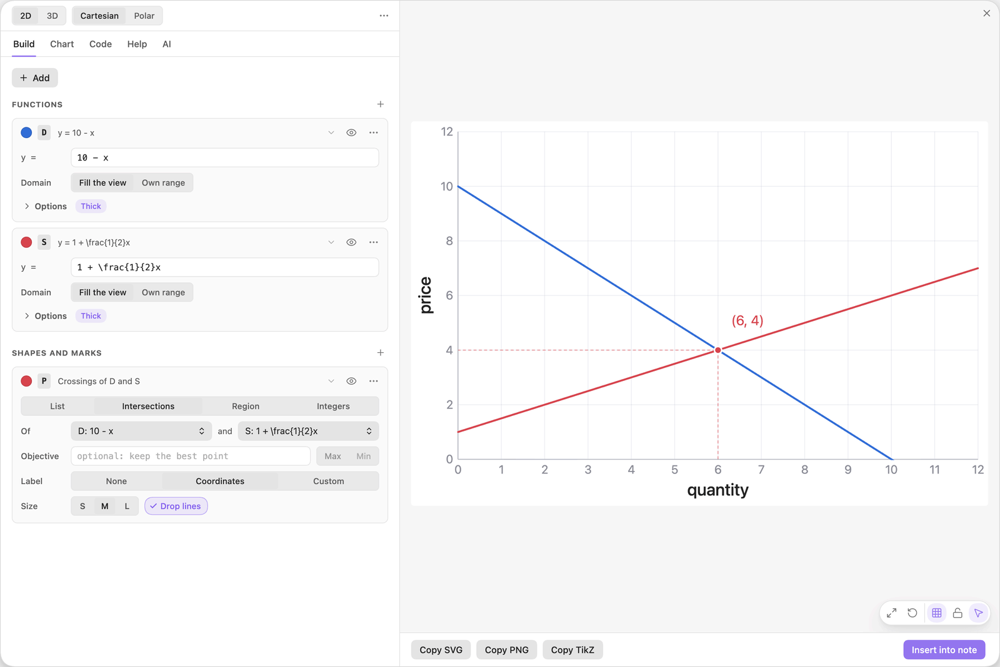
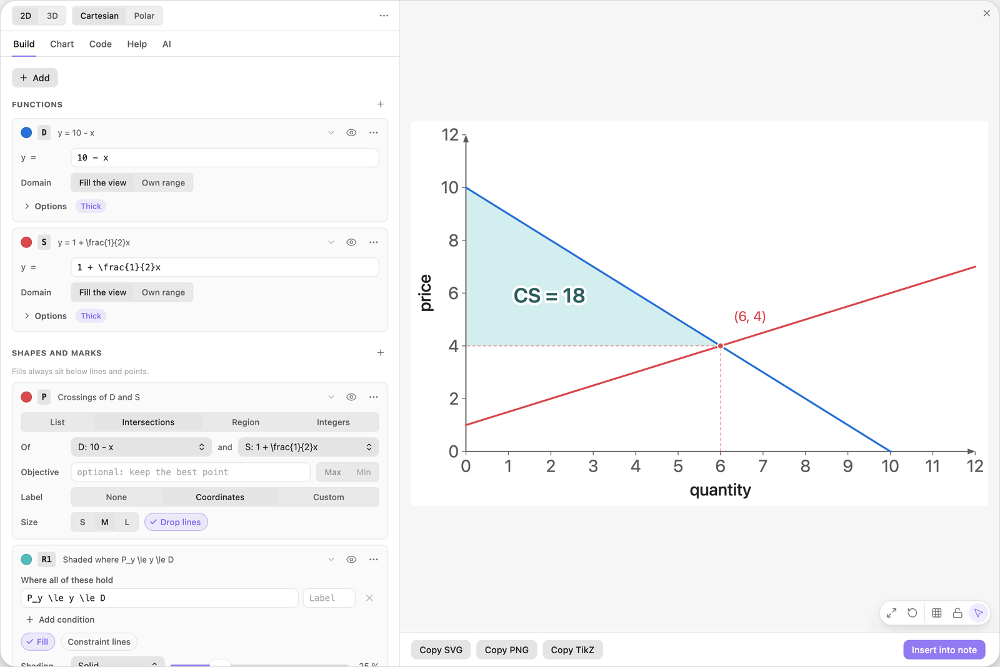
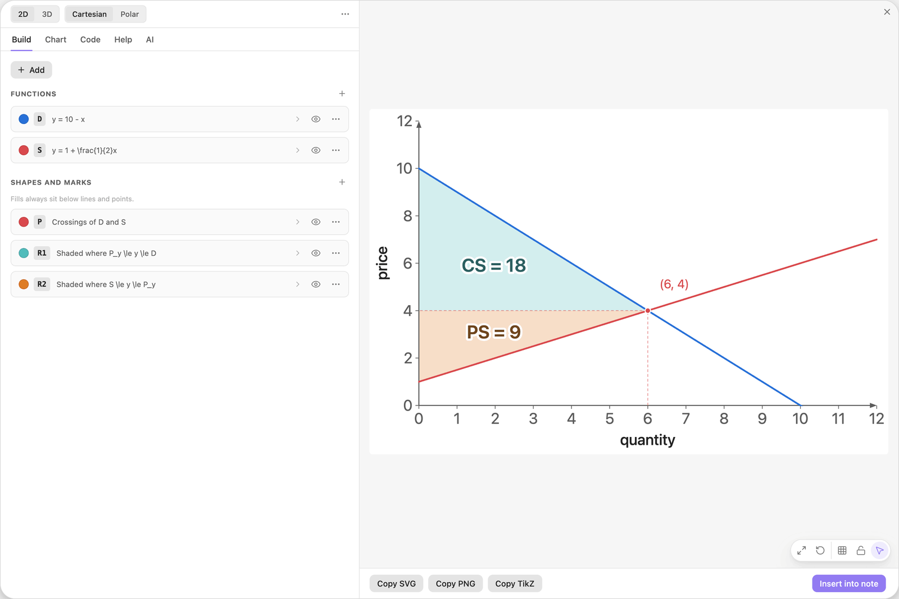
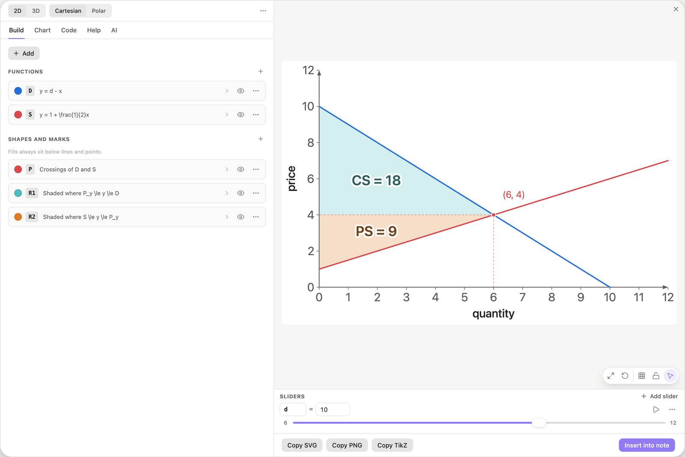

<!-- Generated by scripts/media/build-guides.mjs from src/guides. Do not edit. -->

# Draw a market with surplus areas

[All guides](README.md) · Regions and optimisation · Core · about 3 minutes

Demand and supply, the equilibrium with lines to the axes, and both surpluses following a demand slider.

<p align="center"></p>

**What you can do afterwards**

- Mark the equilibrium of two lines
- Shade consumer and producer surplus with computed limits
- Shift demand with a slider and watch everything follow

**Read first:** [Shade the areas between two curves](areas-between.md)

## 1. Draw the demand line

`xlabel` and `ylabel` name the axes: economists put the price on the y axis. Demand `D` falls, because people buy more when the price is lower.

The chart in words:

```easy-tikz
show x from 0 to 12 and y from 0 to 12
size 12 x 8
axes on the edges
xlabel quantity
ylabel price
plot D(x) = 10 - x in blue, thick
```



## 2. Add supply and the equilibrium

Supply `S` rises with the price. The market settles where the lines cross, and `with lines to the axes` shows its quantity and price.

The chart gets these lines:

```easy-tikz
plot $S(x) = 1 + \frac{1}{2}x$ in red, thick
P: mark where D and S cross, with lines to the axes and coordinates
```



## 3. Shade the consumer surplus

Buyers gain the area between the price `P_y` and demand. The braces in the label compute it: half the width `P_x` times the height `D(0) - P_y`.

The chart gets these lines:

```easy-tikz
shade where $P_y \le y \le D$ in teal, labelled "CS = {P_x*(D(0) - P_y)/2:1}"
```



> **Tip:** In a condition, `D` without brackets is the value of demand at each x.

## 4. Shade the producer surplus

Sellers gain the area between supply and the price. Together the two areas fill the triangle between the lines, left of the equilibrium.

The chart gets these lines:

```easy-tikz
shade where $S \le y \le P_y$ in orange, labelled "PS = {P_x*(P_y - S(0))/2:1}"
```



## 5. Shift demand with a slider

Replace 10 by a slider `d` and drag it. The equilibrium, its lines and both areas with their values follow at once.

The chart gets these lines:

```easy-tikz
slider d from 6 to 12, starting at 10
plot D(x) = d - x in blue, thick
```



> **Tip:** `:1` after a formula in braces rounds it to one decimal.

## The finished chart

Paste this block into a note to get the finished chart of this guide. Click the chart in the note to open it in the editor.

<details>
<summary>The chart as an easy-tikz block</summary>

```easy-tikz
show x from 0 to 12 and y from 0 to 12
size 12 x 8
axes on the edges
xlabel quantity
ylabel price
slider d from 6 to 12, starting at 10
plot D(x) = d - x in blue, thick
plot $S(x) = 1 + \frac{1}{2}x$ in red, thick
P: mark where D and S cross, with lines to the axes and coordinates
shade where $P_y \le y \le D$ in teal, labelled "CS = {P_x*(D(0) - P_y)/2:1}"
shade where $S \le y \le P_y$ in orange, labelled "PS = {P_x*(P_y - S(0))/2:1}"
```

</details>

## Next guides

- [Calculate with computed points](computed-values.md): Use what crossing points publish, their count and coordinates, in a title, a new point and an area.
- [Charts in your notes](charts-in-notes.md): Insert a chart into a note, edit it again, and move its sliders there, also across charts.

[All guides](README.md)
