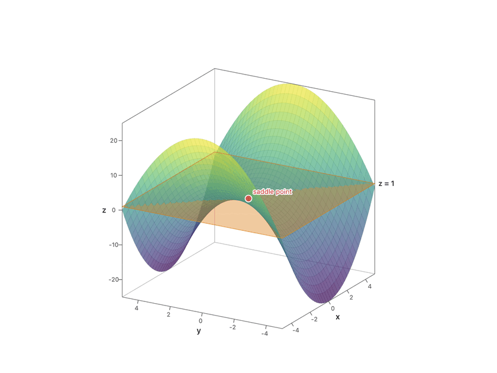
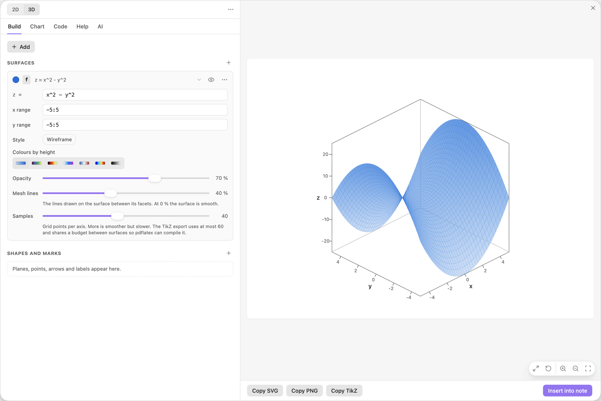
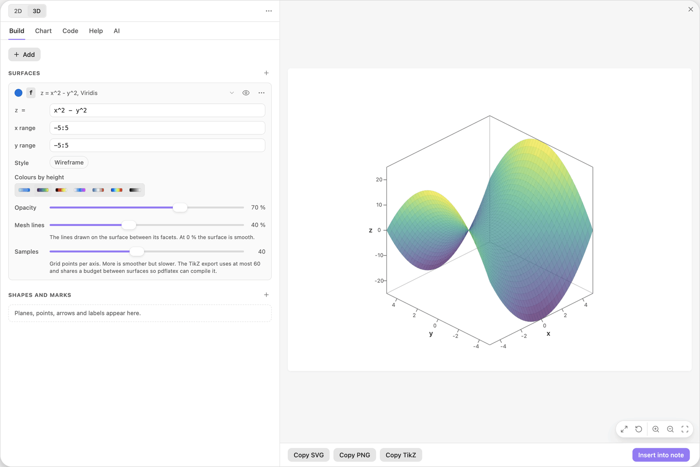
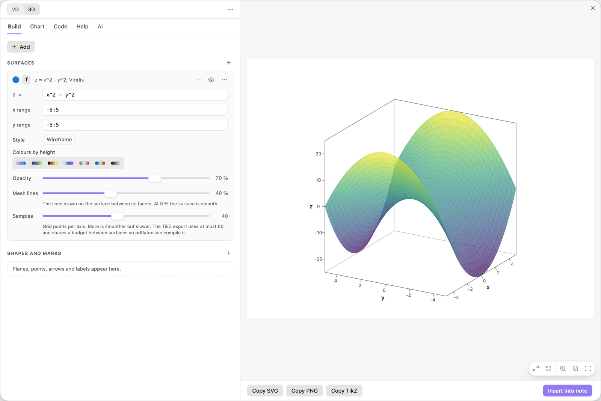
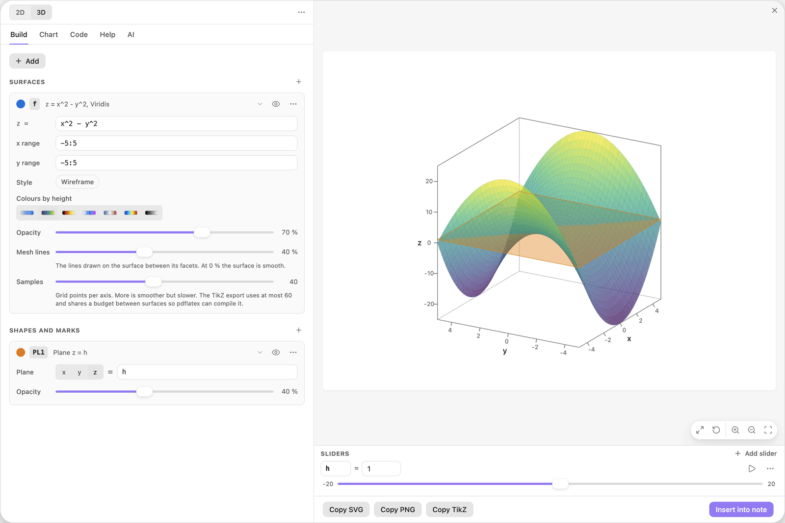
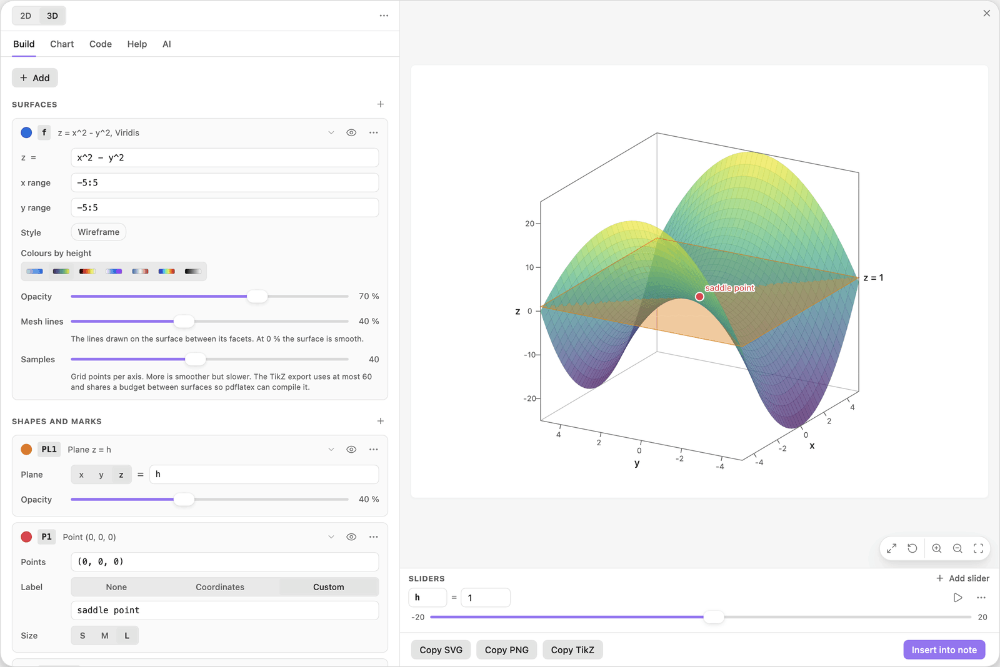

<!-- Generated by scripts/media/build-guides.mjs from src/guides. Do not edit. -->

# Surfaces, planes and points in 3D

[All guides](README.md) · 3D · Core · about 3 minutes

Plot a surface coloured by height in a cube, turn it, and cut it with a plane on a slider.

<p align="center"></p>

**What you can do afterwards**

- Plot a surface in a colour map inside a cube
- Turn the view and keep its angles
- Add a moving plane, a marked point and a label

**Read first:** [Sliders that move the picture](sliders.md)

## 1. Plot a surface in a cube

A formula in `x` and `y` is a surface, so the chart turns 3D. `cube` draws its box as a cube, whatever the ranges of x, y and z.

The chart in words:

```easy-tikz
3d
cube
show x from -5 to 5, y from -5 to 5 and z from -25 to 25
size 12 x 9
plot f(x, y) = x^2 - y^2
```



## 2. Colour it by height

`in viridis` colours the surface by its height. `heat`, `cool`, `diverging`, `rainbow` and `greyscale` work too.

The chart gets these lines:

```easy-tikz
plot f(x, y) = x^2 - y^2 in viridis
```



## 3. Turn the view

In the editor, drag the chart to turn it. The two angles are kept as lines: `rotationX` tilts the view, `rotationZ` turns it around the z-axis.

The chart gets these lines:

```easy-tikz
set rotationX = 20
set rotationZ = 60
```



> **Tip:** Elevation and Azimuth under 3D view in the Chart tab set the two angles exactly.

## 4. Cut it with a plane on a slider

`draw the plane z = h` lays a flat plane at the height `h`. Press play on `h`: the plane moves up and down through the saddle.

The chart gets these lines:

```easy-tikz
slider h from -20 to 20, starting at 1
draw the plane z = h, opacity 0.4
```



## 5. Mark a point and add a label

A point in 3D has three coordinates. A label takes a height as well: `z = {h}` sits on a corner of the plane and rides with it.

The chart gets these lines:

```easy-tikz
mark (0, 0, 0), large, labelled "saddle point"
write "z = {h}" at (5, -5, h), center
```



## The finished chart

Paste this block into a note to get the finished chart of this guide. Click the chart in the note to open it in the editor.

<details>
<summary>The chart as an easy-tikz block</summary>

```easy-tikz
3d
cube
show x from -5 to 5, y from -5 to 5 and z from -25 to 25
size 12 x 9
set rotationX = 20
set rotationZ = 60
slider h from -20 to 20, starting at 1
plot f(x, y) = x^2 - y^2 in viridis
draw the plane z = h, opacity 0.4
mark (0, 0, 0), large, labelled "saddle point"
write "z = {h}" at (5, -5, h), center
```

</details>

## Next guides

- [Charts in your notes](charts-in-notes.md): Insert a chart into a note, edit it again, and move its sliders there, also across charts.
- [Export to LaTeX](export-latex.md): Copy a chart as pgfplots code, compile it with pdflatex, or take only the picture for your document.

[All guides](README.md)
