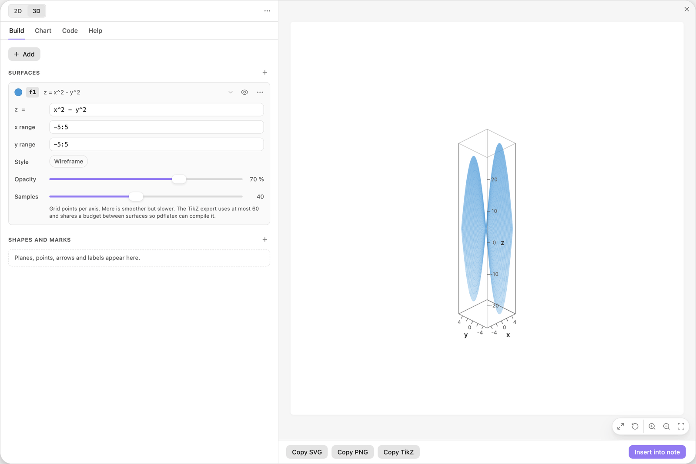
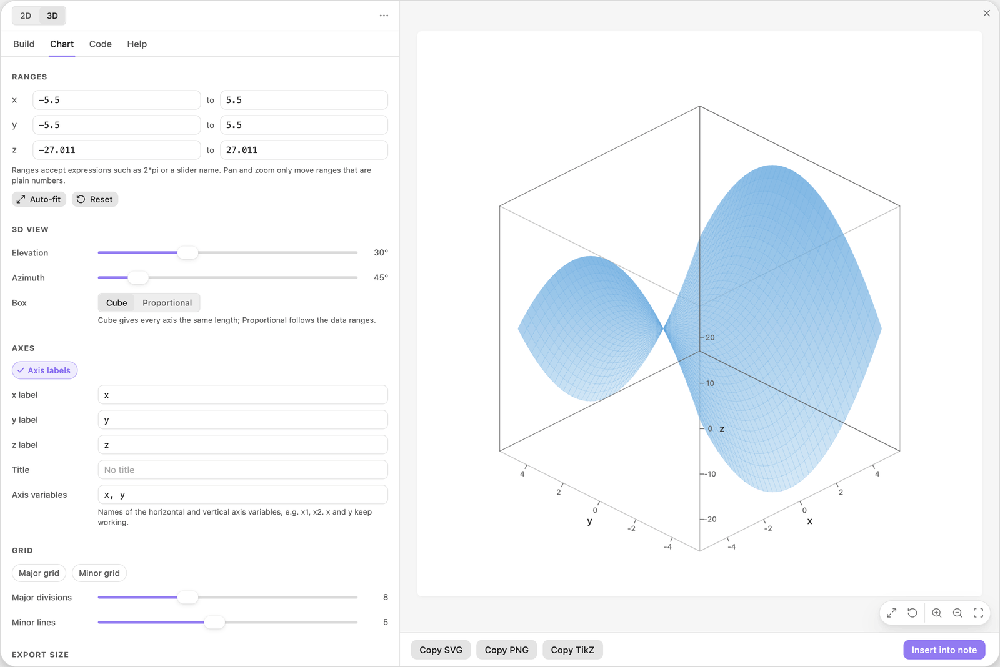
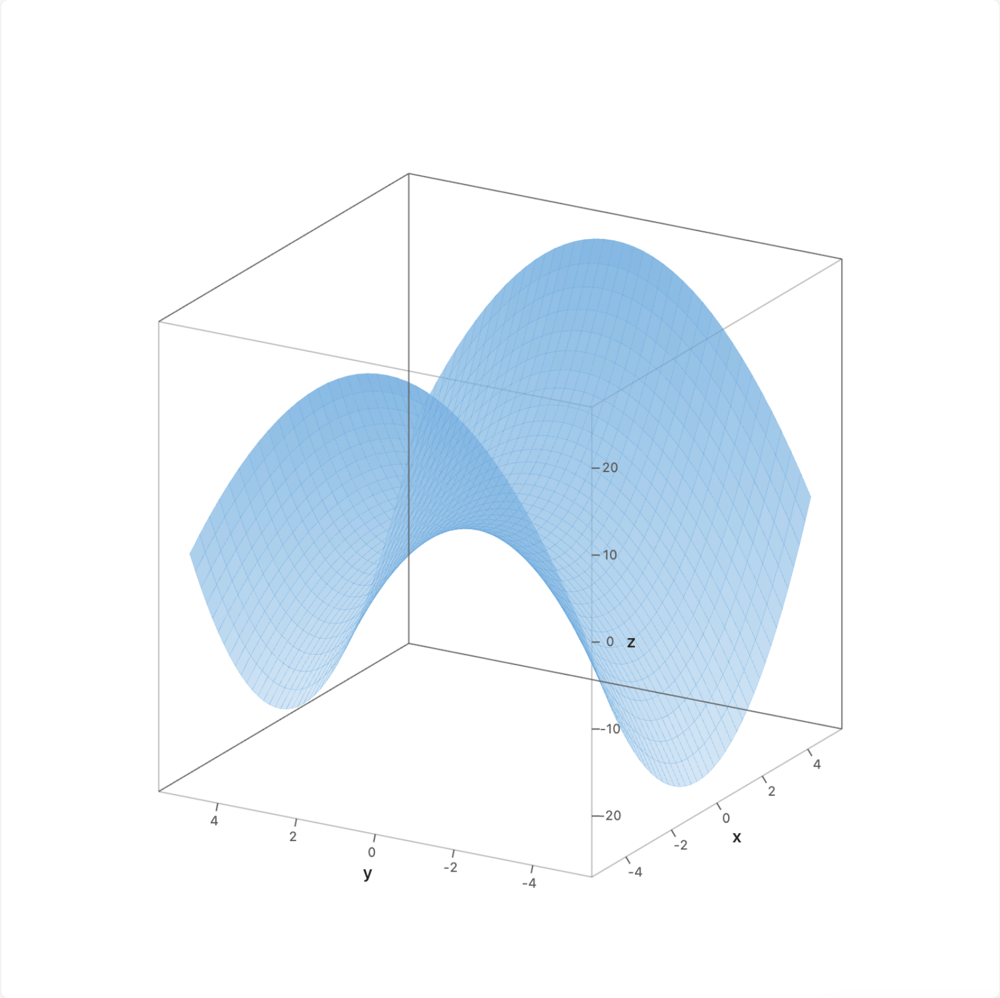
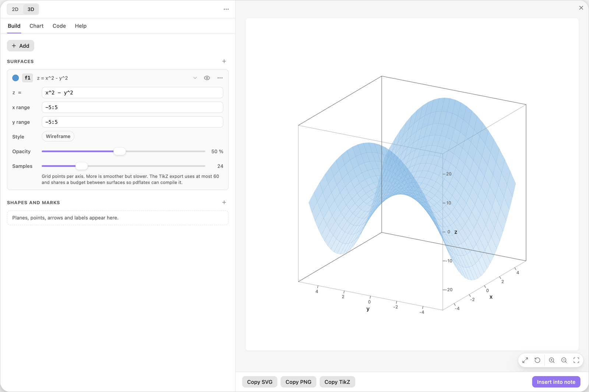
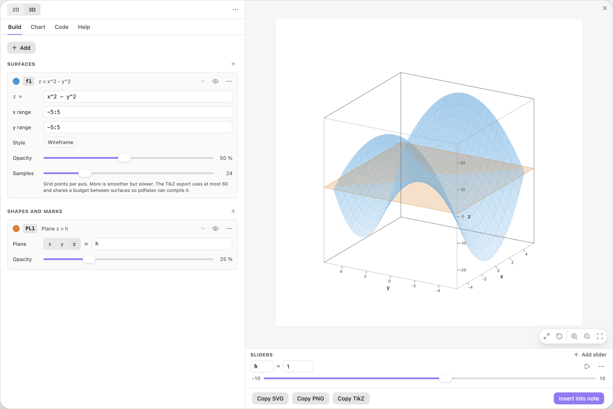
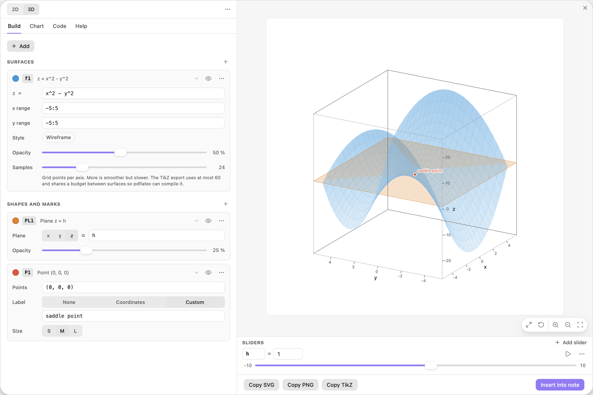
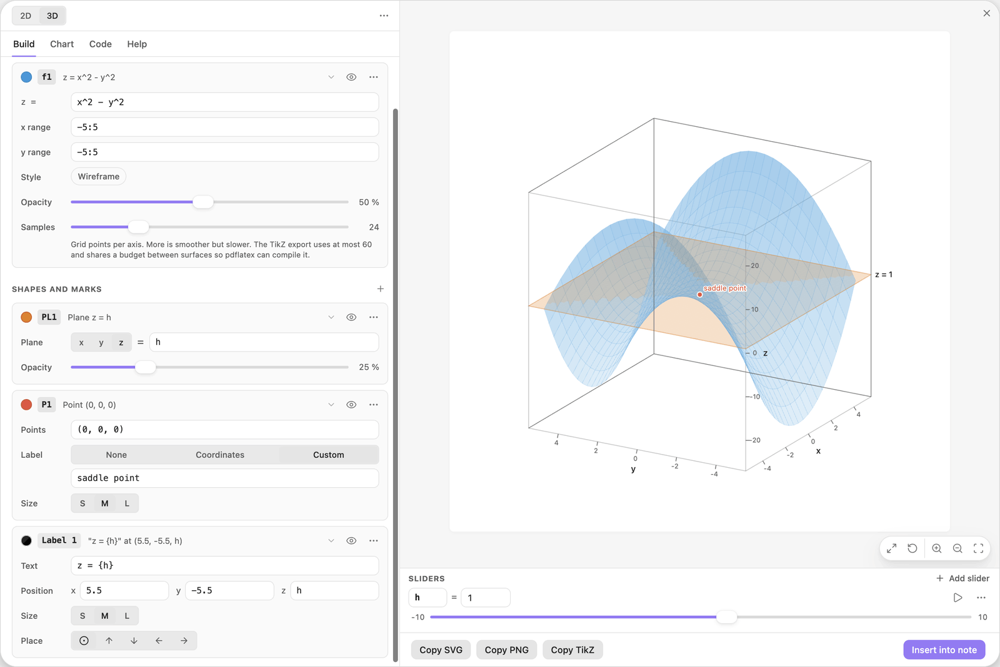

<!-- Generated by scripts/media/build-guides.mjs from src/guides. Do not edit. -->

# Surfaces, planes and points in 3D

[All guides](README.md) · 3D · Core · about 10 minutes

Plot a surface z = f(x, y), fix the shape of the box, turn the view, and cut the surface with a plane on a slider.

<p align="center"></p>

**What you can do afterwards**

- Plot a surface and give its box a sensible shape
- Rotate, zoom and style a 3D chart
- Add a plane on a slider, a labelled point and a label that moves with the slider

**Read first:** [Your first chart](first-chart.md), [Sliders that move the picture](sliders.md)

## 1. Switch to 3D and type a surface

Open the editor on an empty chart and click 3D in the header. Type the formula into the Start a chart field and press Enter.

The surface appears as a tall, narrow sail. That is correct: the editor fitted the box to the surface, z runs from about -27 to 27 while x and y only run from -5.5 to 5.5, and the box is drawn in true proportions.

| Where | Type |
| --- | --- |
| Start a chart | `x^2 - y^2` |



*The surface in a box with true proportions: tall and narrow.*

> **Tip:** A surface has its own x range and y range on its card (here `-5:5`). They say where the surface is computed. The box around it is set in the Chart tab under Ranges.

## 2. Make the box a cube

Open the Chart tab. Under 3D view, set Box to Cube. Every axis now has the same length on screen, and the saddle shows: the surface rises along x and falls along y.



*Box set to Cube under 3D view in the Chart tab.*

> **Tip:** Proportional suits charts whose three ranges are similar, such as a sphere. Cube suits charts where z is on a different scale than x and y.

## 3. Turn the view

Drag in the preview to rotate the chart. When the preview has the focus, the arrow keys turn it in steps of 5 degrees. The last three buttons of the action pill, in the corner of the preview, zoom in, zoom out and reset the zoom.

For exact angles, use Elevation and Azimuth under 3D view in the Chart tab. This step uses an elevation of 20 and an azimuth of 60 degrees.



*The same surface seen from elevation 20 and azimuth 60.*

> **Tip:** If dragging up and down feels the wrong way round, switch on Invert vertical drag in 3D in the plugin settings (Settings, Community plugins, Easy TikZ).

## 4. Style the surface

Go back to the Build tab. On the card f1, drag Opacity down to 50 % and Samples down to 24. The surface becomes more transparent and its mesh coarser, which leaves room for the things you add next. Wireframe in the Style row removes the faces and keeps only the mesh.



*Opacity 50 % and 24 samples per axis on the surface card.*

> **Tip:** The exported LaTeX uses at most 60 samples per axis, because pdflatex runs out of memory above that. The hint under Samples says the same.

## 5. Cut it with a plane

Click + Add and choose Plane. The card PL1 reads Plane z = 0. Replace the value with the name `h` and click Add slider h under the field.

A horizontal plane cuts the saddle at z = 1. Drag h in the Sliders dock, or press its play button, and the plane moves up and down through the surface.

| Where | Type |
| --- | --- |
| PL1, Plane value | `h` |



*The plane z = h, with h on a slider.*

> **Tip:** The x, y and z buttons on the card choose which coordinate the plane holds constant: x = h and y = h give vertical planes.

## 6. Mark a point and name it

Click + Add and choose Point. In the card P1, replace the sample point with the one below: three coordinates, `(x, y, z)`. Then click Custom in the Label row and type the name. A red marker sits on the saddle point, where the surface is flat.

| Where | Type |
| --- | --- |
| P1, Points | `(0, 0, 0)` |
| P1, Label text | `saddle point` |



*A labelled point at the origin, the saddle point of the surface.*

> **Tip:** \+ Add also has Segment and Arrow for 3D. Their paths take `(x, y, z)` points too, for example `(0, 0, 0); (0, 0, 20)`.

## 7. Let a label ride on the plane

Click + Add and choose Text label. In the card Label 1, type the text and the three positions below. In 3D a label has a z position as well.

The x and y positions are a corner of the box, and the z position is the slider itself. So the label sits on a corner of the plane and shows its height. Drag h: the plane, the label and its number move together.

| Where | Type |
| --- | --- |
| Label 1, Text | `z = {h}` |
| Label 1, Position x | `5.5` |
| Label 1, Position y | `-5.5` |
| Label 1, Position z | `h` |



*The label uses the slider h as its z position and in its text.*

> **Tip:** In 3D, dragging in the preview always rotates the view. Labels and shapes are moved by typing their coordinates.

## The finished chart

Paste this block into a note to get the finished chart of this guide. Click the chart in the note to open it in the editor.

<details>
<summary>The chart as an easy-tikz block</summary>

```easy-tikz
3d
show x from -5.5 to 5.5, y from -5.5 to 5.5 and z from -27.011 to 27.011
set rotationX = 20
set rotationZ = 60
set boxAspect = "equal"
slider h from -10 to 10, starting at 1, in steps of 0.1
plot f1(x, y) = x^2 - y^2, opacity 0.5, with 24 samples
draw the plane z = h
mark (0, 0, 0), labelled "saddle point"
write "z = {h}" at (5.5, -5.5, h), center
```

</details>

## Next guides

- [Charts in your notes](charts-in-notes.md): Insert a chart into a note, play with its sliders there, set its width and alignment, and open it again to change it.
- [Export to LaTeX](export-latex.md): Get pgfplots code that compiles with pdflatex: as a standalone document or as a snippet, at the size you need, in the colours of the preview.
- [Find a nonlinear optimum with level curves](level-curves.md): Level curves of an objective, a constraint region, the best point on its edge, and the level curve that touches it there.

[All guides](README.md)
