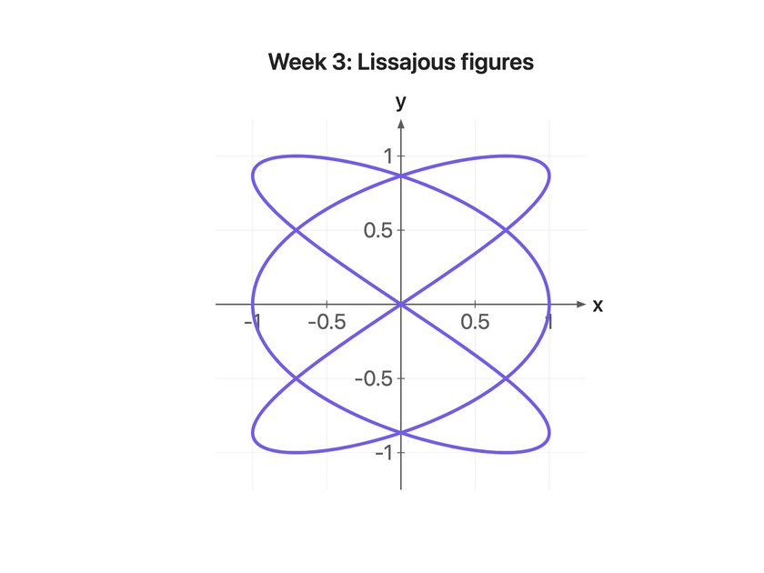
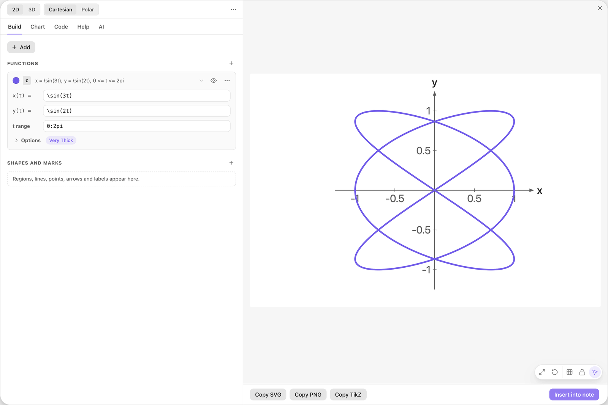
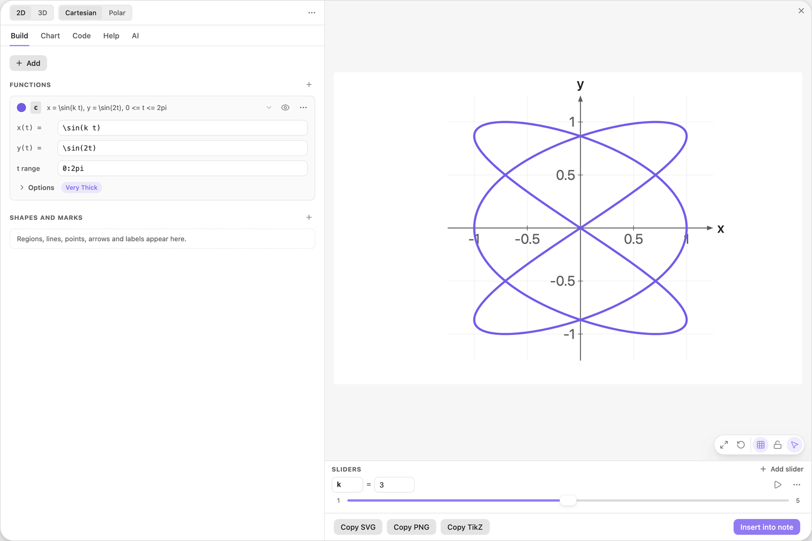
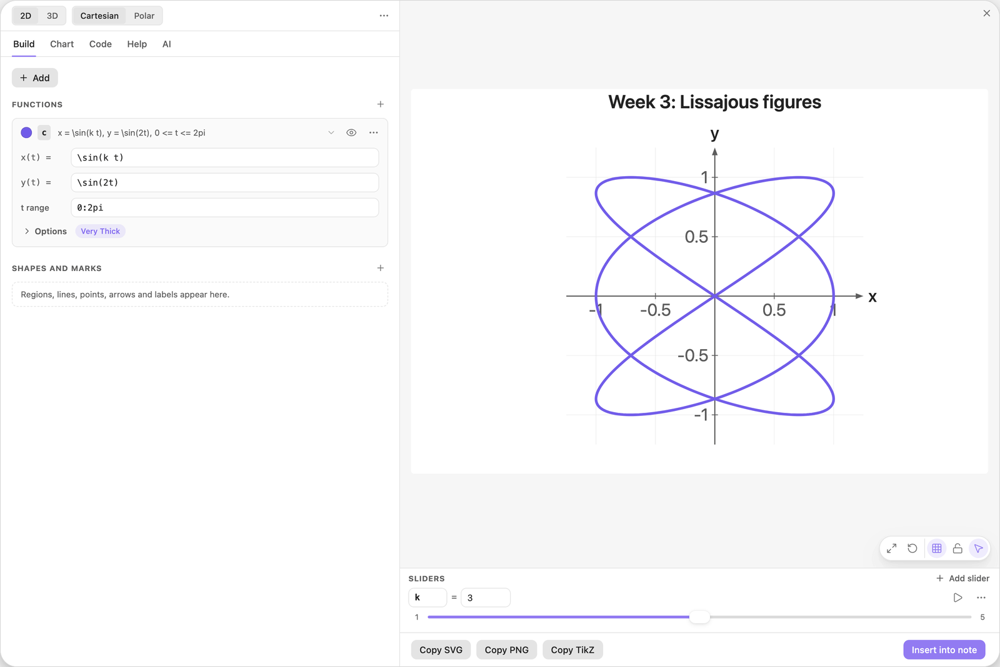

<!-- Generated by scripts/media/build-guides.mjs from src/guides. Do not edit. -->

# Charts as SVG files

[All guides](README.md) · Notes and export · Core · about 2 minutes

Keep every chart of a note as an SVG file too, for Obsidian Publish, GitHub and other apps.

<p align="center"></p>

**What you can do afterwards**

- Keep the charts of your notes as SVG files
- Find, update and embed the file of a chart

**Read first:** [Charts in your notes](charts-in-notes.md)

## 1. Switch on Charts as SVG files

In the plugin's settings, switch on Charts as SVG files. Every chart of a note then also lives as an SVG file in the attachment folder.

The chart in words:

```easy-tikz
show x from -1.25 to 1.25 and y from -1.25 to 1.25
size 12 x 8
equal scale
axes in the middle
plot $c(t) = (\sin(3t), \sin(2t))$ for t from 0 to 2pi in purple, very thick
```



## 2. Find the file of each chart

A file takes the note's name and the chart's place in it: `Week 3 · chart 1.svg`. It has a white background and the light theme's colours.

The chart gets these lines:

```easy-tikz
with a grid
```


## 3. Edit a chart, and its file follows

Change a chart, and a moment after the note is saved its file is written again. Only files whose picture changed are written.

The chart gets these lines:

```easy-tikz
slider k from 1 to 5, starting at 3, in steps of 1
plot $c(t) = (\sin(k t), \sin(2t))$ for t from 0 to 2pi in purple, very thick
```



> **Tip:** A file cannot move, so sliders draw at their saved values.

## 4. Embed the file in other apps

Obsidian Publish, GitHub and other Markdown apps do not run the plugin, but they show the file. Embed it with `![[Week 3 · chart 1.svg]]`.

The chart gets these lines:

```easy-tikz
title Week 3: Lissajous figures
```



> **Tip:** The command Save the charts of this note as SVG files writes them at once.

## The finished chart

Paste this block into a note to get the finished chart of this guide. Click the chart in the note to open it in the editor.

<details>
<summary>The chart as an easy-tikz block</summary>

```easy-tikz
show x from -1.25 to 1.25 and y from -1.25 to 1.25
size 12 x 8
equal scale
axes in the middle
with a grid
title Week 3: Lissajous figures
slider k from 1 to 5, starting at 3, in steps of 1
plot $c(t) = (\sin(k t), \sin(2t))$ for t from 0 to 2pi in purple, very thick
```

</details>

## Next guides

- [Export to LaTeX](export-latex.md): Copy a chart as pgfplots code, compile it with pdflatex, or take only the picture for your document.
- [Charts in your notes](charts-in-notes.md): Insert a chart into a note, edit it again, and move its sliders there, also across charts.

[All guides](README.md)
