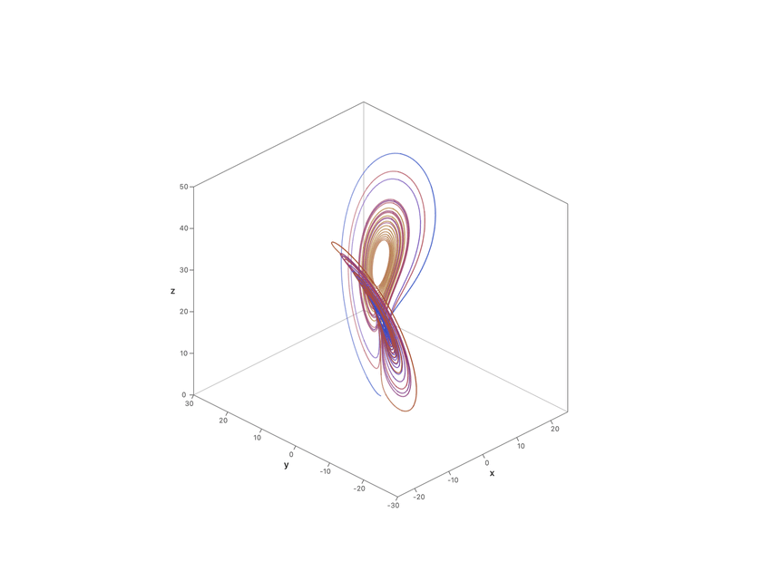
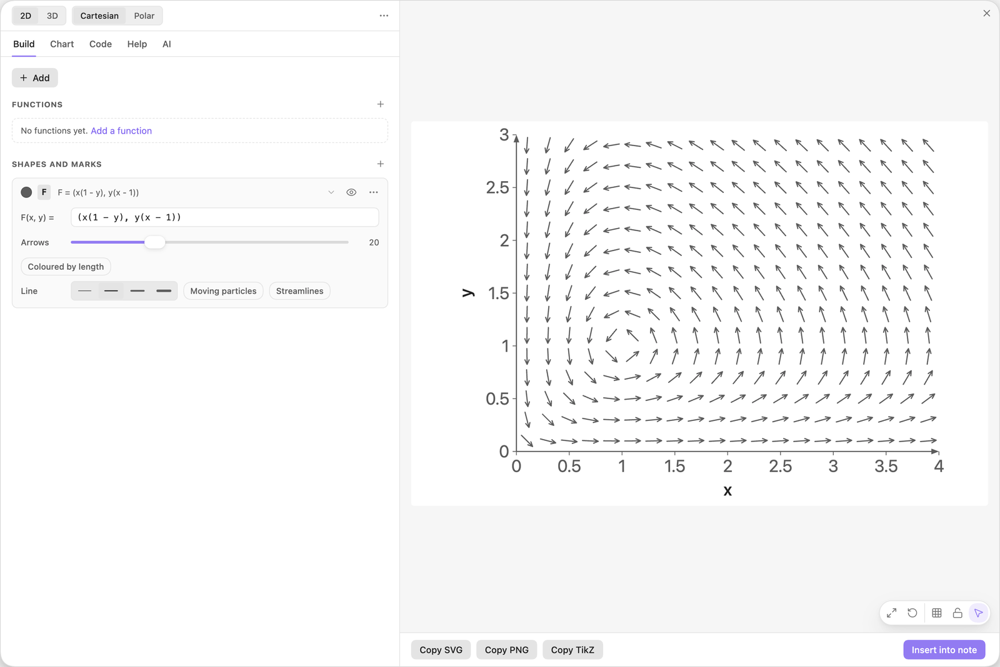
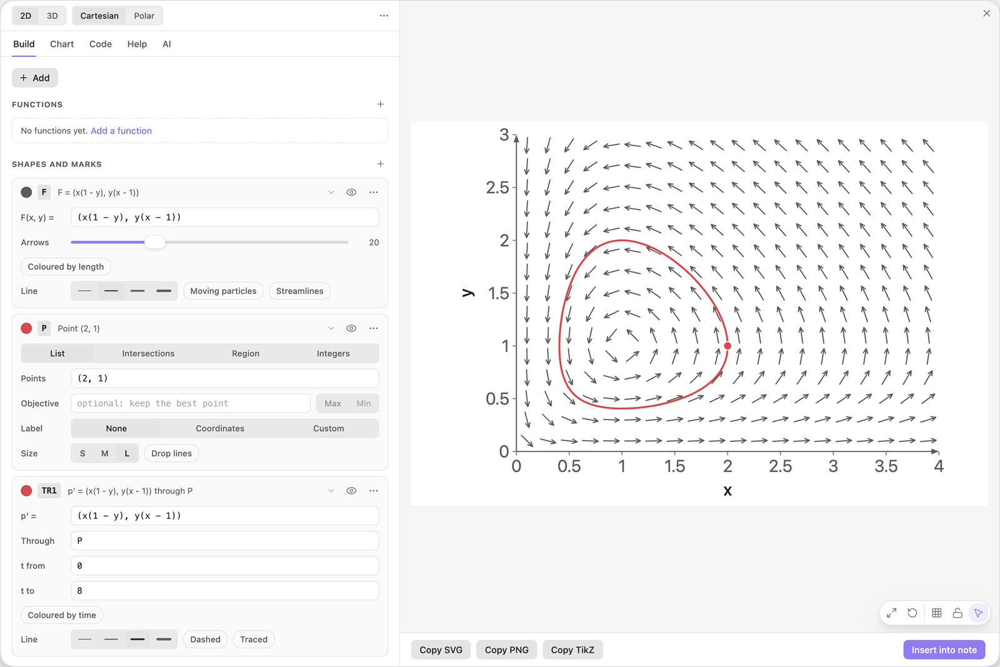
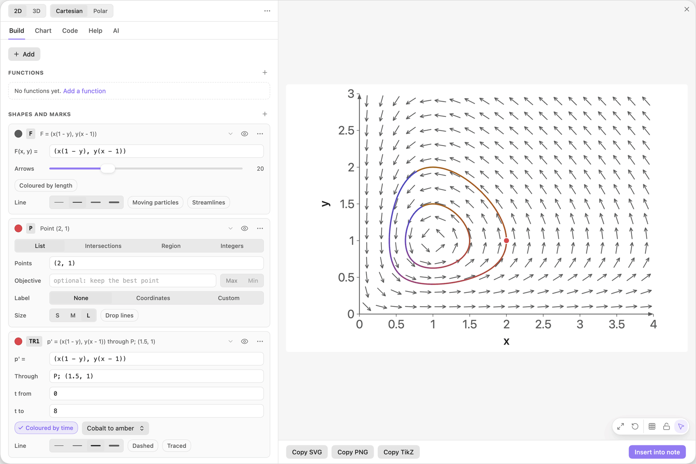
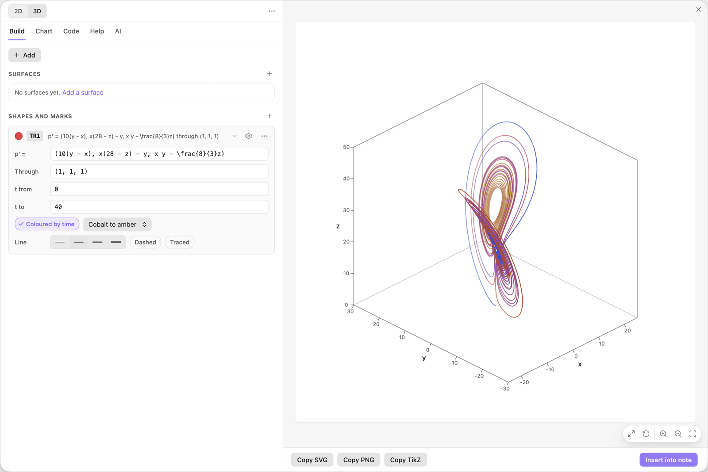

<!-- Generated by scripts/media/build-guides.mjs from src/guides. Do not edit. -->

# Solutions of systems in 2D and 3D

[All guides](README.md) · Dynamics and fractals · Advanced · about 3 minutes

Draw the path a system of equations takes from a point: predators and prey in the plane, then the Lorenz system in space.

<p align="center"></p>

**What you can do afterwards**

- Draw the solution of a 2D system through a point
- Start several solutions and colour them by time
- Draw the Lorenz system in 3D

**Read first:** [Vector fields and rest points](vector-fields.md)

## 1. Draw the field of the system

Prey x and predators y: `$\dot{p} = (x(1 - y), y(x - 1))$`. Its vector field shows where the two numbers go from each point.

The chart in words:

```easy-tikz
show x from 0 to 4 and y from 0 to 3
size 12 x 8
equal scale
axes on the edges
draw the vector field $F(x, y) = (x(1 - y), y(x - 1))$ in gray
```



## 2. Draw the solution through P

`draw the solution of` the system `through P` follows it from P for t from 0 to 8. The prey grow, the predators follow, and the path comes round again.

The chart gets these lines:

```easy-tikz
P: mark (2, 1), large
draw the solution of $\dot{p} = (x(1 - y), y(x - 1))$ through P for t from 0 to 8
```



> **Tip:** In the editor, drag P: the path follows.

## 3. Start two and colour by time

`through P and (1.5, 1)` starts a second path. `coloured by time` runs each from dark to light, so you can see which way it goes.

The chart gets these lines:

```easy-tikz
draw the solution of $\dot{p} = (x(1 - y), y(x - 1))$ through P and (1.5, 1) for t from 0 to 8, coloured by time
```



## 4. Go into space: the Lorenz system

In a 3D chart the system has three parts. From (1, 1, 1) the Lorenz system winds round two wings and never repeats. Drag the chart to turn it.

The chart gets these lines:

```easy-tikz
3d
show x from -25 to 25, y from -30 to 30 and z from 0 to 50
draw the solution of $\dot{p} = (10(y - x), x(28 - z) - y, x y - \frac{8}{3}z)$ through (1, 1, 1) for t from 0 to 40, coloured by time
```



## The finished chart

Paste this block into a note to get the finished chart of this guide. Click the chart in the note to open it in the editor.

<details>
<summary>The chart as an easy-tikz block</summary>

```easy-tikz
3d
show x from -25 to 25, y from -30 to 30 and z from 0 to 50
draw the solution of $\dot{p} = (10(y - x), x(28 - z) - y, x y - \frac{8}{3}z)$ through (1, 1, 1) for t from 0 to 40, coloured by time
```

</details>

## Next guides

- [Two paths of the Lorenz system](lorenz-butterfly.md): Start the Lorenz system twice, a thousandth apart: the two paths draw themselves together for a while, then part for good.
- [Surfaces, planes and points in 3D](surfaces-3d.md): Plot a surface coloured by height in a cube, turn it, and cut it with a plane on a slider.

[All guides](README.md)
