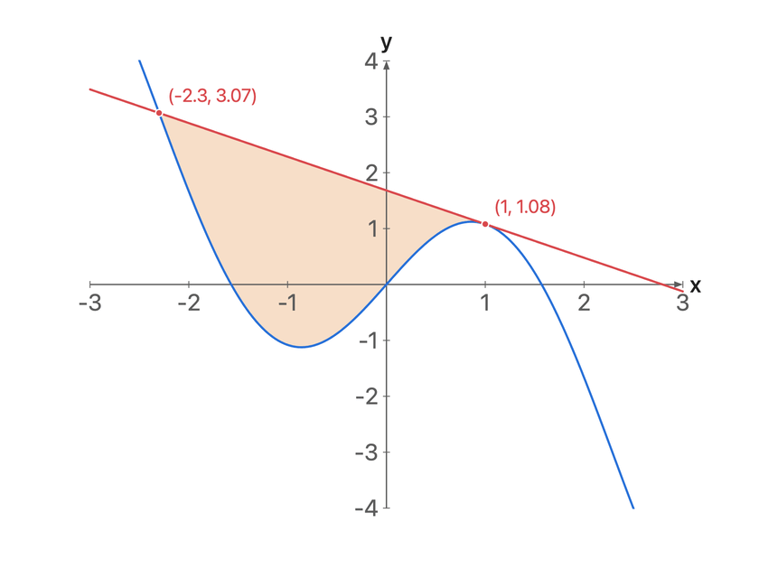
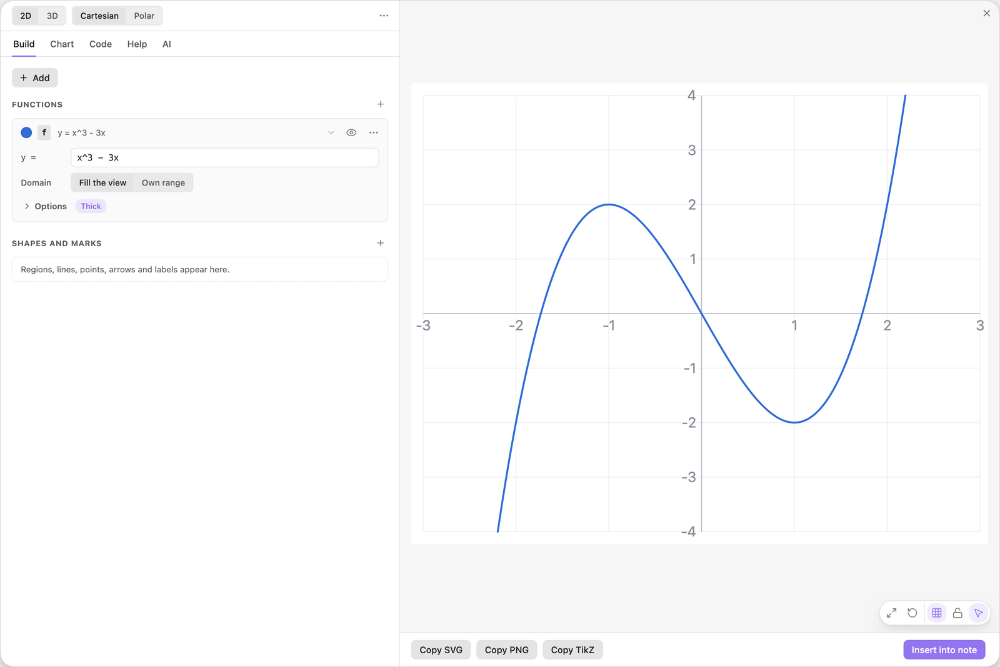
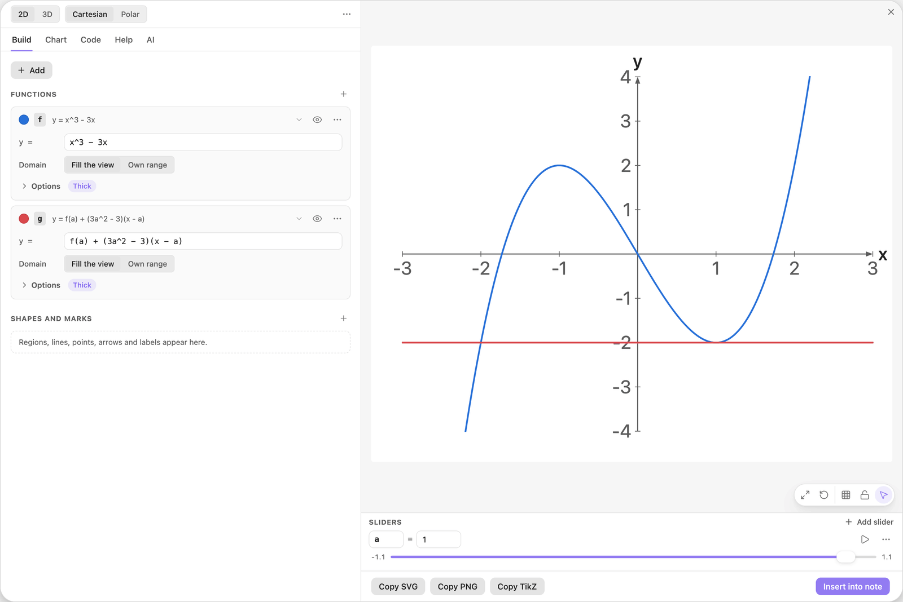
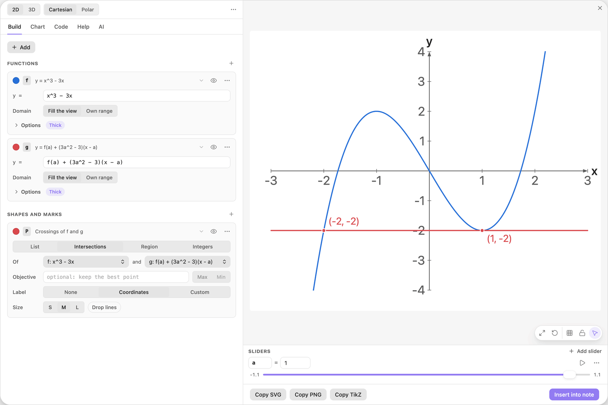
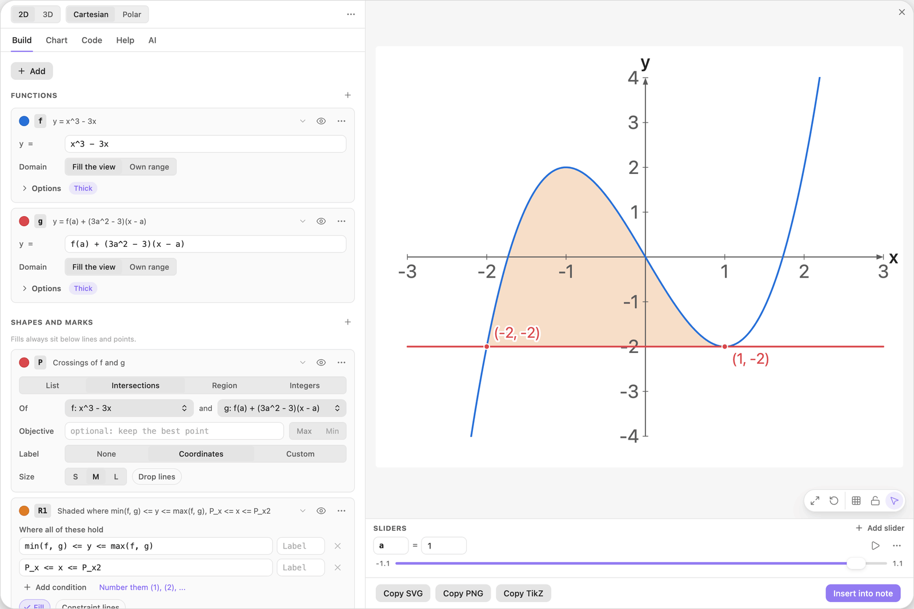
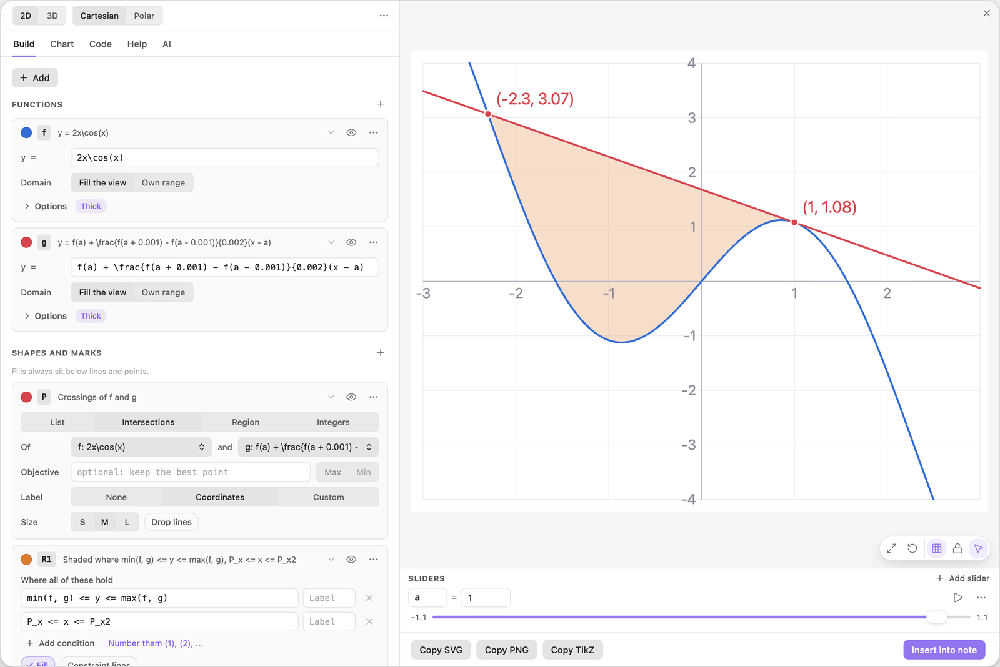

<!-- Generated by scripts/media/build-guides.mjs from src/guides. Do not edit. -->

# Shade between a curve and its tangent

[All guides](README.md) · Regions and optimisation · Advanced · about 4 minutes

Write the tangent at a slider point as a function and shade the area it encloses with the curve.

<p align="center"></p>

**What you can do afterwards**

- Write a tangent that follows a slider
- Shade from one computed point to another
- Make the chart work for any curve

**Read first:** [Shade the areas between two curves](areas-between.md), [Sliders that move the picture](sliders.md)

## 1. Draw the curve

Plot the cubic `f` in a window around its hill and its valley. The next step adds a tangent that touches it at a point you can drag.

The chart in words:

```easy-tikz
show x from -3 to 3 and y from -4 to 4
size 10 x 8
axes in the middle
plot f(x) = x^3 - 3x in blue, thick
```



## 2. Write the tangent as a function

The tangent at `a` is the height `f(a)` plus the slope `3a^2 - 3` times the step `x - a`. Drag `a` and the line rolls along the curve.

The chart gets these lines:

```easy-tikz
slider a from -1.1 to 1.1, starting at 1
plot g(x) = f(a) + (3a^2 - 3)(x - a) in red, thick
```



> **Tip:** `with its tangent at a` draws a tangent too, but without a name, and a region needs a named function.

## 3. Mark where the two meet

The tangent touches the curve at `a` and crosses it once more. `P_x` and `P_x2` are the x of the two points, from left to right.

The chart gets these lines:

```easy-tikz
P: mark where f and g cross, with coordinates
```



## 4. Shade between the two points

`shade between f and g` fills the gap between the curves, whichever is on top, and the range keeps the part from `P_x` to `P_x2`.

The chart gets these lines:

```easy-tikz
shade between f and g from x = P_x to P_x2 in orange
```



> **Tip:** At `a = 0` the tangent meets the curve only once, so there is nothing to shade.

## 5. Make it work for any curve

Write the slope as a difference quotient: it measures the slope of `f` at `a` for any formula. Now change `f`: the tangent, the points and the area follow.

The chart gets these lines:

```easy-tikz
plot $f(x) = 2x\cos(x)$ in blue, thick
plot $g(x) = f(a) + \frac{f(a + 0.001) - f(a - 0.001)}{0.002}(x - a)$ in red, thick
```



## The finished chart

Paste this block into a note to get the finished chart of this guide. Click the chart in the note to open it in the editor.

<details>
<summary>The chart as an easy-tikz block</summary>

```easy-tikz
show x from -3 to 3 and y from -4 to 4
size 10 x 8
axes in the middle
slider a from -1.1 to 1.1, starting at 1
plot $f(x) = 2x\cos(x)$ in blue, thick
plot $g(x) = f(a) + \frac{f(a + 0.001) - f(a - 0.001)}{0.002}(x - a)$ in red, thick
P: mark where f and g cross, with coordinates
shade between f and g from x = P_x to P_x2 in orange
```

</details>

## Next guides

- [Solve a linear program in a picture](linear-program.md): Constraint lines, the feasible region and its corners, an objective line on a slider, the maximum and the minimum.
- [From secant to tangent](secant-tangent.md): Shrink the gap h between two points of a curve and watch the secant through them turn into the tangent.

[All guides](README.md)
