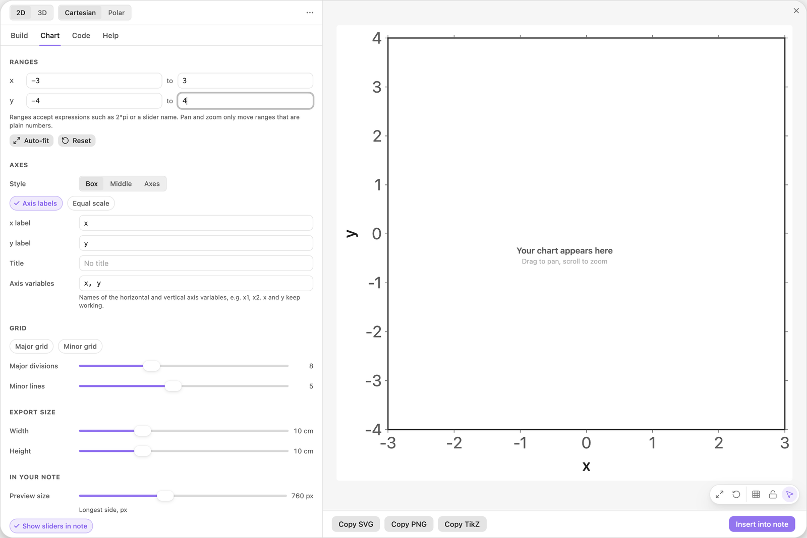
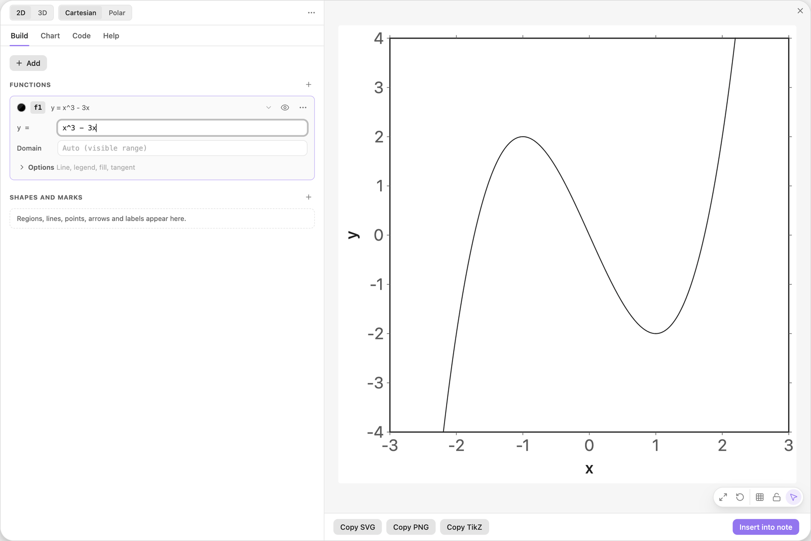
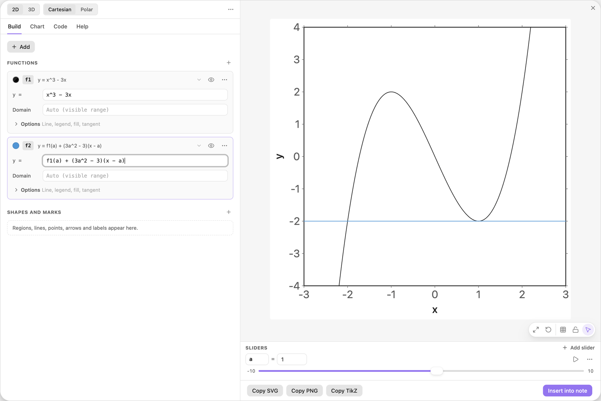
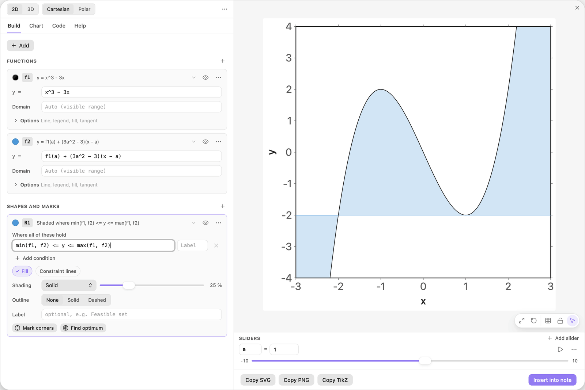
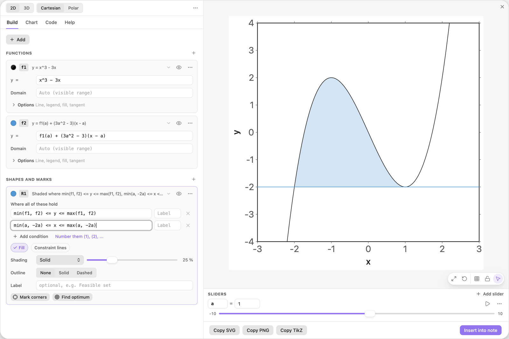
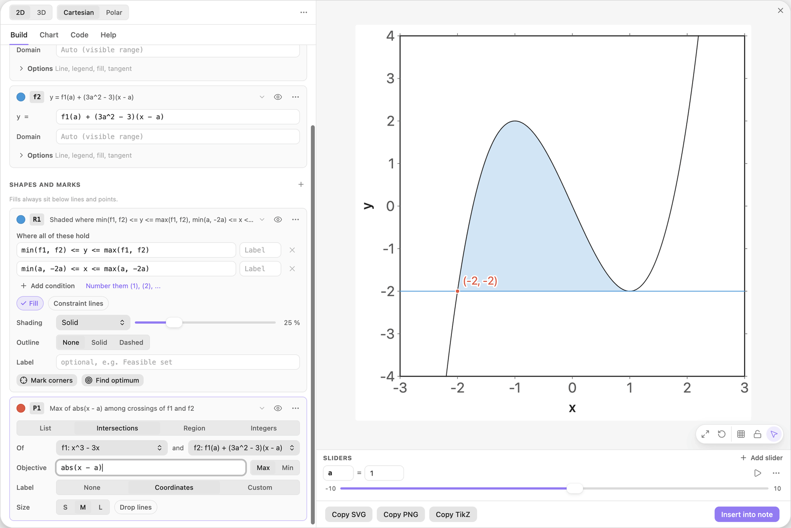
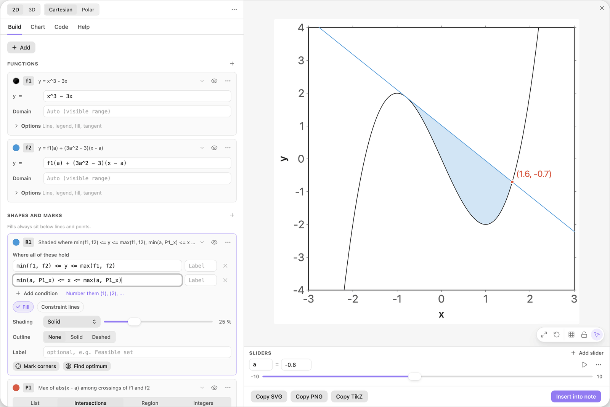
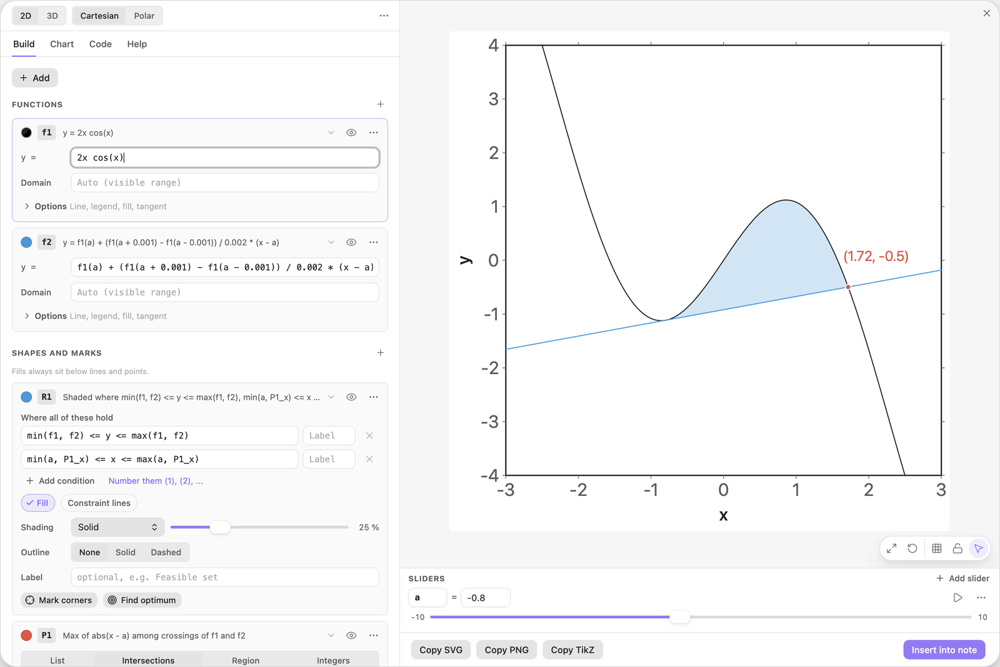

<!-- Generated by scripts/media/build-guides.mjs from src/guides. Do not edit. -->

# Shade between a curve and its tangent

[All guides](README.md) · Regions and optimisation · Advanced · about 10 minutes

Write the tangent at a slider point as a function, shade the area it encloses with the curve, and make it work for any curve.

<p align="center"></p>

**What you can do afterwards**

- Write the tangent at a slider point as a function of its own
- Shade the area between curve and tangent, whichever is on top
- End the area at a computed crossing point
- Reuse the chart for any curve with a numeric slope

**Read first:** [Shade the areas between two curves](areas-between.md), [Sliders that move the picture](sliders.md)

## 1. Set the view

Start with a new chart and open the Chart tab. Under Ranges set x from -3 to 3 and y from -4 to 4.

The default view shows x from -0.5 to 10. The curve of this guide has its hill and its valley close to 0 and grows fast outside them, so the ranges come first: with them in place, the editor leaves the view alone when you type the formula.



*Chart \> Ranges. Each bound is a field of its own and accepts formulas.*

> **Tip:** Lost the curve after panning or zooming? The Reset button under the ranges brings the default view back.

## 2. Type the curve

Go back to the Build tab, type the formula below into Start a chart and press Enter.

The card f1 appears and the preview shows a cubic with a hill at x = -1 and a valley at x = 1.

| Where | Type |
| --- | --- |
| Start a chart | `x^3 - 3x` |



*The curve f1. Its name is what the tangent refers to in the next step.*

> **Tip:** `3x` means 3 times x. Powers bind first, so `-x^2` is the negative of x squared.

## 3. Write the tangent as a function

Click + Add and choose Function y = f(x). Type the formula below into the new card f2. The name `a` is unknown, so a button Add slider a appears under the field. Click it.

The formula is the point-slope form of a line: the height of the curve at a, plus the slope there times the distance from a. `f1(a)` calls the first function by its name, and `3a^2 - 3` is the derivative of `x^3 - 3x` at a. The slider starts at 1, the bottom of the valley, so the tangent is the horizontal line y = -2.

| Where | Type |
| --- | --- |
| f2, y = | `f1(a) + (3a^2 - 3)(x - a)` |



*The tangent at x = a as the function f2. The slider a appears in the Sliders dock under the preview.*

> **Tip:** A function card can draw a tangent by itself (Options, Tangent), but that line has no name. A region can only use named functions, which is why the tangent is written out here.

## 4. Shade between curve and tangent

Click + Add and choose Area between two functions. The card R1 starts with `f2 <= y <= f1`, which shades only where the curve is above the tangent. Replace it with the condition below.

`min` and `max` pick the lower and the upper of the two at every x, so the area is shaded whichever one is on top. For now the shading runs across the whole view, also beyond the points where the two lines meet.

| Where | Type |
| --- | --- |
| R1, condition 1 | `min(f1, f2) <= y <= max(f1, f2)` |



*Everything between curve and tangent is shaded, on both sides of the crossing.*

> **Tip:** With `f2 <= y <= f1` the area between the contact points would vanish whenever the tangent lies above the curve there, for example at a = -1.

## 5. Keep the part between the contact points

Click Add condition on R1 and type the chain below. The shading now ends where tangent and curve meet. Drag the slider a under the preview and the area follows.

For this curve the tangent at a meets the curve again at x = -2a: curve minus tangent is `(x - a)^2 (x + 2a)`, which is zero at a and at -2a. Which of the two lies further left depends on the sign of a, so the chain uses `min` and `max` once more.

| Where | Type |
| --- | --- |
| R1, condition 2 | `min(a, -2a) <= x <= max(a, -2a)` |



*The area between the curve and its tangent at a = 1, from x = -2 to x = 1.*

> **Tip:** The shaded area is exactly 27a^4/4 here. Put `A = {27a^4/4:2}` into the Label of R1 and the picture prints its own area.

## 6. Find the far crossing

Most curves have no formula like -2a for the second meeting point, so let the chart find it. Click + Add and choose Intersections of two functions. The card P1 marks the two points where f1 and f2 meet.

Then type the formula below into the field Objective and leave the switch on Max. P1 keeps only the point furthest from a, the far crossing, and publishes its position as `P1_x` and `P1_y`.

| Where | Type |
| --- | --- |
| P1, Objective | `abs(x - a)` |



*An objective keeps the best of the crossings: here the one furthest from a.*

> **Tip:** Without the objective, P1 holds the contact point too, and which one comes first changes with the sign of a. The objective makes `P1_x` unambiguous.

## 7. Use the crossing as the limit

In the second row of R1, replace `-2a` by `P1_x` in both places, so that the row reads as below. Then drag the slider a to -0.8 to check.

The tangent now touches the hill, the far crossing sits on the right at x = 1.6, and the shading ends exactly there. No formula of yours says where the lines cross any more.

| Where | Type |
| --- | --- |
| R1, condition 2 | `min(a, P1_x) <= x <= max(a, P1_x)` |



*At a = -0.8 the area lies on the other side. The limit P1\_x followed by itself.*

> **Tip:** When the tangent does not meet the curve a second time inside the view, there is nothing to shade and the status chip on the preview says so.

## 8. Swap in another curve

One formula still belongs to the cubic: the slope `3a^2 - 3` in f2. Replace it by a difference quotient, as in the first row below. It measures the slope of f1 at a from two points close to a, so it is right for every formula.

Now change f1 itself to the second row. The tangent, the far crossing and the shaded area all follow, without any calculus from you.

| Where | Type |
| --- | --- |
| f2, y = | `f1(a) + (f1(a + 0.001) - f1(a - 0.001)) / 0.002 * (x - a)` |
| f1, y = | `2x cos(x)` |



*A different curve, the same chart: slope and crossing are computed.*

> **Tip:** Give a a smaller range so the tangent stays in view: click the small numbers at the two ends of the slider and type -1.5 and 1.5.

## The finished chart

Paste this block into a note to get the finished chart of this guide. Click the chart in the note to open it in the editor.

<details>
<summary>The chart as an easy-tikz block</summary>

```easy-tikz
{
  "v": 4,
  "dimension": false,
  "documentSetup": true,
  "title": "",
  "size_x_cm": 10,
  "size_y_cm": 10,
  "show_axis_label": true,
  "axis_label_x": "x",
  "axis_label_y": "y",
  "showAxis": true,
  "showLargeGrid": false,
  "showSmallGrid": false,
  "gridSize": 5,
  "majorTickNum": 8,
  "xmin": "-3",
  "xmax": "3",
  "ymin": "-4",
  "ymax": "4",
  "zmin": "-5",
  "zmax": "5",
  "axis_style": "box",
  "coordinateSystem": "cartesian",
  "axis_label_x_polar": "",
  "axis_label_y_polar": "",
  "axis_label_z": "z",
  "rotationX": 30,
  "rotationZ": 45,
  "zoom3D": 1,
  "boxAspect": "true",
  "previewSize": 760,
  "functions": [
    {
      "expression": "2x cos(x)",
      "domain": "",
      "showLegend": false,
      "fill": false,
      "fillOpacity": 0.2,
      "fillPattern": "solid",
      "tangent": false,
      "color": "black",
      "dashed": false,
      "tangentPoint": "",
      "extrema": false,
      "thickness": "thin",
      "parametric": false,
      "expressionY": "",
      "name": "f1"
    },
    {
      "expression": "f1(a) + (f1(a + 0.001) - f1(a - 0.001)) / 0.002 * (x - a)",
      "domain": "",
      "showLegend": false,
      "fill": false,
      "fillOpacity": 0.2,
      "fillPattern": "solid",
      "tangent": false,
      "color": "blue",
      "dashed": false,
      "tangentPoint": "",
      "extrema": false,
      "thickness": "thin",
      "parametric": false,
      "expressionY": "",
      "name": "f2"
    }
  ],
  "functions3D": [],
  "tools": [
    {
      "type": "region",
      "color": "blue",
      "conditions": [
        "min(f1, f2) <= y <= max(f1, f2)",
        "min(a, P1_x) <= x <= max(a, P1_x)"
      ],
      "conditionLabels": [
        "",
        ""
      ],
      "fill": true,
      "fillOpacity": 0.25,
      "fillPattern": "solid",
      "outline": "none",
      "thickness": "thin",
      "constraintLines": false,
      "label": "",
      "id": "t0",
      "name": "R1"
    },
    {
      "type": "points",
      "color": "red",
      "dim": 2,
      "source": "intersections",
      "points": "",
      "ref1": "f1",
      "ref2": "f2",
      "regionName": "",
      "objective": "abs(x - a)",
      "sense": "max",
      "label": "({x:2}, {y:2})",
      "dropLines": false,
      "size": "normal",
      "id": "t1",
      "name": "P1"
    }
  ],
  "annotations": [],
  "parameters": [
    {
      "name": "a",
      "value": -0.8,
      "min": -10,
      "max": 10,
      "step": 0.1
    }
  ],
  "variables": "x, y",
  "equalScale": false,
  "showSlidersInNote": true
}
```

</details>

## Next guides

- [Tangents and extrema](tangents-extrema.md): Mark the turning points of a function, add a tangent, slide it along the curve and label its slope.
- [Drag shapes to edit them](drag-to-edit.md): Grab a line or a curve in the preview and its numbers follow: move, turn, stretch, undo.
- [Export to LaTeX](export-latex.md): Get pgfplots code that compiles with pdflatex: as a standalone document or as a snippet, at the size you need, in the colours of the preview.

[All guides](README.md)
