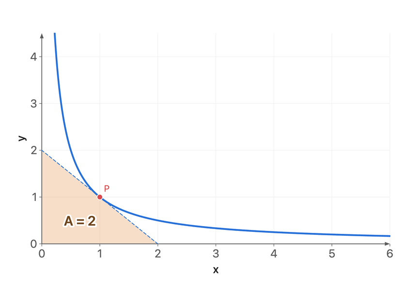
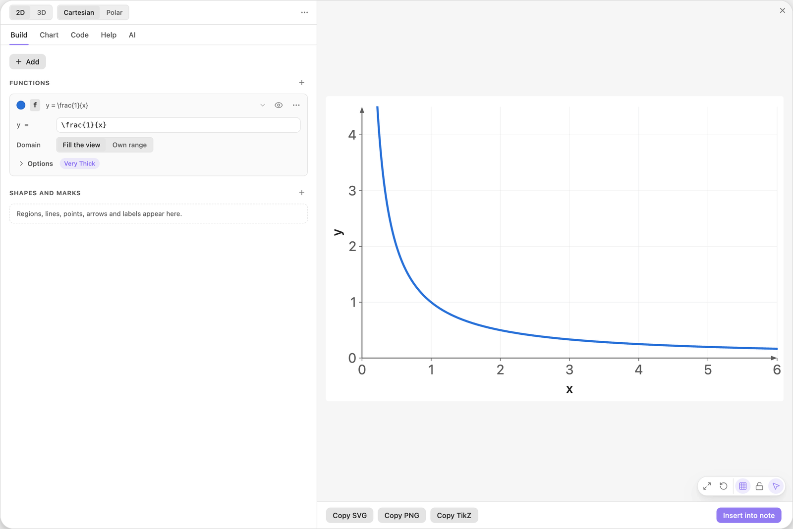
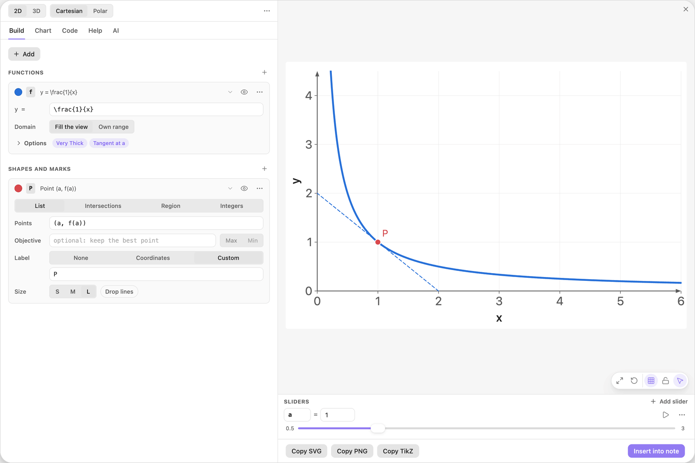
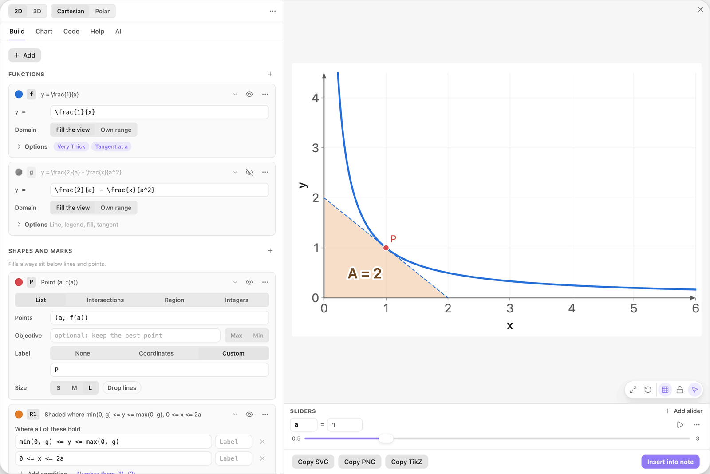

<!-- Generated by scripts/media/build-guides.mjs from src/guides. Do not edit. -->

# Shade under a tangent

[All guides](README.md) · Showcase · Core · about 2 minutes

The tangent to 1/x cuts a triangle from the corner of the axes; drag the point and its area stays 2.

<p align="center"></p>

**What you can do afterwards**

- Put a tangent on a slider
- Shade under a line that moves
- Print a value that follows the slider

## 1. Plot the hyperbola

Start with `f(x) = 1/x` in the first quadrant.

The chart in words:

```easy-tikz
show x from 0 to 6 and y from 0 to 4.5
size 12 x 8
axes on the edges
with a grid
plot $f(x) = \frac{1}{x}$ in blue, very thick
```



## 2. Put a tangent on a slider

`with its tangent at a` draws the tangent at the point P over `a`. Drag `a` and both move.

The chart gets these lines:

```easy-tikz
slider a from 0.5 to 3, starting at 1
plot $f(x) = \frac{1}{x}$ in blue, very thick, with its tangent at a
P: mark (a, f(a)), large, labelled "P"
```



## 3. Shade under the tangent

The tangent is the hidden line `g`. `shade under g` fills the triangle it cuts from the axes, from 0 to `2a`.

The chart gets these lines:

```easy-tikz
plot $g(x) = \frac{2}{a} - \frac{x}{a^2}$, hidden
shade under g from x = 0 to 2a in orange
```


## 4. Print the area

The label works out the area while you drag. The triangle changes shape, but its area stays 2.

The chart gets these lines:

```easy-tikz
shade under g from x = 0 to 2a in orange, labelled "A = {(2*a)*(2/a)/2:2}"
```



## The finished chart

Paste this block into a note to get the finished chart of this guide. Click the chart in the note to open it in the editor.

<details>
<summary>The chart as an easy-tikz block</summary>

```easy-tikz
show x from 0 to 6 and y from 0 to 4.5
size 12 x 8
axes on the edges
with a grid
slider a from 0.5 to 3, starting at 1
plot $f(x) = \frac{1}{x}$ in blue, very thick, with its tangent at a
plot $g(x) = \frac{2}{a} - \frac{x}{a^2}$, hidden
P: mark (a, f(a)), large, labelled "P"
shade under g from x = 0 to 2a in orange, labelled "A = {(2*a)*(2/a)/2:2}"
```

</details>

## Next guides

- [The largest rectangle under a parabola](largest-rectangle.md): A rectangle whose corners sit on the parabola: drag its corner and find where its area is largest.
- [Shade between a curve and its tangent](tangent-area.md): Write the tangent at a slider point as a function and shade the area it encloses with the curve.

[All guides](README.md)
