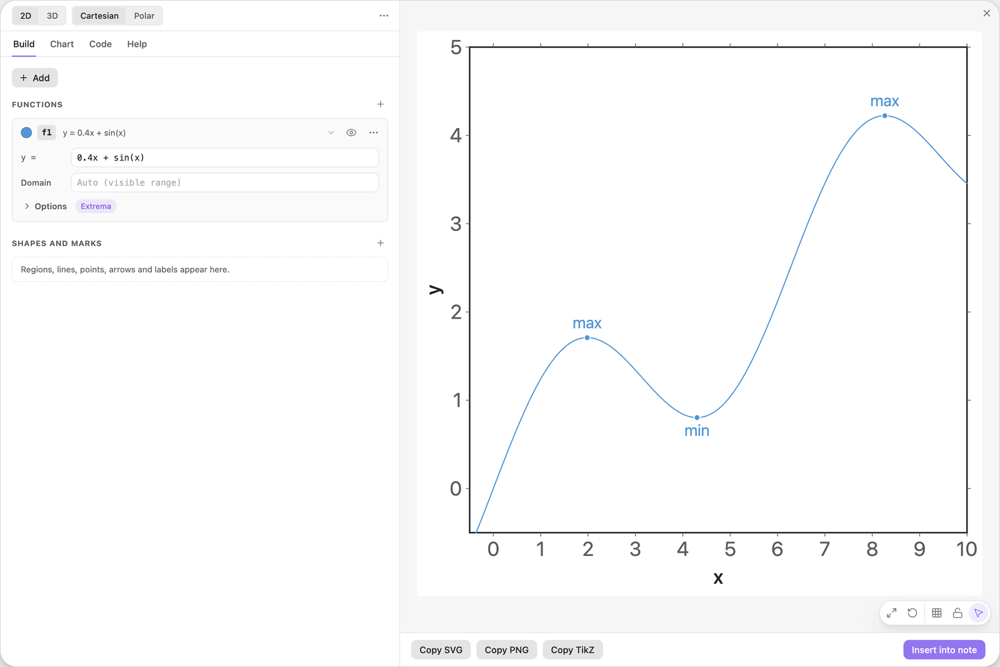
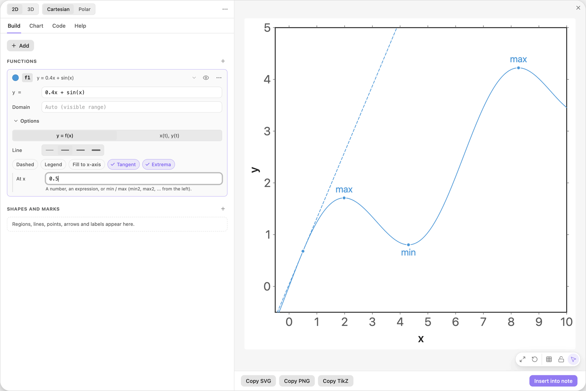
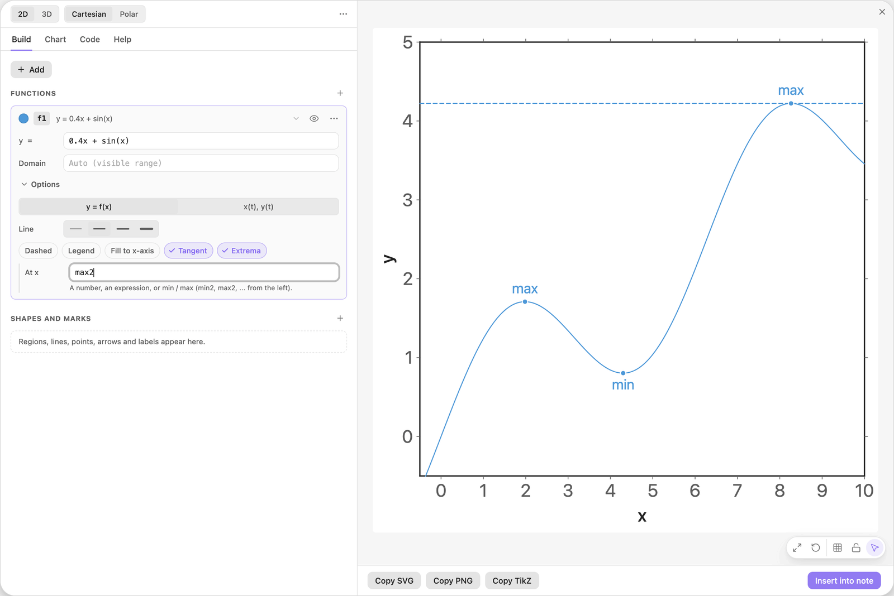
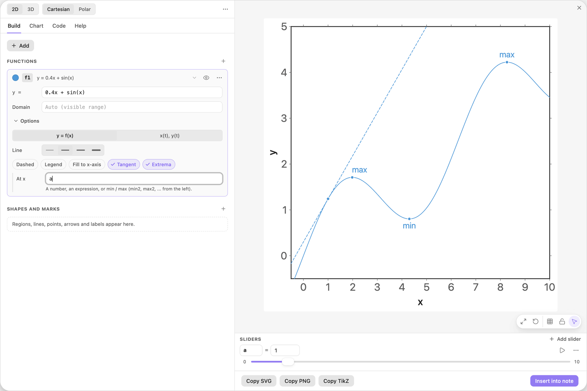
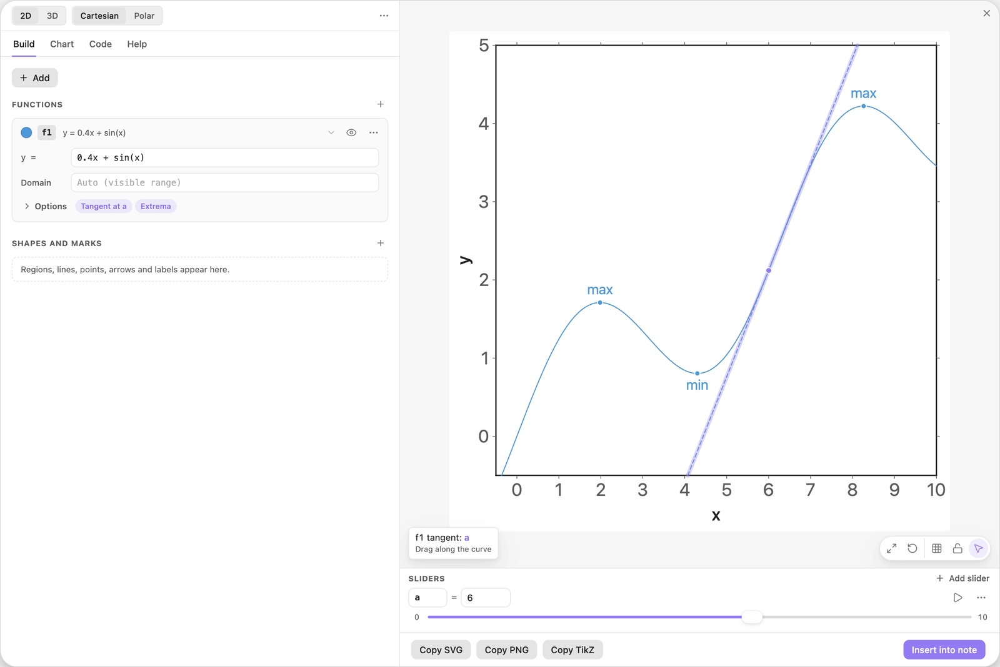
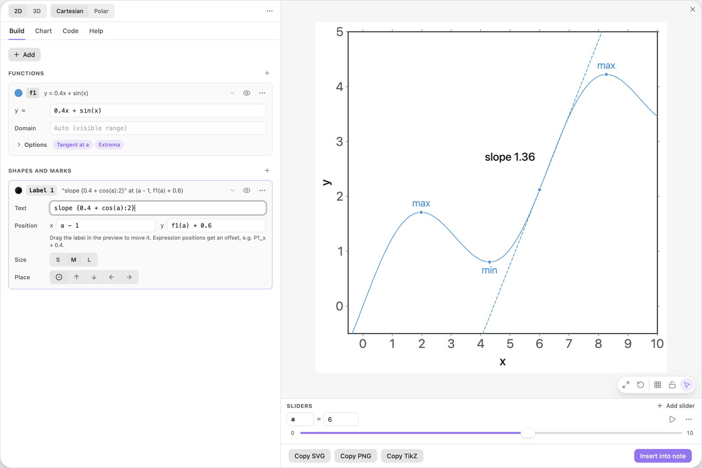

<!-- Generated by scripts/media/build-guides.mjs from src/guides. Do not edit. -->

# Tangents and extrema

[All guides](README.md) · Functions and sliders · Core · about 7 minutes

Mark the turning points of a function, add a tangent, slide it along the curve and label its slope.

<p align="center"></p>

**What you can do afterwards**

- Mark local minima and maxima
- Draw a tangent at a number, at min or max, or at a slider
- Slide the tangent by dragging its point
- Label the slope with a live value

**Read first:** [Your first chart](first-chart.md), [Sliders that move the picture](sliders.md)

## 1. Plot the function

In a new chart, click + Add, choose Function y = f(x) and type the formula: a wave on a slope, with two crests and one trough in view.

Click the colour swatch on the card and pick Blue. The tangent and the markers will take the colour of their function.

| Where | Type |
| --- | --- |
| f1, y = | `0.4x + sin(x)` |


*The function to explore.*

## 2. Mark the extrema

Open Options on the `f1` card and click Extrema. A dot appears at every local maximum and minimum, labelled max or min.

The dots are computed from the curve, so they move when you change the formula.



*Extrema on: two maxima and one minimum are marked.*

> **Tip:** Extrema are searched in the visible x range, or in the Domain when the function has one.

## 3. Add a tangent

In the same Options, click Tangent. A field At x appears, filled in with the middle of the view, and a dashed tangent is drawn with a dot where it touches the curve.

Type `0.5` into At x. The tangent now touches the first rise of the curve.

| Where | Type |
| --- | --- |
| f1, At x | `0.5` |



*A tangent at x = 0.5. The field At x sits in the Options of the card.*

## 4. Snap it to an extremum

Replace the number with `max2`. The tangent jumps to the second maximum and lies flat. `max` and `min` mean the first local maximum or minimum from the left, `max2` the second maximum, and so on.

These keywords stay live: change the formula and the tangent follows the new extremum.

| Where | Type |
| --- | --- |
| f1, At x | `max2` |



*At x = max2: a horizontal tangent at the second maximum.*

> **Tip:** If the curve has fewer extrema than the keyword asks for, the status chip at the top left of the preview says so, for example that f1 has only 2 local maxima.

## 5. Put the tangent on a slider

Type `a` into At x and click Add slider a. The point of contact is now the value of the slider, 1 at first.

Click the small number at the left end of the slider and type `0`. The slider now runs from 0 to 10, which is the part of the curve in view. Drag it and the tangent rolls along the curve.

| Where | Type |
| --- | --- |
| f1, At x | `a` |
| Sliders, a: minimum | `0` |



*At x = a: the slider moves the tangent.*

## 6. Drag the tangent along the curve

You do not need the dock. Grab the dot of the tangent in the preview and drag it along the curve to x = 6. The slider `a` follows, and the tip shows its live value.

This works whenever At x is a number or a slider. A tangent at `min` or `max` is computed, so it cannot be dragged.



*The tangent dragged to x = 6. Resting on its dot, the tip says Drag along the curve.*

> **Tip:** A dragged slider stays on its step and inside its range, so this tangent stops at 0 and at 10.

## 7. Label the slope

Click + Add and choose Text label. In the new card, type the text and the two positions. The label prints the slope with two decimals and sits next to the point of contact.

`f1(a)` is the height of the curve at the slider value, so the label travels with the tangent.

| Where | Type |
| --- | --- |
| Label 1, Text | `slope {0.4 + cos(a):2}` |
| Label 1, Position x | `a - 1` |
| Label 1, Position y | `f1(a) + 0.6` |



*A label that follows the tangent and prints its slope.*

> **Tip:** The slope formula is typed by hand. For another function, replace `0.4 + cos(a)` with its derivative at `a`.

## The finished chart

Paste this block into a note to get the finished chart of this guide. Click the chart in the note to open it in the editor.

<details>
<summary>The chart as an easy-tikz block</summary>

```easy-tikz
{
  "v": 4,
  "dimension": false,
  "documentSetup": true,
  "title": "",
  "size_x_cm": 10,
  "size_y_cm": 10,
  "show_axis_label": true,
  "axis_label_x": "x",
  "axis_label_y": "y",
  "showAxis": true,
  "showLargeGrid": false,
  "showSmallGrid": false,
  "gridSize": 5,
  "majorTickNum": 8,
  "xmin": "-0.5",
  "xmax": "10",
  "ymin": "-0.5",
  "ymax": "5",
  "zmin": "-5",
  "zmax": "5",
  "axis_style": "box",
  "coordinateSystem": "cartesian",
  "axis_label_x_polar": "",
  "axis_label_y_polar": "",
  "axis_label_z": "z",
  "rotationX": 30,
  "rotationZ": 45,
  "zoom3D": 1,
  "boxAspect": "true",
  "previewSize": 760,
  "functions": [
    {
      "expression": "0.4x + sin(x)",
      "domain": "",
      "showLegend": false,
      "fill": false,
      "fillOpacity": 0.2,
      "fillPattern": "solid",
      "tangent": true,
      "color": "blue",
      "dashed": false,
      "tangentPoint": "a",
      "extrema": true,
      "thickness": "thin",
      "parametric": false,
      "expressionY": "",
      "name": "f1"
    }
  ],
  "functions3D": [],
  "tools": [],
  "annotations": [
    {
      "x": "a - 1",
      "y": "f1(a) + 0.6",
      "text": "slope {0.4 + cos(a):2}",
      "color": "black",
      "size": "normal",
      "anchor": "center"
    }
  ],
  "parameters": [
    {
      "name": "a",
      "value": 6,
      "min": 0,
      "max": 10,
      "step": 0.1
    }
  ],
  "variables": "x, y",
  "equalScale": false,
  "showSlidersInNote": true
}
```

</details>

## Next guides

- [From secant to tangent](secant-tangent.md): Draw the secant through two points of a curve, shrink their distance h with a slider and watch its slope approach the slope of the tangent.
- [Shade between a curve and its tangent](tangent-area.md): Write the tangent at a slider point as a function, shade the area it encloses with the curve, and make it work for any curve.
- [Points, intersections and live labels](points-labels.md): Mark points from a list, find where two curves cross, and print values that update when a slider moves.
- [Drag shapes to edit them](drag-to-edit.md): Grab a line or a curve in the preview and its numbers follow: move, turn, stretch, undo.

[All guides](README.md)
